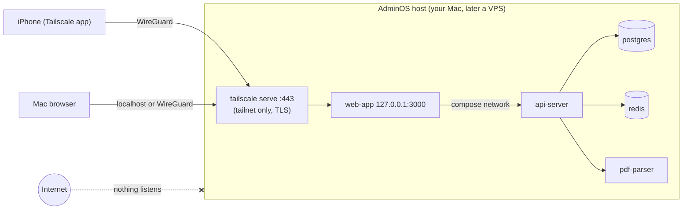

# Private access: reach AdminOS from your iPhone and Mac with nothing on the internet

_AOS-616 · proposed decision D-97 · builds on D-91 (network layer), D-32 (same-origin proxy), D-59 (Gmail fallback)._

**Goal:** AdminOS answers only your own devices. From anywhere else on the internet there is nothing to
connect to: no open port, no public hostname, no login page to attack. The app's own sign-in (owner-only
Google, AOS-614; passkey, AOS-617) is the second layer, not the first.

**Time:** about 30 minutes at go-live.

---

## 1. How it works



- **Tailscale** (WireGuard) connects your devices into a private network (a *tailnet*). Only devices you
  approve, signed in as you, can join. Connections are end-to-end encrypted between your devices.
- **`tailscale serve`** gives AdminOS an HTTPS address inside the tailnet,
  `https://adminos.<your-tailnet>.ts.net`, with a real certificate that Tailscale provisions. It is reachable
  only from the tailnet; Tailscale **Funnel** (the public variant) stays off and is blocked by the policy.
- Docker publishes ports **only on `127.0.0.1`** (checked by `scripts/check-compose-exposure.sh`, which CI
  runs). Postgres, Redis and the parser are never reachable from another machine; Postgres and Redis are
  published to the host's loopback for local development only.
- `tailscale serve` sets `X-Forwarded-For` to the connecting device's tailnet address (it overwrites any value
  the client sent: [`ipn/ipnlocal/serve.go`](https://github.com/tailscale/tailscale/blob/main/ipn/ipnlocal/serve.go),
  `r.Out.Header.Set("X-Forwarded-For", …)`). That is the "edge proxy owns XFF" launch requirement from D-32,
  so rate limits and audit IPs see the real device.

## 2. Options considered

| | **A. Tailscale + `tailscale serve`** (chosen) | B. Cloudflare Tunnel + Cloudflare Access | C. WireGuard by hand | D. Public port + app login |
|---|---|---|---|---|
| Public listener | **None.** Nothing on the internet resolves or answers | None on your host, but a **public hostname** at Cloudflare's edge serving the Access login page | One UDP port open to the internet (WireGuard answers nothing without a valid key) | **Yes**: TCP 443 open to everyone |
| Who decides access | WireGuard keys of devices you approved, plus a tailnet policy (default deny) | Cloudflare Access policy: your email via an identity provider, optional device posture (WARP) | Your keys only | Only the app's own login |
| A bug in AdminOS's login | Not reachable by strangers | Not reachable until Access is passed | Not reachable | **Directly exploitable** |
| TLS | Let's Encrypt cert for `*.ts.net` via Tailscale | Cloudflare terminates TLS (Cloudflare sees plaintext traffic) | None needed inside the tunnel; add your own for HTTPS | You run it |
| Trust in a third party | Tailscale's coordination server distributes keys; it never sees traffic. **Tailnet Lock** removes its ability to add devices | Cloudflare sees every request and response in clear | None | None |
| iPhone | Tailscale app, "VPN On Demand" | Browser login to Access (or WARP for posture) | WireGuard app, static config | Browser |
| Setup / upkeep | Low: install the app, sign in, paste a policy | Medium: domain on Cloudflare, tunnel, Access app and policies | High: keys, IPs, NAT, DNS, certs, updates by hand | Low, but you own every exposure |
| Cost | Free (Personal plan) | Free (Zero Trust free tier) + a domain | Free + a reachable host / port forward | Free |

- **D is rejected** (D-91: "a public URL protected only by the app's login"). Every vulnerability in the
  app, its framework or its dependencies would be one HTTP request away for the whole internet.
- **C** is the most minimal and has no third party, but it needs an inbound UDP port (or a relay), a fixed
  address, hand-managed keys and its own certificates for HTTPS. Tailscale is WireGuard with those parts
  automated, so C buys little extra security for much more upkeep.
- **B** is a good model when you need a browser login from devices you can't install software on. For one
  owner with their own devices it adds a public login page, and Cloudflare decrypts all traffic, including
  financial data. We keep Cloudflare Tunnel for one narrow job only: the optional Gmail push webhook (§5).
- **A** has no public surface at all, end-to-end encryption, per-device approval, and works the same on a
  Mac and a VPS.

Evidence: Tailscale Serve is tailnet-only and Funnel is a separate opt-in ([Serve docs](https://tailscale.com/kb/1312/serve));
tailnet policies are deny-by-default ([policy syntax](https://tailscale.com/kb/1337/policy-syntax));
Cloudflare Tunnel connects outbound only and ingress rules can route by path with a final catch-all
([tunnel configuration](https://developers.cloudflare.com/cloudflare-one/connections/connect-networks/configure-tunnels/local-management/configuration-file/)).

## 3. Set up the tailnet (once)

1. **Account.** Create a Tailscale account at <https://login.tailscale.com> with the **same Google account
   as `OWNER_EMAIL`**. That Google account should have a passkey or security key and no SMS fallback:
   whoever controls it can add devices.
2. **Admin console → Settings → Device management:**
   - turn on **Manually approve new devices** (device approval): a device that signs in as you still waits
     for your approval;
   - **Key expiry:** keep it on for your own devices (180 days by default; 90 is fine). You re-authenticate
     a device when it expires.
3. **Admin console → DNS:** turn on **MagicDNS** and **HTTPS Certificates**. Note your tailnet name
   (`<something>.ts.net`).
4. **Admin console → Access controls:** replace the default policy (which allows every device to reach
   every other one, and lets members use Funnel) with [`deploy/tailscale/policy.hujson`](../../deploy/tailscale/policy.hujson).
   Put your Tailscale login in place of `owner@example.com` in its `tests` before saving. Tailscale runs the
   tests on save and refuses a policy that fails them.
5. **Tailnet Lock** (recommended, after your Mac and iPhone are in): Admin console → Settings → Tailnet
   Lock, or `tailscale lock init` on the Mac with the Mac's and iPhone's keys as trusted signers. From then
   on a new device needs a signature from one of your devices, so not even Tailscale's coordination server
   (or someone who steals your Google session) can add a device. Store the disablement secrets in your
   password manager (see the key-backup guide, AOS-621).

## 4. Run AdminOS on the tailnet

### 4a. On your Mac (recommended now)

1. Install **Tailscale** for macOS (Mac App Store or <https://tailscale.com/download>) and sign in.
   Approve the Mac in the admin console.
2. Tag the Mac as the AdminOS host, so the policy applies to it (Terminal):
   ```bash
   tailscale set --advertise-tags=tag:adminos   # older clients: tailscale up --advertise-tags=tag:adminos
   ```
   A tagged device no longer acts as "you" towards your other devices; it only receives connections on 443.
   Tagged devices don't expire by default; device approval and Tailnet Lock still protect it.
3. In `.env`:
   ```bash
   APP_URL=https://<mac-name>.<your-tailnet>.ts.net
   ```
   The API refuses to start if `APP_URL` is plain `http` on anything other than `localhost`/`127.0.0.1`/`::1`,
   or has a path, query or credentials (AOS-616), so session cookies are always `Secure` off-machine.
4. Start AdminOS as usual, then serve the web app on the tailnet in the background:
   ```bash
   docker compose --profile full up -d
   tailscale serve --bg --https=443 http://127.0.0.1:3000
   tailscale serve status        # must say "(tailnet only)"; never run `tailscale funnel`
   ```
   `serve --bg` persists across restarts. To stop: `tailscale serve --https=443 off`.
5. **Google sign-in:** in Google Cloud Console → APIs & Services → Credentials → your OAuth client, add the
   authorised redirect URI `https://<mac-name>.<your-tailnet>.ts.net/auth/callback` (and the JavaScript origin
   `https://<mac-name>.<your-tailnet>.ts.net`). _Go-live check:_ Google accepts `*.ts.net` redirect URIs
   because `ts.net` is a public suffix; if the consent screen asks you to verify an authorised domain you
   can't own, keep the OAuth app unpublished for that test, or use a domain you own with option B for sign-in
   only. Record what happened in the ticket.
6. On the Mac itself you can keep using <http://localhost:3000> (sessions are per origin: sign in once per
   address you use).

### 4b. On a server or VPS (later): the Tailscale sidecar

Use [`docker-compose.tailnet.yml`](../../docker-compose.tailnet.yml), which adds a `tailscale` container that
joins the tailnet as `adminos` and serves the web app over the compose network
([`deploy/tailscale/serve.json`](../../deploy/tailscale/serve.json), Funnel off). It runs in userspace mode:
no `/dev/net/tun`, no `NET_ADMIN`, all capabilities dropped, read-only root filesystem.

1. Admin console → Settings → Keys → **Generate auth key**: not reusable, not ephemeral, **pre-approved
   off** (you approve it), tag `tag:adminos`, expiry 1 day. Put it in `.env` as `TS_AUTHKEY=`.
2. `APP_URL=https://adminos.<your-tailnet>.ts.net` in `.env`.
3. Start:
   ```bash
   docker compose -f docker-compose.yml -f docker-compose.tailnet.yml --profile full up -d
   ```
   Approve the `adminos` device in the admin console. After the first start the node's identity lives in
   the `tailscale_state` volume: **delete `TS_AUTHKEY` from `.env`**.
4. Server firewall: deny all inbound (Tailscale works outbound-only; optionally allow UDP 41641 for direct
   connections). Reach the server's shell over Tailscale SSH or a provider console, never a public SSH port.
5. `scripts/check-compose-exposure.sh` checks this overlay too; it publishes no port.

## 5. Things that must reach the API without opening the site

### iPhone SMS (iOS Shortcut)
The primary path is the Mac reader ([`sms-on-mac.md`](sms-on-mac.md)): it posts to `http://127.0.0.1:8080`
on the same Mac and refuses any non-localhost URL, so it needs nothing from this guide.

If you also use an iOS Shortcut automation on the iPhone:
- Install the **Tailscale** iOS app, sign in, approve the iPhone. In the app: **Settings → VPN On Demand**
  on ("Always"), so the tunnel is up whenever the Shortcut runs.
- The Shortcut posts to `https://<host>.<your-tailnet>.ts.net/api/v1/ingest/sms/raw` with
  `Authorization: Bearer <device token>` (Settings → Connected devices; the token can only submit SMS).
- If the VPN is off, the request fails (no public fallback by design); the Mac reader still catches the SMS.

### Gmail push (Pub/Sub)
Google's Pub/Sub must POST to a public HTTPS URL; it can't join a tailnet. Options:

| | **1. No push: daily fallback + "Sync now"** (recommended) | 2. Webhook-only Cloudflare Tunnel | 3. Pull subscription from a worker |
|---|---|---|---|
| Public surface | **None** | One path at Cloudflare's edge, OIDC-verified by the API; everything else 404 at the edge | None (outbound only) |
| Freshness | Daily (06:00, D-59), or instantly when you tap Sync now | Seconds | Seconds to a minute |
| Work | None (already built) | Cloudflare account, domain, tunnel; already scripted here | New code: a pull client, ack handling, tests (a new ticket) |
| Failure modes | Mail found up to a day late | A webhook bug becomes internet-reachable; Cloudflare sees the (tiny) notification | More moving parts in the worker |

**Recommendation: option 1 at go-live.** It keeps "nothing on the internet" literally true. Bank emails
mostly duplicate SMS that arrive instantly, so a daily Gmail sync loses little. If fresher email matters later,
prefer **option 3** (Pub/Sub *pull* needs no inbound connection at all) as a new ticket; option 2 is the
ready-made fallback if push is needed before that.

**Option 2, if you choose it:** [`docker-compose.gmail-push.yml`](../../docker-compose.gmail-push.yml) and
[`deploy/cloudflared/config.yml`](../../deploy/cloudflared/config.yml).
- The tunnel connects outbound; no port opens on your host.
- Its ingress routes **only** `^/api/v1/webhooks/gmail$` to the API; every other path and hostname gets
  404 at Cloudflare's edge (`scripts/tests/cloudflared-ingress.test.sh` checks 15 paths, including `..`
  and encoding tricks). The web app and every other API route are not routed at all.
- The API accepts a push only with a Google-signed OIDC token whose audience and service account match
  `GOOGLE_PUBSUB_AUDIENCE` / `GOOGLE_PUBSUB_SERVICE_ACCOUNT`, and refuses everything when they're unset (AOS-609).

Steps:
1. Put a domain you own on Cloudflare (free plan). Install `cloudflared` on the Mac
   (`brew install cloudflared`), then:
   ```bash
   cloudflared tunnel login
   cloudflared tunnel create adminos-gmail-push          # prints the tunnel id; writes ~/.cloudflared/<id>.json
   cloudflared tunnel route dns adminos-gmail-push hooks.<your-domain>
   ```
2. `.env`: `CLOUDFLARED_TUNNEL_ID=<id>`, `CLOUDFLARED_CREDENTIALS_FILE=/Users/<you>/.cloudflared/<id>.json`
   (keep that file out of the repo; it's a secret).
3. Google Cloud → Pub/Sub → your push subscription: endpoint `https://hooks.<your-domain>/api/v1/webhooks/gmail`,
   **Enable authentication** with a dedicated service account; audience = that same URL. Set
   `GOOGLE_PUBSUB_AUDIENCE`, `GOOGLE_PUBSUB_SERVICE_ACCOUNT`, `GOOGLE_GMAIL_PUBSUB_TOPIC` in `.env`.
4. Optional, recommended: Cloudflare dashboard → Security → WAF → a custom rule that blocks requests to
   `hooks.<your-domain>` unless the method is `POST` and the path is `/api/v1/webhooks/gmail`.
5. Start: `docker compose -f docker-compose.yml -f docker-compose.gmail-push.yml --profile full up -d`.
6. Check from a phone on mobile data (off the tailnet): `https://hooks.<your-domain>/` → 404,
   `https://hooks.<your-domain>/login` → 404, and a `POST` to the webhook without a token → 401.

## 6. Verify (go-live checklist)

Run these and paste the results into the AOS-605 / AOS-623 ticket.

1. **Nothing published beyond loopback:** `scripts/check-compose-exposure.sh` prints `OK` for every stack.
2. **Nothing listening on other interfaces** (with the stack up):
   ```bash
   lsof -nP -iTCP -sTCP:LISTEN | grep -Ev '127\.0\.0\.1|\[::1\]'
   ```
   Expected: no Docker or AdminOS lines (macOS system services may appear; Tailscale's own listener is on
   its tailnet address only).
3. **From your iPhone on the tailnet:** `https://<host>.<tailnet>.ts.net` loads, sign-in works, the padlock
   shows a valid certificate.
4. **From outside the tailnet** (iPhone with Tailscale off, on mobile data): the `ts.net` name does not
   resolve or does not answer. There is no other address to try.
5. **Funnel is off:** `tailscale serve status` shows "tailnet only"; `tailscale funnel status` shows nothing.
6. **Policy:** Admin console → Access controls → the tests pass; Machines lists only your devices.
7. **Cookies:** in the browser's dev tools, `access_token` and `refresh_token` are `Secure`, `HttpOnly`,
   `SameSite=Strict`.

## 7. Lost or replaced device

1. Admin console → Machines → the device → **Remove** (and, with Tailnet Lock, revoke its key).
2. AdminOS → Settings → Connected devices → revoke its device token; sign out all sessions (AOS-620).
3. Review the Tailscale and Google security logs for new sign-ins.

## 8. What this doesn't protect against
- **Malware on one of your own devices**: it is on the tailnet as you. The app login and passkey (AOS-617)
  are the next layer; keep devices updated and locked.
- **Losing your Google account** to an attacker: they could try to add a device. Device approval and
  Tailnet Lock stop that; a passkey on the Google account makes it unlikely.
- **A compromised dependency** inside the stack: scanning and container hardening (AOS-622) reduce it.
