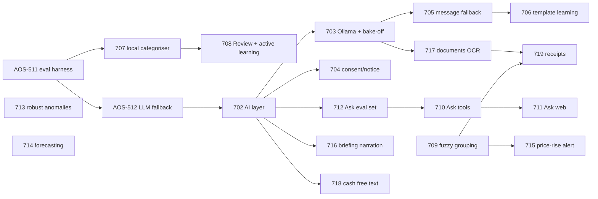

# AI/ML in AdminOS: where it helps, how to build it, and the evidence

_AOS-701 · Epic [AOS-E7](../tickets/AOS-E7.md) · Decision D-67 · Written 2026-10-17 by Claude for Pragun · Docs only, no code changed._

## Executive summary

AdminOS already gets most things right with deterministic code: regex bank parsers, a catalogue-plus-rules categoriser (D-41, D-44), rule-based anomaly checks (D-53), a template-written weekly briefing (D-57), and named-factor waste scores (D-58). AI is useful where that code runs out of road. It should never replace the parts that must be exactly right, such as totals, transfers and refunds.

**The ground rule (D-67):** AI may read, classify, extract and rewrite. It never produces a number that the app shows as fact. Every output is validated against its input or the database. Each feature is off by default and sends the minimum data. It is local-first where that is good enough, goes through one provider port, and ships only after it passes its own eval.

**Top recommendations, in order of value for effort:**

1. **A small AI foundation first (AOS-702).** This means one `AiProvider` port with Anthropic and Ollama adapters, redaction, a monthly cost cap, an audit log, per-feature flags and an eval gate. It should grow out of what AOS-512 builds, not sit beside it. At Pragun's scale every cloud feature together costs **well under $5 a month**, so cost isn't the constraint. Privacy and correctness are.
2. **A local learned categoriser (AOS-707).** It is a TF-IDF + logistic regression model trained on Pragun's own corrections and the D-61 golden set. It runs in the JVM (Tribuo), with calibrated confidence and a Review queue ordered by uncertainty. No data leaves the machine. The AOS-511 numbers show the rules are precise but leave about 30% as "Other", and this targets exactly that.
3. **Anomaly alerts with robust baselines (AOS-713).** Replace "3× the 30-day category average" with a per-merchant and per-category median/MAD (modified z-score), and learn per-merchant tolerance from dismissed alerts. This needs no LLM, and the statistics are textbook.
4. **A message-reading fallback (AOS-705).** When the regex parsers say "not a recognised transaction message", a small model extracts fields into a JSON schema. The result is accepted only if the amount, the last four digits and the date appear in the text, and it lands in Review at first. Later (AOS-706), repeated message shapes become proposed regex templates that a human approves, so the LLM is needed less over time.
5. **"Ask your money" through tool calling (AOS-710/711).** The model chooses one of the existing analytics endpoints and fills in its parameters. The API computes the numbers, and every number in the answer must come from a tool result. Text-to-SQL is rejected: even the best systems still get one query in five wrong on public benchmarks (BIRD, Spider 2.0).
6. **Forecasting with simple methods (AOS-714).** "Money left until salary" is mostly deterministic: balance, known dues and mandates, minus a robust daily run-rate for discretionary spend with an empirical range. Prophet and deep models are not worth it on one person's sparse data (M4/M5 evidence).
7. **Documents vault OCR, local-first (AOS-717).** PaddleOCR or docTR in the existing Python service, plus a local or cloud model only for field extraction. Proposed fields are confirmed by the user, never silently saved.
8. **Later, convenience features:** briefing narration with a number check (AOS-716), cash from free text or voice (AOS-718), and receipt photo → transaction matched to the card/UPI debit (AOS-719).

**Dropped or deferred because the evidence doesn't support them at personal scale:** Isolation Forest for anomalies (too few points per merchant), Prophet or deep forecasting, text-to-SQL, fine-tuning any LLM, and a vector database. The details are in each section.

**Recommended privacy default:** local models (Ollama) for anything that touches raw message text or documents. A cloud LLM (Claude) is opt-in per feature and gets redacted, minimal payloads. India's DPDP Act exempts purely personal use (s.3(c)(i)), so this is a choice for Pragun now. It becomes a legal requirement (notice, consent, processor contracts) before a public launch (D-22, AOS-602).

---

## Contents
1. [How AdminOS works today (the baseline)](#1-how-adminos-works-today-the-baseline)
2. [Cross-cutting: privacy, DPDP, cloud vs local](#2-cross-cutting-privacy-dpdp-cloud-vs-local)
3. [Cross-cutting: structured outputs and validation](#3-cross-cutting-structured-outputs-and-validation)
4. [Cross-cutting: where ML runs](#4-cross-cutting-where-ml-runs)
5. [Area 1: shared AI layer](#5-area-1-shared-ai-layer)
6. [Area 2: message reading](#6-area-2-message-reading-sms-gmail-whatsapp)
7. [Area 3: Ask your money](#7-area-3-ask-your-money)
8. [Area 4: documents vault OCR](#8-area-4-documents-vault-ocr-and-field-extraction)
9. [Area 5: categorisation beyond rules](#9-area-5-categorisation-beyond-rules)
10. [Area 6: anomaly alerts](#10-area-6-anomaly-alerts)
11. [Area 7: forecasting](#11-area-7-forecasting)
12. [Area 8: subscriptions](#12-area-8-subscriptions-price-rises-and-fuzzy-merchant-grouping)
13. [Area 9: weekly briefing narration](#13-area-9-weekly-briefing-narration)
14. [Area 10: cash quick-add from text/voice; receipts](#14-area-10-cash-from-free-text-or-voice-receipt-photos)
15. [Other ideas considered](#15-other-ideas-considered)
16. [Roadmap: value vs effort, dependencies](#16-roadmap-value-vs-effort-and-dependencies)
17. [Open questions and uncertainties](#17-open-questions-and-uncertainties)

**Cost assumptions used throughout.** These are personal scale and a guess, to be confirmed on real data (AOS-211/212):
- about 300 transactions and 600 bank SMS or emails a month;
- about 30 unparsed messages a month;
- about 100 questions a month;
- 4 briefings a month.

The prices are Anthropic's list prices per million tokens (input/output) as of October 2026:
- `claude-haiku-5-5`: $0.10 / $0.50 (prompts up to 100K tokens);
- `claude-sonnet-5-5`: $2 / $10;
- `claude-opus-5-5`: $4 / $20.

The Batch API costs 50% less. Source: [Anthropic models overview](https://platform.claude.com/docs/en/about-claude/models/overview) and [pricing](https://platform.claude.com/docs/en/about-claude/pricing) (2026). Local models cost nothing per call. Their cost is laptop RAM (a 4B-parameter model quantised to 4 bits needs about 3 GB) and latency.

---

## 1. How AdminOS works today (the baseline)

| Area | Code today | Behaviour |
|---|---|---|
| SMS parsing | `services/api/.../domain/ingestion/sms/SmsParserRegistry.kt`, `BankSmsParser.kt`, `MandateSmsParser.kt` | Sender header → bank parser → generic parser, else `Ignored("not a recognised transaction message")`. The raw text is never stored (D-33). |
| Gmail parsing | `services/workers/internal/handlers/gmail_handler.go` (`parseFinancialEmail`, `extractAmount`, `extractMerchant`, …) | Go regexes write ingest events, and direction is decided by D-43. Only financial senders are read (D-59). |
| WhatsApp | Not built (AOS-402/403 ⬜) | — |
| Statements | `services/pdf-parser/app/parser.py`, `table_mapper.py`, `banks.py` (Python, pdfplumber/openpyxl/xlrd) | Table mapping per bank. Files are discarded after parsing (D-37). |
| Pipeline | `domain/ingestion/pipeline/Steps.kt`: normalise → categorise → dedup → transfer → refund | Deterministic, in Kotlin (D-34). |
| Categorisation | `domain/financial/CategorizationService.kt`, `CategoryRules.kt`, `MerchantCatalogue.kt` + `resources/merchants/catalogue.json` | Remembered rule → catalogue → whole-word patterns → Other (D-41). On the AOS-511 golden set this scores 82.6% accuracy and 69.4% coverage, with precision 0.95–1.0 outside "Other" (PR #71). |
| Anomalies | `domain/agent/AnomalyRules.kt`, `AnomalyDetectorService.kt` | Fixed rules: more than 3× the 30-day category average (₹2,000 minimum, at least 3 spends), foreign currency, odd hours, ₹1 card-testing, 24 h duplicates. Confidence = max + 0.05 per extra rule (D-53). |
| Subscriptions | `domain/financial/SubscriptionDetectorService.kt`, `WasteScorer.kt` | Grouped by exact merchant name. `priceChanged` when the last two charges differ by more than 5%, and the waste score adds points for a price rise (D-58, D-65). |
| Briefing | `domain/agent/briefing/WeeklyBriefing.kt` | Facts plus a template, no LLM (D-57). |
| Documents | `domain/documents/Document.kt`, `DocumentService.kt` | Encrypted vault. `expiresOn` and `notes` are typed by hand (D-60). |
| Cash | `domain/ingestion/cash/CashIntake.kt` | Amount + category, two taps (D-42). |
| Analytics | `domain/analytics/AnalyticsService.kt`, `AnalyticsRoutes.kt`: `/analytics/summary`, `/series`, `/categories`, `/merchants` | Exact money as strings (D-30), in the user's timezone (D-45, D-46). |
| Legacy LLM code | `services/workers/internal/claude/client.go`, `prompts.go`, `handlers/briefing_handler.go`, `anomaly_explain_handler.go` | Registered in `cmd/worker/main.go`, but nothing in the API enqueues these task types any more (D-57 moved the briefing to Kotlin). The default model is the dated `claude-sonnet-4-20250514` and no port, cap or redaction is applied. **Finding:** retire it or route it through the AOS-702 port. Reported only, not changed here. |
| In flight | AOS-511 (PR #71: golden set + regression gate, D-61 proposed); AOS-512 (LLM fallback for "Other", off by default, D-62, V28) | The foundation this epic builds on. Not duplicated here. |

**What the baseline tells us:**
- The rules are **precise but incomplete**: misses are "Other", not wrong labels.
- The parsers **fail closed**: unrecognised messages are dropped, not guessed.

Both are the right defaults. AI should fill the gaps without giving up either property.

---

## 2. Cross-cutting: privacy, DPDP, cloud vs local

### 2.1 What the law says (India, DPDP Act 2023 and Rules 2025)
- **Personal use is exempt.** The Act doesn't apply to personal data "processed by an individual for any personal or domestic purpose" (s.3(c)(i)). Pragun running AdminOS on their own data is in that zone.
- **Public users bring the full Act into play.** The day AdminOS processes other people's data, AdminOS is a Data Fiduciary:
  - **Notice and consent:** consent must be "free, specific, informed, unconditional and unambiguous" and "limited to such personal data as is necessary for such specified purpose" (s.6(1)), with an itemised notice (s.5).
  - **Processors:** a cloud LLM provider is a Data Processor and needs a valid contract (s.8(2)).
  - **Security, breaches and erasure:** reasonable security safeguards (s.8(5)), breach intimation (s.8(6)), and erasure when the purpose ends (s.8(7)).
  - **Transfers abroad:** allowed except to countries the government restricts (s.16).
- **Timeline:** the DPDP Rules were notified in November 2025, and most obligations apply 18 months later (from May 2027), which is already in BRD §7.
- **Sources:**
  - [MeitY data protection framework](https://www.meity.gov.in/data-protection-framework) (2023–2025);
  - [PRS India summary of the Act](https://prsindia.org/billtrack/digital-personal-data-protection-bill-2023) (2023);
  - [DLA Piper India overview](https://www.dlapiperdataprotection.com/index.html?t=law&c=IN) (2025).
- **Caveat:** this is a reading of the Act, not legal advice. The section numbers are from the Act as passed, and the Rules' transfer details should be re-checked at AOS-602.

**What that means for the design:**
- Each AI feature is a separate **purpose**, so it gets its own toggle (consent) and its own line in the notice.
- **Minimisation** is a legal principle, not only good taste: send the fewest fields needed.
- The audit log of AI calls (AOS-702) doubles as the evidence trail for AOS-602.

### 2.2 Threats specific to LLMs
- **Prompt injection through data.** SMS, email and WhatsApp text is untrusted input, and an email can contain "ignore previous instructions…". Indirect prompt injection is well documented ([Greshake et al., 2023](https://arxiv.org/abs/2302.12173)) and is #1 in the [OWASP Top 10 for LLM Applications 2025](https://genai.owasp.org/llm-top-10/).
- **The "lethal trifecta":** the risk is highest when one agent has private data, untrusted content and a way to send data out ([Willison, 2025](https://simonwillison.net/2025/Jun/16/the-lethal-trifecta/)).

**Guardrails for AdminOS:**
1. AI features get **no outbound tools**: no email, no HTTP, no writes beyond a proposal row.
2. Extraction prompts wrap message text as data, and outputs are schema-validated and **checked against the source text** (§3).
3. "Ask your money" tools are **read-only** and scoped to the signed-in user by the server, never by the model.

### 2.3 Cloud vs local

| | Cloud (Claude via API) | Local (Ollama / llama.cpp, small open models) |
|---|---|---|
| Accuracy | Highest, especially on reasoning, tool choice and messy layouts | Good for narrow extraction and classification with a schema. Weaker at multi-step tool use. 3–8B models such as Qwen3 ([tech report, 2025](https://arxiv.org/abs/2505.09388)) and Gemma 3 ([2025](https://arxiv.org/abs/2503.19786)) are competitive on simple extraction, but **no public benchmark covers Indian bank SMS**, so we must measure on our own golden sets |
| Privacy | Data leaves the machine. Anthropic's commercial terms say API data isn't used for training by default ([commercial terms](https://www.anthropic.com/legal/commercial-terms)), but data is still processed and kept for a period, and needs a processor contract for public users | Nothing leaves the laptop |
| Cost at our scale | Cents to a few dollars a month | ₹0 per call; 3–6 GB RAM while loaded |
| Latency | About 1–3 s per call | About 1–10 s on a Mac laptop for a 4B model; fine for background jobs, borderline for chat |
| Ops | API key, cap, outage handling | One more container or app (`ollama serve`); model files of 2–5 GB |
| Structured output | Native JSON-schema outputs and strict tools ([docs](https://platform.claude.com/docs/en/build-with-claude/structured-outputs)) | Ollama `format` takes a JSON schema ([Ollama, Dec 2024](https://ollama.com/blog/structured-outputs)); llama.cpp has GBNF grammars and JSON-schema conversion ([README](https://github.com/ggml-org/llama.cpp/blob/master/grammars/README.md)) |

**Recommended default (part of D-67):**
- **Local by default** for features that read raw message text, documents, receipts or voice (areas 2, 4, 10).
- **Cloud is opt-in** per feature for reasoning-heavy work over already-structured, minimised data: "Ask your money" sends tool results, not raw messages, and briefing narration sends aggregates.
- **Cloud fallback** for a local-default feature only when the user turns it on for that feature, and only with redaction.
- **Model choice behind the port:**
  - `claude-haiku-5-5` for cheap extraction and classification;
  - `claude-sonnet-5-5` for tool use and "Ask";
  - `claude-opus-5-5` only where an eval shows Sonnet isn't enough (not expected for any feature here).

### 2.4 Redaction (minimum data)
Redaction is a pure function per feature, applied before any cloud call and unit-tested:
- **Masked:** account and card numbers become last-4 only, phone numbers become `<PHONE>`, emails become `<EMAIL>`, and UPI handles become `<VPA:bankhandle>` (keeping only the provider part when that's needed).
- **Dropped:** names of people (the counterparty in a P2P payment) are dropped unless the feature needs them, and OTPs never leave the device (the parser already drops them).
- **Kept** (needed for the task): amounts, dates and merchant brands.
- **Evidence:** regex-based PII scrubbing is the industry baseline, and NER-based tools such as [Microsoft Presidio](https://microsoft.github.io/presidio/) (2019–2025) add names. The evidence is moderate: no redactor is perfect, so the bigger lever is **sending less** (fields, not documents).

---

## 3. Cross-cutting: structured outputs and validation

**Use schemas, not free text.** Every extraction asks for a JSON object with a fixed schema: amount as a string, `direction` as an enum, `confidence` from 0 to 1, and an `evidence` array of exact substrings.

**Use constrained decoding where available:**
- Claude's structured outputs (`output_config.format`) and strict tools (`strict: true`) guarantee schema-valid JSON ([docs](https://platform.claude.com/docs/en/build-with-claude/structured-outputs), 2025–2026).
- Ollama and llama.cpp constrain decoding to a grammar or schema. The method is described by [Willard & Louf (2023), "Efficient Guided Generation"](https://arxiv.org/abs/2307.09702).
- The current Sonnet/Opus 5.5 models don't support forced `tool_choice`, so use structured outputs or `auto` + `strict` tools.

**Know the limit:** strict formats can lower reasoning quality on harder tasks ([Tam et al., 2024, "Let Me Speak Freely?"](https://arxiv.org/abs/2408.02442)). Keep schemas flat for extraction. For "Ask", let the model reason freely and constrain only the tool arguments.

**A valid schema isn't a true answer.** The output must also be checked against the input, because LLMs produce fluent, confident errors ([Huang et al., 2023, hallucination survey](https://arxiv.org/abs/2311.05232)). Validators are pure Kotlin functions:

| Check | Rule |
|---|---|
| Amount grounding | The normalised amount must appear in the source text (allowing for `Rs`, `INR`, `₹`, commas and `.00`) |
| Account grounding | Any last-4 must appear in the text |
| Date grounding | Any date must parse from a substring of the text, within ±1 day of the message's received time for SMS |
| Direction | Must agree with D-43's word families when they are present; if they conflict, the message goes to needs-review |
| Evidence spans | Every `evidence` string must be an exact substring |
| Number check (generated prose) | Every number in the output must be in the set of numbers provided as input (§13) |

A failed check means the output is rejected and logged with its reason (IDs and counts only), and the item goes to Review or stays unparsed. Nothing falls back silently (ENGINEERING §2, "no silent fallbacks").

---

## 4. Cross-cutting: where ML runs

| Option | Fits | Libraries | Notes |
|---|---|---|---|
| **In the Kotlin API (JVM)** | Small classical models whose inputs live in the API (categoriser, baselines, forecasts) | [Tribuo](https://tribuo.org) (Oracle, Apache-2.0, 2020–): logistic regression, linear SGD, kNN, with provenance tracking built in. [Smile](https://haifengl.github.io/): broad and fast, but **recent versions are GPL-3.0**, so check the licence first. [ONNX Runtime Java](https://onnxruntime.ai/docs/get-started/with-java.html): runs models trained elsewhere. [DJL](https://djl.ai) (Apache-2.0): runs PyTorch/ONNX/HF tokenisers | No new service, no network hop, and the data stays in the process. It works with the D-48 coverage gate and in-memory fakes |
| **In the Python parser service** | OCR, vision and anything that needs the Python ecosystem (PaddleOCR, docTR, scikit-learn experiments) | PaddleOCR, docTR, Tesseract (pytesseract), scikit-learn | Already a stateless FastAPI service that receives files and discards them (D-37), which is the right shape for OCR |
| **Ollama sidecar (optional compose profile)** | Local LLM and vision-LLM calls | Ollama HTTP API | Called by the API through the `AiProvider` port, like a cloud provider |
| Go workers | — | — | Workers are fetchers (D-34). Don't put ML there |

**Recommendation:**
- **Classical models in the JVM with Tribuo** (Apache-2.0, provenance fits the audit log), with ONNX Runtime as the bridge if a model must be trained in Python.
- **OCR in the Python service.**
- **LLMs behind the port**, whether Ollama or Anthropic.
- **No new microservice.**

The models here are tiny: a logistic regression over 10–50k sparse features trains in under a second on a few thousand rows. So "retrain nightly in the scheduler (D-50)" is cheap.

---

## 5. Area 1: shared AI layer

**Problem today.**
- There is no common AI layer.
- The only LLM code is the legacy Go client (§1), with no cap, redaction or audit.
- AOS-512 is adding the first Kotlin LLM use (fallback categoriser, D-62, V28).

Without a shared layer, each feature would re-solve keys, retries, caps, logging, flags and evals, and they would drift apart.

**Benefit to Pragun.**
- Turning a feature on or off is one switch in Settings.
- Spend can never surprise Pragun: a hard monthly cap, ₹ shown in Settings.
- Pragun can see what was sent and why: an audit list showing IDs, feature, model, tokens and cost, never content.
- Switching to local or another vendor is configuration, not code.

**Options.**

| Option | Accuracy | Privacy | Cost | Effort | Fit |
|---|---|---|---|---|---|
| **A. Hand-written Kotlin port + adapters** (`AiProvider` with `extract(schema)`, `complete()`, `callTools()`; adapters for Anthropic via the official Java SDK, Ollama via HTTP, and a fake for tests) | n/a | Full control over redaction | — | 8–10 h | Matches the ports-and-adapters rules (ENGINEERING §1, §6) and the D-60 storage-port style |
| B. A framework (LangChain4j / Spring AI / Koog) | n/a | Harder to audit what's sent | — | 4–6 h + lock-in | Brings large transitive dependencies (D-28 pins) and abstractions we don't need for 6 call sites |
| C. Keep calling vendors directly per feature | n/a | Inconsistent | — | low now, high later | Rejected: duplicates retries, caps and logging |

**Evidence.**
- Ports-and-adapters is the repo's own standard (D-26, D-27).
- Running evals before shipping and gating regressions is what model providers themselves recommend ([Anthropic, "Define success criteria and build evaluations"](https://platform.claude.com/docs/en/test-and-evaluate/develop-tests), 2025).
- A vendor-neutral port is industry practice rather than research. The evidence for it is engineering consensus, not studies.

**Recommendation: option A, built by extending whatever AOS-512 creates, not as a parallel stack.**
- **Contents:**
  - `AiFeature` enum (one entry per feature);
  - `AiPolicy` (enabled, provider, model, monthly cap, data allowed);
  - `Redactor` per feature;
  - `AiCallLog` table: feature, provider, model, prompt version, input and output token counts, cost in micro-dollars, outcome (`accepted` / `rejected:<reason>` / `error`), latency, user ID, time; no text;
  - `CostGuard`: refuse when the month's estimate would exceed the cap, which fails closed with a clear status;
  - `EvalGate`: a feature can't be enabled for a user unless its eval report meets its committed baseline, generalising the D-61 `RegressionGate`.
- **Settings:** each feature defaults **off**, and the web Settings page gets an "AI features" section listing each feature, the provider (local or cloud), what data it sends, and this month's spend.

**Eval metric.**
- Unit tests show the cap is enforced (including concurrent calls).
- Redaction is tested against a fixture list of Indian formats (cards, VPAs, mobile numbers, Aadhaar-like 12-digit numbers).
- The audit row never contains message text (a property test).

**Risks and guardrails.**
- **Duplication with AOS-512:** coordinate. AOS-702 starts after AOS-512 merges and refactors its call path into the port.
- **The Java SDK is a new dependency** (D-28: exact pin).
- **Migration:** V29+ (V26 and V27 are Gmail watch and OAuth states; V28 is AOS-512).

**Effort:** 10 h (AOS-702), plus 3 h for the Ollama compose profile and local model bake-off (AOS-703), plus 3 h for consent and notice copy with per-feature toggles (AOS-704).

---

## 6. Area 2: message reading (SMS, Gmail, WhatsApp)

**Problem today.**
- `SmsParserRegistry.parse` returns `Ignored("not a recognised transaction message")` when no bank or generic regex matches.
- Gmail extraction is Go regex (`gmail_handler.go`).
- WhatsApp will need its own parsing (AOS-402/403).
- Banks change templates without notice, and small banks, NBFCs and wallets aren't covered.

Every drop is a missing transaction, which is the worst kind of error for "numbers I can trust" (BRD P3, P4). Pragun won't notice them, because nothing shows.

**Benefit to Pragun.** Fewer silently missed transactions. A new bank or a changed template keeps working the same day, and the regex catches up later.

**Options.**

| Option | Accuracy | Privacy | Cost/month | Latency | Effort |
|---|---|---|---|---|---|
| **A. LLM fallback extractor, schema + grounding checks, results to Review first** | High on fields that are literally in the text. Grounding rejects invented values | Local by default (raw text); cloud opt-in with redaction | Local ₹0; Haiku about 30 × (600 in + 150 out) tokens ≈ **$0.004** | Background; seconds are fine | 8 h |
| **B. Template learning: cluster unparsed messages into shapes and propose regex templates for human approval** | Exact once approved; covers repeats only | Fully local | ₹0 | — | 8 h |
| C. Only add regexes by hand when Pragun notices | Exact | Local | ₹0 | — | Ongoing toil; misses are invisible |

**Evidence.**
- **LLMs extract information well** when the answer is a span of the input, especially with schemas and few examples ([Xu et al., 2023, "LLMs for Generative Information Extraction: a survey"](https://arxiv.org/abs/2312.17617)). The well-known failure is fabricating plausible values, which grounding checks catch (§3).
- **Template learning is a solved problem for logs:**
  - Drain parses logs into templates online with a fixed-depth tree ([He et al., ICWS 2017](https://jiemingzhu.github.io/pub/pjhe_icws2017.pdf));
  - the LogPAI benchmark compares 13 parsers on 16 datasets ([Zhu et al., ICSE-SEIP 2019](https://arxiv.org/abs/1811.03509));
  - LILAC combines an LLM with a cache of learnt templates, so the LLM is called only for new shapes ([Jiang et al., FSE 2024](https://arxiv.org/abs/2310.01796)), which is exactly the A + B combination.
- Bank SMS are machine-generated from templates, like logs, so the analogy is strong.
- **Weak evidence:** no public benchmark of LLM extraction on **Indian** bank SMS, Gmail alerts or WhatsApp forwards was found. We must build a synthetic golden set (like D-61) and measure.

**Recommendation: A, then B (LILAC-style).**
- **Fallback (AOS-705):**
  - Order: drop rules → regex parsers → LLM fallback, and only for messages from a registered business sender that contain a money word (`debited|credited|spent|sent|paid|received|INR|Rs|₹`). OTPs, promotions and failure notices never reach it (they are dropped earlier, as today).
  - Output schema: `amount`, `direction`, `date?`, `last4?`, `merchant_or_payee?`, `reference?`, `kind ∈ {transaction, mandate_notice, not_a_transaction}`, `evidence[]`.
  - Accept only if grounding passes. Accepted rows enter the pipeline as normal ingest events with `extractedBy=ai:<model>:<promptVersion>` and `needsReview=true`.
  - When an AI-extracted row later matches the same payment from a statement (D-38 dedup), that counts as a confirmation, which feeds the eval.
- **Template learning (AOS-706):**
  - Masked "shapes" of AI-handled messages (digits → `<N>`, amounts → `<AMT>`, last-4 → `<L4>`, merchant span → `<M>`) are clustered Drain-style.
  - After N occurrences (e.g. 3) the system proposes a `BankSmsParser` pattern and shows it to Pragun.
  - Once approved, it is stored as data (like the D-44 catalogue) and runs before the LLM.
  - Only **masked shapes** are kept, never raw text (D-33).
- **WhatsApp and Gmail:** same extractor, different source adapter.
- **Two caveats:** Gmail's Go regex path stays as the first pass. The LLM fallback runs in the API on the event (D-34: workers are fetchers), which needs the event to carry the body in memory only (as D-59 allows) or a "needs extraction" event type.

**Eval metric and test.**
- A synthetic golden set of about 200 messages: bank SMS variants, NBFCs, wallets, and look-alike non-transactions (offers, balance alerts, OTP-like text).
- Field-level exact match (amount, direction, date, last-4), plus **precision on "is a transaction"**. The target is ≥ 0.99, because a false transaction corrupts totals; recall matters less.
- Gate: precision ≥ 0.99, amount exact-match ≥ 0.98 on accepted rows, and zero accepted rows with an ungrounded amount (by construction).
- Template learning: the share of fallback calls that a learnt template handles after 30 days.

**Risks and guardrails.**
- **Injection through the message:** no tools, schema-only output, grounding.
- **Double counting:** AI rows go through dedup like everything else.
- **Cost runaway from a spam burst:** the per-day call cap in `CostGuard`, plus the money-word gate.

**Effort:** AOS-705 8 h; AOS-706 8 h.

---

## 7. Area 3: Ask your money

**Problem today.** The console answers the questions its screens were designed for. "How much did I spend on Swiggy in August vs July?" or "What were my three biggest non-rent spends last month?" means clicking through Spending and Activity with filters.

**Benefit to Pragun.** Answers in seconds, in plain English (or Hinglish), on the phone, and every number comes from the same analytics the console uses (D-45, D-46).

**Options.**

| Option | Accuracy evidence | Privacy | Cost/month (100 Qs) | Effort |
|---|---|---|---|---|
| A. **Text-to-SQL** over Postgres | The best published system on BIRD reaches about 83% execution accuracy vs 93% for humans ([BIRD leaderboard](https://bird-bench.github.io/), [Li et al., NeurIPS 2023](https://arxiv.org/abs/2305.03111)). On realistic enterprise schemas, Spider 2.0 reported 17–21% for the then-best model ([Lei et al., 2024](https://arxiv.org/abs/2411.07763)). Wrong SQL returns **plausible wrong numbers** | Needs a schema dump, a read-only role and row-level security; injection risk via SQL | ~$1 (Sonnet) | 12 h + a high security bar |
| B. **Semantic layer** (named metrics and dimensions; the LLM picks metric + filters; the layer writes the SQL) | Grounding an LLM in a semantic model raised enterprise QA accuracy from 16% to 54% in [Sequeda et al., 2023](https://arxiv.org/abs/2311.07509). Metric definitions are reused, so totals agree with the console | Same as C | ~$1 | 10 h |
| C. **Tool/function calling over the existing analytics API** (read-only tools: `summary`, `series`, `categories`, `merchants`, `transactions.search`, `dues`, `subscriptions`; the model picks a tool and its arguments, the API computes) | Function-calling accuracy is measured by the [Berkeley Function Calling Leaderboard](https://gorilla.cs.berkeley.edu/leaderboard.html) (Patil et al., 2024–2025). Top models are strong at single, well-described calls and weaker at multi-turn and abstaining. [τ-bench (Yao et al., 2024)](https://arxiv.org/abs/2406.12045) shows reliability over repeated trials falls well below single-try accuracy, so keep chains short | The model sees only tool results (aggregates), not raw messages | Sonnet: about 100 × (3k in + 0.5k out) tokens ≈ **$1.10**; with prompt caching of the tool list, less | 10 h (API) + 4 h (web) |

**Why C (with B's idea inside it).**
- The analytics endpoints *are* a small semantic layer already: spent = spend − refunds, transfers excluded, user timezone (D-45, D-46). The model can't get those rules wrong because it never sees them.
- Option A would re-implement D-39/D-40/D-46 logic in model-written SQL, which is the exact failure mode the evidence shows.
- Option C needs no new read path into the DB, and every tool is already auth-scoped.
- Gaps (e.g. "top N excluding category X", or "compare two periods") are filled by **adding typed parameters to tools**. That's option B's lesson: grow the semantic layer, not the prompt.

**Recommendation: C.**
- **Design (AOS-710):**
  - **Tools:** each tool is a thin wrapper over an existing service method, with a JSON schema (`strict: true`), enum-typed categories and ISO dates. The server injects `userId` and the zone; the model can't set them.
  - **Loop:** at most 3 tool calls per question, then answer.
  - **Answer shape:** structured output `{answer_text, numbers_used[{value, tool_call_id, json_path}], follow_ups[]}`.
  - **Number check:** every number in `answer_text` must match a `numbers_used` entry that resolves to a value in a tool result (formatted with `formatInr`), or the answer is replaced with "I couldn't answer that reliably" plus the tool results shown as a table. This is D-67's "AI never invents numbers shown as fact".
  - **Refusing:** questions outside the tools (investments, tax advice, other people's data) are declined in plain words.
  - **Model:** `claude-sonnet-5-5` by default (cloud, opt-in), or a local 7–8B model if it passes the eval (unlikely for multi-step questions; measure in AOS-703).
- **Web (AOS-711):** an "Ask" sheet on Home with suggested questions, the answer, a "How I got this" disclosure listing the tool calls (period, filters) as links to the matching console screen, and thumbs up/down that is stored in the eval set (the question text only, with the user's consent).

**Eval metric and test (AOS-712).**
- A question bank of about 120 synthetic questions with expected **tool calls and arguments**, run against a seeded synthetic DB.
- Metrics:
  - tool-and-argument exact match;
  - answer-number correctness, which is 100% by construction when the number check passes, so the real metric is the **refusal rate** on answerable questions;
  - abstention on unanswerable questions;
  - pass^3 consistency (τ-bench style).
- Gate: argument accuracy ≥ 0.9 and unanswerable-abstention ≥ 0.9.

**Risks and guardrails.**
- **Wrong period interpretation** ("last month" on the 1st): dates are resolved by a deterministic `PeriodResolver` in the API, which offers "this month / last month / last 30 days / last week" as an enum, and the resolved dates are shown in the answer.
- **Cost:** per-feature cap; prompt-cache the system prompt and tools.
- **Data sent:** tool results are aggregates and merchant names. Transaction search results are capped at 20 rows, with descriptions redacted.

**Effort:** AOS-710 10 h; AOS-711 4 h; AOS-712 4 h.

---

## 8. Area 4: documents vault OCR and field extraction

**Problem today.** The vault (D-60) stores encrypted files, and `expiresOn` and `notes` are typed by hand. Pragun has to read each PUC, insurance policy and passport to enter its expiry. Without it, the expiry reminders (`DocumentExpiryJob`) never fire.

**Benefit to Pragun.** Upload a photo or PDF and see proposed fields (document type, expiry date, policy/registration number, insurer, premium amount, vehicle number). Confirm them with one tap, and reminders work without typing.

**Options.**

| Option | Accuracy | Privacy | Cost | Latency | Effort | Fit |
|---|---|---|---|---|---|---|
| **A. Text layer first, then local OCR (PaddleOCR or docTR) in the Python service, then rules + a small LLM for fields** | Text-layer PDFs (most insurers) are exact. PaddleOCR's PP-OCRv5 reports strong multilingual accuracy ([PaddleOCR 3.0 report, 2025](https://arxiv.org/abs/2507.05595)), and docTR is a solid two-stage detector + recogniser ([mindee/doctr](https://github.com/mindee/doctr), Apache-2.0) | Local | ₹0 | 1–5 s per page on CPU | 10 h | The Python service already handles PDFs and discards files (D-37) |
| B. Tesseract 5 (LSTM) | Good on clean scans; weaker on phone photos, skew and stamps ([tesseract](https://github.com/tesseract-ocr/tesseract)). End-to-end document benchmarks rank classic OCR below modern pipelines and VLMs ([OmniDocBench, Ouyang et al., CVPR 2025](https://arxiv.org/abs/2412.07626)) | Local | ₹0 | Fast | 6 h | Simple; a smaller image than Paddle |
| C. Vision LLM directly (Claude Sonnet/Haiku with the image, or a local Qwen2.5-VL-7B ([2025](https://arxiv.org/abs/2502.13923))) | Usually the best on messy layouts and field understanding ([OCRBench v2, 2024](https://arxiv.org/abs/2501.00321)), but can mis-read digits confidently | Cloud: the **whole document** leaves the device (passport!). Local VLM: heavy (≥ 8 GB RAM) | Cloud: about 10 docs × 2 pages ≈ $0.10 | 3–10 s | 6 h | Easiest, worst privacy |

**Evidence summary.**
- Modern OCR + layout pipelines and VLMs beat Tesseract on real-world photos (OmniDocBench, OCRBench v2).
- For **field extraction**, OCR text plus a schema-constrained LLM is the standard pattern (Donut-style end-to-end models are the alternative: [Kim et al., ECCV 2022](https://arxiv.org/abs/2111.15664)).
- **Weak evidence:** no benchmark of Indian PUC certificates or Indian insurance schedules was found. Build about 30 synthetic documents.

**Recommendation: A (local-first), with C as an opt-in cloud fallback per document only for non-identity categories.**
- Passports, Aadhaar and PAN are **never** sent to the cloud. This is a hard rule by `DocumentCategory`.
- **Steps:**
  1. If the PDF has a text layer, use it (pdfplumber, already a dependency).
  2. Otherwise, run PaddleOCR (or docTR if the image size matters) in the parser service on the decrypted bytes in memory, and return the text plus line boxes. The file is not stored, and this keeps the D-60 encryption boundary: the API decrypts and streams to the parser over the internal network only.
  3. Find fields with deterministic patterns first: Indian dates, "valid till/upto", policy-number shapes, vehicle registration (`[A-Z]{2}\d{1,2}[A-Z]{0,3}\d{4}`).
  4. Use the local LLM for the rest, with a schema and grounding (each field must be a substring of the OCR text).
- **Proposals, not facts:** the web shows proposed fields with their source snippet. The user confirms and only then are they saved, so the vault never silently changes.
- **OCR text is not stored.** Only the confirmed fields are saved. Optionally, searchable keywords could be stored later; that's a separate decision.

**Eval metric and test.** Field-level exact match (expiry date, number) on the synthetic set, and false-proposal rate (proposing a wrong expiry). Gate: expiry exact match ≥ 0.95 on accepted proposals.

**Risks and guardrails.**
- **OCR digit errors on dates:** grounding plus the confirm step, and a validity check (expiry after issue, within 20 years).
- **Image size:** Paddle adds hundreds of MB to the Python image. Make it an optional extra (or a separate profile) so statement parsing stays light.

**Effort:** AOS-717 10 h.

---

## 9. Area 5: categorisation beyond rules

**Problem today.**
- **Coverage:** the rules are precise but cover about 69% (AOS-511): 44 of 50 misses on the golden set are "left as Other".
- **Coarse corrections:** D-41 remembers corrections per payee, which is exact but doesn't generalise. Correcting "SHREE GANESH MEDICAL" to Health teaches nothing about "SAI MEDICOS". A correction keyed on a brand can also over-apply (the AOS-511 finding about Amazon EMI).
- **What AOS-512 adds:** an LLM fallback for "Other" (D-62), which closes the gap with a model. A learned local model can close much of the same gap with no data leaving the machine, and it gets better with every correction.

**Benefit to Pragun.** Fewer "Other" rows, a Review queue that asks about the few transactions where a correction teaches the most, and categories that improve with every correction, without a cloud call.

**Options.**

| Option | Accuracy evidence | Privacy | Cost | Effort | Fit |
|---|---|---|---|---|---|
| **A. TF-IDF (word + char 3–5-grams of the normalised merchant/narration, plus amount bucket, rail and hour) + multinomial logistic regression** | Linear models on n-grams are strong baselines for short-text classification ([Wang & Manning, ACL 2012](https://aclanthology.org/P12-2018/)). Char n-grams handle the misspellings and truncation typical of narrations. Logistic regression is reasonably well calibrated out of the box ([Niculescu-Mizil & Caruana, ICML 2005](https://doi.org/10.1145/1102351.1102430)) | Local | ₹0 | 8 h | Tribuo in the JVM; trains in under 1 s |
| B. fastText | Matches deep models on text classification at a fraction of the cost ([Joulin et al., 2017](https://arxiv.org/abs/1607.01759)). Subword features help with names | Local | ₹0 | 8 h | No maintained JVM binding; would run in Python or as ONNX. Little gain over A at our data size |
| C. Sentence embeddings + kNN (or SetFit) | Embeddings capture meaning ("medicos" ≈ "pharmacy") ([Reimers & Gurevych, 2019](https://arxiv.org/abs/1908.10084)); SetFit is strong with 8–16 labels per class ([Tunstall et al., 2022](https://arxiv.org/abs/2209.11055)). kNN gives an explainable "like your earlier X" | Local (a small ONNX model, about 90 MB, via DJL/ONNX Runtime) | ₹0 | 10 h | Heavier; good second stage for the long tail |
| D. LLM only (AOS-512) | Good zero-shot on known brands; costs a call per row; no learning from corrections unless they are put in the prompt | Cloud unless local | small | (AOS-512) | Already in flight |

**Evidence on transaction data specifically.** It is **weak in public**: most bank-transaction categorisation work is proprietary. The safe claim: short, noisy merchant strings are a classic short-text classification problem where n-gram linear models and subword models are strong. Our own D-61 harness is the real evidence, so measure A vs D vs A+D.

**Active learning.** Asking about the most uncertain items (uncertainty or margin sampling) cuts labelling effort compared with random review in most studies ([Settles, 2009 survey](https://burrsettles.com/pub/settles.activelearning.pdf)). Gains vary by task, so this is moderate evidence.

**Confidence.** Report a calibrated probability: check the reliability diagram on held-out corrections and, if needed, apply temperature or Platt scaling ([Guo et al., 2017](https://arxiv.org/abs/1706.04599)). Only auto-apply above a threshold chosen so that precision on the golden set stays ≥ the rules' precision (about 0.95).

**Recommendation: A first, layered as rules → remembered → model (≥ threshold) → AOS-512 LLM (if enabled) → Other.**
- **Rules keep priority.** A model may never change a row the rules decided (this is already in D-61's text).
- **Training data:** the golden set (D-61) plus Pragun's corrections (`CategoryCorrectionService`) plus confirmed rule labels, weighted towards corrections. Retrain nightly in the scheduler (D-50). Persist the model as a versioned artefact, with Tribuo provenance stored alongside.
- **Review queue (AOS-708):**
  - lists low-confidence model labels, ordered by uncertainty × amount (a big uncertain spend matters more);
  - each answer becomes a correction and a training row;
  - corrections, scrubbed (merchant normalised, no names of people, amount rounded), are proposed as new golden rows, growing the test set from real-shaped data as D-61 describes.
- **Sub-categories:** later, the same model per parent category.
- **Option C** (embeddings kNN) only if A's eval plateaus on the long tail.

**Eval metric and test.**
- The D-61 harness with a new variant "rules + model".
- Gates:
  - accuracy and macro-F1 ≥ the rules baseline;
  - **no category's precision drops**;
  - coverage reported;
  - expected calibration error (ECE) ≤ 0.05 on held-out corrections.
- Learning-curve test: accuracy after k corrections on a simulated stream.

**Risks and guardrails.**
- **A feedback loop** (the model trains on its own unreviewed labels): train only on rules, corrections and confirmed labels, never on model-only labels.
- **Cold start:** the model is off until it has at least 200 training rows and passes the gate.
- **Explainability:** show "because it looks like: SAI MEDICOS → Health" (the top n-grams or the nearest correction).

**Effort:** AOS-707 8 h; AOS-708 6 h.

---

## 10. Area 6: anomaly alerts

**Problem today.**
- `LargeAmountRule` fires at more than 3× the 30-day **category** average (with at least 3 spends and a ₹2,000 minimum).
- Averages are pulled up by single big spends and are noisy with few points.
- A category mixes very different merchants: rent and groceries both in "Housing", or a once-a-year insurance payment.
- Dismissing an alert teaches nothing, so the same false alarm repeats, and people stop reading alerts that cry wolf.

**Benefit to Pragun.** Fewer, better alerts: "₹4,800 at Swiggy, your usual is ₹350–₹700". Dismissing one ("this is normal for this merchant") reduces future alerts for that merchant.

**Options.**

| Option | Evidence | Data needs | Effort |
|---|---|---|---|
| **A. Robust baseline: median + MAD per merchant (fall back to category), modified z = 0.6745·(x − median)/MAD, flag at > 3.5** | MAD is the recommended robust alternative to the mean ± SD rule ([Leys et al., J. Exp. Social Psych., 2013](https://doi.org/10.1016/j.jesp.2013.03.013)); the 3.5 cut-off is from [Iglewicz & Hoaglin, 1993](https://www.itl.nist.gov/div898/handbook/eda/section3/eda35h.htm) (NIST handbook). Robust to the outliers we want to find | Works from about 5 points; fall back to category, then to today's rule | 6 h |
| B. Seasonal hybrid ESD (robust, seasonal) | Used in production at Twitter ([Hochenbaum et al., 2017](https://arxiv.org/abs/1704.07706)) | Needs long regular series; a person's per-merchant spends are sparse and irregular | 8 h |
| C. Isolation Forest over transaction features | Effective unsupervised outlier detection ([Liu, Ting & Zhou, ICDM 2008](https://doi.org/10.1109/ICDM.2008.17)) | Needs hundreds of points per population and gives scores that are hard to explain to the user | 8 h |

**Feedback from dismissals.**
- Treat each (merchant, rule) as having a tolerance multiplier. A dismissal raises it (e.g. the threshold moves from z 3.5 to 4.5, capped), and a confirmed alert ("this was unexpected") lowers it.
- This is a simple, explainable per-user adjustment. A Beta-Bernoulli "was this alert useful" estimate per merchant is the principled version.
- **Evidence:** weak for personal finance specifically; the bandit and feedback literature is general. Keep it simple and measured.

**Recommendation: A, plus dismissal feedback (AOS-713).**
- Keep the other D-53 rules: foreign currency, ₹1 card-testing, duplicates and odd hours are crisp rules, and that's right.
- Replace `LargeAmountRule` with `RobustAmountRule`:
  - baseline per merchant, using 180 days of SPEND-nature history in the user's zone;
  - category fallback with at least 5 points, else today's rule;
  - the alert text shows the usual range (the 25th–75th percentile) instead of an average.
- Store per-(user, merchant, rule) tolerance (V29+), updated by `PATCH /anomalies/{id}` dismiss/confirm.
- **Drop Isolation Forest** for now: personal data is too sparse and the scores can't be explained in a sentence.
- **No LLM** is needed. An optional sentence of explanation can come from §13's narration rules later.

**Eval metric and test.**
- Synthetic spend streams with injected anomalies (spikes, a new expensive merchant, duplicates), plus normal variation (festival months, yearly insurance).
- Metric: precision@alerts and recall of injected anomalies, plus alerts per month on a "normal" stream (target ≤ 2).
- A dismissal-replay test shows a repeated false alarm stops after 1–2 dismissals.

**Risks.** It could suppress a real fraud at a dismissed merchant. Cap the tolerance, and keep the duplicate and card-testing rules unaffected by tolerance.

**Effort:** 6 h.

---

## 11. Area 7: forecasting

**Problem today.** The console shows what happened. It can't say "at this pace you'll spend about ₹62k this month" or "₹18,400 left until salary on the 1st, after rent and two AutoPays".

**Benefit to Pragun.** An early warning in the middle of the month, and a calm "you're fine" when things are on track.

**Options.**

| Option | Evidence | Fit with sparse personal data | Effort |
|---|---|---|---|
| **A. Decompose: known future outflows (dues, mandates, projected renewals: D-55/D-56) + discretionary run-rate (median daily discretionary spend over the last 8 weeks by weekday) with an empirical range (quantiles of past month-ends, or split-conformal intervals)** | Simple, robust benchmarks are hard to beat; in M4 most sophisticated methods didn't beat simple combinations ([Makridakis et al., IJF 2020](https://doi.org/10.1016/j.ijforecast.2019.04.014)). Conformal intervals give coverage guarantees under weak assumptions ([Angelopoulos & Bates, 2021](https://arxiv.org/abs/2107.07511)) | Good: uses what we know exactly (bills) and estimates only the rest | 8 h |
| B. ETS / seasonal naive on daily totals ([Hyndman & Athanasopoulos, FPP3](https://otexts.com/fpp3/)) | Standard, well understood | Daily personal spend is spiky and intermittent; ETS on it is noisy. Croston-type methods exist for intermittent demand ([Croston, 1972](https://doi.org/10.1057/jors.1972.50)) | 6 h |
| C. Prophet | Designed for business series with strong seasonality and many observations ([Taylor & Letham, 2018](https://doi.org/10.1080/00031305.2017.1380080)); often beaten by simple baselines in independent tests ([Kourentzes, 2017](https://kourentzes.com/forecasting/2017/07/29/benchmarking-facebooks-prophet/)) | Poor: needs months to years of history; a heavy dependency | 8 h |
| D. Foundation time-series models (e.g. Chronos, [Ansari et al., 2024](https://arxiv.org/abs/2403.07815)) | Promising zero-shot | Overkill; Python/GPU | 10 h |

**Recommendation: A (AOS-714).**
- **Month-end forecast** = spent so far + Σ known dues/renewals/mandates due before month-end that aren't yet paid (D-54 matching) + a robust run-rate × the remaining days, split by weekday/weekend.
- **Range:** from the last 6–12 months' forecast errors at the same day-of-month (empirical or split-conformal).
- **"Money left until salary":**
  - salary date and amount are learnt from INCOME-nature credits, the same payer monthly (deterministic detection, user-confirmable);
  - balance from the latest balance-bearing SMS or statement, if known; otherwise the feature says it doesn't know the balance and shows "spend until salary" only.
- **Numbers are deterministic code**, so D-67 is satisfied without an LLM.
- **Below 3 months of data:** show "not enough history yet" rather than a guess.

**Eval metric and test.** A backtest on synthetic multi-month histories, with forecasts at day 10 and day 20 of each month. Metrics: MAPE/MASE vs the naive "spent so far × days in month / days elapsed" baseline, and interval coverage (80% intervals should cover about 80%). Gate: beat naive on MASE, and coverage within ±10 points.

**Effort:** 8 h.

---

## 12. Area 8: subscriptions: price rises and fuzzy merchant grouping

**Problem today.**
- **Price rises:** `SubscriptionDetectorService` sets `priceChanged` when the last two charges differ by more than 5%, and the waste score adds points (D-58). There is no **alert** at the moment of the rise, and a rise followed by a GST rounding change is noisy.
- **Grouping is by exact merchant name:** "NETFLIX.COM", "Netflix India" and "NETFLIX ENTERTAINMENT" are joined only if the catalogue (D-44) maps all of them. Uncatalogued merchants ("SPOTIFYINDIA" vs "Spotify AB") split into two subscriptions, and both get flagged as duplicates by the waste score.

**Benefit to Pragun.** "Netflix went up from ₹649 to ₹799 (+23%)" the day it happens, and one subscription per real service.

**Options for price rises.**
- A simple rule is enough. Alert on a rise of ≥ max(5%, ₹20) vs the **median of the previous 3 charges** (so one odd charge doesn't trigger it), once per new price.
- **No ML needed.** Evidence isn't the question here: it's a deterministic rule, and the waste score already reuses it.

**Options for fuzzy grouping.**

| Option | Evidence | Effort |
|---|---|---|
| **A. Normalise (lowercase, strip legal suffixes, `.com`, `india`, `pvt ltd`, gateway prefixes) + Jaro-Winkler or token-set similarity ≥ threshold + same amount band and cycle** | Classic record-linkage string metrics ([Winkler, 1990](https://files.eric.ed.gov/fulltext/ED325505.pdf)); the probabilistic linkage framework of [Fellegi & Sunter, 1969](https://doi.org/10.1080/01621459.1969.10501049), implemented in tools like [Splink](https://moj-analytical-services.github.io/splink/) | 5 h |
| B. Embedding similarity of merchant names | Handles meaning but not needed for spelling variants | 6 h |
| C. LLM "are these the same service?" | Works; a cloud call per pair; unnecessary | 4 h |

**Recommendation: A, plus the price-rise alert, as one task (AOS-709 grouping, AOS-715 alert).**
- Grouping proposes merges of **uncatalogued** merchants only (catalogued brands are already exact). Merges show in Review ("Are SPOTIFYINDIA and Spotify AB the same?"), and a confirmed merge becomes a catalogue alias for this user (data, D-44 style).
- The same matcher can later help `MerchantNormalizer` on the console's merchant list.

**Eval metric.** Pairwise precision/recall on about 150 synthetic name pairs (the same service vs look-alikes, e.g. "Amazon Prime" vs "Amazon Pay"). Gate: precision ≥ 0.98, because a wrong merge hides a real duplicate.

**Effort:** AOS-709 5 h; AOS-715 2 h.

---

## 13. Area 9: weekly briefing narration

**Problem today.** The briefing (D-57) is deterministic and template-written. It is correct but reads the same every week.

**Benefit to Pragun.** A briefing that reads like a short note: it leads with what changed, groups related items, and suggests one action, while every number stays the template's.

**Options.**

| Option | Evidence | Risk |
|---|---|---|
| **A. LLM rewrites the deterministic text + facts JSON; a number check rejects any output with a number not in the facts** | Data-to-text generation is known to state unsupported facts and numbers ([Wiseman, Shieber & Rush, 2017](https://arxiv.org/abs/1707.08052)); the fix is to verify, not to trust | Low with the check; fall back to the template |
| B. LLM writes from facts with no template | Same hallucination evidence, more freedom | Higher |
| C. Keep the template (status quo) | — | None; less engaging |

**Recommendation: A (AOS-716), off by default.**
- **Input:** the `BriefingFacts` (aggregates: category totals, top merchants, dues, flags), already minimal and redacted.
- **Output schema:** `{headline, body, action?}` with a cap on length.
- **Number check (pure function):** extract every number and money token from the output (₹ amounts with Indian grouping, percentages, counts, dates), normalise them, and require each to be in the multiset of numbers rendered by the template. Any miss, or any new merchant or category name not in the facts, rejects the output: the template is sent, and the rejection is logged with its reason only.
- **Model:** a local small model is likely fine for rewriting (measure); `claude-haiku-5-5` as the cloud option costs about 4 × 2k tokens ≈ $0.002 a month.
- **Tone:** plain words, no shaming or financial advice (the D-49 "calm" design).

**Eval metric and test.**
- The number-check pass rate on 50 synthetic weeks (target ≥ 0.95; failures fall back safely).
- A human preference check by Pragun on 10 pairs (template vs rewritten).
- Property test: a rewritten briefing can never contain a number absent from the facts.

**Effort:** 4 h.

---

## 14. Area 10: cash from free text or voice; receipt photos

**Problem today.** Cash quick-add is amount + category in two taps (AOS-204), which is good but needs the right category tap. Receipts from card or UPI spends at shops hold detail (items, GST) that the bank SMS doesn't.

**Benefit to Pragun.** Type or say "chai 40, auto 120 yesterday", or snap a pharmacy bill, and the entry is filled in. A receipt attaches to the card debit it belongs to, instead of creating a second spend.

**Options: free text and voice (AOS-718).**

| Option | Evidence | Privacy | Effort |
|---|---|---|---|
| **A. Deterministic grammar first** (amount tokens, "yesterday"/weekday words, a known-words → category map from the catalogue + corrections), LLM only for what's left | Simple, testable; most entries are "word number" | Local | 4 h |
| B. LLM parse of every entry (schema: `[{amount, note, category, date}]`) | Works, including Hinglish; grounding: each amount must appear in the text | Local model fine | 3 h |
| C. Voice: the iOS keyboard's dictation ([Apple, "Dictate text on iPhone"](https://support.apple.com/guide/iphone/dictate-text-iph2c0651d2/ios); whether it runs on-device depends on the device and language) into the same text box; or the Web Speech API; or Whisper/whisper.cpp ([Radford et al., 2022](https://arxiv.org/abs/2212.04356)) in the parser service | Dictation is free and needs no server of ours; Whisper is strong, but Indian English and Hinglish accuracy varies ([AI4Bharat Vistaar/IndicWhisper, 2023](https://arxiv.org/abs/2305.15386)) | Best: no audio reaches AdminOS | 0 h (dictation) / 6 h (Whisper) |

**Recommendation: A + B fallback; voice through the keyboard's dictation (no server audio).** Always show a confirm sheet before saving, and use the same `CashIntake` path (D-42).

**Options: receipt photo → transaction (AOS-719).**
- **Pipeline:** OCR (the same §8 path) → fields (merchant, total, date, GST, items) → **match** to an existing card/UPI debit (amount within ±1%, date ±2 days, merchant similarity from §12). It attaches as evidence and doesn't create a new transaction unless there is no match and the user says it was cash.
- **Evidence:** receipt understanding benchmarks SROIE ([Huang et al., ICDAR 2019](https://arxiv.org/abs/2103.10213)) and CORD ([Park et al., 2019](https://github.com/clovaai/cord)) show strong results for modern OCR + key-information extraction on printed receipts. Thermal, faded Indian receipts are harder (weak evidence; measure).
- **Recommendation:** after AOS-717 (it reuses the OCR), local-first, with a confirm step.

**Effort:** AOS-718 5 h; AOS-719 8 h.

---

## 15. Other ideas considered

| Idea | Verdict | Why |
|---|---|---|
| Statement parsing fallback with an LLM for unknown bank layouts (`services/pdf-parser`) | **Add to AOS-705's scope later** (same extractor, row-level grounding) | Valuable for new banks. Statements have a balance column, so a running-balance check gives strong validation (each row's balance = the previous one ± amount) |
| Transfer/refund detection with ML | **No** | D-39/D-40 rules are exact and explainable; mistakes there corrupt totals |
| Dedup scoring (D-38) learnt from Review decisions | **Later, maybe** | The rule bands work; tuning the thresholds from confirm/reject data is a simple calibration, not a model |
| Fine-tuning an LLM on Pragun's data | **No** | Not enough data, privacy cost, and the eval-gated prompt + classical model gets most of the value |
| Vector DB / RAG over transactions | **No** | Questions are numeric and structured; tools over analytics beat retrieval (§7) |
| Bill/due extraction from Gmail PDFs with the LLM fallback | **Yes, in AOS-705** | Same pattern as messages; amount and due date must be grounded |
| Spending "insights" written by an LLM ("you spend more on Fridays") | **Only via deterministic detectors + §13 narration** | The insight must be computed; the LLM may only phrase it |

---

## 16. Roadmap: value vs effort, and dependencies

Value is for Pragun now (H/M/L). Effort is focused hours (D-23). "Privacy" shows where the data goes by default.

| # | Task | Value | Effort | Default runs | Depends on |
|---|---|---|---|---|---|
| 1 | AOS-702 AI layer: port, adapters, redaction, cost cap, audit log, flags, eval gate | H (enabler) | 10 h | — | AOS-511, AOS-512 merged |
| 2 | AOS-707 Local learned categoriser (TF-IDF + LR, calibrated) | H | 8 h | Local JVM | AOS-511 (D-61 harness); not 702 (no LLM) |
| 3 | AOS-713 Robust anomaly baselines + dismissal feedback | H | 6 h | Local, no LLM | — |
| 4 | AOS-708 Review queue with active learning; golden set grows from corrections | H | 6 h | Local | AOS-707 |
| 5 | AOS-703 Ollama profile + local model bake-off on our golden sets | M (enabler) | 3 h | Local | AOS-702 |
| 6 | AOS-705 Message-reading fallback (SMS/Gmail/WhatsApp, Gmail bills) with grounding | H | 8 h | Local (cloud opt-in) | AOS-702, AOS-703 |
| 7 | AOS-714 Month-end forecast + money left until salary | M–H | 8 h | Local, no LLM | AOS-503, AOS-502 (exist) |
| 8 | AOS-704 AI consent and notice per feature; Settings "AI features" | M (H before public) | 3 h | — | AOS-702 |
| 9 | AOS-712 + AOS-710 + AOS-711 Ask your money: eval set, tools, web | M–H | 18 h | Cloud opt-in | AOS-702 |
| 10 | AOS-709 + AOS-715 Fuzzy subscription grouping, price-rise alert | M | 7 h | Local | — |
| 11 | AOS-717 Documents OCR + field proposals | M | 10 h | Local (Python service) | AOS-702 (for the LLM part), AOS-703 |
| 12 | AOS-716 Briefing narration with number check | L–M | 4 h | Local or Haiku | AOS-702 |
| 13 | AOS-718 Cash from free text/dictation | L–M | 5 h | Local | AOS-702 (only for the fallback) |
| 14 | AOS-706 Template learning from repeated message shapes | M (grows over time) | 8 h | Local | AOS-705 running for a few weeks |
| 15 | AOS-719 Receipt photo → transaction, matched to the debit | L–M | 8 h | Local | AOS-717, AOS-709 |

**Total ≈ 112 h.**

**Suggested order:**
- **Wave 1, no LLM, quick wins:** 707 → 713 → 708 → 714. These run today with no cloud, so privacy questions don't block them.
- **Wave 2, foundation then LLM features:** 702 → 703 → 704 → 705 → 712/710/711.
- **Wave 3, convenience:** 709/715 → 717 → 716 → 718 → 706 → 719.

---

## 17. Open questions and uncertainties

1. **Local model quality on Indian bank SMS is unmeasured.** The bake-off (AOS-703) decides whether "local by default" holds for message reading; if a 4B model fails the gate, the options are a 7–8B model (more RAM) or cloud opt-in with redaction.
2. **Overlap with AOS-512.** This plan assumes AOS-512 delivers a minimal LLM call path and V28. AOS-702 will refactor it into the port; its ETA may change once AOS-512's design is visible.
3. **DPDP details.** The section references are to the Act as passed (2023), and the Rules (2025) phase in obligations through 2027. The cross-border position for a cloud LLM needs re-checking at AOS-602.
4. **Data volumes are estimates.** Costs are tiny under any reasonable assumption. The 30-unparsed-messages figure is a guess until AOS-211 runs on real SMS.
5. **Licences.** Smile's licence (GPL in recent versions) would affect a public release; Tribuo (Apache-2.0) is assumed. The PaddleOCR (Apache-2.0) image size is a practical concern.
6. **Anthropic prices and model IDs** are as of October 2026 and may change; the port keeps model IDs in configuration.
7. **Evidence gaps** called out above: Indian SMS, PUC and insurance documents, and thermal receipts have no public benchmarks. Every feature's synthetic golden set is the evidence we will rely on.
