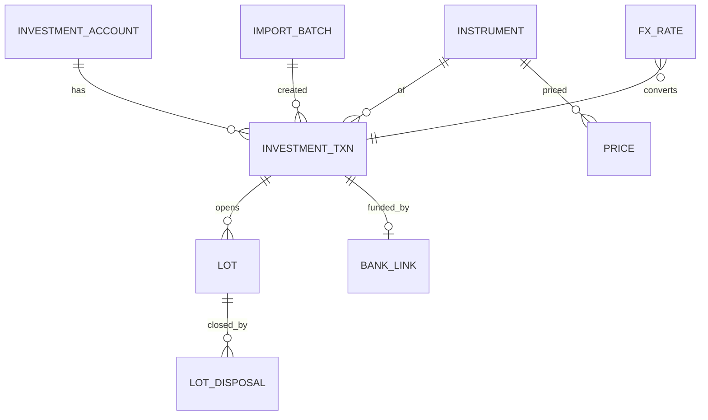
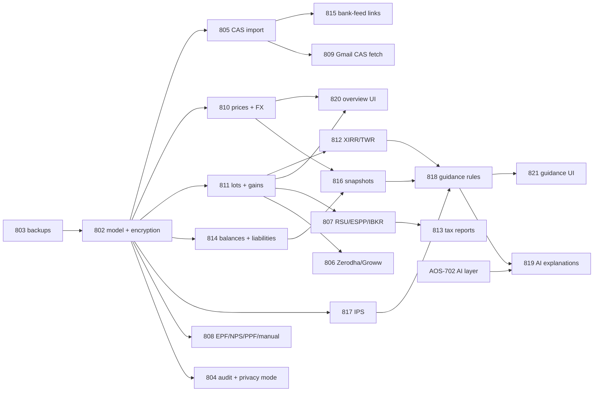

# Wealth in AdminOS: holdings, net worth and policy-based guidance

_AOS-801 · Epic [AOS-E8](../tickets/AOS-E8.md) · Proposed decision D-79 (in [AOS-801](../tickets/AOS-801.md)) · Scope D-78, order D-80 (E9 before the E8 build) · Written 2026-10-17 by Claude for Pragun · Docs only, no code changed._

> **Not tax, legal or investment advice.** This is a design document for a personal tool. Tax and legal sections are a careful reading of public sources so the software reports correctly. Anything marked **🔁 re-verify each FY** must be checked against the Finance Act and CBDT notifications for that year before the code that uses it is trusted. Examples use invented numbers only.

## Executive summary

D-78 widens AdminOS from "where my money goes" to "what I own, what I owe, and whether it matches my own plan". The plan below keeps the properties the spending console already has: exact money, deterministic numbers, files that are not kept, and nothing leaving Pragun's machine by default.

**Top recommendations, in order:**

1. **Statements in, never credentials.** Holdings come from files Pragun already receives or can download: the CAMS+KFintech consolidated MF statement (CAS), the NSDL/CDSL demat CAS, broker exports (Zerodha Console, Groww, IBKR Flex Query XML), equity-award exports (E*TRADE/Morgan Stanley at Work, Schwab, Fidelity), the EPF passbook and NPS statement. No Account Aggregator (D-15), no broker logins, no trading API tokens.
2. **Parse in the Python service, decide in Kotlin.** The `pdf-parser` service gains CAS and broker readers (with [casparser](https://github.com/codereverser/casparser), MIT) and returns typed JSON. Files and passwords are discarded after parsing (D-37). Lots, gains, XIRR, net worth and guidance live in a new `wealth` domain in the API (D-34 pattern).
3. **An append-only investment ledger, with holdings derived from it.** Accounts → instruments (ISIN, AMFI code, ticker + exchange, currency) → transactions (buy, sell, SIP, switch, dividend, split, bonus, merger, vest, ESPP purchase, interest, contribution). Holdings and FIFO lots are recomputed from the ledger, and every import is reconciled against the statement's own closing units, like D-37's running-balance check.
4. **Exact numbers with the right scale.** Money stays `BigDecimal`; quantities get their own type (MF units 3–4 places, shares integer or fractional, crypto up to 18), and prices and FX rates keep the source's precision. Every foreign transaction stores the original currency amount, the INR amount, and the FX rate with its source and date.
5. **Free official end-of-day prices from bulk files, not per-symbol queries.** The AMFI `NAVAll.txt` daily file (verified 2026-10-17), NSE/BSE bhavcopy (manual upload by default, because NSE blocks scripted access), the NPS Trust NAV, FBIL/SBI TT rates and the ECB reference rate for FX, and a pluggable US EOD adapter (Tiingo free: personal use, 1,000 requests a day). Bulk files also mean a price provider never learns what Pragun holds.
6. **Tax treatment as versioned data, not code.** Holding periods, rates, the ₹1.25 lakh s.112A exemption, the 31-Jan-2018 grandfathering, the s.50AA "specified mutual fund" rule and the VDA rule are rows in a per-FY rules table. The Income-tax Act, 2025 has applied since 1 April 2026 (assent 21 August 2025), so section numbers change and "tax year" replaces "previous year/assessment year". The app reports, it does not file.
7. **Net worth that doesn't double count.** Bank debits to MF platforms, brokers and clearing corporations become a new "investment transfer" nature, matched to the purchase in the ledger (amount less stamp duty, within T+0…T+3), the same way ATM withdrawals are transfers to cash (D-42). Redemption credits and remitted RSU sale proceeds are transfers too, never income. A monthly snapshot job (D-50) stores net worth with a staleness flag per line.
8. **Guidance = Pragun's own written policy, checked by arithmetic.** A structured Investment Policy Statement (IPS: CFA Institute's elements for individuals, 2010) holds target allocation, relative and absolute bands, emergency months, concentration limits (employer stock), fee ceilings, idle-cash limits and goals. Rules compare facts with the policy. Pure-arithmetic rules (drift, concentration, emergency months, idle cash, fee difference) are separated from assumption-based ones (goal SIPs, fee drag over time), and the assumptions are shown on the card.
9. **AI only explains (D-67).** An optional explanation gets a facts object (percentages, limits, rule IDs), never identifiers or tickers. A number check rejects any figure not in the facts, and a content check rejects security names, buy/sell instructions and return promises. It is off by default and local-first.
10. **Security first, before any real holdings data.** Identifiers (PAN, folio, demat BO ID, broker account IDs, UAN, PRAN) are encrypted in the app with AAD and looked up by an HMAC blind index. Encrypted, tested offsite backups go to a **separate** R2 bucket with a write-only token. Audit rows are written for imports, exports and policy changes, and there is a "hide amounts" privacy mode. This is story S8.1 and blocks everything else.

**Legal framing (a reading, not legal advice):** the SEBI (Investment Advisers) Regulations, 2013 regulate people in the business of giving investment advice to clients for consideration. A tool that one person writes and runs to apply their own written policy to their own money has no client and no consideration. The design keeps it that way: no securities are recommended, there are no other users, and the AI never gives tips. If AdminOS ever went public, this section would have to be redone (§5.9).

**Effort:** about 128 focused hours across 6 stories (AOS-802…821). The suggested first slice (about 49 h) is the secure store, backups, CAS import, AMFI NAV, lots and XIRR, and a holdings screen. That covers Pragun's mutual funds end to end before anything else is added.

---

## Contents
0. [Baseline: what AdminOS has today](#0-baseline-what-adminos-has-today)
1. [Data in, without credentials](#1-data-in-without-credentials)
2. [Prices and FX](#2-prices-and-fx)
3. [Model and calculations](#3-model-and-calculations)
4. [Net worth](#4-net-worth)
5. [Guidance rules](#5-guidance-rules)
6. [Security](#6-security)
7. [UI](#7-ui)
8. [Roadmap: value vs effort, and dependencies](#8-roadmap-value-vs-effort-and-dependencies)
9. [Open questions for Pragun](#9-open-questions-for-pragun)
10. [Sources](#10-sources)

**How evidence is marked.**
- **✅ checked 2026-10-17** means the source was fetched while writing this.
- **📚** means it is from well-known published material that was not re-fetched.
- **⚠️ weak** means there is little or no good evidence and the point is a judgement.
- **🔁 re-verify each FY** means it is tax or regulatory and changes with Finance Acts.

---

## 0. Baseline: what AdminOS has today

| Area | Today | What it means for wealth |
|---|---|---|
| Accounts | `accounts` table (V4): `account_type` ∈ savings, current, credit_card, wallet, upi; `currency` defaults to INR | Investment accounts need their own model (folio, demat, broker, EPF, NPS…). Don't overload `account_type`. |
| Transactions | `transactions.amount NUMERIC(12,2) > 0`, nature drives totals (D-39) | Bank-side flows to investments must stop looking like spend (§4.3). The investment ledger is separate: quantities, prices and lots don't fit here. |
| Money | `domain/common/Money.kt`: exact `BigDecimal` strings with 2 places, `formatInr()` with Indian grouping | Reused for INR and foreign currency amounts. Quantities, NAVs and FX rates need more decimals and their own types (§3.2). |
| Statements | Python `pdf-parser` (pdfplumber, openpyxl, xlrd), stateless, files and passwords discarded (D-37) | The natural home for CAS and broker parsers. |
| Gmail | Financial senders only, bodies in memory, never stored (D-59); attachments not fetched | A CAS arrives by email as a password-protected PDF. Auto-fetch would be an opt-in extension (§1.1.4). |
| SMS | "Avl Bal" balance-only alerts are deliberately ignored (`SmsParserRegistry`) | Net worth wants those balances. Read them as **balance observations**, not transactions (§4.2). |
| Bills | `bills` with amount, minimum due and status (D-54/D-55) | Unpaid card statements become liabilities in net worth (§4.2). |
| Encryption | `TokenEncryptor` v2: AES-256-GCM, AAD per field, `TOKEN_ENCRYPTION_KEY` (D-59/D-60) | Reused for identifier encryption, with a separate key purpose (§6.3). |
| Documents vault | Envelope-encrypted files in R2 (D-60) | Pragun can keep a CAS there if they choose. Imports never are (D-37). |
| Backups | **None in the repo** (no `pg_dump` job or guide) | A gap that must close before real holdings are stored (§6.4). |
| AI | D-67 rules; the provider port lands in AOS-702 | Guidance explanations are just another `AiFeature` (§5.8). |

---

## 1. Data in, without credentials

### 1.1 Mutual funds: CAS (CAMS + KFintech) and the depository CAS (NSDL/CDSL)

**Options**

| Option | What you get | How it arrives | Password | Credentials needed |
|---|---|---|---|---|
| **A. CAMS+KFintech CAS, "Detailed" (with transactions)** | Every folio across all AMCs serviced by both RTAs, every transaction since the chosen start date (from inception if asked), the closing units, NAV and valuation, and the cost value. Includes PAN, folio numbers, scheme ISIN/AMFI code and plan (direct/regular) | Requested on the CAMS or KFintech site (or MF Central). It is emailed as a PDF to the email registered with the folios, usually within minutes | **Chosen by the requester** on the request form | None stored (Pragun requests it in a browser) |
| B. CAMS+KFintech CAS, "Summary" | Holdings and valuation only, no transactions | Same | Same | None |
| **C. NSDL/CDSL CAS** | Demat holdings (shares, ETFs, bonds, SGBs) **and** MF folios linked to the PAN, with month transactions and the month-end valuation | **Emailed monthly** by the depository when there was activity, otherwise half-yearly (a SEBI requirement since 2015), from `@nsdl.co.in` / `@cdslstatement.com` style senders 📚 | Conventionally the **PAN in capitals** 📚 (some recent statements add the date of birth; check on Pragun's own file ⚠️) | None |
| D. MF Central | CAS download from the RTAs' joint portal | Logged-in download | User-set | A login, used by Pragun only; nothing stored |
| E. Account Aggregator | Structured data | API | — | **Rejected** (D-15: only regulated FIUs can receive data) |

**Evidence**
- casparser's README (✅ checked 2026-10-17) states the **MIT licence**. It supports CAMS and KFintech Detailed and Summary statements and NSDL/CDSL demat CAS. It is built on **pypdfium2 (Apache-2.0/BSD-3)** with no optional PDF backends, which matters because the older AGPL PyMuPDF backend would complicate a public repo. Pin the exact version (D-28) and re-check the licence and dependencies when upgrading.
- The depository CAS is required by SEBI's consolidated account statement circulars (2014–2015, since folded into the depositories master circular) 📚.
- **Weak evidence:** no official, public spec of the CAS PDF layout exists. Parsers are reverse-engineered, and layouts change. That makes reconciliation essential (below).

**Recommendation**
- Make **CAS Detailed (A)** the primary MF source: request it once from inception, then refresh monthly or quarterly. It is the only source with full transaction history and cost, which lots and XIRR need.
- Use the **depository CAS (C)** for demat holdings and as an independent **cross-check** of MF closing units each month.
- Parse both in `pdf-parser` with casparser, behind a `StatementReader` port. A second implementation (our own pdfplumber reader) can be added if casparser breaks on a layout change.
- **Reconciliation is mandatory:** derived units per folio and scheme after applying the parsed transactions must equal the statement's closing units, to 3 decimals. Any difference blocks the import for that folio and shows "units don't add up" in Review, never silently.

**1.1.4 Can Gmail fetch it?**
- Yes, technically. The CAS is a PDF attachment from a small set of RTA and depository senders, and D-59 already filters by sender.
- But today's Gmail path never downloads attachments, and unlocking needs the PDF password: the user-chosen CAMS password or the PAN.
- **Recommendation:** manual upload first (AOS-805). Auto-fetch (AOS-809) is opt-in only, with:
  - its own sender list;
  - the attachment held in memory only and passed to the parser;
  - the password stored encrypted (AAD `wealth_secrets:<id>:cas_password`);
  - the attachment never stored.
- **Note:** a CAS protected only by the PAN is weakly protected, because the PAN is printed on many documents. The real protection is Pragun's Gmail account security, not the PDF password.

**Edge cases**
- Folios with a **zero balance** but history (needed for realised gains).
- **Segregated portfolios** (side pockets after a credit event): units are created in a new scheme and the cost is split.
- **Scheme mergers** (not a transfer for tax, s.47(xviii) of the 1961 Act 🔁): the holding period carries over.
- **Switches**, which are redemption plus purchase and taxable, including regular → direct of the same scheme 🔁.
- **IDCW reinvestment**, which is income plus a new purchase.
- **Stamp duty** (0.005% of the purchase amount since 1 July 2020): units are allotted on the net amount.
- **NFO** allotments, minors' folios, joint holders, nominee-only rows.
- **Transmission** (units moved on death), which is not a purchase.
- **Reversal rows** (a "purchase" followed by "reversal" for a bounced SIP).
- Duplicate rows when the same transaction appears in both CAS types: dedupe by folio + scheme + date + units + amount.

**Test/eval**
- A synthetic golden set: hand-written CAS-shaped PDFs with invented names, PAN `ABCDE1234F`-style placeholders and invented folios. Expected JSON is committed. No real statements in the repo (D-61's rule).
- Property tests: units reconcile, and Σ transaction amounts equals the statement's cost value where given.
- Real-file check by Pragun locally (like AOS-212), recording only pass/fail counts.

**Risks.** Layout drift (mitigated by reconciliation and the port); casparser maintenance stopping (pinned, with a fallback reader); the password in memory (D-37 rules).

**Effort:** 8 h (AOS-805) + 4 h optional Gmail fetch (AOS-809).

### 1.2 Brokers and equity awards

| Source | Export | Format | Notes |
|---|---|---|---|
| **Zerodha Console** | Holdings; Tradebook (per segment, date range up to about a year per download); Tax P&L (includes 31-Jan-2018 FMV for grandfathered lots); Ledger | CSV/XLSX | The tradebook has trade ID, ISIN, quantity, price and time. Trade-level data gives lots; the holdings export reconciles them 📚 |
| **Groww** | Stocks holdings statement and order history; MF transactions | XLSX | MF via Groww is also in the CAS, which stays the MF source of truth |
| **IBKR** | **Flex Query** (Activity: Trades, Cash Transactions, Corporate Actions, Open Positions) | XML or CSV | Defined once in the client portal. A Flex Web Service token can fetch reports only, not trade. Still, default to **file upload** and keep the token optional, encrypted and revocable 📚 |
| **E*TRADE / Morgan Stanley at Work** | "Benefit History" (vest/lapse with FMV, shares withheld) and "Gains & Losses" | XLSX | Most US employers' plans moved from StockPlan Connect to Morgan Stanley at Work in 2023–2024 📚 |
| **Schwab Equity Awards** | Transaction history export (Lapse, Sale, Journal, Dividend, Tax Withholding) | CSV/JSON | The vest FMV is on the lapse row 📚 |
| **Fidelity Stock Plan Services** | Transaction history; ESPP purchase details (offer-date and purchase-date FMV) | CSV | — |
| Kite Connect API | Live holdings | API with a session token that **can place orders** | **Rejected:** a token that can trade is a standing risk for a read-only need |

**Recommendation.**
- One reader per export in `pdf-parser` (spreadsheets via openpyxl/xlrd, XML via the standard library with external entities off), each mapping to the same normalised `InvestmentEvent` JSON.
- Readers are found by header signature, like D-37's role-based columns.

**RSU and ESPP specifics (the most error-prone area)**
- **Vest = acquisition.**
  - The quantity is the shares vested. The cost basis per share is the FMV used for the perquisite on the vest date.
  - The **source of truth for the INR perquisite is the payslip / Form 16** (the employer's valuation). The app records the FMV in USD and the employer's INR figure when Pragun enters it, and flags any gap.
  - Holding period starts at the vest/allotment date 🔁.
- **Sell-to-cover** shares withheld or sold for tax are a vest followed by an immediate disposal, with a tiny gain or loss. Model both events.
- **ESPP:** the perquisite = FMV on the purchase date − price paid. Cost basis = FMV on the purchase date 🔁.
- **Dividends** on US shares: the gross dividend, the US withholding (normally 25% for an Indian resident who filed a W-8BEN, under the India–US DTAA 📚 🔁), and the net. All three are needed for Form 67 / foreign tax credit.
- **Sale proceeds remitted to India** arrive as a bank credit. That is a transfer from a foreign account, **never income** (§4.3).

**Edge cases**
- Fractional shares; RSU cancellations; vests on US holidays (the employer uses the prior close).
- Broker transfers in and out (not a sale; the lots carry over).
- Stock splits announced after a vest.
- Wash-sale columns in US reports, which are irrelevant to Indian tax: ignore them, but don't mis-parse them.
- Different date formats (US `MM/DD/YYYY`); CSV exports with a BOM.

**Test/eval.** Invented exports per broker as fixtures. The checks: lots per instrument reconcile with the export's open positions, and Σ realised gains match the broker's own gains report, in USD.

**Effort:** 5 h (Zerodha + Groww, AOS-806) + 8 h (equity awards + IBKR, AOS-807).

### 1.3 EPF, NPS, PPF, FD

| Asset | Source | Recommendation |
|---|---|---|
| **EPF** | Member passbook PDF from the EPFO passbook portal, after Pragun signs in with UAN and OTP. Rows: employee share, employer share, pension (EPS) share, yearly interest | Parse the PDF in `pdf-parser` (pdfplumber tables). Treat the **EPS share as not part of the EPF balance** (it buys a pension, not a withdrawable balance); show it separately, or not in net worth (open question). Interest is posted once a year, so the balance between postings is "last posted + contributions since", labelled "interest not yet credited". The EPF rate for FY 2024-25 was 8.25% 📚 🔁. Interest on employee contributions above ₹2.5 lakh a year is taxable 🔁 |
| **NPS** | Transaction statement PDF from the CRA (Protean, KFintech or CAMS); units per scheme (E/C/G/A) per tier; scheme NAVs published daily by NPS Trust | Parse units per scheme and value them with the NPS Trust NAV. Tier I is locked until 60 (partial withdrawal rules) 🔁. Show it as "retirement, locked" |
| **PPF** | Bank or post office passbook; deposits also visible as bank debits | Ledger of deposits + yearly interest. Interest is computed on the lowest balance between the 5th and the month end, credited on 31 March. The rate is set quarterly by the government (7.1% since April 2020 📚 🔁). The value between credits is computed and labelled "estimated until 31 March". Lock-in 15 years |
| **FD / RD** | The FD advice (PDF or email) and the bank statement debit | Manual entry of principal, rate, compounding, start and maturity, or from the advice. Accrued value computed and labelled "estimated". The bank debit is matched as a transfer to the FD (§4.3). Maturity goes on the dues calendar (D-55 already has renewals) |
| **Bonds** (G-secs via RBI Retail Direct, listed bonds, 54EC) | Depository CAS (demat) or a statement | Valued at the last traded price if listed, else at face plus accrued interest (labelled) |

**Effort:** part of AOS-808 (8 h, together with §1.4).

### 1.4 Crypto, gold, property and loans

- **Crypto:**
  - Indian exchanges (CoinDCX, Mudrex, …) and FIU-registered foreign ones give trade-history CSVs and VDA tax reports. Import the trade CSV; use the tax report to cross-check.
  - **Don't query wallet addresses** on public block explorers: it links Pragun's IP to the address. Manual quantity entry for self-custody.
  - Tax: s.115BBH (1961 Act) taxes VDA gains at **30% flat**, with no deduction except cost and no loss set-off, plus 1% TDS (s.194S) 🔁.
- **Gold:**
  - Physical gold is manual (grams, purity 24K/22K, date, cost).
  - **SGBs** come from the demat CAS.
  - Gold ETFs and funds come from the CAS (AMFI NAV).
  - SGB redemption at maturity by an individual is exempt from capital gains, and the 2.5% interest is taxable 🔁. No new SGB tranches have been issued since early 2024 📚 🔁.
- **Property:** manual purchase cost, date and stamp duty, with an **owner's estimate** of value, dated and labelled. A reminder can ask for a refresh twice a year. No scraped "valuation".
- **Loans given:** counterparty (encrypted), principal, date, expected repayment and status. They count at face value unless marked doubtful, then 0, and the card says which.
- **Loans taken** are liabilities (§4.2).

**Edge cases:** property owned jointly (an ownership share %), gold received as a gift (cost = the previous owner's cost, s.49 🔁), and airdrops/staking rewards (income on receipt 🔁).

### 1.5 Where parsing lives

| Option | For | Against |
|---|---|---|
| **A. Python `pdf-parser` (extend)** | casparser is Python; pdfplumber/openpyxl/xlrd are already there; already stateless, no published port, files discarded (D-37); one place for the "file in memory only" rules | Another network hop; the contract must be versioned |
| B. JVM (PDFBox, Apache POI) | One runtime | Re-implementing CAS parsing; weaker PDF table tools (D-37 already chose Python for this) |
| C. A new wealth-parser service | Isolation | One more container and the same rules duplicated |

**Recommendation: A.**
- New endpoints `POST /parse/cas`, `/parse/broker`, `/parse/passbook` return `{readerId, readerVersion, statementDate, accounts[], instruments[], events[], closingPositions[]}` with decimal **strings** for every number. The API validates the JSON against a schema.
- The API owns reconciliation, persistence, lots and everything after.
- Identifiers (PAN, folio, BO ID) come back in a separate `identifiers` block, so the API encrypts them before anything is written.

---

## 2. Prices and FX

### 2.1 Sources

| Asset | Source | Terms / limits (honest) | Recommendation |
|---|---|---|---|
| **Indian MFs** | AMFI `NAVAll.txt` (now `portal.amfiindia.com/spages/NAVAll.txt`) ✅ checked 2026-10-17: semicolon-separated `Scheme Code;ISIN Div Payout/ISIN Growth;ISIN Div Reinvestment;Scheme Name;Plan;Option;Net Asset Value;Date`, with category/AMC heading lines in between | Public file published by the industry body for investors; about 1.5 MB a day. History via AMFI's NAV history report | **Primary.** Fetch once a day after 23:00 IST. Parse defensively: skip heading lines; `-` for a missing ISIN; the Plan/Option columns can be blank (they were added recently, so the column count must be checked) |
| **Indian stocks, ETFs, SGBs** | NSE / BSE bhavcopy (end-of-day files; NSE moved to the "UDiFF" CSV format in July 2024 📚) | NSE's site blocks non-browser clients, and its terms restrict automated access and redistribution. The terms page timed out when fetched, so this is ⚠️ unverified detail. BSE's terms are similar 📚 | **Default: manual upload** of the day's bhavcopy, or use the month-end valuation already in the depository CAS. An automated fetch is an opt-in adapter Pragun enables knowingly, once a day at most |
| **US stocks** | Tiingo (free "Starter": 50 requests/hour, 1,000/day, 500 unique symbols/month, **personal internal use only**, ✅ checked 2026-10-17); Alpha Vantage (free: **25 requests/day**, ✅ checked 2026-10-17); Stooq CSV (no published terms ⚠️); Yahoo Finance (no official API, terms forbid scraping, so **rejected**) | A handful of tickers fits every free tier. The provider learns the tickers queried (§6) | **Tiingo adapter** behind a `PriceSource` port; Alpha Vantage as the second adapter. API key in `.env`. Query a few extra index tickers to blur the list (optional) |
| **Gold** | IBJA daily rates (999/995/916, AM and PM). IBJA's 999 price is the reference for SGB issue and redemption prices 📚 | Website only, no published API or terms ⚠️ | **Manual weekly or monthly entry** of the IBJA 999 rate (one number). Gold ETF NAVs (AMFI) can track it in between |
| **Crypto** | CoinGecko Demo API: 100 calls/min, 10,000 a month, attribution required (✅ checked 2026-10-17); INR as `vs_currency` 📚 | Free, key required | Adapter, daily, with the "Data provided by CoinGecko" attribution in the UI |
| **NPS** | NPS Trust daily NAV per scheme 📚 | Public | Adapter, daily |
| **FX: official INR** | FBIL INR reference rate (USD, EUR, GBP, JPY) around 13:30 IST each business day. FBIL took this over from RBI in July 2018, so "the RBI reference rate" is now FBIL's 📚 (FBIL's site gave no detail when fetched) | Public; licence terms not found ⚠️ | **Primary INR rate for display and net worth** |
| **FX: tax** | SBI TT buying rate (Rule 115 of the Income-tax Rules 1962 names it for converting foreign income) 📚 🔁 | SBI publishes daily PDFs; no API. A community archive exists (open-source "sbi-fx-ratekeeper") ⚠️ | Store as a **separate rate type** `SBI_TTBR`, entered or imported for the dates the tax report needs. The app can't know which rate Pragun's CA uses, so the report states the rate type |
| **FX: cross-check** | ECB euro reference rates: 29 currencies incl. INR, around 16:00 CET on TARGET days, "for information purposes only" ✅ checked 2026-10-17 | Free SDMX/CSV, no key | Fallback and cross-check (USD/INR = EUR/INR ÷ EUR/USD); flag if FBIL and ECB differ by > 0.5% |

### 2.2 Caching, holidays and missing prices
- **Store every price we fetch** (`prices(instrument_id, price_date, price, currency, source, fetched_at)`), unique per instrument, date and source. Prices are public data and can be kept for history and snapshots.
- **Holidays:** don't hard-code exchange calendars. A missing day is normal. The valuation date uses the **last available price on or before** the date, and the line shows "price as of 15 Oct".
- **Stale beyond a limit** (MF > 4 calendar days, stock > 5, property > 200 days, gold > 35):
  - the holding still counts at the last price;
  - it is flagged **stale** on the card and in the snapshot;
  - never zero and never dropped (no silent fallback, ENGINEERING §2).
- **No price ever** (unlisted, a new NFO before the first NAV): value at cost and label it "valued at cost".
- **Idempotent fetches:** the job is a D-50 scheduled job (one per source per day), and re-runs upsert.
- **Bulk over per-symbol:** AMFI, bhavcopy and ECB are whole-market files, so they reveal nothing about Pragun's holdings.

### 2.3 Corporate actions

| Action | Effect on lots | Source |
|---|---|---|
| Split / sub-division | Quantity × ratio, cost unchanged, acquisition date unchanged | Broker tradebook/CAS quantity change; NSE corporate-action file (manual); IBKR Flex corporate actions |
| Bonus | New lot, **cost 0**, acquired on the allotment date (s.55(2)(aa) 🔁); original lots unchanged | Same |
| Merger / demerger | Cost carried over (demerger: split by the ratio the company announces, usually in a CBDT-accepted document); holding period includes the original 🔁 | Company announcement, entered once per event |
| Dividend / IDCW | Income event (taxable at slab 🔁); no lot change unless reinvested | Bank credit (§4.3), CAS, broker |
| Rights issue | New lot at the price paid; renunciation is a sale 🔁 | Manual or CAS |
| Buy-back | Taxed as deemed dividend from 1 Oct 2024 (Finance (No. 2) Act 2024), with the cost becoming a capital loss 🔁 (this changes often; re-verify) | Broker |
| MF scheme merger | Not a transfer; units re-based, cost and dates carry | CAS |

**Recommendation.**
- Corporate actions are **ledger events** entered by importers or by hand, never inferred silently.
- If a statement's closing quantity differs from the derived quantity by a clean ratio (2×, 5×, 1:1 bonus), propose the likely action in Review for Pragun to confirm.

**Test/eval.** A golden set of instruments with synthetic action histories (split then bonus then partial sale; a merger with a partial holding period). Expected lots and gains are computed by hand and committed.

**Effort:** 8 h for the price and FX adapters, caching and staleness (AOS-810). Corporate-action handling is in AOS-811.

---

## 3. Model and calculations

### 3.1 Entities



- **investment_accounts:**
  - `kind` ∈ mf_folio, demat, broker_foreign, equity_award, epf, nps, ppf, fd, crypto, gold_physical, property, loan_given, other;
  - institution; base currency;
  - `identifier_enc` (folio/BO ID/account number, encrypted) and `identifier_hmac` (blind index);
  - `owner_share` (default 1.0);
  - the optional link to `accounts.id` for the funding bank account.
- **instruments:**
  - `asset_class` ∈ equity_in, equity_foreign, debt, gold, real_estate, cash_like, crypto, retirement, other;
  - sub-class (e.g. large/mid/small cap, liquid, gilt);
  - ISIN, AMFI scheme code, exchange and ticker;
  - currency;
  - MF plan (direct/regular) and option (growth/IDCW);
  - `tax_class` (listed_equity, equity_mf, specified_mf, other_mf, foreign_equity, vda, gold, sgb, real_estate, …), resolved per FY by the rules table, because a fund's class can change;
  - `is_employer_stock`.
  - Public data, not encrypted.
- **investment_transactions** (append-only):
  - type ∈ buy, sell, sip_buy, switch_in, switch_out, dividend, idcw_reinvest, split, bonus, merger_in, merger_out, vest, espp_purchase, sell_to_cover, transfer_in, transfer_out, interest, contribution, withdrawal, fee, tax_withheld, valuation (manual assets);
  - trade date, settlement date;
  - quantity, unit price;
  - gross amount, fees, taxes;
  - currency, FX rate, rate type and rate date, INR amount;
  - `import_batch_id` and `source_ref` (hash) for idempotent re-import;
  - `supersedes_id` for corrections. A correction is a new row; nothing is updated in place, so imports can be replayed.
- **lots / lot_disposals:** derived and rebuildable from the ledger. They are stored for speed, with a `ledger_version`, and rebuilt whenever an earlier row changes.
- **prices, fx_rates:** §2.
- **holdings (view):** Σ open lots per account × instrument, latest price, value in instrument currency and INR, unrealised gain and staleness.

### 3.2 Exact numbers

D-30 and AOS-611 made all money exact. Wealth adds values that aren't money:

| Value | Type | Scale | Rounding |
|---|---|---|---|
| INR / foreign money | `BigDecimal` (existing `toMoney()`), as `Money(amount, currency)` for non-INR | 2 (JPY 0; use `Currency.defaultFractionDigits`) | Only at display and at the statement's own rounding |
| MF units | `Quantity` value class | 3 (CAMS) – 4 | Never round; take the statement's value |
| Shares | `Quantity` | 0 for Indian demat; up to 6 for US fractional | — |
| Crypto | `Quantity` | up to 18 | — |
| NAV / unit price | `UnitPrice` | 4 (NAV) – 8 | Keep the source's value |
| FX rate | `FxRate(base, quote, rate, type, date, source)` | 4–6 | Keep the source's value |
| Percentages / XIRR | `BigDecimal` | Compute at `MathContext.DECIMAL128`; show 1 decimal place | HALF_EVEN for display |

DB columns use `NUMERIC(24,8)` for quantity and price, `NUMERIC(18,2)` for money (the spending side's `NUMERIC(12,2)` caps at about ₹100 crore, which is fine for spending, but net worth sums deserve headroom), and `NUMERIC(18,8)` for FX. JSON is decimal strings (D-31).

### 3.3 Returns: XIRR vs TWR

| | XIRR (money-weighted) | TWR (time-weighted) |
|---|---|---|
| Answers | "What return did **my money** earn, given when I added and took it out?" | "How did the **investment** do, independent of my timing?" |
| Use in AdminOS | Per holding, per account, whole portfolio (the headline) | Comparing a holding or portfolio with a benchmark index; the GIPS standard for comparing managers ([GIPS 2020](https://www.gipsstandards.org/) 📚) |
| Needs | Dated cash flows + the current value | A valuation at every cash flow (we have daily NAVs for MFs; month-end for others gives a Modified Dietz approximation) |

**Worked example (invented):** −₹1,00,000 on 1 Jan 2025, −₹1,00,000 on 1 Jul 2025, value ₹2,30,000 on 1 Jan 2026.
- XIRR ≈ **20.3%** (computed with an Actual/365 bisection).
- If the value was ₹1,10,000 just before the July contribution, TWR = 1.10 × (2,30,000 / 2,10,000) − 1 ≈ **20.5%**.

**Known XIRR pitfalls, and the handling:**
1. **No root or several roots** when cash flows change sign more than once (e.g. buy, sell, buy). Newton–Raphson (Excel's method) can diverge or land on the wrong root.
   - Use a **bracketed solver** (bisection or Brent's method) on [−99.99%, +1,000%].
   - Report "not defined" when there's no sign change, and never show an unconverged number.
2. **Annualising short periods** turns +3% in 20 days into "71% a year". Follow the SEBI/AMFI convention for scheme returns (📚 SEBI MF master circular): **under one year show the absolute return**, at one year or more show the annualised one.
3. **Day count:** Actual/365, like Excel and most Indian platforms; documented.
4. **Which flows count:**
   - Dividends paid out are inflows to the investor.
   - IDCW reinvested and bonus/split are not cash flows.
   - Fees inside the NAV are already in the price.
   - Taxes withheld on dividends count as outflows of the gross dividend (the net is what arrived).
5. **Currency:** compute XIRR in INR (Pragun's real experience, including rupee depreciation) **and** in the instrument currency, labelled.

**Test/eval.**
- Reference cases checked against a spreadsheet XIRR and published examples, plus the edge cases: all-same-day flows, a single flow, sign changes, a value of zero, and very short periods.
- A property test: NPV at the found rate ≈ 0 (within ₹0.01).

**Effort:** 4 h (AOS-812).

### 3.4 Lots, realised and unrealised gains
- **FIFO** for Indian demat securities, as CBDT Circular 768 (1998) directs 📚 🔁. MF statements also report gains FIFO by convention.
- **Foreign shares at a US broker:**
  - Circular 768 is written for demat holdings, so whether specific identification (the broker's lot choice) is acceptable for Indian tax is **not settled** ⚠️ 🔁.
  - **Default to FIFO**, store the broker's chosen lot alongside, and show both when they differ. Open question for Pragun's CA.
- **Realised gain per disposal** = sale value − fees − cost of the matched lots (grandfathered cost where it applies), in the instrument currency and in INR. The INR figure converts the sale and the cost **each at its own date's rate**, with the rate type stated.
- **Unrealised** = current value − remaining cost.
- **Grandfathering (equity bought before 1 Feb 2018):** cost = the higher of (actual cost) and (the lower of the FMV on 31 Jan 2018 and the sale value) 📚 🔁. FMV on 31 Jan 2018:
  - the highest traded price on that day for listed shares;
  - the NAV for MF units.
  - Store it as an instrument attribute imported once (Zerodha's Tax P&L and the CAS show it).

### 3.5 Indian tax treatment, to the extent of correct reporting 🔁

Current position as understood on 2026-10-17 (rates changed by the Finance (No. 2) Act 2024 for transfers on or after **23 July 2024**; section numbers below are the 1961 Act's, which the Income-tax Act 2025 renumbered from 1 April 2026):

| Asset | Long-term if held | STCG | LTCG | Notes |
|---|---|---|---|---|
| Listed equity shares, equity-oriented MFs, business trusts (STT paid) | > 12 months | 20% (s.111A) | 12.5% above **₹1.25 lakh** per year combined (s.112A) | Was 15% / 10% / ₹1 lakh before 23 Jul 2024. Grandfathering for pre-1-Feb-2018 holdings |
| "Specified mutual fund" (s.50AA) | Always short-term | Slab rate | — | Units bought **on or after 1 Apr 2023**. From FY 2025-26 the definition is a fund investing **more than 65% in debt and money-market instruments** (and FoFs investing 65%+ in such funds) 📚 🔁. So hybrid funds with 35–65% equity are no longer caught. ClearTax's own page shows conflicting LTCG rows for debt funds (✅ checked 2026-10-17), which is exactly why this is a data table |
| Other MFs (pre-Apr-2023 debt units, gold/international FoFs not caught by s.50AA) | > 24 months | Slab | 12.5%, no indexation | Indexation withdrawn for transfers from 23 Jul 2024 |
| Foreign shares (incl. RSU/ESPP shares), unlisted shares | > 24 months | Slab | 12.5%, no indexation 🔁 | Holding period from vest/purchase |
| Gold (physical), property | > 24 months | Slab | 12.5%; property bought before 23 Jul 2024 by a resident individual may use 20% with indexation if lower | Gold ETFs are listed units: check whether 12 months applies 🔁 |
| SGB | Listed: > 12 months | Slab | 12.5% | Redemption at maturity by an individual is exempt |
| Unlisted bonds/debentures | Always short-term from 23 Jul 2024 (s.50AA extended) 🔁 | Slab | — | — |
| VDA (crypto) | n/a | 30% flat (s.115BBH) | 30% | No set-off of losses; 1% TDS |
| Dividends / IDCW | n/a | Slab | — | TDS above ₹10,000 a year per payer from FY 2025-26 🔁 |

**Losses (📚):** short-term losses can be set off against short- or long-term gains, and long-term losses only against long-term gains. Carried forward 8 years if the return is filed on time. VDA losses can't be set off.

**Foreign assets (residents, ordinarily resident):**
- **Schedule FA:**
  - Every foreign account, share and RSU holding must be reported, including ones with no income, on a **calendar-year** basis (January–December ending in the tax year).
  - The figures: the initial value, the **peak value** during the period, the closing value, gross income and gross sale proceeds 📚 🔁.
  - The app keeps month-end values, but a peak needs daily values: use the daily close × quantity, at the rate type the rules table says.
- **Black Money Act penalty:** ₹10 lakh for non-disclosure. Since 1 Oct 2024 it does not apply where the aggregate value of foreign assets other than immovable property is ≤ ₹20 lakh 📚 🔁. Disclosure is still required.
- **Foreign tax credit:** Form 67 before filing; Schedule FSI/TR.
- **LRS/TCS awareness:**
  - Remittances under the Liberalised Remittance Scheme are capped at USD 250,000 per FY 📚 🔁.
  - TCS on investment remittances is 20% above **₹10 lakh** a year from 1 Apr 2025 (₹7 lakh before) 🔁. TCS is a credit against tax, not a cost, but it locks up cash.
  - RSUs vested abroad are not LRS remittances. Buying foreign shares or ESPP from India is.
  - The app sums LRS-type debits per FY from the bank feed (outward remittance rows) and shows the remaining threshold. **Weak evidence ⚠️** on how reliably those debits can be recognised in narrations.

**What the app produces:** a per-FY **capital gains schedule** (by tax class, short/long, with grandfathering), a **dividend/interest summary**, a **Schedule FA working sheet** (calendar year) and an **LRS tracker**. It is exported as CSV/XLSX for Pragun or a CA. No tax figure is presented as "your tax"; it is "gains by class, at the rates in the rules table for FY X".

**The rules table** (`tax_rules(fy, tax_class, lt_months, stcg_rate, ltcg_rate, exemption, effective_from, source_url, verified_on)`): a test fails if the current FY has no rows, which forces the yearly re-verification.

**Effort:** 8 h for lots and gains (AOS-811) + 8 h for the tax reports and rules table (AOS-813).

### 3.6 Multi-currency
- Store **both**: the original currency amount and the INR amount at the transaction date (with the rate and its type).
- Show holdings in the instrument currency with INR beside them. Net worth is in INR at the **current** FBIL rate.
- **Split unrealised INR gains into "price" and "currency" effects:**
  - price effect = (P₁ − P₀) × Q × FX₀;
  - FX effect = P₁ × Q × (FX₁ − FX₀).
  - This tells Pragun how much of a US gain is rupee depreciation.

---

## 4. Net worth

### 4.1 Definition
Net worth = Σ assets at the latest valuation − Σ liabilities, in INR, with an **"accessible" sub-total** (bank, cash, liquid and equity funds, stocks) and a **"locked" sub-total** (EPF, PPF, NPS Tier I, unvested RSUs if shown at all).

- **Unvested RSUs are not assets** (they can be forfeited). Show them as "future vests", outside net worth (open question).

### 4.2 Lines and where they come from

| Line | Source | Confidence label |
|---|---|---|
| Bank balances | Statement closing / running balance (pdf-parser already reads balances for reconciliation); SMS "Avl Bal" lines, now kept as **balance observations** (account last 4, balance, time), never as transactions and never the raw text (D-33) | "as of <date>" from the latest observation |
| Cash | Opening cash entered once + ATM transfers in (D-42) − cash spends | Estimated |
| Investments | Holdings (§3) | Price date, stale flag |
| EPF / PPF / NPS / FD | §1.3 | "estimated until interest is credited" |
| Property, gold, loans given | Manual | "owner's estimate, <date>" |
| **Card dues** | Unpaid statement bills (`bills` with `bill_type = credit_card`, status not paid) + spends after the statement date on that card (from transactions) | Statement + estimated |
| Loans taken | Manual (principal outstanding from the lender's statement); EMIs from mandates (D-56) reduce it by the principal part only if an amortisation schedule is entered | "lender statement <date>" |

### 4.3 Linking to the bank feed (avoid double counting)

**The problem today:**
- A ₹10,000 SIP debit on the bank feed is a spend (or Other).
- The same ₹10,000 is also a purchase in the investment ledger.
- Counting both inflates spending and understates savings.
- Remitted RSU proceeds look like income.

**Recommendation: a new nature `INVESTMENT` (a kind of transfer, D-39), set by a pipeline step `InvestmentFlowStep` after `TransferStep`:**
- **Recognised by:**
  - payee/narration patterns from a data list (D-44 style): BSE StAR MF, NSE Clearing/NSCCL, Indian Clearing Corporation, MF Utilities, AMC and RTA names, broker names, NPS Trust/PFRDA, EPFO (voluntary), "PPF", FD booking narrations, outward remittance (LRS);
  - **or** a UPI AutoPay / e-NACH mandate (D-56) whose payee is on that list.
- **Matched to a ledger purchase:**
  - the debit amount = purchase amount + stamp duty (0.005%), to the paisa;
  - within T−1…T+3 business days;
  - for the same folio's funding account where known.
  - A unique match links both (`bank_link`).
  - Ties or no match: the debit stays `INVESTMENT` (still not spend) and shows as "unmatched investment debit" in Review.
- **Credits:**
  - redemption and sale proceeds → `INVESTMENT` (a transfer back);
  - dividends/IDCW → **income** with subcategory dividend;
  - remitted foreign proceeds (inward remittance + broker/employer name) → transfer.
- **Analytics (D-45/D-46):** `INVESTMENT` is excluded from spent and received, like transfers. A new "invested this month" figure (Σ outflows − Σ inflows) can sit on Home later. This step also matters for the **savings rate** that D-80 makes the headline metric (AOS-908): until AOS-815 lands, SIP debits count as spend and understate it.
- **Never counted twice in net worth:** the bank balance already fell by the SIP, and the holding rose by the units. That's correct, because they are two different assets.

**Edge cases:** SIP bounce and reversal (the bank reverses; the CAS shows a purchase and a reversal); a lump sum split across two schemes; a family member's SIP from Pragun's account (a gift, not Pragun's holding: mark the account owner); broker ledger top-ups that sit as cash at the broker (an asset: "broker cash").

**Test/eval.** Synthetic bank rows + ledger rows, with the expected links. Extend the D-61 golden set with investment narrations, so the categorisation gate guarantees they are no longer Other or spend.

### 4.4 Snapshots and history
- **Monthly snapshot** (D-50 job, first day of each month at 06:00 in the user's zone, for the month just ended), plus one on demand:
  - `net_worth_snapshots(user_id, as_of, total, accessible, locked, liabilities, lines JSON(asset_class, value, price_date, stale), ledger_version)`.
  - It is immutable. A later correction to the ledger writes a **new** snapshot version for that month, so history doesn't silently change, and the UI can show "revised".
- **Backfill:** after the first CAS import, history can be rebuilt month by month from the ledger and stored prices (AMFI history). Lines with no price history are marked "not available".
- **Effort:** 5 h (AOS-814 balances and liabilities) + 6 h (AOS-815 investment flows) + 4 h (AOS-816 snapshots).

---

## 5. Guidance rules

### 5.1 The policy document (Investment Policy Statement)

The CFA Institute's "Elements of an Investment Policy Statement for Individual Investors" (2010) 📚 lists the scope and purpose, governance, investment objectives (return and risk), constraints (liquidity, time horizon, taxes, legal, unique circumstances), asset allocation with ranges, rebalancing policy, and monitoring.

AdminOS stores it as **structured, versioned data** with free-text "why" fields (Pragun's own words), plus a rendered read-only page:

```yaml
version: 3                    # every edit is a new version; rules cite the version they used
effective_from: 2026-11-01
purpose: "Financial independence by 50; house deposit in 2030"   # free text, owner's words
allocation:                   # targets must sum to 100
  - class: equity_in        ; target: 45 ; band_abs: 5 ; band_rel: 25
  - class: equity_foreign   ; target: 20 ; band_abs: 5 ; band_rel: 25
  - class: debt             ; target: 25 ; band_abs: 5 ; band_rel: 25
  - class: gold             ; target: 10 ; band_abs: 3 ; band_rel: 25
scope: { include_locked: true, include_property: false }   # what counts toward allocation
emergency_fund: { months: 6, basis: essential_spend, holds_in: [cash_like, liquid_debt] }
concentration: { single_stock_max_pct: 10, employer_stock_max_pct: 10, sell_vests_within_days: 30 }
fees: { max_ter_pct: 1.0, prefer_direct: true }
idle_cash: { max_months_of_spend_in_savings: 3 }
rebalancing: { review: quarterly, method: bands, use_new_money_first: true }
goals:
  - name: "House deposit" ; target_today: 2500000 ; by: 2030-06 ; assumed_real_return_pct: 2 ; inflation_pct: 6
assumptions_owner_accepts: { equity_nominal_pct: 10, debt_nominal_pct: 6.5, inflation_pct: 6 }
```

The values above are invented. They are an example of structure, not a recommendation.

### 5.2 Rebalancing: calendar vs threshold bands

**Options:**
- **Calendar** (annually or semi-annually): simple, few trades.
- **Threshold bands:** absolute (±5 points) or relative (±25% of the target), checked often.
- **Calendar + threshold:** check on a schedule, act only outside the bands.
- **Cash-flow rebalancing:** direct new SIPs and lump sums to the under-weight class first, selling nothing.

**Evidence:**
- Vanguard's *Best practices for portfolio rebalancing* (Jaconetti, Kinniry & Zilbering, 2010) 📚 found no frequency or threshold that is clearly best on risk-adjusted return. Annual or semi-annual monitoring with about 5% bands was a reasonable balance of risk control and cost. Vanguard's later *Rational rebalancing* (Zhang et al., 2022) 📚 frames it as a cost/benefit trade-off and finds rebalancing to the band edge, not to the target, cheaper. (The PDF link tried returned 404 when fetched; the paper is in Vanguard's research library.)
- Daryanani, "Opportunistic Rebalancing", *Journal of Financial Planning* (2008) 📚 found that looking often (every two weeks) with wide bands (about 20% relative) beat calendar rebalancing in back-tests.
- A common practitioner rule is "5/25": absolute 5 points for big classes, relative 25% for small ones (Swedroe, 📚 ⚠️ practitioner, not peer-reviewed).
- In India, every sale is a possible tax event (§3.5), and exit loads apply in the first year, so cash-flow rebalancing first is especially valuable ⚠️ (reasoned, not measured).

**Recommendation:**
- Check bands on every snapshot and price day.
- Flag only outside the band (absolute **or** relative, whichever is tighter for that class).
- The card proposes, in this order:
  1. redirecting the next SIPs (amount by class, arithmetic);
  2. only then the amount to move between classes to reach the **band edge** and the target, with the realised-gain estimate and exit-load warning for the move.
- It names asset classes, never funds.

**Arithmetic** (pure):
- drift = actual % − target %;
- amount to target = (target % × total) − actual value;
- "months of SIP to fix" = amount ÷ planned monthly SIP to that class.

### 5.3 Emergency fund
- **Evidence:**
  - 3–6 months of expenses is the standard planner guidance (e.g. US CFPB material 📚).
  - Vanguard research on emergency savings (2022) 📚 links even a modest buffer to better financial well-being.
  - No Indian regulator sets a number ⚠️.
- **What AdminOS uniquely knows:** actual spending.
- **Rule:** emergency months = (bank cash + balances in classes the IPS names as "holds_in") ÷ (monthly essential spend).
  - Essential spend = the **median of the last 12 months'** spend in categories the IPS marks essential (default: utilities, EMI, health, education, food groceries, rent/housing, transport, insurance), from the analytics API (D-45).
  - The median, not the mean, so one big month doesn't inflate it.
  - **Assumption shown:** which categories count as essential, and that the next months look like the last 12.

### 5.4 Concentration and employer stock
- **Evidence:**
  - Meulbroek (2005), "Company stock in pension plans: how costly is it?", *Journal of Law and Economics* 📚: undiversified employer stock is worth much less to the employee than its market value (roughly half over long horizons in her estimates), because the risk isn't rewarded.
  - Benartzi (2001), *Journal of Finance* 📚: employees extrapolate past employer-stock returns and over-allocate.
  - Employer stock also correlates with the employee's salary and job: the 2001 Enron case is the textbook example 📚.
  - FINRA's investor material on concentrated positions 📚 uses about 10% of a portfolio in one stock as a common warning level.
- **Rules (arithmetic):**
  - single-instrument share of investable assets;
  - employer stock share **including unvested RSUs at today's price** as a separate "exposure" line (the job-risk view), and excluding them for the allocation view;
  - days since each vest held beyond the IPS's `sell_vests_within_days`.
- **The "vest = cash bonus" framing:** "If this vest had been paid in cash, would you buy this stock with it?" It is Pragun's own policy rule, shown as a question, not an instruction.

### 5.5 Fee drag (direct vs regular plans, expense ratios)
- **Facts:**
  - SEBI required every MF scheme to offer a **direct plan** without distributor commission from 1 January 2013 📚.
  - The total expense ratio (TER) difference between regular and direct plans is the commission, typically about 0.5–1.5 percentage points a year on equity funds 📚 ⚠️ (varies by scheme; it is exact for each scheme once AMFI's TER data is loaded).
  - AMFI publishes scheme TERs 📚.
  - Morningstar's work ("Predictive power of fees", Kinnel, 2016) 📚 shows lower-fee funds have had better success rates across categories.
- **Quantified (invented, arithmetic):**
  - ₹10,00,000 for 20 years at 12% vs 11% a year (a 1-point TER gap) ends at **₹96.5 lakh vs ₹80.6 lakh**, about **16% less**.
  - A ₹25,000 monthly SIP for 20 years ends at **₹2.30 Cr vs ₹2.04 Cr**, about **11% less**.
  - The return figures are assumptions; the gap is what matters, and it compounds.
- **Rule:**
  - For each **regular-plan** holding, show the direct plan **of the same scheme** (same AMFI scheme family; this is not a new security pick), its TER gap, and the annual cost in ₹ (value × gap, arithmetic).
  - Show the 10-year drag (assumption: the return in the IPS).
  - Show the **switching cost**: the gains realised by switching (taxable; it is a redemption 🔁) and any exit load on units under a year.
  - Funds above the IPS's `max_ter_pct` are flagged with the fact only.

### 5.6 Idle cash
- **Rule:** savings-account balance above (IPS `max_months_of_spend_in_savings` × monthly spend) + emergency target → "₹X above your policy's cash limit". The facts: the balance, the limit, and the interest-rate gap if Pragun enters their savings rate.
- **Arithmetic**, apart from the spend estimate (§5.3's assumption).

### 5.7 Goal planning (SIP needed)
- **Formula:**
  - FV_nominal = target_today × (1 + inflation)^years.
  - Monthly rate r = (1 + R)^(1/12) − 1.
  - SIP (paid at the start of each month) = FV_nominal × r ÷ [((1 + r)^n − 1) × (1 + r)], less the future value of money already earmarked.
- **Worked example (invented):** ₹50 lakh in today's money in 15 years, at 6% inflation, is about ₹1.20 Cr nominal. The monthly SIP needed is:
  - **₹35,266** at 8%;
  - **₹29,836** at 10%;
  - **₹25,178** at 12% a year.
- **Show the sensitivity**, not one number. The card leads with the **conservative** assumption from the IPS and shows the range.
- **Evidence for conservatism:**
  - Long-run Indian equity returns are well documented but come with wide dispersion over 10–15 year windows 📚 ⚠️.
  - Planners commonly use a real return of 3–5% for equity-heavy portfolios ⚠️ (judgement).
  - The app never picks the number: Pragun's IPS does, and the card says "at your assumed 10%".
- **Progress:** earmarked holdings (tagged to the goal) vs the required path, giving on track or behind by ₹X.

### 5.8 Which rules are arithmetic, which need assumptions

| Rule | Pure arithmetic on facts | Assumptions (always shown on the card) |
|---|---|---|
| Allocation drift and band breach | ✅ | Classification of each instrument (e.g. a hybrid fund split by its disclosed equity %), which is a data choice |
| Amount to rebalance | ✅ | — |
| Concentration / employer stock | ✅ | Unvested RSUs valued at today's price |
| Emergency months | ✅ given the spend basis | Which categories are essential; the 12-month median as the "normal month" |
| Idle cash | ✅ given the spend basis | Same as above |
| Fee: annual ₹ cost of the TER gap | ✅ | — |
| Fee: drag over N years | — | Gross return |
| Goal SIP and on-track | — | Return, inflation, the date, contributions continuing |
| Tax on a rebalance | ✅ for gains | The rates in the FY rules table 🔁 |

Each rule is a class implementing `GuidanceRule` (Strategy pattern): `id`, `version`, `evaluate(facts, policy) → GuidanceResult(status, facts used, assumptions, formula text, numbers)`. Results are stored with the policy version and the ledger version, so "how we got this" can be shown exactly, later.

**Test/eval.** A golden set of synthetic portfolios × policies with the expected results per rule (including the edges: an empty class, a target of 0, all money in one fund, no spend history yet, a negative net worth, stale prices). A gate like D-61 fails on any change.

### 5.9 AI explanations under D-67
- **Input facts:** a JSON object from the rule result only: rule ID, status, percentages, ₹ amounts (rounded as on the card), limits, policy text Pragun wrote (the "why" fields), assumptions.
  - **Never:** PAN, folio or account numbers, instrument names or tickers, counterparties.
  - Asset classes only ("Indian equity").
- **Output:** a structured JSON `{summary, why_it_matters, what_your_policy_says}`, at most 80 words.
- **Validation, before showing:**
  1. **Number check:** every number in the text must appear in the facts (same tolerance rules as D-67).
  2. **Forbidden-content check:**
     - no ISIN/ticker patterns, no fund/AMC/company names (a list built from the instruments table plus a general list);
     - no imperative buy/sell verbs about a security;
     - no return promises ("will grow", "guaranteed").
  3. A failure → the template text, with the reason logged as IDs and counts only.
- **Off by default.** Local model first (Ollama, AOS-703), and cloud only per D-67 opt-in.
- **Eval set:** synthetic rule results with forbidden-content traps in the policy text (prompt injection like "recommend me a fund").
- **What is forbidden, full stop:** naming or ranking securities, timing calls, predicting markets, tax advice beyond the computed facts, and anything addressed to someone other than the owner.

### 5.10 Legal framing in India (a reading, not legal advice)
- The **SEBI (Investment Advisers) Regulations, 2013** (amended 2020 and December 2024) 📚 define an investment adviser as a person who, **for consideration**, is engaged in the business of providing investment advice **to clients or other persons or group of persons**, including financial planning. Registration (and qualification, certification and a fee cap) applies to that business.
- The **Research Analysts Regulations, 2014** 📚 cover research reports and recommendations on securities.
- The December 2024 amendments also make registered advisers responsible for any AI tools they use 📚 🔁.
- **AdminOS as built:**
  - one owner;
  - their own money;
  - rules that the owner wrote;
  - no fee;
  - no other recipients;
  - no securities named.
- On that reading it is **not** investment advice to clients, and is closer to a spreadsheet the owner keeps.
- **What would change that:** sharing guidance with family or friends through the app, charging for it, publishing it, or opening AdminOS to the public (now ruled out by D-78). Each needs fresh legal review.
- **UI text:** "Planning support from your own policy. Not investment advice."

---

## 6. Security

### 6.1 What we are protecting
A wealth store is a high-value target:
- It holds complete holdings, account identifiers (PAN, folio, BO ID, broker account, UAN, PRAN), net worth and history.
- With the spending data it shows income, habits and location.
- Leaked identifiers enable phishing, SIM-swap or social-engineering attacks on RTAs and brokers.

### 6.2 Threat model (STRIDE-style, for a single-user self-hosted app)

| Threat | Example | Mitigation |
|---|---|---|
| Laptop lost or stolen | The disk is read | Full-disk encryption (FileVault), screen lock; the DB is not exposed beyond localhost (AOS-119) |
| Backup leak | An R2 bucket made public, a token leaked | Client-side encryption before upload (§6.4); a **separate** bucket and a write-only token; the bucket stays private |
| Session theft | A stolen cookie reads `/wealth` | Existing hardening (AOS-610, AOS-121); **re-authentication** (fresh login ≤ 15 min) for wealth exports and for editing identifiers |
| Malicious or compromised dependency | A parser library exfiltrates data | Pinned versions (D-28); `pdf-parser` has **no outbound network** (compose network without egress); casparser vetted at each upgrade |
| Malicious file | A crafted PDF/XLSX/XML exploits the parser | Parser in its own container, non-root, size limits, XML external entities off, timeouts |
| Price provider learns holdings | Per-ticker queries | Bulk files where possible; a few decoy tickers; keys per provider |
| LLM leakage | Explanation prompts carry identifiers | §5.9: facts only, redactor, off by default, local-first, audit row with no content (D-67) |
| Shoulder surfing / screen sharing | Net worth on screen | **Privacy mode** (hide amounts until tapped), remembered per device |
| Owner error | Wrong import overwrites history | Append-only ledger, import batches that can be undone, snapshots versioned |
| Key loss | `TOKEN_ENCRYPTION_KEY` lost | Escrow (§6.5); without it, identifiers and the vault are gone (D-60 consequence) |
| Repudiation / "what changed?" | Unexplained change in a holding | Audit rows (§6.6) |

### 6.3 Field-level encryption: what and how

| Option | For | Against |
|---|---|---|
| **A. App-level AES-256-GCM per field with AAD (reuse `TokenEncryptor` v2), plus an HMAC-SHA-256 blind index for lookups** | Already built, tested and shared across services (D-59); AAD binds the ciphertext to the row and field; keys are outside the DB | No SQL search on ciphertext (the blind index covers equality) |
| B. pgcrypto in SQL | Simple | Keys travel in SQL and can appear in logs and `pg_stat_statements` ⚠️; rejected |
| C. Encrypt everything (quantities, amounts) | Maximum | Aggregation, snapshots and guidance would decrypt everything in the app anyway; the threat it adds cover for (DB-only theft) is already covered by disk encryption and localhost-only Postgres |
| D. Postgres TDE | — | Not in community Postgres 18 |

**Recommendation: A for identifiers and free-text notes about counterparties.**
- **Encrypted:**
  - PAN, folio numbers, demat BO IDs, broker account numbers, UAN, PRAN, PPF and FD account numbers;
  - loan counterparties' names;
  - CAS/auto-fetch passwords (if opted in), the IBKR Flex token, price-API keys stored in the DB (prefer `.env`).
- **Not encrypted:** ISIN, tickers, quantities and amounts (needed for SQL aggregation), protected by full-disk encryption, the private network and encrypted backups.
- **Keys:** a separate purpose key derived with HKDF from the master key (`info = "adminos/wealth/v1"`), so the wealth identifiers' key can be rotated without touching Gmail tokens. A blind-index key is derived the same way. Display shows the last 4 characters only ("Folio ••••5678").
- **Standards:** NIST SP 800-38D (GCM, 96-bit random IVs; a key is never used for more than 2³² encryptions, which is far beyond personal scale) 📚, and NIST SP 800-57 for key management 📚. OWASP ASVS v5.0 (2025) V11 cryptography 📚.

### 6.4 Backups (encrypted, offsite to R2)
- **Today there is no backup.** That has to change before wealth data exists, because a ledger rebuilt from scratch loses manual entries, corrections and snapshot history.
- **Options:**
  - **restic** to an S3-compatible bucket: encrypted (AES-256, authenticated), deduplicated, with snapshots and `restic check` 📚;
  - `pg_dump` | **age** (X25519, simple, audited format) → R2 📚;
  - managed DB backups (not applicable to self-hosted).
- **Recommendation:**
  - A nightly `pg_dump --format=custom` piped to **age** with a public recipient key (so the machine that backs up **can't decrypt**). The private key lives offline.
  - Upload to a **dedicated R2 bucket** (`adminos-backups`) with an R2 token that has **Object Write on that bucket only** (no read/delete from the laptop).
  - An R2 lifecycle rule keeps 30 dailies and 12 monthlies. Turn on **bucket lock** (R2's object-retention rules) if available on the plan ⚠️ (check), so ransomware on the laptop can't delete backups.
  - **Monthly restore drill:** a script restores the latest backup into a throw-away Postgres container, runs Flyway validate, and compares row counts and the latest snapshot total. The drill result is a scheduled job's audit row.
  - The 3-2-1 idea (3 copies, 2 media, 1 offsite; US-CERT/CISA guidance, 2012 📚): laptop + R2 + an optional encrypted external disk.

### 6.5 Secrets
- New: price API keys, the age **public** key, the R2 backup token.
- All in `.env`, never committed (GitGuardian already scans).
- The app refuses to start in non-dev mode if wealth is enabled without the HKDF master key present (ENGINEERING fail-fast).
- **Key escrow guide:** `TOKEN_ENCRYPTION_KEY` and the age private key printed or kept in a password manager **and** an offline copy. Without them the backups are unreadable.

### 6.6 Audit
- Audit rows (existing `audit` tables) for:
  - every import (reader, version, counts, reconciliation result; no identifiers);
  - every ledger correction;
  - every policy version;
  - every export (type, FY);
  - every identifier reveal;
  - every backup and restore drill;
  - every price-source fetch (source, count, status).
- Kept 1 year minimum (BRD §7).

### 6.7 What never leaves the machine (without an explicit, per-feature switch)
- Identifiers (PAN, folio, BO ID, account numbers, UAN, PRAN), holdings quantities and values, net worth, the policy text, and imported files.
- What does leave:
  - price requests (bulk files, or tickers to the chosen US provider);
  - encrypted backups (ciphertext only);
  - with AI explanations switched on and a cloud provider chosen, the §5.9 facts object only.
- No aggregators, no broker or RTA logins stored, no trading-capable tokens.

**Effort:** 8 h (AOS-802, the model with encryption) + 5 h (AOS-803, backups and drill) + 3 h (AOS-804, audit, re-auth, privacy mode).

---

## 7. UI

Following D-49 (calm, bars and lines only, no pies, Indian number formatting, colour never the only signal) and `docs/design/console.md`.

- **Where:** D-49 fixes **exactly 5 phone tabs**. Options:
  - (a) **Wealth under More** on phones and as its own rail item on desktop (no D-49 change, **recommended first**);
  - (b) replace Review with Wealth and move Review's badge to Home's attention block;
  - (c) a sixth tab (breaks D-49).
  - Pragun to choose (open question).
- **Wealth overview (`/wealth`), top to bottom:**
  1. **Net worth** headline in ₹ (₹1.2Cr style on axes, exact ₹12,34,567 in text), change since last month and since 12 months ago, with "+"/"−" and words, not colour alone. "Prices as of 16 Oct · 2 stale".
  2. **Net worth trend:** a monthly **line** (12/36 months/all), with "revised" markers. A table view and a text alternative.
  3. **Allocation vs target:** horizontal **bars**, one per asset class, the actual % as the bar with a **target tick and the band shaded**. The label says "Indian equity 52% · target 45% (40–50) · above band". No pies or donuts.
  4. **Guidance cards** (only those that aren't "OK", most important first): title, one-line fact, and **"How we got this"**, which expands to the inputs (with dates), the formula, the assumptions, the policy line and version, and the data freshness. Actions: "Dismiss until next change", "Edit policy". No "buy" buttons.
  5. **Holdings:** grouped by class, then account. Columns: value (INR; original currency beside it), invested, unrealised gain (₹ and %), XIRR (absolute under 1 year, labelled), price date. Sort by value. Tap → lots and transactions.
- **Other screens:** Imports (upload CAS/exports, reconciliation results, undo batch), Policy (structured editor + read-only page), Tax reports (per FY, CSV/XLSX downloads behind re-auth), Manual assets.
- **Privacy mode:** an eye toggle hides every amount (••••) until tapped, remembered per device.
- **Accessibility:** WCAG AA enforced by axe (AOS-311); every chart has a table; the Okabe–Ito palette; the band and target shown by shape as well as colour.

**Effort:** 8 h (AOS-820 overview, holdings) + 6 h (AOS-821 guidance cards, policy editor, imports).

---

## 8. Roadmap: value vs effort, and dependencies

Value for Pragun now (H/M/L). Effort in focused hours (D-23).

| # | Task | Value | Effort | Depends on |
|---|---|---|---|---|
| 1 | AOS-802 Wealth domain model + schema, exact quantity types, encrypted identifiers + blind index | H (enabler) | 8 h | — |
| 2 | AOS-803 Encrypted offsite backups (pg_dump → age → separate R2 bucket), restore drill, key escrow guide | H (protects everything) | 5 h | — (do first, even before 802 lands) |
| 3 | AOS-805 CAS import (CAMS/KFintech + NSDL/CDSL) with reconciliation | H | 8 h | 802 |
| 4 | AOS-810 Price and FX sources (AMFI, NPS, FBIL/ECB, SBI TTBR store, US EOD, CoinGecko, bhavcopy upload), staleness | H | 8 h | 802 |
| 5 | AOS-811 Lots + gains engine (FIFO, corporate actions, multi-currency) | H | 8 h | 802 |
| 6 | AOS-812 XIRR (bracketed) + TWR | H | 4 h | 811 |
| 7 | AOS-820 Wealth overview: net worth, allocation, holdings | H | 8 h | 810, 811 |
| 8 | AOS-815 Investment flows in the bank feed (`INVESTMENT` nature, matching) | H (fixes spending totals too) | 6 h | 802, 805 |
| 9 | AOS-807 RSU/ESPP + IBKR exports | H (foreign holdings) | 8 h | 811 |
| 10 | AOS-814 Balances and liabilities | M–H | 5 h | 802 |
| 11 | AOS-816 Net worth snapshots + backfill | M–H | 4 h | 810, 814 |
| 12 | AOS-817 Investment Policy Statement (structured, versioned) | H (enabler for guidance) | 4 h | 802 |
| 13 | AOS-818 Guidance rules + golden set | H | 10 h | 812, 816, 817 |
| 14 | AOS-821 Guidance cards, policy editor, imports UI | H | 6 h | 818 |
| 15 | AOS-806 Zerodha + Groww exports | M | 5 h | 811 |
| 16 | AOS-808 EPF, NPS, PPF, FD, gold/SGB, property, loans, crypto | M | 8 h | 802, 810 |
| 17 | AOS-813 Tax reports per FY (gains schedule, Schedule FA sheet, LRS tracker), rules table | M (H at filing time) | 8 h | 811, 807 |
| 18 | AOS-804 Audit events, re-auth for exports, privacy mode | M | 3 h | 802 |
| 19 | AOS-819 AI explanations (D-67 checks), off by default | L–M | 5 h | 818, AOS-702 |
| 20 | AOS-809 CAS auto-fetch from Gmail (opt-in) | L–M | 4 h | 805, AOS-401 |

**Total ≈ 125 h** of new tasks (plus AOS-801, 3 h, done).

**Suggested waves.** D-80 puts the E9 spending coach before the E8 build. The exception is AOS-803 (backups), which protects the spending data that already exists and can go now. AOS-815 can also be pulled forward, because it corrects the savings rate (AOS-908).

- **Wave 1, "my mutual funds, safely" (about 49 h):** 803 → 802 → 805 → 810 → 811 → 812 → 820 (holdings part).
- **Wave 2, "true net worth" (about 23 h):** 815 → 814 → 816 → 807.
- **Wave 3, "my policy, checked" (about 20 h):** 817 → 818 → 821.
- **Wave 4, completeness (about 33 h):** 806, 808, 813 (before the next ITR season), 804, 819, 809.



---

## 9. Open questions for Pragun

1. **Navigation:** Wealth under More (no D-49 change), or replace a tab? (§7)
2. **What counts in net worth:** EPS (pension) share, unvested RSUs, property at the owner's estimate, loans given. Suggested: EPS no, unvested RSUs no (shown separately), property yes but excluded from allocation, loans given yes unless doubtful.
3. **Foreign lot matching:** FIFO, or follow the broker's specific lots? Worth a one-time question to your CA (§3.4).
4. **FX for tax:** confirm the rate convention your CA uses (SBI TTBR per Rule 115 on which date) so the tax report matches (§2.1, §3.5).
5. **CAS by Gmail:** keep manual upload, or opt in to auto-fetch with the CAS password stored encrypted? (§1.1.4)
6. **Price sources:** are you comfortable with a free US EOD provider (Tiingo) learning your ticker list, and with a manual bhavcopy upload rather than automated NSE fetching? (§2.1)
7. **Policy numbers:** you write the targets, bands, emergency months and return assumptions. Do you want a guided first draft with neutral defaults (clearly marked "edit me"), or a blank form?
8. **Employer stock rule:** a concentration limit, a "sell within N days of vest" rule, or both?
9. **Backups:** OK to create a separate R2 bucket and a write-only token, and to keep the age private key offline (paper + password manager)?
10. **AI explanations:** wanted at all? If yes, local-only?
11. **Tax reports:** which FY first (FY 2025-26, filed in 2026, or the current tax year 2026-27)? This decides whether the Income-tax Act 2025 section mapping is needed immediately.
12. **Scope check:** joint holdings or a spouse's/family assets — tracked with an ownership share, or out of scope?

---

## 10. Sources

Checked while writing (2026-10-17):
- casparser README (MIT; CAMS/KFintech/NSDL/CDSL; pypdfium2): <https://github.com/codereverser/casparser>
- AMFI daily NAV file and format: <https://portal.amfiindia.com/spages/NAVAll.txt>
- ECB euro reference rates (INR included, ~16:00 CET, information only): <https://www.ecb.europa.eu/stats/policy_and_exchange_rates/euro_reference_exchange_rates/html/index.en.html>
- Tiingo pricing (Starter: 50/hour, 1,000/day, 500 symbols/month, personal internal use): <https://www.tiingo.com/about/pricing>
- Alpha Vantage support (free: 25 requests/day): <https://www.alphavantage.co/support/>
- CoinGecko API pricing (Demo: 100/min, 10,000/month, attribution): <https://www.coingecko.com/en/api/pricing>
- Income-tax Act, 2025 (assent 21 Aug 2025, in force 1 Apr 2026, "tax year"): <https://en.wikipedia.org/wiki/Income-tax_Act,_2025>
- ClearTax capital gains summary (2024 rates, holding periods; shows a conflicting debt-fund row): <https://cleartax.in/s/capital-gains-income>

Tried, but not usable when fetched: NSE terms of use (timeout); FBIL home page (no content); a Vanguard rebalancing PDF URL (404).

Published material relied on, not re-fetched (📚; check before relying on detail):
- CFA Institute, *Elements of an Investment Policy Statement for Individual Investors* (2010).
- Jaconetti, Kinniry & Zilbering, *Best practices for portfolio rebalancing*, Vanguard (2010); Zhang et al., *Rational rebalancing*, Vanguard (2022).
- Daryanani, "Opportunistic Rebalancing: A New Paradigm for Wealth Managers", *Journal of Financial Planning* (2008).
- Meulbroek, "Company Stock in Pension Plans: How Costly Is It?", *Journal of Law and Economics* 48(2) (2005).
- Benartzi, "Excessive Extrapolation and the Allocation of 401(k) Accounts to Company Stock", *Journal of Finance* 56(5) (2001).
- Kinnel, "Predictive Power of Fees: Why Mutual Fund Fees Are So Important", Morningstar (2016).
- GIPS Standards (2020), CFA Institute.
- SEBI (Investment Advisers) Regulations, 2013 and amendments (2020, 2024); SEBI (Research Analysts) Regulations, 2014; SEBI master circular for mutual funds (performance disclosure); SEBI direct-plan circular (2012, effective 1 Jan 2013).
- CBDT Circular 768 (24 June 1998), FIFO for demat securities.
- Finance (No. 2) Act 2024 (capital gains changes from 23 July 2024; Black Money Act ₹20 lakh relief; buy-back as dividend); Finance Act 2023 (s.50AA); Finance Act 2025 (TCS threshold ₹10 lakh; TDS on dividends ₹10,000).
- Income-tax Rules 1962, Rule 115 (SBI TT buying rate).
- NIST SP 800-38D (GCM), NIST SP 800-57 (key management); OWASP ASVS 5.0 (2025).
- US-CERT/CISA, *Data Backup Options* (2012) (3-2-1).
- FBIL INR reference rate (from July 2018); NPS Trust NAVs; IBJA rates; EPFO member passbook.
