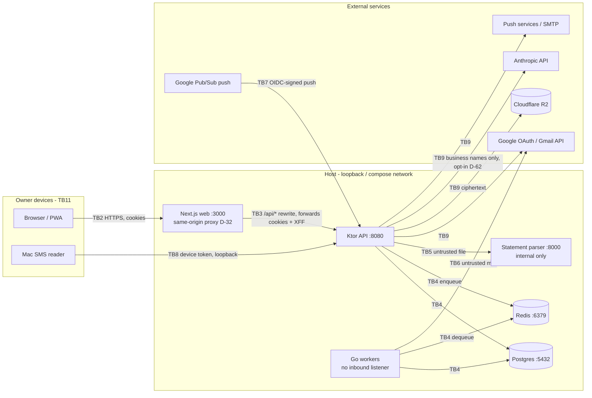

# AdminOS threat model

_AOS-615 · Proposed decision D-92 · Written 2026-10-17 · Review on every security-relevant change (D-91, D-100)._

AdminOS is one person's money console (D-78). It holds their bank transactions, Gmail access, documents and,
soon, investment holdings. There is exactly one legitimate user, the owner. **Every other actor is an attacker.**
This model lists what we protect, who attacks it, where trust changes hands, and which control answers each
threat. The findings of the first audit against it are in [AUDIT-2026-10.md](AUDIT-2026-10.md).

Honesty rule (D-91): nothing here claims the system is unhackable. The aim is no reachable attack surface from
the internet, and every layer tested as if the layer before it had failed.

---

## 1. Assets

| ID | Asset | Where it lives | Why it matters |
|---|---|---|---|
| A1 | Transactions, balances, bills, mandates, subscriptions, analytics | Postgres | The owner's financial life; confidentiality and **integrity** (a fake debit misleads decisions) |
| A2 | Gmail OAuth tokens (refresh + access) | Postgres, AES-256-GCM, row-bound AAD (AOS-608) | Read access to the owner's mailbox |
| A3 | Vault documents (IDs, policies, statements the owner keeps) | Cloudflare R2, envelope-encrypted in the app (D-60) | Identity theft material |
| A4 | Sessions: refresh tokens, access JWTs, device tokens | Hashes in Postgres; JWTs in HttpOnly cookies / the Mac reader's 0600 file | Whoever holds one *is* the owner to the API |
| A5 | Server secrets: `JWT_SECRET`, `TOKEN_ENCRYPTION_KEY`, `DB_PASSWORD`, Google client secret, VAPID private key, R2 keys, SMTP and Anthropic keys | `.env` on the host, process environment | One leaked secret defeats a whole layer (forged sessions, decrypted tokens/documents) |
| A6 | Holdings and net worth (Epic E8) | Postgres, encrypted at rest (D-78) | Same as A1, plus a target list for fraud |
| A7 | The owner's alert channels (Web Push, email) | Push subscriptions, SMTP | The owner's early warning; attacker text in them is a phishing vector |
| A8 | Availability | All services | A money console that is down can't warn about a fraudulent debit |

## 2. Attackers

| ID | Attacker | Capability | Goal |
|---|---|---|---|
| T1 | **Internet stranger** | Sends any HTTP request to anything reachable; has their own Google account; can read this public repo | Sign in, read data, or knock the service over |
| T2 | **Someone on the same Wi-Fi / LAN** | Sees and injects plain traffic on the local network; can reach LAN-bound ports | Steal a cookie or token in transit, reach an unauthenticated service |
| T3 | **Stolen laptop or phone** (locked or unlocked) | The owner's browser profile and cookies, the Mac reader's token file, a Google session | Use the sessions found there; keep access after the owner notices |
| T4 | **Malicious content**: an email, SMS, WhatsApp export, statement or document | Bytes the owner (or Gmail sync) feeds in; can choose sender names, subjects, merchant text | Inject fake transactions, exploit a parser, smuggle text into alerts, exhaust memory/CPU |
| T5 | **Compromised dependency or image** | Code that runs inside one of our processes or build steps | Exfiltrate secrets and data |
| T6 | **Another local user or process on the host** | Talks to loopback ports and the Docker network | Read the queue or database, forge jobs |

Out of scope (accepted): an attacker who controls the owner's Google account **and** an unlocked enrolled
passkey device; a compromised host OS or hypervisor; Google, Cloudflare or Apple acting maliciously.

## 3. Architecture and data flows

Main flows:
1. **Sign-in:** browser → Google consent → `/auth/callback` → `POST /api/v1/auth/google` (code) → API exchanges
   the code with Google, checks the verified email is `OWNER_EMAIL` and the Google ID is the pinned one (AOS-614),
   creates a session, sets HttpOnly cookies (`access_token` path `/`, `refresh_token` path `/api/v1/auth`).
2. **Every API call:** browser → web origin → Next rewrite → API; the API authenticates the cookie (or a bearer
   header) itself. The web route guard only redirects; it is not a security boundary (pages hold no data).
3. **Ingestion:** Gmail (worker, via Redis job) · SMS (Mac reader, device token) · uploads (statements → parser,
   WhatsApp zip/txt in the API, documents → R2) · manual cash. All become one `IngestEvent` (D-21).
4. **Alerts:** detectors → notification dispatcher → Web Push (allowlisted push hosts only) / email / in-app.

## 4. Trust boundaries and STRIDE

Each row: the threat, the control in place (✅), the gap and its ticket (⚠). Ticket rows for gaps are in the audit.

### TB1 — Network edge (anything that can reach the host)
| STRIDE | Threat | Controls / gaps |
|---|---|---|
| S | T1 reaches the login and tries to sign in | ✅ Owner-only Google sign-in, pinned Google ID, fail closed (AOS-614). ⚠ No second factor yet (AOS-617). ⚠ Not yet private-network-only (AOS-616). |
| T | T2 tampers with plain HTTP | ✅ All binds and published ports are `127.0.0.1` (checked: 5432, 6379, 8080, 3000; parser unpublished). ✅ `Secure` cookies off-loopback (AOS-610). ⚠ No HSTS (AOS-618). |
| D | T1 floods or sends huge bodies | ✅ Bodies capped before auth (AOS-615, AUD-01). ⚠ Per-IP limits are spoofable without an edge proxy (AUD-03 → AOS-618/616). |
| I | Error pages or headers leak internals | ✅ Generic 500s. ⚠ Some 400s echo parser text (AUD-15 → AOS-618). |

### TB2 — Browser ↔ web origin
| STRIDE | Threat | Controls / gaps |
|---|---|---|
| S | Session theft by script (XSS) | ✅ Tokens only in HttpOnly cookies, never in bodies or storage. ✅ React escaping; no `dangerouslySetInnerHTML`; service worker opens same-origin paths only. ⚠ No CSP as a second line (AUD-07 → AOS-618). |
| T | CSRF on cookie-authenticated mutations | ✅ `SameSite=Strict`. ⚠ No Origin / Fetch-Metadata check (AUD-08 → AOS-618). |
| T | Clickjacking | ⚠ No `frame-ancestors` (AUD-07 → AOS-618); partly mitigated because Strict cookies aren't sent to a cross-site frame. |
| I | Login CSRF / authorization-code injection | ⚠ The sign-in request has no `state` or PKCE (AUD-06 → AOS-618); impact limited to "the owner signs in as the owner". |
| R | The owner can't tell a stranger signed in | ⚠ No sign-in alerts or session list with revoke-all (AUD-10 → AOS-620). |

### TB3 — Web (Next) ↔ API
| STRIDE | Threat | Controls / gaps |
|---|---|---|
| S | Spoofed client IP via `X-Forwarded-For` | ⚠ Next forwards a client-sent XFF unchanged (verified 2026-10-17); the API trusts the last hop (AUD-03 → AOS-618 default-distrust; AOS-616 edge must append XFF). |
| E | Path tricks bypass the web guard | ✅ Not a boundary: the API authenticates every call. ⚠ Guard prefix-matches public paths (AUD-13 → AOS-619). |
| E | A new API route ships without auth | ⚠ No automated inventory yet (AOS-619 adds a CI test that fails on any unauthenticated route not on a reviewed allowlist). |

### TB4 — Services ↔ Postgres / Redis
| STRIDE | Threat | Controls / gaps |
|---|---|---|
| T/E | SQL injection | ✅ Exposed DSL everywhere; the one raw query binds every value. No LIKE patterns. |
| I | Cross-user reads (IDOR) | ✅ Every `{id}` route checks ownership and answers 404. ⚠ Not yet tested per resource (AOS-619). |
| T/E | T6 forges or reads queue jobs | ⚠ Redis has no AUTH and is published on host loopback (AUD-12 → AOS-616/622). |
| I | DB dump / backup leak | ✅ Gmail tokens and documents encrypted with keys outside the DB. ⚠ Encrypted backups (AOS-621). |

### TB5 — API ↔ statement parser (untrusted files)
| STRIDE | Threat | Controls / gaps |
|---|---|---|
| T/E | Parser exploit via a crafted PDF/XLS(X)/CSV | ✅ Separate non-root container, no published port, no secrets, files never written to disk; deps scanned clean (pip-audit 2026-10-17). |
| D | Decompression / page bombs | ✅ 20 MB cap both sides, 60 s API timeout. Each parse runs in a killed-on-timeout child process (30 s, 1 GiB address space, 2 at once); at most 300 pages, 50 sheets, 100 000 rows and 2 000 000 cells (AOS-626). |
| I | File or password in logs | ✅ Only error codes and counts are logged (D-37). |

### TB6 — Workers ↔ Gmail (untrusted mail)
| STRIDE | Threat | Controls / gaps |
|---|---|---|
| S/T | T4 sends a fake bank alert to inject transactions or alert text | ✅ Admitted by listed sender only, and only with Gmail's topmost `Authentication-Results` (`mx.google.com`) showing DMARC pass or an aligned DKIM pass; subjects never admit; every fetched message is re-qualified (AOS-624). |
| D | Huge or nested messages | ✅ Bodies cut at 64 KB; responses read through `LimitReader`; RE2 regexes (linear time). |
| I | Raw mail stored or logged | ✅ Never stored or logged (D-33). |

### TB7 — Google Pub/Sub → webhook
| STRIDE | Threat | Controls / gaps |
|---|---|---|
| S | Forged push | ✅ Google OIDC: RS256 via JWKS, our audience, Google issuer, our push service account, `email_verified`; fails closed (503) when unconfigured (AOS-609). |
| R/D | Replayed push token queues extra syncs | ✅ Syncs are idempotent; a push at or before the stored history ID is ignored, and while a sync is queued (not started) further pushes fold into it: at most one running and one waiting sync per connection (AOS-630). |

### TB8 — Mac SMS reader → API
| STRIDE | Threat | Controls / gaps |
|---|---|---|
| S | Device token used as a login, or a login as a device | ✅ `typ` and issuer checked both ways; device auth reads the header only, never cookies (D-36). |
| E | Stolen token file | ✅ File must be 0600; token is scoped to `ingest:sms`, revocable, checked against its row on every use; reader talks to loopback only. |

### TB9 — API → external services
| STRIDE | Threat | Controls / gaps |
|---|---|---|
| I | SSRF through push endpoints | ✅ https, port 443, no userinfo, known push hosts only, redirects off. |
| I | Data sent to the AI provider | ✅ Off by default; business names only (D-62, D-67). |
| T | OAuth form injection | ✅ Every field form-encoded (AOS-610). |

### TB10 — Supply chain
| STRIDE | Threat | Controls / gaps |
|---|---|---|
| E | A vulnerable or hijacked dependency | ✅ Exact pins and lockfiles; scans 2026-10-17: OSV (API, after the AUD-02 fix) 0, `npm audit --omit=dev` 0, govulncheck 0, pip-audit 0. ⚠ CI scanning, read-only containers (AOS-622). |

### TB11 — Owner devices
| STRIDE | Threat | Controls / gaps |
|---|---|---|
| S | T3 uses the cookies on a stolen laptop | ⚠ 30-day refresh without rotation (AUD-05 → AOS-620 does AOS-121), access tokens outlive revoke (AUD-04 → AOS-620), no second factor (AUD-09 → AOS-617). |
| R | The owner can't cut a lost device off | ⚠ Revoke-all and a sessions page (AOS-620); device tokens are already revocable. |

## 5. Security invariants (tested)

These must always hold; each has tests (unit, route and, where a screen is involved, Playwright `e2e/security.spec.ts`).
1. Only `OWNER_EMAIL`'s pinned Google account can create a session; anyone else gets `USER_003` with nothing created.
2. Every API route requires authentication unless it is on the reviewed allowlist (AOS-619 route inventory).
3. Every resource lookup is scoped to the signed-in user; another user's ID is indistinguishable from a missing one (404).
4. Tokens never reach JavaScript, response bodies (except a device token once, at creation), logs or URLs.
5. No body is buffered before its declared size is checked; no unbounded upload, zip entry or batch.
6. Secrets are never defaults, never in the repo, and with a database the API refuses to start without them.
7. Every listener is loopback or compose-network only; nothing widens a bind or publishes a port beyond `127.0.0.1`.
8. Untrusted text (email, SMS, merchant, file names) is rendered as text only: no HTML in the web, push or email.
9. Every failure fails closed: missing config refuses, unknown input is rejected, verification errors deny.

## 6. Method

- Checklists: **OWASP ASVS 5.0** (Level 2) chapters V1–V16 and the **OWASP WSTG** test cases cited per finding.
  References: <https://owasp.org/www-project-application-security-verification-standard/>,
  <https://owasp.org/www-project-web-security-testing-guide/>, RFC 9700 (OAuth 2.0 Security BCP), RFC 8725 (JWT BCP).
- Each finding gets a CVSS 3.1-style base score and an environmental note (how reachable it is *here*).
- Proof is a failing test where possible, otherwise a reproducible manual check recorded in the audit.
- Re-run: before go-live (AOS-623), and on every change that touches auth, sessions, uploads, parsers, proxies,
  ports, secrets or dependencies.
