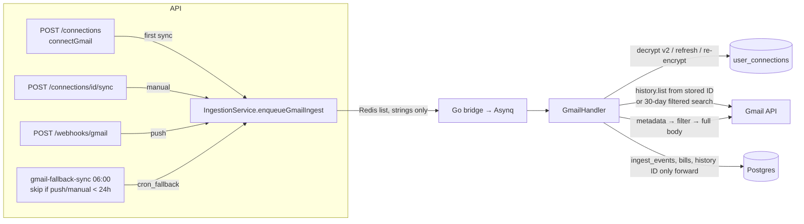

# AOS-401 — Gmail incremental sync, full body, sender filters, encrypted tokens, connect flow, fallback cron

| Field | Value |
|---|---|
| **Type** | Task |
| **Parent** | [AOS-S4.1](AOS-S4.1.md) (Epic [AOS-E4](AOS-E4.md)) |
| **Status** | 🟨 Done, unverified (needs a live Google account, AOS-111) |
| **Priority** | P1 |
| **Owner** | Claude |
| **ETA** | 5h |
| **Actual** | 4.5h |
| **Created / Updated / Done** | 2026-10-17 / 2026-10-17 / — |
| **Branch** | `aos-401-gmail-sync` |
| **Decisions** | D-33, D-43, D-50, D-59 (proposed below) |
| **Blocked by / Blocks** | AOS-205 ✅ (pipeline hand-off) · live check blocked by AOS-111 (Google OAuth client) / — |

## Description
Make Gmail import real and safe, everything that can be built and tested without a live Google account:
- **Incremental sync** from Gmail's real history ID (`users.history.list`), with a bounded full sync when there is none or it has expired.
- **Full message body** (text/plain, else stripped HTML), never only the snippet.
- **Sender filters**, so personal mail is never read.
- **Encrypted tokens at rest**, read and written by the Go worker in the API's `TokenEncryptor` v2 format.
- **Connect flow**: the consent URL, and a connect that checks what Google granted.
- **Daily fallback sync** as a scheduled job, with a skip rule.

## Why
- PROGRESS known issue 7: the worker stored a made-up `history_<unix time>`, so incremental sync couldn't work.
- PROGRESS known issue 6: the worker wrote refreshed Gmail tokens in plain text (`gmail_handler.go:185`), and read them as plain text.
- The worker read only the snippet and only the first page of a broad search (`category:updates OR category:promotions …`), so it could read personal mail and miss alerts.
- `GmailCronService.runDailyFallbackSync` was never called.

## Scope
- **In:** the Go Gmail client, sync and token handling; the API connect, manual sync and fallback job; a shared cross-language test vector; compose wiring.
- **Out (need a live Google account or their own ticket):**
  - `users.watch` registration and its 7-day renewal (push never fires without it, so for now the daily fallback is the sync);
  - the web "Connect Gmail" screen and the OAuth `state` (CSRF) check on its callback;
  - checking the sender list against a real inbox.

## Acceptance criteria
- [x] **Real history ID:** after a sync the connection stores Gmail's own history ID: from `history.list` on an incremental sync, from `users.getProfile` (read *before* listing) on a full sync. Never `history_<time>`.
  - Tests: `TestIncrementalSyncStartsAtTheStoredHistoryIDAndStoresGmailsNewOne`, `TestAnExpiredHistoryIDFallsBackToAFullSync`, `TestAFullSyncIsCappedAndReadsTheHistoryIDFirst`, `TestGmailSyncEndToEnd_Integration`.
- [x] **Incremental sync:** a sync starts from the history ID **stored on the connection**, follows every `history.list` page and de-duplicates message IDs.
  - Tests: `TestIncrementalSyncFollowsHistoryPagesAndDeduplicatesMessages`, `TestIncrementalSyncWithNothingNewKeepsTheHistoryIDGmailReturns`.
- [x] **Fallback:** a missing or non-Gmail history ID (incl. the old fake ones), or a 404 from `history.list`, runs a full sync over the last 30 days with the sender-filtered query, at most 500 messages.
  - Tests: `TestAMissingOrMadeUpHistoryIDRunsAFullSync`, `TestAnExpiredHistoryIDFallsBackToAFullSync`, `TestFullSyncSearchesOnlyFinancialSendersInTheLast30Days`, `TestAFullSyncIsCappedAndReadsTheHistoryIDFirst`.
- [x] **History only moves forward:** a late, older sync never rewinds it; "" keeps it; a fake one is replaced; comparison is numeric.
  - Test: `TestGmailPersistHistoryIDOnlyMovesForward_Integration`.
- [x] **Full body:** text/plain is preferred, else text/html with scripts, styles, comments and tags removed and entities decoded; nested MIME parts are walked; attachments ignored; URL-safe base64 with or without padding; bounded to 64 KB; the snippet only when there's no readable text.
  - Tests: `body_test.go` (6), `TestTheFullBodyIsParsedNotTheSnippet`, `TestAMessageWithoutReadableTextFallsBackToItsSnippet`.
- [x] **Email content never leaves the parser (D-33):** `GmailEmail` can't be serialised; errors carry the HTTP status only, never Google's response body; logs carry IDs and counts only.
  - Tests: `TestEmailContentIsNeverSerialised`, `TestErrorsNeverQuoteTheResponseBody`.
- [x] **Sender filters:** a data list of bank, card, UPI and biller domains (incl. RBI's `bank.in`), exact addresses and subject phrases.
  - The full sync searches `newer_than:30d (from:(…) OR subject:(…))`.
  - The incremental sync reads only From/Subject (`format=metadata`) of each new message, and fetches in full only those that match. Spam, trash, drafts and chats are never read.
  - Look-alike domains don't match.
  - Tests: `filters_test.go` (3), `TestPersonalMailIsNeverFetchedInFull`, `TestMetadataRequestsOnlyFromAndSubject`.
- [x] **Encrypted tokens, same format as the API:**
  - Go `tokencrypt` reads and writes `v2:` AES-256-GCM with the `user_connections:<id>:<field>` context as AAD, using `TOKEN_ENCRYPTION_KEY`.
  - Refreshed access tokens are stored encrypted.
  - A value sealed with another key, or copied from another row or field, is refused (nothing is sent to Google).
  - Tests: `tokencrypt_test.go` (10), `TestAnExpiringTokenIsRefreshedAndStoredEncrypted`, `TestATokenSealedWithAnotherKeyFailsClearly`, `TestATokenCopiedFromAnotherConnectionIsRejected`.
- [x] **Cross-language vector:** `services/workers/internal/tokencrypt/testdata/token_v2_vectors.json` holds one value sealed by Kotlin and one by Go. Both test suites decrypt both. The key is SHA-256 of a public seed, computed at test time, so no key is stored.
  - Tests: `TestGoDecryptsWhatTheAPIsTokenEncryptorWrote`, `TestTheGoVectorForTheAPIIsValid`, `TokenEncryptorCrossLanguageTest` (4).
- [x] **Legacy plain-text tokens** are read once and stored encrypted, whether or not a refresh happens. Pre-AOS-608 API ciphertext (base64, no prefix) is detected and refused, never mistaken for a token.
  - Tests: `TestLegacyPlainTextTokensAreReadOnceAndReEncrypted`, `TestALegacyRefreshTokenIsReEncryptedWhenRefreshing`, `TestThePreAOS608CiphertextIsNotMistakenForAPlainToken`, `TestGmailSyncEndToEnd_Integration`.
- [x] **Retries with backoff for Gmail and the token endpoint:**
  - 429, 5xx and network errors are retried: 4 tries, 500 ms doubling, capped at 8 s, cancellable;
  - 401, 403 and 404 are not retried.
  - Tests: `TestTemporaryGmailErrorsAreRetriedWithBackoff`, `TestRetriesStopAfterTheLastAttempt`, `TestAuthErrorsAreNotRetried`, `TestACancelledContextStopsRetrying`, `TestATemporaryTokenEndpointErrorIsRetried`.
- [x] **Failures are visible (D-43):**
  - unreachable Gmail fails the job (it is retried) and is recorded on the sync session (`failed`, `error_details.reason`) and the connection (`last_sync_status`, `last_error`), with a short, content-free reason;
  - a revoked refresh token puts the connection in `error`;
  - a deleted message is skipped and counted.
  - Tests: `TestUnreachableGmailFailsTheJobAndRecordsWhy`, `TestARevokedRefreshTokenPutsTheConnectionInError`, `TestAMessageDeletedBeforeItIsFetchedIsSkipped`, `TestAFailedMessageFetchFailsTheJob`, `TestACancelledSyncIsRecordedAsInterrupted`, `TestGmailStoreRecordsFailuresAndRevocation_Integration`.
- [x] **The worker refuses to start without the key:**
  - the Gmail worker exits without `TOKEN_ENCRYPTION_KEY`, and any worker exits with a malformed one;
  - with type `all` and no key, Gmail ingestion is logged as OFF;
  - compose passes the key to `gmail-worker`.
  - Manual check: `cmd/worker/main.go` `gmailConfig`.
- [x] **Connect flow:**
  - `GET /api/v1/connections/gmail/authorize-url?redirectUri=` returns Google's consent URL: `openid email gmail.readonly`, `access_type=offline`, `prompt=consent`. It answers 400 without a redirect and 503 when Google isn't configured.
  - Connecting Gmail needs `gmail.readonly` in the granted scopes (else 400 `CONN_007`) and a refresh token (else 400 `CONN_008`).
  - The token expiry and scopes are stored, and the first full sync is queued (once; again after a reconnect).
  - Tests: `ConnectionRoutesCoverageTest` (+6), `ConnectionServiceCoverageTest` (+8).
- [x] **Manual sync really syncs:** for Gmail, `POST /connections/{id}/sync` now queues a `manual` job for the worker.
  - Test: `a manual gmail sync is queued for the worker as manual`.
- [x] **Daily fallback job `gmail-fallback-sync`** (06:00 in the scheduler zone, D-50):
  - queues a `cron_fallback` sync for every connected Gmail connection, **unless** a push (`incremental`/`historical`) or `manual` sync of it completed in the last 24 h;
  - its own syncs don't count, so a connection without push still syncs daily;
  - an expired access token is no longer a reason to disconnect;
  - one failure doesn't stop the rest.
  - Tests: `WebhookGmailCronCoverageTest` (13), `last completed time counts only completed sessions…` (Postgres), the DI job count.
- [x] **Queue payloads are strings only,** with no `history_id` key when there is none. `AsynqPublisher.kt` is untouched.
  - Test: `a fallback Gmail sync carries only string values and no history id key (AOS-401)`.

## Design
- **Context:**
  - The worker is the only Gmail reader. It writes `ingest_events` (D-43), and the API pipeline does the rest.
  - The API already encrypts tokens (`TokenEncryptor` v2, AOS-608), but the worker read and wrote plain text, so the two disagreed.
  - Push (`/webhooks/gmail`) exists, but nothing registers `users.watch`.
- **Options: the start point of an incremental sync**
  1. **The history ID stored on the connection (chosen).** The worker owns it, and only a successful sync moves it forward.
  2. The push notification's `historyId`. It is the mailbox's *new* position, so starting there skips the very message it announces. It is still passed along, for information only.
- **Options: incremental filtering**
  1. **history.list, then metadata (From/Subject) for each new message, then full only for matches (chosen).** Exact and private: personal bodies are never fetched.
  2. A `messages.list` search with `after:<last sync>` instead of history. Simpler, but second-granularity windows miss or duplicate mail and ignore Gmail's change log.
  3. history.list with `labelId`. Banks don't share a label, so it can't filter by sender.
- **Options: tokens in Go**
  1. **Implement the v2 format in Go with stdlib AES-GCM, and pin it with a shared vector (chosen).** No new dependency; one format for both services.
  2. Have the API refresh tokens and hand the worker short-lived ones. That needs a new internal endpoint, its auth and a live API for every sync.
  3. A different Go-side format. Two formats would mean the API couldn't read what the worker wrote.
- **Options: the fallback schedule**
  1. **A `ScheduledJob` in the API, claimed per slot (chosen, D-50).** Runs once across instances; reuses the enqueue path.
  2. An Asynq periodic task in Go. That duplicates the scheduler, and the skip rule needs the API's sessions.
- **Patterns:**
  - Template Method (Parse → Execute → Persist);
  - Strategy-free data filters (sender/subject lists are data);
  - Repository (`gmailConnectionStore`: pgx + in-memory fake, same behaviour);
  - Retry with exponential backoff;
  - Null-object-free fail-fast (no key = no Gmail handler; the Gmail worker exits).
- **Extensibility:** a new bank or biller is one line in `gmail/filters.go`. Another OAuth source can reuse `tokencrypt`, `OAuthGrant` and the store.
- **Impact:**
  - **Worker:** `internal/gmail` (client, body, filters), `internal/tokencrypt` (new), `handlers/gmail_*`, `config` (`TOKEN_ENCRYPTION_KEY`), `main.go`.
  - **API:** `ConnectionService` (`connectGmail`, `OAuthGrant`, manual Gmail sync), `ConnectionRoutes` (authorize URL, CONN_007/008/009), `GoogleOAuthClient.gmailConsentUrl`, `IngestionService.enqueueGmailIngest` (`syncType`, string payload), `SyncSessionRepository.lastCompletedAt`, `GmailCronService` + `GmailFallbackSyncJob`.
  - **Compose:** `TOKEN_ENCRYPTION_KEY` for `gmail-worker`.
  - **Schema:** none (no V25 needed).
- **Diagram:**

## Implementation plan
1. Go `tokencrypt` (v2 + AAD) and the shared vector, with a Kotlin test for the same fixture.
2. Gmail client: retries, profile, history, metadata, no bodies in errors; MIME body extraction; filters.
3. Handler: connection store (pgx + fake), tokens (decrypt, refresh, re-encrypt legacy), sync (incremental/full), monotonic history, failure recording; `main.go` key handling.
4. API: string payloads + `syncType`; `lastCompletedAt`; fallback job with skip rule; `connectGmail` and authorize URL; manual Gmail sync.
5. Tests at every layer; compose.

## Verification
- **API:** `./gradlew test integrationTest koverVerify` passes.
  - 1,245 unit and 108 integration tests, 0 failures, 0 disabled.
  - Coverage over the whole API: 99.3% lines (7,756/7,809) and 92.3% branches (4,209/4,562); the gate is 90/85.
- **Worker, unit:** in Docker (`golang:1.27`), `go build ./...`, `go vet ./...` and `go vet -tags integration ./...` are clean, and `go test ./...` passes: 110 tests.
  - Coverage: `gmail` 92.7%, `tokencrypt` 89.7%.
- **Worker, integration:** `go test -tags integration ./...` passes on a throwaway `postgres:18.6-alpine`, on a private network (`aos-401-it`, no published ports, random password), with every `V*.sql` applied.
  - 117 tests, including 7 integration tests (4 new): end-to-end sync, history only forward, failures/revocation, token store.
  - The container and network were removed afterwards.
- **Cross-language:** the same fixture passes in Kotlin (4 tests) and Go (2 tests).
- **Not run:** Playwright (no web changes).

## Risks / notes
- **Needs a live Google account (AOS-111) before ✅:**
  - a real consent with `gmail.readonly`;
  - a real `history.list` run and its 404 after expiry;
  - real bank HTML bodies through the parser;
  - tuning the sender list against Pragun's inbox.
- **Google app status:** `gmail.readonly` is a *restricted* scope. While the OAuth app is in "Testing", Google expires refresh tokens after 7 days. The worker then marks the connection `error` ("reconnect Gmail"), which is correct but will happen weekly until the app is published or verified.
- **Push isn't registered:** nothing calls `users.watch` (and it must be renewed every 7 days), so push never fires. Until then the daily fallback is the only automatic sync, and the skip rule simply never skips. Needs its own ticket.
- **OAuth `state`:** the consent URL has no `state` yet. The code is redeemed by an authenticated POST, but a CSRF check belongs with the web callback screen (follow-up).
- **Sender list:** it is a best guess (domains, not every sub-address). A missed sender only means a missed email, never a personal email read.
- **Legacy ciphertext:** values the API wrote before AOS-608 can only be read by the API. The worker refuses them clearly instead of guessing. None should exist: Gmail was never connected for real.
- **Bugs found in existing code** (all fixed here; see Resolution):
  1. the old fallback cron would have **disconnected every Gmail connection** whose 1-hour access token had expired (i.e. all of them), and was never scheduled;
  2. a manual Gmail sync only stored a `queued` session that nothing ever ran;
  3. the push `historyId` was the intended start point, which would skip the announced mail;
  4. failed syncs left sessions `queued` forever;
  5. Gmail client errors quoted Google's response bodies;
  6. the token expiry was never stored at connect;
  7. only the first page of a broad search was read.

## Proposed decision D-59
### D-59 — Gmail sync: start point, filters, shared token encryption, daily fallback
2026-10-17 · Proposed · Type: Architecture · Tasks: AOS-401
- **Start point:** a sync always starts from the history ID **stored on the connection** (`users.history.list`, messages added). The push notification's history ID is informational, because it is the mailbox's new position.
  - After a sync the connection stores Gmail's real history ID: from `history.list`, or from `users.getProfile` read before a full sync starts.
  - It only moves forward (numeric compare), and only on a successful sync.
- **Fallback:** with no usable history ID (none, or not a Gmail number), or when Gmail answers 404 (expired), a full sync runs over the last 30 days, at most 500 messages, with the filtered search.
- **Only financial mail is read:** a data list of sender domains (incl. `bank.in`), addresses and subject phrases.
  - A full sync searches `newer_than:30d (from:(…) OR subject:(…))`.
  - An incremental sync reads only From/Subject of each new message, and fetches the full body only when they match. Spam, trash, drafts and chats are never read.
- **Body:** text/plain, else HTML stripped to text, max 64 KB. It is used in memory for extraction only; it is never stored, serialised or logged, and Gmail errors carry statuses, not bodies (D-33).
- **Tokens:** the worker reads and writes the API's `TokenEncryptor` v2 format: `v2:` + base64(iv‖ct‖tag), AES-256-GCM, AAD `user_connections:<id>:<field>`, key `TOKEN_ENCRYPTION_KEY`.
  - Plain-text legacy tokens are read once and re-encrypted; pre-AOS-608 ciphertext is refused.
  - A shared vector (key = SHA-256 of a public seed, computed at test time) is tested by both services.
  - The Gmail worker refuses to start without the key.
- **Connect:** Gmail is connected only with `gmail.readonly` granted and a refresh token. The expiry and scopes are stored, and the first full sync is queued.
- **Retries:** 429, 5xx and network errors are retried with exponential backoff (4 tries); 401/403/404 are not. A failed sync is recorded on the session and the connection with a short reason; a revoked grant puts the connection in `error`.
- **Daily fallback:** the `gmail-fallback-sync` scheduled job (06:00, D-50) queues a sync for every connected Gmail connection, unless a push or manual sync of it completed in the last 24 h.
  - The fallback's own syncs don't count, so a connection without push syncs daily.
  - An expired access token is never a reason to disconnect.
- **Rejected:**
  - starting from the notification's history ID;
  - date-window searches instead of history;
  - the API refreshing tokens for the worker (a new internal endpoint);
  - an Asynq periodic task for the fallback.

## Activity log
- 2026-10-17 — Claude: ticket created and started (🟦). The design was chosen under the coordinator's brief: no schema change, AsynqPublisher untouched.
- 2026-10-17 — Claude: Go tokencrypt + shared vector; Gmail client (retries, history, profile, metadata), body extraction, sender filters; handler store/tokens/sync; API connect flow, manual Gmail sync, fallback job with skip rule.
- 2026-10-17 — Claude: API gate green (1,245 unit + 108 integration, 99.3% lines / 92.3% branches); worker unit (110) and integration (7) green on a throwaway Postgres. Status 🟨 until a live Google check (AOS-111).

## Activity log (coordinator)
- 2026-10-17 — Claude: rebased on main (AOS-506/509/507), resolved the AppModule/DI job conflicts (8 jobs), re-ran the API gate (unit 1,306 / integration 116) and Go build/vet/test; D-59 recorded; merged. Stays 🟨 until a live Google check (AOS-111).

## Definition of Done (docs/ENGINEERING.md §4)
- [x] Each acceptance criterion covered by a test or a documented manual check
- [x] Tests/build green (integration tests if the DB is touched)
- [x] Layer rules respected; no silent fallbacks; no secrets/PII in logs
- [x] Decisions recorded · ticket, story, epic and board updated · PROGRESS.md updated
- [x] Commit message starts with `AOS-401:`

## Resolution
- **Worker:**
  - new `internal/tokencrypt` (v2 AES-GCM with AAD, legacy handling, shared vector);
  - `internal/gmail`: the client (backoff retries; profile, history, metadata calls; typed `ErrNotFound`/`ErrHistoryExpired`; no bodies in errors), `body.go` (MIME text, HTML stripping) and `filters.go` (financial senders and subjects, the search query, the local matcher);
  - `handlers`: `gmail_store.go` (the connection store), `gmail_tokens.go` (decrypt/refresh/re-encrypt), `gmail_sync.go` (incremental/full sync); `gmail_handler.go` (config, UUID payload checks, failure recording, monotonic history in Persist);
  - `config.go` and `main.go`: `TOKEN_ENCRYPTION_KEY`.
- **API:**
  - `ConnectionService` (`connectGmail`, `OAuthGrant`, `GmailGrantException`, manual Gmail sync through `IngestionService`);
  - `ConnectionRoutes` (`GET /connections/gmail/authorize-url`; CONN_007/008/009) and `GoogleOAuthClient.gmailConsentUrl`;
  - `IngestionService.enqueueGmailIngest(syncType)`, with string-only payloads;
  - `SyncSessionRepository.lastCompletedAt` (in-memory + Exposed);
  - `GmailCronService` (skip rule, no disconnects) and `GmailFallbackSyncJob`, registered in `AppModule`.
- **Compose:** `TOKEN_ENCRYPTION_KEY` for `gmail-worker`.
- **Tests:**
  - Go: 7 new test files, 2 updated;
  - Kotlin: `TokenEncryptorCrossLanguageTest` (new); the cron, connection service and route tests, the DI tests and the repository integration test (updated).
- **Verified:** as in Verification.
- **Actual vs ETA:** 4.5h vs 5h. ✅ waits for a live Google check (AOS-111).
