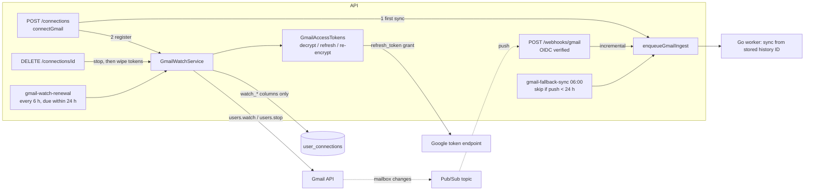

# AOS-405 — Gmail push: users.watch registration and renewal

| Field | Value |
|---|---|
| **Type** | Task |
| **Parent** | [AOS-S4.1](AOS-S4.1.md) (Epic [AOS-E4](AOS-E4.md)) |
| **Status** | 🟨 Done, unverified (needs a live Google account and Pub/Sub topic, AOS-111) |
| **Priority** | P1 |
| **Owner** | Claude |
| **ETA** | 4h |
| **Actual** | 3h |
| **Created / Updated / Done** | 2026-10-17 / 2026-10-17 / — |
| **Branch** | `aos-405-gmail-watch` |
| **Decisions** | D-50, D-59, D-63 (proposed below) |
| **Blocked by / Blocks** | AOS-401 ✅ (merged) · live check blocked by AOS-111 (Google OAuth client, Pub/Sub topic) / AOS-406 (Connect Gmail screen) |

## Description
Gmail push never fired: nothing called `users.watch`, so Gmail never published mailbox changes to our Pub/Sub topic and the daily fallback was the only sync. This task:
- registers the watch right after Gmail is connected (after the first sync is queued);
- renews it before it lapses (Gmail watches last at most 7 days) with a scheduled job;
- stops it on disconnect (best effort);
- makes every push an incremental sync, so the 24 h skip rule of the daily fallback applies once pushes arrive.

## Why
- AOS-401 Risks: "Push isn't registered … push never fires. Until then the daily fallback is the only automatic sync, and the skip rule simply never skips."
- Push turns "within a day" into "within a minute" for bank alerts by email.

## Scope
- **In:** the API's `users.watch` / `users.stop` client, token refresh for the API's own Gmail calls, the watch state on the connection (V26), registration on connect, the `gmail-watch-renewal` job, stop on disconnect, push → incremental sync, `.env.example`.
- **Out:**
  - creating the Pub/Sub topic and push subscription and granting Gmail publish rights (manual setup with AOS-111);
  - the Connect Gmail screen (AOS-406);
  - coalescing bursts of pushes (needs the worker to mark sessions `in_progress`; see Risks).

## Acceptance criteria
- [x] **Register on connect:** connecting Gmail queues the first full sync, then calls `users.watch` on `GOOGLE_GMAIL_PUBSUB_TOPIC` with the decrypted access token; the expiry and Gmail's history ID are stored on the connection and returned as `watchExpiresAt`.
  - Tests: `connecting gmail queues the first sync and then registers push`, `the watch is set on the configured topic with the decrypted access token`, `registering a watch stores gmail's expiry and history id and clears an old error`.
- [x] **A failed registration never fails the connect** and is recorded (`watch_error`, `watch_checked_at`); the connection stays connected.
  - Tests: `a failed push registration never fails the connect`, `a failed watch is recorded and the connection stays connected`, `a failed renewal keeps the watch gmail is still honouring`.
- [x] **Renewal job** `gmail-watch-renewal` every 6 h (D-50) renews every connected Gmail watch that is missing, expired or ends within 24 h; the others are left; failures are counted and retried by the next run; one bad connection never stops the rest.
  - Tests: `renewal renews missing, expired and soon-ending watches and leaves the rest`, `a failed renewal is counted and retried by the next run`, `an unexpected error on one connection does not stop the others`, `the renewal job runs every 6 hours and reports counts`, DI job count (9).
- [x] **Stops for disconnected and revoked connections:** only `connected` Gmail connections are registered or renewed.
  - Tests: `renewal stops for disconnected and revoked connections`, `a disconnected or non-gmail connection is never registered`.
- [x] **Disconnect calls `users.stop`** with the stored token *before* the tokens are wiped, best effort (a failure never blocks the disconnect), and forgets the watch; a reconnect starts a fresh watch.
  - Tests: `disconnecting stops push with the stored token before wiping it, and forgets the watch`, `a failed stop never blocks the disconnect`, `reconnecting starts a fresh watch`, `stopping ignores gmail and token failures`, `there is nothing to stop without an active watch, a topic, or for other sources`.
- [x] **Topic not configured:** nothing is called; logged once at start-up; the job reports `disabled=1`. A malformed topic stops start-up.
  - Tests: `without a topic nothing is registered`, `renewal without a topic reports push as off and calls nothing`, `the renewal job says when push is off`, `a malformed topic or renewal window is refused at start-up`.
- [x] **Tokens stay encrypted at rest:** an access token expiring within 2 minutes (or of unknown expiry) is refreshed first and stored encrypted (TokenEncryptor v2, same context as the worker); a token sealed with another key, for another row, or legacy plain text is refused, never sent to Google; a 401 from Gmail is retried once with a refreshed token.
  - Tests: `GmailAccessTokensTest` (9), `a watch refused with 401 is retried once with a refreshed token`, `a second 401 after refreshing is recorded as a failure`, `an expiring access token is refreshed before the watch call`.
- [x] **Revoked grant:** Google's `invalid_grant` puts the connection in `error` with the worker's reason (`gmail access revoked: reconnect Gmail`), so renewals stop and the console asks to reconnect. Other token errors change nothing.
  - Tests: `a revoked grant puts the connection in error and is recorded on the watch`, `a refused refresh token marks the connection error with the worker's reason`, `GoogleTokenRefreshTest` (8).
- [x] **No clobbering the worker:** watch, refreshed-token and error writes touch only their own columns, so they never rewind the history ID the worker moved meanwhile (D-59).
  - Tests: `storing a watch never rewinds the history id the worker moved meanwhile`, `storing a refreshed access token changes only the token and its expiry`, `marking a connection in error keeps everything else`, `the watch round-trips through save, update and read` (Postgres).
- [x] **Push → incremental sync from the stored history ID:** every verified push queues an `incremental` sync (also without a history ID in the notification; the notification's ID stays informational), and a completed push sync makes the daily fallback skip the connection for 24 h.
  - Tests: `a notification with a history id queues an incremental sync for that connection`, `a notification without a history id still queues an incremental sync (AOS-405)`, `a completed push sync makes the daily fallback skip the connection (AOS-405)`.
- [x] **Gmail's wire format:** `POST /gmail/v1/users/me/watch` with `topicName`, `labelIds:["INBOX"]`, `labelFilterBehavior:"include"`; the response's string `historyId` and epoch-ms `expiration` are parsed; 401 / other statuses / unreadable / unreachable are distinct errors that carry the status only, never Google's body. `users.stop` accepts 204.
  - Tests: `HttpGmailPushApiTest` (7).
- [ ] 🟨 **Live check (AOS-111):** a real `users.watch` on a real topic, a real push arriving at `/webhooks/gmail` and syncing, a renewal before day 7, and `users.stop` on disconnect.

## Design
- **Context:**
  - The API has `GoogleOAuthClient` (code exchange only) and `TokenEncryptor`; it connects Gmail and owns the scheduler (D-50).
  - The Go worker owns Gmail *reading*: it refreshes tokens, syncs from the stored history ID, and writes `history_id`, sync status and tokens with narrow `UPDATE`s (D-59).
  - The Pub/Sub webhook exists and is verified (AOS-609). `user_connections.pubsub_expiry` existed but was never written.
- **Options: who calls `users.watch` / `users.stop`**
  1. **The API, from the scheduler and the connect/disconnect flow (chosen).**
     - `users.stop` must run *before* disconnect wipes the tokens; in the API that is one call in the same request.
     - The renewal is a `ScheduledJob` claimed per slot (D-50), so it runs once across instances and its counts are recorded with the run.
     - Cost: a second token refresh (Kotlin, ~30 lines) next to the worker's. Both read and write the same v2 format and context, pinned by the shared vector (D-59), so it is one format in two languages, not two formats.
  2. The Go worker, through new `gmail_watch` / `gmail_stop` queue jobs.
     - Reuses the worker's refresh and retry code.
     - But stop-on-disconnect needs tokens that disconnect has already wiped: either the tokens outlive the disconnect until the worker runs (worse privacy; never wiped if the worker is down) or a token travels through Redis (rejected outright).
     - Two new cross-service job contracts, and the scheduler only sees "queued", not whether renewal worked.
  3. An Asynq periodic task in Go for renewal. Rejected for the same reasons as in D-59: it duplicates the scheduler.
- **Options: where the watch state lives**
  1. **Columns on `user_connections` (chosen):** `watch_expires_at` (the renamed, never-written `pubsub_expiry`), `watch_history_id`, `watch_error`, `watch_checked_at`. One row per mailbox, read with the connection.
  2. A separate `gmail_watches` table. Cleaner for several watches per connection, which Gmail doesn't allow (one watch per user and topic).
- **Options: avoiding lost updates with the worker**
  1. **Narrow repository writes (chosen):** `updateWatch`, `updateAccessToken`, `markError` touch only their columns. The general `update` writes the whole row, so a renewal that read the row before a sync finished would rewind the history ID.
  2. Optimistic locking with a version column. Needs the worker to bump it on every write; larger change for the same effect.
- **Options: which changes Gmail publishes**
  1. **INBOX only (chosen):** far fewer pushes (none for reading, archiving, sending). Each sync still reads every message *added* since the stored history ID, whatever its labels, so mail a filter moves out of the Inbox is picked up by the next sync of any kind (push, manual or fallback).
  2. All changes: a push for every read/label change, i.e. many more syncs for no new mail.
- **Choice:** option 1 in each.
- **Patterns:**
  - Ports owned by the domain (`GmailPushApi`, `GmailTokenRefresher`), implemented by infrastructure (`HttpGmailPushApi`, `GoogleOAuthClient`) — dependency inversion; fakes in tests.
  - Single responsibility: `GmailAccessTokens` (a usable token), `GmailWatchService` (registration rules), `GmailWatchRenewalJob` (schedule).
  - Sealed errors and outcomes (`GmailPushException`, `GmailAccessException`, `WatchOutcome`).
  - Batch isolation (`forEachIsolated`) for the renewal run.
- **Extensibility:** another OAuth source that needs its own push (e.g. Outlook) reuses `GmailAccessTokens`' approach and plugs a new port + job. The renewal window and the schedule are parameters.
- **Impact:**
  - **API:** `domain/ingestion/connection` (new `GmailWatch`, `GmailPorts`, `GmailAccessTokens`, `GmailWatchService` + job; `ConnectionService` connect/disconnect; repository narrow writes), `infrastructure/google/HttpGmailPushApi` (new), `GoogleOAuthClient.refresh`, `WebhookRoutes` (push = incremental), `AppModule` (9 jobs), `ConnectionResponse.watchExpiresAt`.
  - **Schema:** `V26__gmail_watch.sql` (rename + 3 columns). No Go change: the worker never referenced `pubsub_expiry`.
  - **Contracts:** none changed; the queue payload is the same.
  - **Config:** `GOOGLE_GMAIL_PUBSUB_TOPIC` (already in compose) now matters; `.env.example` leaves it empty (= off).
- **Diagram:**

## Implementation plan
1. V26 migration; `GmailWatch` on `UserConnection`; narrow repository writes (in-memory + Exposed).
2. Ports and errors; `HttpGmailPushApi`; `GoogleOAuthClient.refresh`.
3. `GmailAccessTokens`, `GmailWatchService`, `GmailWatchRenewalJob`; wiring in `ConnectionService` and `AppModule`.
4. Webhook: push = incremental.
5. Tests at every layer; `.env.example`.

## Verification
- **API:** `./gradlew test integrationTest koverVerify` passes.
  - 1,362 unit and 120 integration tests, 0 failures, 0 disabled (+55 unit and +4 integration tests for this task).
  - Coverage over the whole API: 99.29% lines (8,659/8,721) and 91.08% branches (4,728/5,191); the gate is 90/85.
- **Worker:** not changed. The migration only renames a column the worker never used and adds new ones.
- **Not run:** Playwright (no web change).
- **Pending AOS-111 (🟨):** the live check in the acceptance criteria.

## Risks / notes
- **Setup (with AOS-111):** create the topic and a push subscription to `/api/v1/webhooks/gmail` with OIDC (AOS-609), and grant `gmail-api-push@system.gserviceaccount.com` the Pub/Sub Publisher role on the topic, or `users.watch` answers 403 (recorded as `watch_error`).
- **Push bursts:** each verified push queues a sync. Coalescing them (skip when a push sync is already queued) is unsafe today: the worker never marks a session `in_progress`, so "queued" can mean "running, already past the new mail", and dropping that push would delay the mail until the next trigger (up to a day with the skip rule). Follow-up: the worker sets `in_progress`; then coalesce queued-only. Duplicate reads are de-duplicated by the pipeline meanwhile.
- **Testing-mode refresh tokens** expire after 7 days (AOS-401 risk). The renewal then fails with `invalid_grant`, which marks the connection `error`, as the worker does.
- **Two refreshers:** the API and the worker may both refresh the same connection's access token at about the same time. Both are valid; whichever is stored last is used. Google refresh tokens don't rotate on refresh, so nothing is lost.
- **Bugs found in existing code:**
  1. A push without a `historyId` was queued as `historical`, a type the D-59 skip rule counts but the console reads as "first full sync". Now every push is `incremental` (fixed here, test updated).
  2. `ConnectionRepository.update` writes every column, so any API write racing a worker sync can rewind `history_id`. The new writes avoid it; existing callers (connect/disconnect) still use the full update. Reported, not changed (outside this step).

## Proposed decision D-63
### D-63 — Gmail push: the API registers and renews the watch
2026-10-17 · Proposed · Type: Architecture · Tasks: AOS-405 · Extends D-59
- **Who calls Gmail:** the API calls `users.watch` and `users.stop` itself, with its own token refresh. The Go worker stays the only Gmail *reader*.
  - Why: `users.stop` must run before disconnect wipes the tokens, and renewal is a scheduled job (D-50) whose outcome the scheduler records.
  - Tokens stay encrypted at rest: a refreshed access token is stored in the TokenEncryptor v2 format with the worker's context (D-59).
- **When:**
  - right after Gmail is connected, once the first sync is queued;
  - by `gmail-watch-renewal` every 6 h, for every connected Gmail connection whose watch is missing, expired or ends within 24 h;
  - `users.stop` on disconnect, best effort.
- **What Gmail publishes:** INBOX changes only (`labelIds:["INBOX"]`, include). Every sync still reads all messages added since the stored history ID.
- **Stored on the connection:** `watch_expires_at`, `watch_history_id` (informational), `watch_error`, `watch_checked_at`. Only these columns are written by watch updates, so they never clobber the worker's history ID.
- **Failures:**
  - a failed watch is recorded and retried by the next run; it never disconnects or fails the connect;
  - Google's `invalid_grant` puts the connection in `error` (as the worker does), which stops renewals;
  - a 401 from Gmail is retried once with a refreshed token.
- **Off switch:** without `GOOGLE_GMAIL_PUBSUB_TOPIC` nothing is called (logged once); a malformed topic stops start-up.
- **Push:** every verified push queues an `incremental` sync from the stored history ID; its completion is what lets the daily fallback skip (D-59).
- **Rejected:**
  - the worker calling `users.watch`/`stop` via new queue jobs (the tokens are gone by the time it would stop);
  - an Asynq periodic task for renewal;
  - a separate watches table;
  - watching all mailbox changes.

## Activity log
- 2026-10-17 — Claude: ticket created and started (🟦) under the coordinator's brief (V26, D-63). Design chosen: the API calls Gmail.
- 2026-10-17 — Claude: V26, narrow writes, ports, HTTP client, token refresh, watch service and job, connect/disconnect wiring, push = incremental; tests at every layer.
- 2026-10-17 — Claude: API gate green (1,362 unit + 120 integration; 99.29% lines / 91.08% branches). Status 🟨 until a live Google check (AOS-111). PR opened, not merged.

## Definition of Done (docs/ENGINEERING.md §4)
- [x] Each acceptance criterion covered by a test or a documented manual check (the live check is pending AOS-111)
- [x] Tests/build green (integration tests if the DB is touched)
- [x] Layer rules respected; no silent fallbacks; no secrets/PII in logs
- [ ] Decisions recorded · ticket, story, epic and board updated · PROGRESS.md updated (coordinator: D-63, story/epic/board rows, PROGRESS)
- [x] Commit message starts with `AOS-405:`

## Resolution
- **Schema:** `V26__gmail_watch.sql`.
- **API:**
  - new `GmailWatch`, `GmailPorts` (`GmailPushApi`, `GmailTokenRefresher`, errors), `GmailAccessTokens`, `GmailWatchService` + `GmailWatchRenewalJob`, `infrastructure/google/HttpGmailPushApi`;
  - `ConnectionRepository` (+ in-memory, Exposed): `updateWatch`, `updateAccessToken`, `markError`; `UserConnection.watch`; `ConnectionResponse.watchExpiresAt`;
  - `ConnectionService`: register after connect, stop before disconnect, fresh watch on reconnect;
  - `GoogleOAuthClient.refresh`; `WebhookRoutes`: push = incremental; `AppModule`: wiring and the 9th job.
- **Config:** `.env.example` documents `GOOGLE_GMAIL_PUBSUB_TOPIC` (empty = off).
- **Tests:** 6 new test files (`GmailWatchServiceTest` 25, `GmailAccessTokensTest` 9, `GoogleTokenRefreshTest` 8, `HttpGmailPushApiTest` 7, `ConnectionServiceGmailWatchTest` 6, `GmailWatchPersistenceIntegrationTest` 4), and updates to the webhook and DI tests.
- **Verified:** as in Verification. ✅ waits for the live check (AOS-111).
- **Actual vs ETA:** 3h vs 4h.
