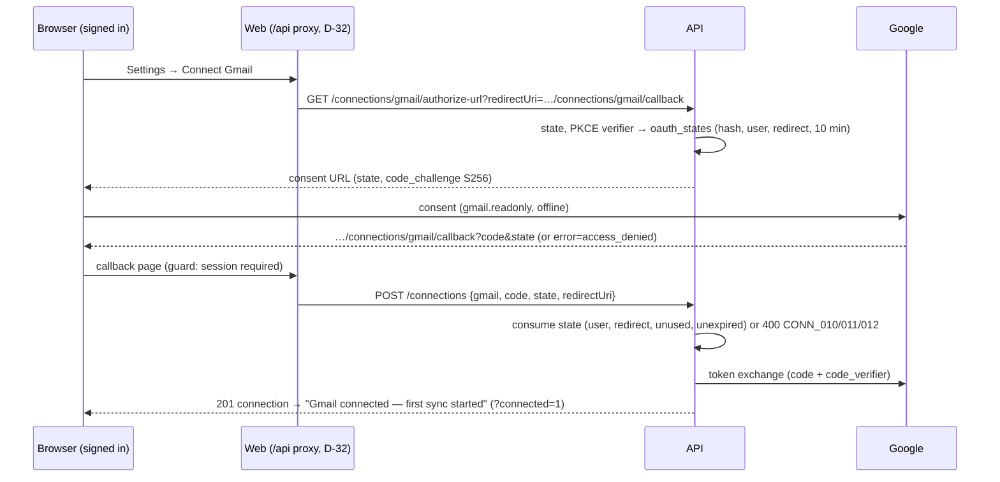

# AOS-406 — Web: Connect Gmail with an OAuth state check

| Field | Value |
|---|---|
| **Type** | Task |
| **Parent** | [AOS-S4.1](AOS-S4.1.md) (Epic [AOS-E4](AOS-E4.md)) |
| **Status** | 🟨 Done, unverified (needs a live Google OAuth client, AOS-111) |
| **Priority** | P1 |
| **Owner** | Claude |
| **ETA** | 5h |
| **Actual** | 3.5h |
| **Created / Updated / Done** | 2026-10-17 / 2026-10-17 / — |
| **Branch** | `aos-406-connect-gmail` |
| **Decisions** | D-32, D-47, D-49, D-59, D-64 |
| **Blocked by / Blocks** | AOS-405 ✅ (merged) · live check blocked by AOS-111 / — |

## Description
A real way to connect Gmail from the console, safe against CSRF:
- Settings → Data sources: **Connect Gmail** (and **Reconnect** for a Gmail in error or disconnected) asks the API for Google's consent URL and goes there.
- Google sends the user back to `/connections/gmail/callback`, which posts the code and the `state` to the API's existing connect endpoint and says what happened, in words.
- The API issues a random, single-use, 10-minute `state` bound to the signed-in user (and the redirect URI), plus a PKCE challenge, and refuses the connect without a matching one.

## Why
- AOS-401 Risks: "the consent URL has no `state` yet … a CSRF check belongs with the web callback screen."
- Without a state, another site could send a signed-in user's browser to the callback with *its own* Google code, connecting the attacker's mailbox to the victim's AdminOS (login CSRF, RFC 6749 §10.12).
- Settings had no way to connect Gmail; its Reconnect posted `{sourceType: "gmail"}` without a code, which the API refuses (`CONN_006`).

## Scope
- **In:** API state + PKCE (`oauth_states`, V27), the authorize-url and connect routes, `lastError` on connections; web callback page, Connect/Reconnect in Settings, error wording, unit tests, Playwright specs and mocks.
- **Out:** registering the redirect URI on the Google OAuth client (AOS-111); keeping the callback's query across a sign-in (see Risks).

## Acceptance criteria
- [x] **State issued:** `GET /connections/gmail/authorize-url?redirectUri=` returns a consent URL with a fresh `state` (32 random bytes, base64url) and `code_challenge` (S256). Only its SHA-256 is stored, with the user, purpose (`gmail_connect`), redirect URI, an encrypted PKCE verifier, and a 10-minute expiry. No secret literal: nothing is signed.
  - Tests: `the authorize url carries a fresh state and an S256 pkce challenge`, `only the hash of the state and an encrypted verifier are stored`, `states and verifiers are random and url-safe`, `a state round-trips and is consumed once` (Postgres).
- [x] **State required and checked before the code is used:** the connect call must present the state; missing/unknown/another user's/another redirect URI → 400 `CONN_010`; older than 10 min → 400 `CONN_011`; already used → 400 `CONN_012`. Google is never called in those cases. A mismatch never uses up the owner's state.
  - Tests: `connecting gmail without a state is CONN_010 and google is not called`, `an unknown state is CONN_010 …`, `a state started by another user is CONN_010 and stays usable by its owner`, `a state issued for another redirect uri is CONN_010`, `a state older than 10 minutes is CONN_011`, `a state can be used once, the second time is CONN_012`, `a code google rejects still uses up its state`, `OAuthStateServiceTest` (12).
- [x] **Single use under concurrency:** redemption is one conditional `UPDATE … WHERE used_at IS NULL`.
  - Tests: `only one of many concurrent redemptions marks a state used` (Postgres, 8 parallel), `a race between two redemptions lets only one through`.
- [x] **PKCE:** the token exchange sends the `code_verifier` that matches the challenge.
  - Test: `the code is exchanged with the pkce verifier that matches the challenge`.
- [x] **Callback page** `/connections/gmail/callback`: posts `code` + `state` + `redirectUri` once (also under React Strict Mode), shows "Connecting Gmail…", then "Gmail connected — first sync started" at `?connected=1` (so refresh/Back never re-post); every failure in words with **Start again** where it can help and **Back to Settings**:
  - user denied consent (`error=access_denied`), any other Google error, an address without code/state;
  - `CONN_010` / `011` / `012` (state), `CONN_007` (no `gmail.readonly`), `CONN_008` (no refresh token), `CONN_009` 503 / `CONN_006` (Google sign-in not configured; no Start again), `CONN_002` (Google refused the code), network failure, any other API message.
  - Tests: `src/app/connections/gmail/callback/page.test.tsx` (18).
- [x] **Settings → Data sources:** each source shows status, address (Gmail), last sync, last error, and for Gmail "Instant updates on until …" (push, AOS-405) or "Checked once a day"; **Connect Gmail** when there is no Gmail; **Reconnect** (through Google) for a Gmail in error or disconnected; **Sync** only when connected; **Disconnect** unless disconnected. A Connect failure (e.g. `CONN_009`) is said in place.
  - Tests: `src/app/settings/page.test.tsx` (+5, 1 rewritten).
- [x] **The guard protects the callback:** signed out, `/connections/gmail/callback` redirects to `/login`.
  - Tests: `the Connect Gmail callback is for signed-in users only (AOS-406)` (proxy unit test), Playwright `the callback needs a session …`.
- [x] **Playwright specs and mocks** (not run here, see Verification): `e2e/gmail.spec.ts` (5: full round trip with Back, cancelled consent, refused state + Start again, not configured, signed-out), two callback screens added to `a11y.spec.ts`, and `mock-api.ts` defaults for the authorize URL and the connect POST.
- [ ] 🟨 **Live check (AOS-111):** a real consent with the callback URI registered; a real code + state + PKCE exchange.

## Design
- **Context:**
  - `GET /connections/gmail/authorize-url` and `POST /connections` (code exchange, `CONN_007/008/009`) exist (AOS-401). The browser talks only to the web origin (D-32), so the session cookie is first-party and the API knows the signed-in user on both calls.
  - The JWT secret and `TOKEN_ENCRYPTION_KEY` exist; no secret may be written into code.
- **Options: how the state is made and checked**
  1. **Random state stored server-side, hashed (chosen).** 32 random bytes; the API stores SHA-256(state) with the user, purpose, redirect URI, expiry and `used_at`.
     - Single use is a real guarantee (a conditional update), across instances and restarts.
     - No key to manage or rotate; a database copy can't be replayed (only hashes).
     - Cost: one small table (V27) and a delete of old rows on each issue.
  2. A signed state (HMAC over user, nonce and expiry, with a key derived from the JWT secret).
     - Stateless for expiry and binding, but **single use still needs storage** of used nonces, so it adds a key derivation without removing the table.
  3. A cookie holding the state (double-submit).
     - Works without server storage, but needs a new cookie and its attributes, and single use is only as good as the browser deleting it.
- **Options: PKCE**
  1. **Yes, S256, verifier kept server-side and encrypted (chosen).** Google supports PKCE for web clients. A stolen code (e.g. from logs or a referrer) is useless without the verifier, which never leaves the API.
  2. No PKCE: the client secret already authenticates the exchange. Rejected: PKCE is cheap here because the state row already exists.
- **Options: what the callback does after success**
  1. **Replace the address with `?connected=1` and show success there (chosen).** Refresh and Back never re-post a used code (which would show "already used").
  2. Redirect to Settings with a banner. Loses the dedicated success screen and needs Settings to read a flag.
- **Choice:** option 1 in each.
- **Patterns:**
  - Repository (`OAuthStateRepository`: in-memory + Exposed, same behaviour);
  - sealed domain errors (`OAuthStateException`) mapped to codes only in the route;
  - parameter object (`OAuthStateClaim`);
  - the web keeps URLs and error wording in `lib/gmail.ts`; components only render (`ConnectGmailButton`, the callback page).
- **Extensibility:** another OAuth source adds a value to `OAuthPurpose` and reuses `OAuthStateService` unchanged.
- **Impact:**
  - **API:** `OAuthState`, `OAuthStateService`, repositories, `OAuthStatesTable`; `ConnectionRoutes` (`GmailOAuth`, `CONN_010/011/012`), `GoogleOAuthClient` (`state`, PKCE, `isConfigured`), `IngestionModule`, `AppModule`; `ConnectionResponse.lastError`; `CreateConnectionRequest.state`.
  - **Schema:** `V27__oauth_states.sql` (new table).
  - **Web:** new `lib/gmail.ts`, `components/ConnectGmailButton.tsx`, `app/connections/gmail/callback/page.tsx`; `app/settings/page.tsx`; `lib/types.ts`.
  - **Contract change:** connecting Gmail now requires `state` (the web is the only client).
- **Diagram:**

## Implementation plan
1. V27, `OAuthState` + repositories, `OAuthStateService` (issue/consume, PKCE).
2. `GoogleOAuthClient` state/PKCE; routes and error codes; DI.
3. Web: `lib/gmail.ts`, `ConnectGmailButton`, callback page, Settings.
4. Tests: API unit, route and Postgres; web unit; Playwright specs and mocks.

## Verification
- **API:** `./gradlew test integrationTest koverVerify` passes.
  - 1,384 unit and 123 integration tests, 0 failures, 0 disabled (+22 unit and +3 integration over AOS-405).
  - Coverage over the whole API: 99.30% lines (8,800/8,862) and 91.12% branches (4,800/5,268); the gate is 90/85.
- **Web:** `npm run typecheck`, `npx eslint . --max-warnings 0`, `npm run test:coverage` and `npx next build` all pass.
  - 354 tests in 30 files; coverage 98.39% statements, 95.79% branches, 97.59% functions, 98.91% lines (gate 90/85).
  - The build lists `/connections/gmail/callback`.
- **Not run (by instruction, fixed ports collide with parallel work):** Playwright. The coordinator should run `npx playwright test e2e/gmail.spec.ts e2e/a11y.spec.ts e2e/screens.spec.ts`.
- **Pending AOS-111 (🟨):** the live check in the acceptance criteria.

## Risks / notes
- **Register the redirect URI** `<APP_URL>/connections/gmail/callback` (e.g. `http://localhost:3000/connections/gmail/callback`) on the Google OAuth client (AOS-111), or Google answers `redirect_uri_mismatch`.
- **Session expiring during consent:** the guard sends a signed-out user to `/login` without keeping the callback's query, so the code is dropped and the user starts again. Safe (the state is bound to the user anyway); a "return to" parameter on login would be nicer (follow-up).
- **Gmail Reconnect while connected:** `connectGmail` keeps an existing *connected* row as it is (AOS-401), so Reconnect is only offered for `error`/`disconnected`.
- **Contract:** an old client posting a Gmail code without `state` now gets `CONN_010`. Only the web connects Gmail.
- **Migration numbers:** this branch adds V27 on top of AOS-405's V26; V25 belongs to another ticket. If V25 merges after V26/V27 were applied somewhere, Flyway needs `outOfOrder` or a renumber (coordinator).
- **Bug found in existing code:** Settings → Reconnect for Gmail posted `{sourceType: "gmail"}` without a code, which the API always refused (`CONN_006`). Fixed here: Reconnect goes through Google.

## Decision D-64 (recorded in DECISIONS.md)
See [DECISIONS.md](../DECISIONS.md) D-64.

## Activity log
- 2026-10-17 — Claude (main session): reviewed, rebased on main, gates re-run. Playwright had not been run: the new `gmail.spec.ts` failed on all browsers (Next's route announcer is also `role="alert"`; WebKit refuses a mocked 302), so the spec was fixed. D-64 recorded, merged.
- 2026-10-17 — Claude: ticket created and started (🟦) under the coordinator's brief (D-64), on top of the AOS-405 branch.
- 2026-10-17 — Claude: V27 + state service, routes and codes, PKCE; callback page, Connect/Reconnect in Settings; unit, route, Postgres and web tests; Playwright specs and mocks written (not run).
- 2026-10-17 — Claude: API gate green (1,384 unit + 123 integration; 99.30% / 91.12%); web typecheck, lint, 354 tests (98.91% lines / 95.79% branches) and build green. Status 🟨 until a live Google check (AOS-111). PR opened, not merged.

## Definition of Done (docs/ENGINEERING.md §4)
- [x] Each acceptance criterion covered by a test or a documented manual check (the live check is pending AOS-111; Playwright written, to be run by the coordinator)
- [x] Tests/build green (integration tests if the DB is touched)
- [x] Layer rules respected; no silent fallbacks; no secrets/PII in logs
- [ ] Decisions recorded · ticket, story, epic and board updated · PROGRESS.md updated (coordinator: D-64, story/epic/board rows, PROGRESS)
- [x] Commit message starts with `AOS-406:`

## Resolution
- **Schema:** `V27__oauth_states.sql`.
- **API:**
  - new `OAuthState` (+ `OAuthPurpose`, `OAuthStateRepository`, `OAuthStateException`), `OAuthStateService`, `InMemoryOAuthStateRepository`, `ExposedOAuthStateRepository`, `OAuthStatesTable`;
  - `ConnectionRoutes`: `GmailOAuth`, state issue/consume, `CONN_010/011/012`; `GoogleOAuthClient`: `state`, `code_challenge`, `code_verifier`, `isConfigured`;
  - `CreateConnectionRequest.state`, `ConnectionResponse.lastError`; `IngestionModule`, `AppModule`.
- **Web:** `lib/gmail.ts`, `components/ConnectGmailButton.tsx`, `app/connections/gmail/callback/page.tsx` (+ test), `app/settings/page.tsx` (+ tests), `lib/types.ts`, `proxy.test.ts`.
- **E2E:** `e2e/gmail.spec.ts` (new), `e2e/a11y.spec.ts`, `e2e/support/mock-api.ts`.
- **Verified:** as in Verification. ✅ waits for Playwright (coordinator) and the live check (AOS-111).
- **Actual vs ETA:** 3.5h vs 5h.
