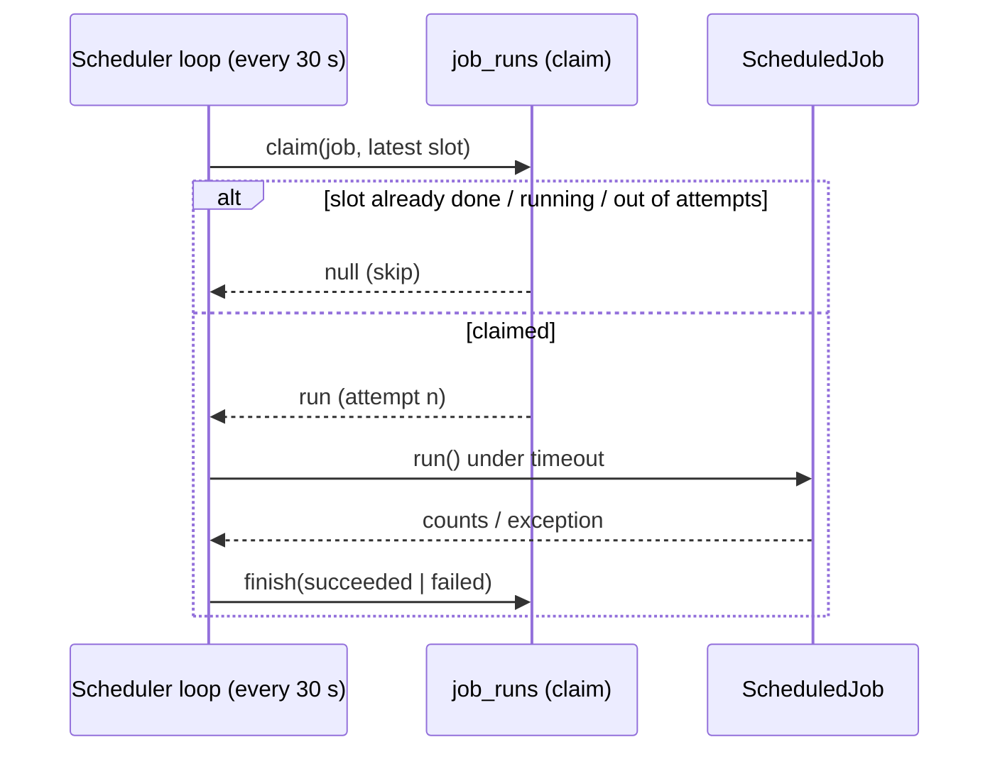

# AOS-501 — Scheduler: run reminders, nudges and detectors on time

| Field | Value |
|---|---|
| **Type** | Task |
| **Parent** | [AOS-S5.1](AOS-S5.1.md) (Epic [AOS-E5](AOS-E5.md)) |
| **Status** | ✅ Done |
| **Priority** | P1 |
| **Owner** | Claude |
| **ETA** | — (Pragun: no ETAs, as soon as possible) |
| **Actual** | 2h |
| **Created / Updated / Done** | 2026-10-16 / 2026-10-16 / 2026-10-16 |
| **Branch** | `aos-501-scheduler` |
| **Decisions** | D-48, D-50 |
| **Blocked by / Blocks** | — / AOS-504, AOS-503, AOS-506 |

## Description
Nothing ran the legacy MVP's timed work: bill reminders, overdue marking, onboarding nudges and subscription detection were written and registered but never called. Add a scheduler that runs registered jobs on time, once, safely across restarts and API instances, and switch those jobs on.

## Why
E5's goal is "the app tells me what to act on". None of it can happen without timed jobs (D-48: legacy features are integrated, not deleted).

## Scope
- **In:** the scheduler (schedules, run records, claims, retries, timeouts, shutdown); jobs for bill reminders (incl. overdue), onboarding nudges, nightly subscription detection; configuration; run counts from the engines.
- **Out:** real delivery of notifications (AOS-504 — today they're stored in-app, push and email are still stubs); the weekly briefing job (AOS-506); the Gmail daily fallback (AOS-401); per-user time zones for daily jobs (later); a status screen.

## Acceptance criteria
- [x] A job is one class (`ScheduledJob`: name, schedule, `run()`) registered in Koin; the scheduler needs no change to add one.
- [x] Daily schedules use a time zone (default `Asia/Kolkata`); day boundaries follow the local date; a time skipped by daylight saving moves to the next valid time. Fixed periods align to the epoch.
- [x] Each (job, slot) runs **once**, across restarts and several API instances (unique key + row lock in Postgres, mutex in memory).
- [x] After downtime a job catches up **once**, not once per missed slot.
- [x] A failed slot is retried after a delay (default 15 min), at most 3 attempts; a run whose instance died (lease expired) is taken over; a late finish from that instance can't overwrite the retry's result.
- [x] A run longer than its timeout (default 10 min) is cancelled and recorded as failed.
- [x] One failing job never stops the others; a broken claim (database down) skips that job for the tick only.
- [x] Shutting down mid-run records a failure, so the slot is retried rather than left running.
- [x] Within a job, one bad user/bill is logged and counted, never stops the rest (`forEachIsolated`).
- [x] Each run stores its counts (e.g. `remindersSent=2, failed=0`) — counts only, no personal data; errors store the exception class and message.
- [x] `SCHEDULER_ENABLED`, `SCHEDULER_ZONE`, `SCHEDULER_TICK_SECONDS`; invalid values stop start-up with a message naming the setting.
- [x] Jobs: `bill-reminders` 09:00, `onboarding-nudges` 11:00, `subscription-detection` 04:00 (active users only).

## Design
- **Context:** the API already runs one background loop (IngestProcessor, D-34). The Go workers have Asynq, but every job to schedule is a Kotlin service. Compose has no cron. More than one API instance may run (public later).
- **Options considered:**
  1. **In-process scheduler + `job_runs` claim table** (chosen) — no new infrastructure; Kotlin jobs call services directly; the DB claim makes it safe with many instances.
  2. Quartz — heavy (11 tables, its own threads and config); more than we need.
  3. Asynq periodic tasks in Go — jobs would have to cross into Go or call back into the API; two places to look.
  4. OS / container cron calling an admin endpoint — needs an authenticated internal endpoint and an extra container; harder to test.
- **Decision:** option 1 (D-50). **Patterns:** Strategy (`Schedule`), Registry (Koin `bind ScheduledJob::class` → `getAll()`), Repository (`JobRunRepository`, InMemory + Exposed under one contract test), Template-method-like run flow (claim → run under timeout → record).
- **Extensibility:** a new job = one class + one Koin line. A new kind of schedule (e.g. weekly, cron expression, per-user zone) = one more `Schedule` implementation. Notification channels plug in separately (AOS-504).
- **Impact:** new `domain/scheduling`; V17 `job_runs`; `UserRepository.findActive()`; `ReminderEngine.runReminders()` and `DropOffNudgeService.runNudges()` now return summaries; config + compose + `.env.example`.

## Verification
- `./gradlew test integrationTest koverVerify` — unit 1,101, integration 99, 0 disabled; API 99.6% lines / 95.3% branches.
- The claim contract (10 cases incl. 8 simultaneous claims → 1 winner) runs on both the in-memory repository and Postgres.

## Risks / notes
- Notifications are stored but not yet delivered by push/email (AOS-504).
- Known bugs in the engines this switches on, fixed in their own tasks:
  - custom reminder days aren't persisted in Postgres (only the 3-day/1-day flags), and reminder dates use the server's date, not the user's (AOS-503);
  - nudge copy still describes an Android SMS app (known issue 9).
- Daily jobs run in one zone (the owner's). Per-user zones are a new `Schedule`/job variant when there are public users.

## Activity log
- 2026-10-16 — Claude: started (Pragun: "go go ahead"; plan approved with the design summary).
- 2026-10-16 — Claude: done.

## Definition of Done (docs/ENGINEERING.md §4)
- [x] Each acceptance criterion covered by a test
- [x] Tests/build green (integration tests too: the DB is touched)
- [x] Layer rules respected; no silent fallbacks; no secrets/PII in logs (bill reminder log no longer names the biller)
- [x] Decisions recorded · ticket, story, epic and board updated · PROGRESS.md updated
- [x] Commit message starts with `AOS-501:`

## Resolution
Done.
- **Scheduler** (`domain/scheduling`): `Schedule` (Daily in a zone, Every period), `ScheduledJob`, `JobScheduler` (tick → claim → run under timeout → record; shutdown-safe), `JobRunRepository` (InMemory + Exposed, shared claim rules), `forEachIsolated`.
- **Schema:** V17 `job_runs` (unique job + slot).
- **Jobs:** `BillRemindersJob`, `OnboardingNudgesJob`, `SubscriptionDetectionJob`; the engines report counts.
- **Config:** `SchedulerConfig` (enabled, zone, tick), compose and `.env.example`.
- **Tests:** schedules (incl. DST and the IST date edge), model validation, the claim contract on both repositories, scheduler behaviour (once per slot, catch-up once, retry after delay, timeout, claim failure isolation, shutdown, the loop), jobs and their counts, config parsing, `findActive` on both repositories, app start with the scheduler off.
