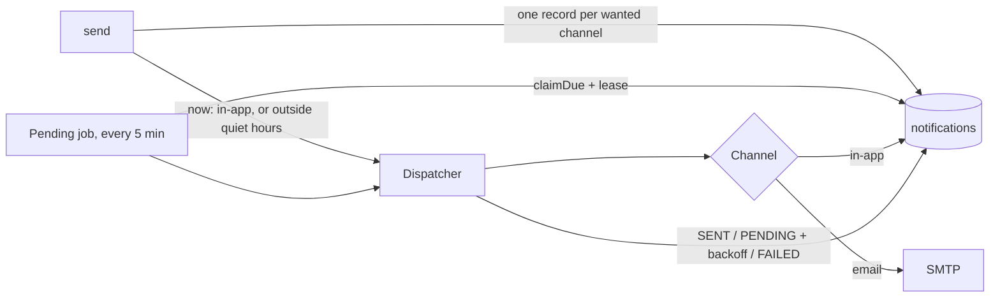

# AOS-504 — Real notifications: delivery channels, email, held and retried delivery

| Field | Value |
|---|---|
| **Type** | Task |
| **Parent** | [AOS-S5.1](AOS-S5.1.md) (Epic [AOS-E5](AOS-E5.md)) |
| **Status** | ✅ Done |
| **Priority** | P1 |
| **Owner** | Claude |
| **ETA** | — (as soon as possible) |
| **Actual** | 2.5h |
| **Created / Updated / Done** | 2026-10-16 / 2026-10-16 / 2026-10-16 |
| **Branch** | `aos-504-notification-channels` |
| **Decisions** | D-19, D-50, D-51 |
| **Blocked by / Blocks** | AOS-501 ✅ / AOS-510 (Web Push), AOS-505, AOS-506 |

## Description
Notifications were never delivered:
- "push" was a Firebase stub that only logged;
- email was saved as SENT without being sent;
- notices held for quiet hours stayed PENDING forever.

This task makes delivery real behind pluggable channels: in-app plus SMTP email now, with Web Push for iPhone next (AOS-510).

## Scope
- **In:**
  - the `DeliveryChannel` interface and registry;
  - in-app delivery;
  - the email channel and an SMTP sender;
  - the dispatcher (outcomes, retries);
  - quiet-hours holding with a real "deliver after" time;
  - the every-5-minutes pending job;
  - SMTP configuration;
  - removing the FCM stub.
- **Out:**
  - Web Push: subscriptions, VAPID keys, the service worker and the Settings toggle (AOS-510);
  - HTML email templates;
  - the in-app inbox screen (it lists every channel's record today, see the notes).

## Acceptance criteria
- [x] A channel is one class registered as `DeliveryChannel`. An unconfigured channel (no `SMTP_HOST`) isn't registered, so nothing is recorded as sent through it. Start-up logs which channels are on and which are not configured.
- [x] One stored notification per channel the user wants, in-app first. Channels the user switched off get no record.
- [x] In-app is delivered at once, even in quiet hours, because it is silent.
- [x] During quiet hours, push and email for non-critical types wait until quiet hours end, in the user's time zone. Anomaly alerts ignore quiet hours. An invalid zone falls back to India time and is logged.
- [x] Delivery outcomes:
  - delivered → SENT, with the provider reference;
  - retryable → PENDING after 5 min, 30 min, then 3 h, and FAILED after 4 attempts;
  - permanent (no address, rejected address, channel no longer configured) → FAILED, with the reason.
  - A channel that throws counts as retryable.
- [x] The pending job runs every 5 minutes and delivers what's due: notices held for quiet hours, retries, and rows left by a crash. It claims rows with a lease, so no two runs or instances send the same row; delivery is at least once.
- [x] Email:
  - the subject is the title on one line, so header injection isn't possible;
  - the body is plain UTF-8 text with links to the app and to Settings (to switch email off);
  - it is sent to the user's account email.
- [x] SMTP:
  - STARTTLS is the default, and TLS on 465 is supported;
  - STARTTLS is required, never a silent fall-back to plain text;
  - every timeout is 10 s;
  - a wrong password is retryable (once the config is fixed it goes through);
  - a refused recipient is permanent.
- [x] SMTP config is validated at start-up:
  - `SMTP_FROM` is required;
  - username and password come as a pair;
  - `none` security is refused when a password is set;
  - the password is never printed.
- [x] Each failure reason is stored (`last_error`) without personal data.

## Design
- **Context:** the legacy `NotificationService` hard-coded three channels, with FCM stubbed and email faked. The owner uses an iPhone and the web app (D-19), so FCM is the wrong push channel.
- **Options considered:**
  1. **Channel interface + dispatcher + stored delivery state** (chosen). Each channel is small and testable; retries and quiet hours live in one place; state survives restarts.
  2. **Send inline and forget.** Simple, but holds and retries are lost on restart, and there's no record of failures.
  3. **Queue each send to the Go workers (Asynq).** It crosses a service boundary for something the API can do, and the payload stringification bug would apply.
- **Decision:** option 1 (D-51). **Patterns:** Strategy (`DeliveryChannel`), Registry (Koin `bind`/`getAll`), Adapter (`EmailSender` → SMTP), Lease/claim (`claimDue`, as in the ingest processor).
- **Extensibility:** a new channel (Web Push, WhatsApp, Telegram) is one `DeliveryChannel` class plus one Koin line. A new email provider is one `EmailSender` implementation.
- **Impact:**
  - `domain/notifications/delivery/*`;
  - `NotificationService` (new constructor: a dispatcher instead of PushService);
  - `PendingNotificationsJob`;
  - `infrastructure/email/SmtpEmailSender`;
  - V18 adds `deliver_after`, `attempts` and `last_error` to `notifications`;
  - the `SmtpConfig` config;
  - compose and `.env.example`;
  - the Angus Mail 2.0.5 dependency (test: GreenMail 2.1.14).

## Verification
- `./gradlew test integrationTest koverVerify`:
  - 1,110 unit and 100 integration tests, 0 disabled;
  - API coverage 99.5% lines / 95.2% branches.
- SMTP against a real in-process server (GreenMail):
  - a TLS send with login, checking subject, sender, recipient and UTF-8 body;
  - a wrong password, an unreachable server, and a send without login.
- Live start-up: "Notification channels on: [IN_APP]; not configured: [PUSH, EMAIL]"; the pending job ran.
- **Manual check for Pragun:** set `SMTP_HOST=smtp.gmail.com`, `SMTP_USERNAME` and `SMTP_FROM` to your Gmail address, and `SMTP_PASSWORD` to an app password, then receive a bill reminder (needs AOS-111 login and a bill).

## Risks / notes
- **Found by the tests and fixed before merge:** Jakarta Mail's static `Transport.send` always uses plain SMTP. TLS (465) settings would have been ignored and the sender would connect to localhost:25.
- **At-least-once:** a crash between sending and recording can send an email twice. That's preferred over losing a reminder.
- `GET /notifications` returns every channel's record, so one reminder shows up to 3 times. The inbox screen should list in-app only. Noted in PROGRESS for the inbox task.
- The FCM stub (`PushService`) is removed. `devices.fcm_token` stays in the schema, unused.

## Activity log
- 2026-10-16 — Claude: started (Pragun: "yes" to Web Push + SMTP). Split Web Push into AOS-510 to keep the PR reviewable.
- 2026-10-16 — Claude: done.

## Definition of Done (docs/ENGINEERING.md §4)
- [x] Each acceptance criterion covered by a test
- [x] Tests/build green (integration tests too: the DB is touched)
- [x] Layer rules respected; no silent fallbacks (an unconfigured channel is off and logged); no secrets or PII in logs
- [x] Decisions recorded · ticket, story, epic and board updated · PROGRESS.md updated
- [x] Commit message starts with `AOS-504:`

## Resolution
Done:
- **Channels:** `DeliveryChannel`, `InAppChannel`, `EmailChannel` + `EmailSender`/`SmtpEmailSender`.
- **Delivery:** `NotificationDispatcher`, the `NotificationService` rewrite, and `PendingNotificationsJob`.
- **Persistence:** `claimDue` on both repositories, V18, and `SmtpConfig`.
- **Removed:** the FCM stub.
- **Tests:** dispatcher outcomes and backoff, the email channel, the job (due vs not due, retries, counts), claims and leases (in memory and on Postgres), service behaviour on a fixed clock (quiet hours in the user's zone, critical bypass, per-channel failure), SMTP (GreenMail), config parsing, and DI (email registered only with SMTP).
