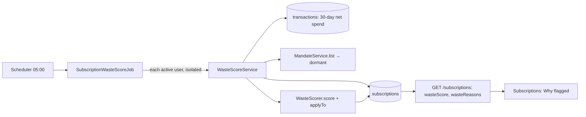

# AOS-509 — Subscription waste score from SMS/statement signals

| Field | Value |
|---|---|
| **Type** | Task |
| **Parent** | [AOS-S5.3](AOS-S5.3.md) (Epic [AOS-E5](AOS-E5.md)) |
| **Status** | ✅ Done |
| **Priority** | P1 |
| **Owner** | Claude |
| **ETA** | 3h |
| **Actual** | 2h |
| **Created / Updated / Done** | 2026-10-17 / 2026-10-17 / — |
| **Branch** | `aos-509-waste-score` |
| **Decisions** | D-56, D-58 (proposed below) |
| **Blocked by / Blocks** | AOS-501 ✅, AOS-502 ✅ / — |

## Description
Score every active or trial subscription from 0.00 to 1.00 for "money probably wasted". The score uses only signals AdminOS really has (bank SMS, statements, mandates and the user's own marks). Each factor is named and explained. The score runs every night, flags high scores, and the Subscriptions page says why.

## Why
The Go worker (`services/workers/internal/handlers/waste_scoring_handler.go`, `ComputeWasteScore`) scores only from Gmail login/usage signals. Nothing produces those signals and nothing ever enqueues the job. Pragun uses an iPhone, SMS and bank statements, so in practice no subscription was ever scored or flagged (BRD §5.3: "the app tells me what to act on").

## Scope
- **In:**
  - a pure Kotlin scorer with named factors;
  - a nightly job;
  - persisting the score, its reasons and the factors the user saw when they kept it (V24);
  - the API fields and the "Why flagged" line on the web.
- **Out:**
  - usage data (app logins, screen time): we don't have it and don't guess;
  - deleting the Go handler (superseded, kept);
  - setting the subscription category in detection (see Risks).

## Acceptance criteria
- [x] **Pure and deterministic:** a `WasteScorer` scores each subscription 0.00–1.00 (two decimals). The same inputs always give the same score and sentences.
- [x] **Named factors:** each factor adds named points (constants) and a human reason:
  - price increased: 30 points, 40 if the rise is 20% or more; a price cut doesn't count;
  - duplicate service: 35 points, for two or more active/trial subscriptions of the same kind (the set category, else the merchant catalogue's subcategory among streaming, music, cloud, books, fitness and courses; "apps" and unknown merchants never count);
  - high cost share: 25 points, when the monthly cost is 5% or more of the last 30 days' net spending; unknown spending adds nothing;
  - long-running: 15 points, after 12 or more months with no price change;
  - dormant AutoPay: 40 points, when an active mandate for the same payee has taken nothing for two cycles (`MandateService.view` → dormant);
  - trial ending: 40 points, when a trial turns paid within 7 days;
  - marked unused: 40 points, when the user marked it unused.
- [x] **No invented usage:** when usage is unknown, the reasons end with "Usage unknown: AdminOS can't see whether you use it" (0 points).
- [x] **Order and cap:** reasons are strongest first and the score is capped at 1.00.
- [x] **Flag:** a score of 0.70 or more flags the subscription, with `flaggedReason` set to the top three reasons. Below 0.70 an old flag is cleared. Re-scoring keeps the first `flaggedAt`.
- [x] **Keep:** the existing keep route (`PATCH /subscriptions/{id}/dismiss`) remembers the factors behind the score. A kept subscription stays unflagged until a factor outside that set appears. That re-flags it and clears the old keep.
- [x] **Stored:** `wasteScore`, `wasteScoreUpdatedAt`, the reasons and the kept factors are stored (V24, `waste_reasons` and `waste_factors_dismissed`). InMemory and Exposed behave the same (the same checks run on both).
- [x] **Job:** a scheduled job `subscription-waste-score` runs daily at 05:00 in the scheduler zone (after detection at 04:00), for active users only:
  - one user's failure, or one subscription's, is isolated (`forEachIsolated`) and counted;
  - re-running gives the same stored result;
  - cancelled and paused subscriptions are not scored.
- [x] **API:** `SubscriptionResponse` has `wasteScore` (number or null) and `wasteReasons` (a list of strings).
- [x] **Web:** a flagged subscription shows "Why flagged: …" with its waste reasons. If it was never scored, it falls back to the older `flaggedReason`; with no reason at all there is no line.

## Design
- **Context:**
  - Subscriptions come from the nightly detector (AOS-501, 04:00), which upserts by (user, merchant, cycle) and keeps other fields through `copy`.
  - `subscriptions` already has `waste_score` and `waste_score_updated_at`, plus `is_flagged`, `flagged_reason` and `flag_dismissed_at`.
  - Mandates (AOS-502) know when an AutoPay has gone dormant.
  - The Go handler needs Gmail signals that don't exist, and the queue publisher turns every payload value into a string (AOS-E5 note), so numbers and lists break in Go.
- **Options considered:**
  1. **Kotlin scorer + scheduled job in the API (chosen).** All the inputs (subscriptions, spending, mandates, the merchant catalogue) already live in the API, and the scheduler gives once-per-slot runs, retries and isolation. One language owns the rule (DRY, ENGINEERING §5).
  2. **Feed the Go `ComputeWasteScore` from Kotlin via the queue.** This needs the payload-type fix (AOS-506), a new contract and a Go writer to the same table. Its signals are login counts we don't have, so it would still score nothing useful. That is two copies of one rule.
  3. **Score on read (in `GET /subscriptions`).** No schema change, but flags would appear and disappear per request, and "kept, no new factor since" can't be remembered without storing the factors anyway. Listing also gets slower (spending and mandate reads per call).
- **Decision:** option 1 (D-58). **Patterns:**
  - each factor is a small rule function (Specification) producing a `WasteReason`;
  - a pure scorer plus a pure `applyTo` flag policy;
  - a domain service gathers the context once per user;
  - a `ScheduledJob` (open/closed: one Koin line).
- **Extensibility:**
  - a new signal (e.g. Gmail "last login" when AOS-401 lands, or SMS "plan expiring") is a new `WasteFactor` code, a points constant and one rule function;
  - the stored reason format (`{factor, points, reason}`) doesn't change;
  - thresholds are named constants on `WasteScorer`.
- **Impact:**
  - **Domain:** `WasteScorer.kt` (`WasteFactor`, `WasteReason`, `WasteContext`, `WasteAssessment`), `WasteScoreService.kt` and `SubscriptionWasteScoreJob.kt`;
  - **Model:** `Subscription` gains `wasteReasons`, `wasteFactorsDismissed`, `keep(at)` and validates `wasteScore ∈ [0,1]`; `BillingCycle.monthlyCost` moves out of `SubscriptionRoutes` so the summary and the scorer share one rule;
  - **Dues:** `DuesService.coveredByMandate` becomes `internal` and is reused for the payee match;
  - **Keep route:** the dismiss route uses `Subscription.keep`;
  - **DTO:** `SubscriptionResponse.wasteScore` / `wasteReasons`;
  - **Persistence:** V24 adds two TEXT columns; `SubscriptionsTable` and `ExposedSubscriptionRepository` map them;
  - **DI:** `AppModule` binds the job;
  - **Web:** `types.ts`, the test fixture, and the Subscriptions page and its tests;
  - **Go:** unchanged; the Kotlin scorer supersedes `ComputeWasteScore` and `TypeWasteScore` is never enqueued.
- **Diagram:**

## Implementation plan
1. Write the scorer, the factors and the flag policy, with unit tests.
2. Add V24, the table, the Exposed mapping and the integration tests (Exposed and InMemory share the same checks).
3. Add the service and the job (isolation and idempotency), and wire them in Koin.
4. Add the DTO fields, the keep snapshot and the route tests.
5. Update the web types, page and tests.

## Verification
- **API:** `./gradlew test integrationTest koverVerify` passes.
  - 1,251 unit and 109 integration tests, 0 failed, 0 skipped.
  - Coverage is 99.3% lines and 92.3% branches (gate 90/85).
  - `WasteScorer.kt` 100% lines and 97/98 branches; `WasteScoreService.kt` 25/26 lines; the job 100%.
  - **Scorer** (`WasteScorerTest`, 22 tests): every factor and its boundaries (trial today/tomorrow/7/8 days, price cut, unknown spending, apps not duplicates, a set category, under a year, unknown start), order and cap, determinism, threshold exactly 0.70, unflag below it, first `flaggedAt` kept, keep then the same factors stays unflagged, a new factor re-flags, validation, and monthly cost for every cycle.
  - **Service and job** (`WasteScoreServiceTest`, 5 tests): context from 30-day spending (older spending ignored) and a dormant mandate ("NETFLIX INDIA" ≈ Netflix), cancelled not scored, re-run idempotent, one failing subscription isolated, and the job's name, 05:00 schedule, active users only, a failing user isolated and its counts.
  - **Routes:** the list returns `wasteScore` and `wasteReasons` (null and empty when unscored); keep stores the seen factors.
  - **Postgres** (`WasteScoreIntegrationTest`, 3 tests): round trip through save and update, empty ↔ NULL, the same checks on InMemory, and a full scoring run on Exposed repositories (0.75, flagged, reason text).
  - **DI:** 5 scheduled jobs, including `subscription-waste-score`.
- **Web:**
  - `npm run typecheck` and `npx eslint . --max-warnings 0` are clean;
  - `npm run test:coverage`: 320 tests in 28 files, 98.51% statements, 95.96% branches, 97.92% functions, 99.02% lines;
  - `npx next build` is OK;
  - new page tests: the "Why flagged" line with all reasons in order, not shown for an unflagged scored subscription, and no line without any reason.
- **Playwright:** not run here (coordinator). `e2e/support/mock-api.ts` is unchanged. Its flagged "Gym" mock has no `wasteReasons` (the fixture default is `[]`), so the page falls back to `flaggedReason`, and `getByText("No visits in 45 days")` still matches inside "Why flagged: No visits in 45 days" (Playwright matches substrings by default).

## Risks / notes
- **The Go handler is superseded, not deleted:** `ComputeWasteScore` / `WasteScoringHandler` stay. Nothing enqueues `TypeWasteScore`, and the Kotlin scorer owns `waste_score`. Remove the Go code in a later cleanup ticket if wanted.
- **Detection never sets a category (existing behaviour, reported):** `SubscriptionDetectorService` always saves `SubscriptionCategory.OTHER`. So duplicates use the merchant catalogue's subcategory when the category is OTHER. Setting the category from the catalogue at detection is a small follow-up.
- **Detection never ends a subscription (existing, reported):**
  - a subscription whose charges stop stays ACTIVE forever;
  - it keeps being scored, and "long-running" can grow on a stale row.
  - A follow-up could mark it stopped after two missed cycles.
- **Other existing issues, reported and not touched:**
  - the detector uses `merchantName!!` and computes dates in UTC rather than the user's zone;
  - `SubscriptionAgentRoutes` calls the repository directly from a route (a layer rule);
  - the cancel route is a stub.
- **The flag is owned by the scorer:** a flag below 0.70 is cleared on the next run. Nothing else sets `is_flagged` today (the Go handler never runs).
- **Legacy keeps:** a subscription kept before V24 has no remembered factors. Its first score of 0.70 or more flags it once; keeping it again remembers the factors.
- **Amounts in reasons:** the cost-share sentence contains the user's own monthly cost and share (e.g. "₹1,000 a month is 6% …"). It is stored and shown only to that user and is never logged. Logs carry IDs and counts only.
- **Thresholds are first guesses:**
  - flagging needs two strong factors, e.g. a duplicate plus a price rise of 20% or more, or a trial ending plus a duplicate;
  - one factor alone never flags;
  - tune them on real data (AOS-111/211).

## Proposed decision D-58
> **D-58 — Subscription waste score in Kotlin, from signals we have** · Type: **Product** · Tasks: AOS-509 · 2026-10-17
>
> **Context:** The Go `ComputeWasteScore` scored only from Gmail login signals that nothing produces, and was never enqueued. The owner's data is iPhone SMS, bank statements and mandates.
>
> **Decision:**
> - A pure Kotlin `WasteScorer` (API, `domain/financial`) scores each active or trial subscription 0.00–1.00 as the sum of named, explained factors (points out of 100, capped):
>   - trial ending within 7 days: 40;
>   - marked unused: 40;
>   - dormant AutoPay for the same payee: 40;
>   - duplicate service of the same kind: 35;
>   - price rise: 30, or 40 if 20% or more;
>   - 5% or more of the last 30 days' spending: 25;
>   - 12 or more months unchanged: 15.
> - Usage is never guessed: unknown usage is said plainly ("Usage unknown"), with 0 points.
> - A score of 0.70 or more flags the subscription with the top three reasons; below that the flag is cleared.
> - "Keep" remembers the factors the user saw. Only a new factor flags it again.
> - The job `subscription-waste-score` runs daily at 05:00 (scheduler zone), after detection.
> - V24 stores the reasons and the kept factors. The API returns `wasteScore` and `wasteReasons`, and the web shows "Why flagged".
> - The Go handler stays but is superseded.
>
> **Alternatives rejected:**
> - Feeding the Go scorer via the queue: two copies of one rule, payloads that break on non-strings, and signals we don't have.
> - Scoring on every read: unstable flags, and "kept" can't be remembered.
>
> **Consequences:**
> - New signals (Gmail logins after AOS-401) are new factors.
> - The thresholds are constants, to be tuned on real data.
> - Detection should set the category and end stopped subscriptions (follow-ups).

## Activity log
- 2026-10-17 — Claude (coordinator): rebased on main (AOS-506), resolved the DI job-count conflict, re-ran the API gate (unit 1,258 / integration 111) and Playwright (232 passed + 7 deliberate skips); D-58 recorded; merged.
- 2026-10-17 — Claude: started (coordinator brief); design above (D-58 proposed).
- 2026-10-17 — Claude: implemented and verified (API 1,251 unit + 109 integration, 99.3% lines / 92.3% branches; web 320 tests, 99.02% lines; next build OK). PR opened; Playwright and docs (DECISIONS, BACKLOG, PROGRESS, epic and story) left to the coordinator.

## Definition of Done (docs/ENGINEERING.md §4)
- [x] Each acceptance criterion covered by a test
- [x] Tests/build green: API unit + integration + coverage gate, web unit + coverage, next build (Playwright: coordinator)
- [x] Layer rules respected; no silent fallbacks; no message text, amounts or names in logs (IDs and counts only)
- [ ] Decisions recorded · ticket, story, epic and board updated · PROGRESS.md updated (coordinator: D-58 text above)
- [x] Commit message starts with `AOS-509:`

## Resolution
Implemented as designed. Files are listed under Design → Impact, and the verification numbers are above. ETA 3h, actual about 2h. The coordinator still needs to run Playwright, record D-58, and update the board, the story, the epic and PROGRESS.
