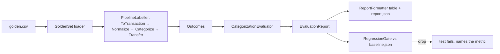

# AOS-511 — Categorization evaluation harness

| Field | Value |
|---|---|
| **Type** | Task |
| **Parent** | [AOS-S2.5](AOS-S2.5.md) (Epic [AOS-E2](AOS-E2.md)) |
| **Status** | ✅ Done |
| **Priority** | P1 |
| **Owner** | Claude |
| **ETA** | 4h |
| **Actual** | 3.5h |
| **Created / Updated / Done** | 2026-10-17 / 2026-10-17 / 2026-10-17 |
| **Branch** | `aos-511-categorization-eval` |
| **Decisions** | D-41, D-44, D-57, D-61 |
| **Blocked by / Blocks** | AOS-206 ✅, AOS-210 ✅ / AOS-512 |

## Description
Measure the categorizer offline and deterministically. The harness has four parts:
- a labelled, synthetic **golden set** (288 rows) of Indian bank narrations, UPI IDs and card descriptors, each with its expected category and subcategory;
- a pure **evaluator** giving precision, recall and F1 per category, accuracy, coverage, confusion pairs and misses;
- a Gradle **report task** (`./gradlew -q categorizationReport`) that prints a table and writes JSON under `build/`;
- a **no-regression gate**: a unit test that fails if accuracy, subcategory accuracy or any category's F1 drops below the checked-in baseline.

## Why
Pragun: AI and algorithms can hallucinate in categorization, and he wants that measured and improved over time. Until now nothing said how often the categorizer is right, so a catalogue or pattern edit could quietly make things worse. D-57 also needs an evaluation harness before any model-written output is allowed. This harness is that measurement, and AOS-512 uses it to measure the AI fallback.

## Scope
- **In:**
  - the golden set (data, synthetic);
  - the evaluator, the baseline and the gate (domain code, pure);
  - the report task and its JSON;
  - a remembered-rules scenario (D-41);
  - trivial fixes for misses that are general gaps (listed below);
  - a documented process for growing the golden set from real corrections.
- **Out:**
  - UI and API endpoints;
  - evaluating dedup, transfer pairing and refund linking (they need other transactions; this is a single-row evaluation);
  - adding brands only because a golden row names them (that would overfit the set; see Risks);
  - schema changes (none needed).

## Acceptance criteria
- [x] **Golden set:** `services/api/src/test/resources/categorization/golden.csv`, 288 rows (200+ required), marked SYNTHETIC in its header. It covers every `TransactionCategory`, with at least 3 rows for each hard-case tag (`p2p`, `gateway`, `amazon`, `fuel`, `nach`, `rent`, `refund`, `atm`, `cardbill`, `wholeword`, `brand-in-vpa`). It holds no real personal data: phone-like handles only use the `98000000xx`/`88000000xx` ranges, and a test enforces this. → `CategorizationRegressionTest`
- [x] **Loader:** a malformed row fails with its line number (unknown category, wrong field count, duplicate id, missing header). Comments and blanks are skipped. → `CategorizationRegressionTest`
- [x] **Evaluator** (pure):
  - per-category support, predicted, precision, recall and F1, plus macro-F1;
  - accuracy, coverage (share not Other), and subcategory accuracy (only rows that expect one);
  - confusion pairs (largest first, with ids), misses, counts by source and accuracy by tag.
  → `CategorizationEvaluatorTest` (13 tests)
- [x] **Report:** `./gradlew -q categorizationReport` prints a readable table and writes `build/reports/categorization/report.json`. → manual check (output under Verification); the formatter is covered by `RegressionGateTest`.
- [x] **No-regression gate:** `CategorizationRegressionTest` fails when overall accuracy, subcategory accuracy or any category's F1 drops below `src/test/resources/categorization/baseline.json`. The message names each metric with its old and new value, e.g. `FOOD F1 dropped from 0.9276 to 0.8`. Improvements are printed, not failed (see Design). → `RegressionGateTest` (9 tests) and the gate test
- [x] **Deliberate baseline update:** `./gradlew -q categorizationReport -PwriteBaseline` rewrites the baseline. A changed golden-set size fails the gate until the baseline is re-recorded.
- [x] **Remembered rules:** on the golden set, corrections (`CategoryCorrectionService`) fix the misses for those payees, for that user only, and no row that was right goes wrong. → `RememberedRulesEvaluationTest` (4 tests)
- [x] **Fixes listed:** each trivial fix is listed below with its effect, and covered by a regression test.
- [x] **Growing the set:** the process for adding Pragun's own corrections without personal data is documented (below).

## Design
- **Context:**
  - The pipeline categorizes in steps: `NormalizeMerchantStep` (catalogue + `NarrationCleaner`), then `CategorizeStep` (`CategorizationService`: remembered rule → catalogue → whole-word patterns → Other), then `TransferStep` (card bill and ATM → Transfer).
  - The categorizer sees the *normalized* name, not the narration, so evaluating `CategorizationService` alone would miss normalizer bugs.
  - The tests already use InMemory repositories.
- **Options considered:**
  1. **Run the shipped pipeline steps on each golden row (chosen).** `PipelineLabeller` builds an `IngestEvent` per row and runs `ToTransactionStep → NormalizeMerchantStep → CategorizeStep → TransferStep`, the last with no candidate transactions. This measures what users see, including normalizer bugs (one was found). It costs a little more setup.
  2. **Call `CategorizationService.builtIn(name)` with hand-normalized names.** Simpler, but it can't see normalizer or transfer-rule effects, and the golden set would need a hand-written "normalized name" column that drifts from the code.
  3. **Evaluate on a snapshot of real transactions.** Most realistic, but it holds personal data (D-33, DPDP), it isn't deterministic, and it can't live in the repo.
- **Gate options:**
  - (a) **Floor only (chosen):** fail on any drop; print improvements.
  - (b) **Ratchet:** also fail when scores rise without a baseline update. Rejected: parallel branches that each add a catalogue brand would break `main` after merging even though both improved things. Raising the floor stays a deliberate `-PwriteBaseline` commit.
- **Where the code lives:**
  - **Main** (`domain/financial/evaluation`): the pure evaluator, `Baseline`/`RegressionGate` and `ReportFormatter`. This is domain logic, measured by Kover and reusable by a later admin report.
  - **Test sources:** the golden-set loader, the labeller and the report `main`. They need the test resources, and they are not product code.
- **Decision:** option 1 with gate (a), D-61. **Patterns:**
  - the labeller is a Strategy (subject under evaluation): rules today, rules + AI in AOS-512;
  - the evaluator is a pure function over `Outcome`s;
  - the gate is a Specification-style comparison returning named `Regression`s.
- **Extensibility:**
  - a new rule or brand is measured by re-running the report;
  - a new labeller (AI, a new categorizer) is a new `suspend (LabelledCase) -> Outcome` with its own baseline file;
  - a new category is a new enum value, and the evaluator picks it up automatically.
- **Impact:**
  - **Domain:** new package `domain/financial/evaluation`. `CategorizationService` gets new patterns, and `MerchantNormalizer` gets a fix.
  - **Data:** one catalogue brand (Nayara Energy).
  - **Build:** a `categorizationReport` JavaExec task.
  - No schema, API, web or Go change.
- **Diagram:**

## Implementation plan
1. Write the golden set first, labelled by what a careful person would choose (before looking at what the code does).
2. Build the evaluator, the baseline, the gate and the formatter in main, with unit tests.
3. Build the loader, the labeller, the report `main` and the Gradle task.
4. Run the report, record the "before" numbers, and fix only general, trivial gaps (each with a regression test).
5. Record the baseline and add the remembered-rules scenario.

## Fixes made (trivial, general; each has a regression test)
1. **Bug: a payee's UPI provider was read as a brand.** `MerchantNormalizer` matched catalogue aliases on the whole narration, including the UPI ID, so `annapoorna@paytm` became the merchant "Paytm". Paytm is in the catalogue as other/wallet, so the row came out as Other/wallet. Every payee with a `@paytm` handle collapsed into one merchant, "Paytm".
   - **Fix:** the narration is matched with the `@provider` part of UPI IDs removed. The handle before `@` still counts.
   - **Regression test:** `MerchantNormalizerTest` › `a UPI ID inside the narration is not read as the brand of its provider`. It fails without the fix (checked).
   - **Fixed rows:** F024. O039 (a cable-TV operator on a `@paytm` handle) is no longer "Paytm", but no rule knows cable TV, so it is still a miss.
   - **Effect:** existing rows with such narrations keep their stored name; new ones get the payee's name. A remembered rule keyed by the merchant name "paytm" would stop matching these payees, but such a rule was wrong for them anyway.
2. **Fuel words → Transport/fuel:** petrol, diesel, fuel, fuels, filling station, petroleum. Fixed T019, T020.
3. **Parking → Transport.** Fixed T031.
4. **Health words:**
   - pharmacy, medical(s), chemist(s) → Health/pharmacy;
   - hospital(s), clinic, dental, diagnostics, pathlabs, gym → Health.
   - Fixed H010, H011, H013, H014, H015, H017.
5. **Education words:** school, university, college, tuition, coaching → Education. Fixed D006, D007, D010, D012.
6. **Food words:** foods, bakery, sweets → Food. Fixed F027.
7. **Catalogue:** Nayara Energy (transport/fuel), the third national fuel retailer, alongside IOCL, HPCL, BPCL and Shell. Fixed T021.

The whole-word tests (`the new words still match whole words only`) keep "Gymkhana" and "Schooler" as Other.

## Verification
- **Categorization numbers** (golden set, 288 rows):

| | Before fixes | After fixes (baseline) |
|---|---|---|
| Accuracy | 77.1% (222) | **82.6% (238)** |
| Coverage (not Other) | 63.9% | 69.4% |
| Macro-F1 | 0.764 | 0.827 |
| Subcategory accuracy | 70.8% (167/236) | 72.5% (171/236) |

- **Per category after the fixes (F1):**
  - Transport 0.973, Transfer 0.957, Food 0.928, Utilities 0.912, Shopping 0.897, Health 0.882, Subscription 0.851;
  - Education 0.762, EMI 0.727, Other 0.631, **Entertainment 0.571 (worst)**.
  - Precision is 0.95–1.00 for every category except Other. When the rules name a category they are almost always right; the misses are nearly all "left as Other" (44 of 50).
- **Remaining misses (50), by kind:**
  - **Unknown brands, left as Other (the AI fallback's target):**
    - subscriptions: Microsoft 365, LinkedIn, Notion, GitHub, The Hindu, Dropbox;
    - entertainment: Steam, PlayStation, Wonderla, Smaaash, Timezone, Paytm Insider, Cinepolis, Dream11, a bowling alley;
    - education: Byju's, upGrad, PhysicsWallah, Sapna Book House, Duolingo;
    - health: MedPlus, Fortis, HealthifyMe, Wellness Forever;
    - food: Barbeque Nation, The Bakers Dozen, A2B, Sagar Ratna, Coca-Cola vending;
    - shopping: kirana and general stores, Lifestyle, Motorola;
    - utilities: TNEB, apartment maintenance, a cable-TV operator, a mobile-recharge shop.
  - **NACH lenders (5):** Bajaj Finance, Home First, Tata Capital, HDB, LIC Housing Finance.
  - **Brand glued into a UPI handle (3):** `netflixupi@`, `uberindia@`, `blinkitpay@`. Whole-word matching can't see a brand that is glued to other letters.
  - **Wrong on purpose or ambiguous (4):**
    - E003 Amazon EMI → Shopping (the catalogue wins over the EMI word);
    - U027 Amazon Pay electricity bill → Shopping;
    - O033 "anil.ola@" → Ola/Transport (a person's surname is a whole-word brand alias);
    - X008 "IB BILLPAY DR-HDFC CARD" is not seen as a card bill.
- **Hard cases by tag:**
  - 100%: gateway 15/15, refund 14/14, fuel 7/7, atm 5/5, rent 4/4, wallet 4/4, investment 4/4;
  - p2p 15/16, cardbill 6/7, amazon 7/9;
  - weakest: nach 5/10, brand-in-vpa 2/5, local 18/27.
- **Remembered rules (D-41) on the golden set:** correcting 4 misses (Steam, Byju's by UPI ID, Anil Ola, Fortis) raises correct rows from 238 to 242. No other row changes, the 4 rows are labelled `remembered`, and another user's report is identical.
  - **Finding:** correcting "EMI 3 OF 12 AMAZON ORDER" to EMI makes a merchant-name rule for "amazon", so every Amazon purchase without its own UPI rule becomes EMI (S001, S002 and R001 break). This follows from D-41's keying, and a characterization test now keeps it visible. Suggested follow-up: don't remember a correction keyed by a catalogue brand name without asking ("only this one / all Amazon").
- **Report:** `./gradlew -q categorizationReport` prints the table above, with confusions, tags and the first 50 misses, and writes `build/reports/categorization/report.json`.
- **API:** `./gradlew test integrationTest koverVerify` is green.
  - 1,341 unit and 116 integration tests, 0 failed, 0 skipped.
  - Coverage is 99.29% lines and 90.72% branches (gate 90/85). The `evaluation` package is at 100% lines.
- **New tests (30):**
  - `CategorizationEvaluatorTest` 13;
  - `RegressionGateTest` 9;
  - `CategorizationRegressionTest` 6 (gate, size and coverage, hard cases, no phone numbers, malformed rows, comments);
  - `RememberedRulesEvaluationTest` 4;
  - plus 1 in `MerchantNormalizerTest` and 2 in `CategorizationServiceTest`.
- No web, Go or schema change, so those suites were not needed.

## Growing the golden set (from Pragun's own corrections)
The golden set should increasingly be real-shaped data. Real data is personal, so only a scrubbed form may be added:
1. **Pick rows.** Use transactions with `category_source = 'user'` (hand corrections), which are labelled by Pragun himself, for example:
   `select merchant_raw, upi_vpa, payment_method, type, category, subcategory from transactions where user_id = :me and category_source = 'user' order by updated_at desc limit 50;`
   Run it with a read-only connection.
2. **Scrub every row by hand before it leaves the machine:**
   - Replace a **person's** name and UPI ID with invented ones (`RAVI KUMAR` / `ravi.k@oksbi`). Keep a **merchant's** name and handle.
   - Replace phone-number handles with `98000000xx`.
   - Replace RRNs, account and card numbers and IFSC branch digits with synthetic values in the same shape (`4289…`, `XXXXXX1234`, `HDFC0001234`).
   - Never copy SMS or email text (D-33): only the narration fields above.
   - Drop the amount: the golden set has none.
3. **Append the rows** to `golden.csv` with a new id prefix (`P###` for "Pragun-derived"), tags (`real-shaped` plus the hard-case tags), and the label Pragun chose.
4. **Run the report and re-record:**
   - Run `./gradlew -q categorizationReport`.
   - New rows usually lower the score at first; that is the point.
   - Record it with `-PwriteBaseline` and say in the commit "golden +N rows (real-shaped)".
5. **Optional later:** a CLI export doing step 2 automatically (a `scrub` that keeps catalogue brands and replaces everything else). It isn't built here, because hand review is the safer first step.

## Risks / notes
- **Overfitting:** the set and the fixes were written by the same author. The fixes were limited to general words and one national fuel brand; brands named only once in the set were left as misses on purpose, so the AI fallback (AOS-512) and future catalogue work can be measured on them. Real-shaped rows (above) are the remedy.
- **Labels are judgement calls:**
  - rent, investments, insurance, wallets and income are Other (with a subcategory where useful), because AdminOS has no Rent or Income category (taxonomy gap: consider a `RENT` or `HOUSING` category later);
  - hotels and travel booking are Transport/travel, as MakeMyTrip is in the catalogue;
  - salons and home services are Other/services.
- **The single-row evaluation** doesn't measure dedup, transfer pairing or refund linking.
- **Normalizer fix:** stored transactions keep their old merchant name. No backfill was done; the next statement import or edit uses the new rule.

## Decision D-61 (recorded in DECISIONS.md)
See [DECISIONS.md](../DECISIONS.md) D-61.

## Activity log
- 2026-10-17 — Claude (main session): reviewed (golden set synthetic, normalizer fix), rebased, gates re-run, D-61 recorded, merged.
- 2026-10-17 — Claude: ticket created. Golden set written first (288 synthetic rows across all 11 categories and hard cases).
- 2026-10-17 — Claude: evaluator, gate, formatter, loader, labeller and report task built. First run: 77.1% accuracy, 63.9% coverage, macro-F1 0.764.
- 2026-10-17 — Claude: found the `@paytm` normalizer bug and the gaps (fuel, health, education, parking, food words, Nayara). After the fixes: 82.6%, 69.4%, macro-F1 0.827. Baseline recorded.
- 2026-10-17 — Claude: remembered-rules scenario added. Found the brand-name rule trade-off (an Amazon EMI correction relabels all Amazon purchases); characterization test added.
- 2026-10-17 — Claude: `./gradlew test integrationTest koverVerify` green (1,341 + 116; 99.29% / 90.72%). PR opened.

## Definition of Done (docs/ENGINEERING.md §4)
- [x] Each acceptance criterion covered by a test or a documented manual check
- [x] Tests/build green (integration tests if the DB is touched)
- [x] Layer rules respected; no silent fallbacks; no secrets/PII in logs
- [ ] Decisions recorded · ticket, story, epic and board updated · PROGRESS.md updated (D-61 proposed above; DECISIONS/BACKLOG/PROGRESS/story are left to the coordinator)
- [x] Commit message starts with `AOS-511:`

## Resolution
- **Built:** a deterministic categorization evaluation harness.
  - **Golden set:** `golden.csv` (288 synthetic rows).
  - **Main** (`domain/financial/evaluation/`): `CategorizationEvaluator.kt` (Label, CaseInput, LabelledCase, Prediction, Outcome and the report types), `RegressionGate.kt` (Baseline, Regression, gate) and `ReportFormatter.kt`.
  - **Test sources:** `GoldenSet.kt`, `PipelineLabeller.kt`, `CategorizationReport.kt` (report `main` and baseline loader) and `baseline.json`.
  - **Build:** the `categorizationReport` task in `build.gradle.kts`.
- **Fixes:**
  - the `@paytm` handle bug in `MerchantNormalizer.kt`;
  - new patterns in `CategorizationService.kt`;
  - Nayara Energy in `catalogue.json`.
- **Tests:** `CategorizationEvaluatorTest`, `RegressionGateTest`, `CategorizationRegressionTest` and `RememberedRulesEvaluationTest`, plus additions to `MerchantNormalizerTest` and `CategorizationServiceTest`.
- **Verified:** the full API suite with the coverage gate (numbers above).
- **Result:** accuracy 77.1% → 82.6% on the golden set. The worst category is Entertainment (F1 0.571).
- **Actual vs ETA:** 3.5h vs 4h.
