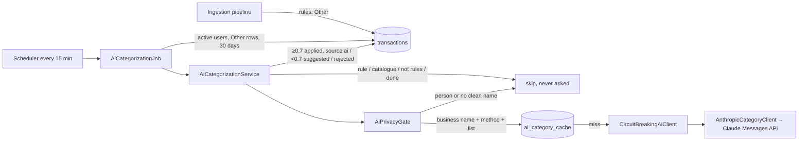

# AOS-512 — AI fallback categorizer for "Other" (off by default)

| Field | Value |
|---|---|
| **Type** | Task |
| **Parent** | [AOS-S2.5](AOS-S2.5.md) (Epic [AOS-E2](AOS-E2.md)) |
| **Status** | ✅ Done (off by default; a real-model run needs an `ANTHROPIC_API_KEY`) |
| **Priority** | P2 |
| **Owner** | Claude |
| **ETA** | 5h |
| **Actual** | 4.5h |
| **Created / Updated / Done** | 2026-10-17 / 2026-10-17 / 2026-10-17 |
| **Branch** | `aos-512-ai-categorizer` |
| **Decisions** | D-33, D-41, D-57, D-61, D-62 |
| **Blocked by / Blocks** | AOS-511 (PR #71) / — |

## Description
When the deterministic categorizer leaves a transaction as **Other**, optionally ask Claude for a category:
- **What is sent:** only the cleaned business name, the payment method and the fixed category list.
- **Strictness:** the answer must be structured and from the list.
- **Confidence:** a sure answer (≥ 0.7) sets the category with source `ai`; an unsure one leaves Other and records the guess as a suggestion.
- **Precedence:** rules and remembered corrections always win.
- **Caching:** answers are cached per merchant.
- **Off by default:** the feature runs only with `AI_CATEGORIZATION_ENABLED=true` and `ANTHROPIC_API_KEY` set.
- **Measured:** the AOS-511 harness scores the rules-plus-AI combination.

## Why
After AOS-511 the rules reach 82.6% on the golden set, and 44 of the 50 misses are "left as Other": unknown brands (Steam, Microsoft 365, Fortis, upGrad…), local shops and NACH lenders. Pragun wants fewer "Other" rows, but is wary of AI hallucinating (D-57). This feature keeps the AI in a box:
- it only fills gaps;
- it never overrides a rule;
- it never sees personal data;
- an unsure answer is shown as a suggestion, not a fact;
- its effect is measured by a gate.

## Scope
- **In:**
  - domain types and port (`AiCategoryClient`), the privacy gate, the service and a scheduled job;
  - the Claude adapter (official Java SDK) with retries, timeouts and a circuit breaker;
  - the per-merchant cache (V28);
  - config validated at start-up;
  - the harness extension (rules + AI with recorded answers, its own baseline, a "never overrides rules" check);
  - `-PrecordAi` to re-record real answers.
- **Out:**
  - UI for suggestions: the web doesn't show `metadata.ai` yet (follow-up below);
  - a subcategory from the AI;
  - the Go/legacy `CLAUDE_API_KEY` paths (untouched);
  - letting the model rephrase anything user-facing (D-57 still applies).

## Acceptance criteria
- [x] **Off unless** `AI_CATEGORIZATION_ENABLED=true`:
  - enabled without `ANTHROPIC_API_KEY`, or with a flag other than true/false, refuses to start with a clear message;
  - the key is never printed (`toString` masks it) or logged, and appears in no file;
  - tests generate a key at runtime.
  → `AiCategorizationConfigTest` (7)
- [x] **Model:** `claude-haiku-5-5` by default, configurable with `AI_CATEGORIZATION_MODEL` (validated as a model id). → `AiCategorizationConfigTest`
- [x] **Messages API via the official SDK** (`com.anthropic:anthropic-java` 2.73.0, the latest stable on Maven Central, released 2026-10-15):
  - 20 s timeout per attempt;
  - the SDK's exponential-backoff retries for 408/409/429/5xx and connection errors (3 retries);
  - a circuit breaker stops asking for 15 minutes after 3 failed requests in a row.
  → `AnthropicCategoryClientTest` (12; local fake server: 529 then 200 is retried and answered, 429 that outlasts retries, 401 not retried, no server, invalid reply), `AiCategoryClientTest` (breaker opens, stays open, closes; a rejected answer resets it)
- [x] **Privacy (D-33):**
  - only `{"merchant", "paymentMethod", "allowedCategories"}` is sent, plus a fixed system prompt;
  - a payee is sent only when it is clearly a business: a card payment, a gateway descriptor, a registered company in the narration, or a business word in the cleaned name (never in the payment note);
  - payments to people, UPI IDs, long numbers, amounts, dates and identity never leave AdminOS.
  → `AiPrivacyGateTest` (5), the request-body test in `AnthropicCategoryClientTest`, and `AiEvaluationTest` (no `p2p` golden row is ever asked)
- [x] **Structured answer:**
  - JSON schema with `category` as an enum of the allowed list, `confidence` and `reason`; `additionalProperties: false`;
  - checked again on receipt: exactly those 3 fields, a category from the list, a confidence that is a number in 0–1, a reason of 1–200 characters;
  - anything else, a refusal or a truncated reply → **Rejected** (stays Other, cached so it isn't asked again);
  - Transfer is never allowed (D-41).
  → `AnthropicCategoryClientTest` (14 malformed shapes rejected)
- [x] **Confidence:**
  - ≥ 0.7 sets the category, with `categorySource = ai`, subcategory null and `metadata.ai = {status: applied, category, confidence, reason, model, at}`;
  - below 0.7 the transaction stays Other with `metadata.ai.status = suggested` (a suggestion to confirm);
  - an "Other" answer is recorded as `status: other`.
  → `AiCategorizationServiceTest`
- [x] **Rules always win:** the model is never asked when:
  - the category came from a person, a remembered rule, a transfer rule, or a non-Other rule result;
  - a remembered rule exists for the UPI ID or the merchant name;
  - the merchant is in the catalogue (e.g. Paytm is Other on purpose);
  - it is income, a transfer or a reversal.
  A correction made while the model was answering is not overwritten (re-read before writing). → `AiCategorizationServiceTest`
- [x] **Cache:** one question per merchant (matching form), stored in `ai_category_cache` (V28: merchant key, model, category, confidence and reason only, with no user, amount or transaction). Rejections are cached; unavailable results are not. → `AiCategorizationServiceTest`, `AiCategorizationIntegrationTest` (Postgres round trip, the same checks on InMemory)
- [x] **Doesn't slow ingestion; idempotent:**
  - a `ScheduledJob` (`ai-categorization`, every 15 minutes) reads each active user's Other rows from the last 30 days (max 200);
  - `metadata.ai` marks a transaction as done;
  - a second run asks nothing;
  - a failing user is isolated.
  → `AiCategorizationServiceTest` (job tests), `AiCategorizationIntegrationTest` (stored on Postgres, other metadata kept, idempotent)
- [x] **Measured by AOS-511:**
  - `./gradlew -q categorizationReport` prints and writes rules + AI (`report-ai.json`) with its own `baseline-ai.json` gate;
  - tests show the AI never changes a rule-decided row and only touches rows left as Other;
  - a reckless fake ("always Food, 0.99") can't change rule-decided rows or payments to people;
  - every asked question is recorded.
  → `AiEvaluationTest` (6)

## Design
- **Context:**
  - The pipeline runs synchronously in `IngestProcessor`, and `TransactionCreatedListener`s run in the same loop after each commit.
  - Scheduled jobs (D-50) are claimed per slot, isolated per user, and recorded.
  - `Transaction.metadata` is JSON (`JsonColumns`).
  - Category corrections (AOS-210) already give the user a "confirm" action: setting a category with remember=true.
  - Link suggestions (`SuggestionService`) are pairwise transaction relations (duplicate, transfer, refund), so they don't fit a category guess.
- **Where it runs. Options considered:**
  1. **A pipeline step:** the simplest, but every unknown merchant would add a network call (up to timeout × retries) to ingestion, and an outage would fail or slow every import. Rejected.
  2. **A `TransactionCreatedListener`:** runs after the commit, but still in the processor loop, so a 300-row statement with 100 unknown merchants would wait ~100 sequential calls. Rejected for that reason.
  3. **A scheduled batch job, every 15 minutes (chosen):** ingestion is never touched. It also backfills existing Other rows (30 days), retries naturally on the next slot, and fits the circuit breaker. The cost is up to 15 minutes before an AI label appears, which is fine for a spending console.
- **Low-confidence answers. Options considered:**
  - (a) reuse `SuggestionService`: it is built for two-transaction links, so it would need a new relation kind, schema and UI;
  - (b) **keep Other and record the guess in `metadata.ai` (chosen):** no schema change on transactions, the user confirms through the existing category correction, and a later UI can show "AI suggests: Health (60%)".
- **Client. Options considered:**
  - (a) `java.net.http` by hand: no new dependency, but we would own retries, timeouts, error typing and the wire format;
  - (b) **the official Anthropic Java SDK (chosen):** typed request/response, built-in backoff for 429/5xx, typed exceptions and structured-output support. It adds OkHttp, Jackson (already on the classpath through other libraries), the OpenTelemetry API and a JSON-schema generator.
  - It is actively maintained (2.73.0, 2026-10-15) and MIT-licensed. Per ENGINEERING §7 the dependency is recorded here.
- **Privacy gate options:**
  - (a) send every Other payee name: rejected, because it would send people's names;
  - (b) a list of merchant UPI handles: incomplete and changing;
  - (c) **positive business evidence (chosen):** card, gateway, registered company, or a business word in the cleaned name. Business words in the free-text note don't count, so "MOBILE RECHARGE" in a note to a friend can't expose the friend.
  - **Trade-off:** some shops (Byju's on UPI, The Bakers Dozen) are never asked and stay Other.
- **Decision:** the job + metadata + SDK + positive gate (D-62). **Patterns:**
  - Adapter (layer 5 client behind the domain `AiCategoryClient` port);
  - Decorator / circuit breaker (`CircuitBreakingAiClient`);
  - Strategy for the evaluation labeller;
  - Repository for the cache (InMemory + Exposed);
  - `ScheduledJob` (open/closed: one Koin line, registered only when enabled).
- **Extensibility:**
  - another model or provider is a new `AiCategoryClient`;
  - subcategories could be added to the schema later;
  - the threshold is one constant;
  - the web can read `metadata.ai` to show suggestions.
- **Impact:**
  - **Domain:** `domain/financial/ai/` (`AiCategoryClient.kt`, `AiCategoryCache.kt`, `AiPrivacyGate.kt`, `AiCategorizationService.kt`, `AiCategorizationJob.kt`);
  - **Config:** `config/AiCategorizationConfig.kt`;
  - **Infrastructure:** `infrastructure/ai/AnthropicCategoryClient.kt`, the cache table and the Exposed repository;
  - **Schema:** `V28__ai_category_cache.sql`;
  - **DI:** `AppModule`;
  - **Build:** `libs.versions.toml` and `build.gradle.kts` (dependency, report flags);
  - `.env.example` and `docker-compose.yml` (off by default).
  - No API/DTO, web or Go change.
- **Diagram:**

## Exactly what is sent to Claude
- **System prompt:** fixed text describing the categories (in `AnthropicCategoryClient`); no user data.
- **User message**, e.g. `{"merchant":"Steam","paymentMethod":"CARD_CREDIT","allowedCategories":["FOOD","TRANSPORT","SHOPPING","UTILITIES","EMI","SUBSCRIPTION","ENTERTAINMENT","HEALTH","EDUCATION","OTHER"]}`.
- **Request settings:** model, `max_tokens` 300, `thinking: disabled`, `output_config: {effort: low, format: json_schema}`.
- **Never sent:** amounts, dates, account or card numbers, UPI IDs, the raw narration, SMS/email/WhatsApp text, the user's name, email or id, or any person's name.

## Verification
- **Golden set (288 rows), rules vs rules + AI** (recorded, synthetic answers for the 36 merchants that pass the gate):

| | Rules (AOS-511 baseline) | Rules + AI (baseline-ai) |
|---|---|---|
| Accuracy | 82.6% (238) | **91.7% (264)** |
| Coverage (not Other) | 69.4% | 79.2% |
| Macro-F1 | 0.827 | 0.913 |
| Rows labelled by AI | 0 | 28 |

- **Per-category F1, rules → rules + AI:**
  - Entertainment 0.571 → 0.846;
  - Education 0.762 → 0.870;
  - EMI 0.727 → 0.833;
  - Health 0.882 → 0.944;
  - Subscription 0.851 → 0.946;
  - Other 0.631 → 0.804.
  - Now worst: Other 0.804, EMI 0.833, Entertainment 0.846.
- **AI mistakes kept on purpose in the recording:**
  - Healthifyme → Subscription and Duolingo → Subscription (both wrong, applied);
  - Prestige AOA (0.62) and Sapna Book House (0.60): suggested, so they stay Other (misses).
  - Subscription precision drops from 1.000 to 0.929. The harness shows that cost.
- **Never asked** (stay as before): all 16 `p2p` rows; every rule-decided row; Paytm Insider (catalogue Paytm); UPI shops with no business word (Byju's, Sagar Ratna, The Bakers Dozen, Cinepolis, Dream11).
- **The numbers measure the policy, not Claude.** The 36 answers are hand-written and plausible. To measure the real model, run `ANTHROPIC_API_KEY=… ./gradlew -q categorizationReport -PrecordAi`. It sends only those 36 merchant names; then re-run the report and `-PwriteBaseline`. This was not run here (no key is available to agents, by design).
- **API:** `./gradlew test integrationTest koverVerify` is green after rebasing on main (with AOS-403, AOS-405 and AOS-513).
  - 1,475 unit and 122 integration tests, 0 failed, 0 skipped.
  - Coverage is 99.32% lines and 90.24% branches (gate 90/85).
  - `domain/financial/ai` is at 99.3% lines and 91.3% branches; `infrastructure/ai` at 100% lines and 85% branches.
- **New tests (55):**
  - `AiCategorizationServiceTest` 15 (incl. job);
  - `AnthropicCategoryClientTest` 12;
  - `AiCategoryClientTest` 8;
  - `AiCategorizationConfigTest` 7 (incl. DI on and off, with and without a DB);
  - `AiEvaluationTest` 6;
  - `AiPrivacyGateTest` 5;
  - `AiCategorizationIntegrationTest` 2 (Postgres).
- No web, Go or Playwright run (nothing there changed).

## Risks / notes
- **Prompt injection through a merchant name:** at most 60 characters of a business name. The output is confined to the enum and checked again, so the worst case is a wrong category, visible as source `ai` and fixable by a correction (which then wins forever).
- **Hallucination:** confined to Other rows. Unsure answers are only suggestions; every AI label carries its confidence and reason in `metadata.ai`, and the gate catches regressions once real answers are recorded.
- **Cost:** about 36 questions for the whole golden set; one question per new merchant after that (cached). Claude Haiku 5.5 costs $0.10 / $0.50 per MTok, so this is negligible.
- **Cache staleness:** answers never expire, and a model change doesn't re-ask. Clearing `ai_category_cache` re-asks.
- **Two key names:** the legacy Go workers use `CLAUDE_API_KEY` / `CLAUDE_MODEL` (with an old model id); this feature uses `ANTHROPIC_API_KEY` (the SDK standard), as briefed. Worth unifying later.
- **Migration number:** V28. V26 and V27 are reserved for AOS-405 and AOS-406, which must merge first (Flyway rejects a lower version arriving after a higher one).
- **Follow-ups:**
  1. Web: show `metadata.ai` suggestions on Other rows ("AI suggests Health, 60%: Confirm"), using the existing correction route.
  2. Run `-PrecordAi` with the real key and adopt the real baseline.
  3. Possibly let the gate accept merchant UPI handles such as `@okbizaxis`.

## Decision D-62 (recorded in DECISIONS.md)
See [DECISIONS.md](../DECISIONS.md) D-62.

## Activity log
- 2026-10-17 — Claude (main session): reviewed (privacy gate, strict schema, off by default), rebased onto main after AOS-511, gates re-run, D-62 recorded, merged.
- 2026-10-17 — Claude: ticket created, branched from `aos-511-categorization-eval`. Design: batch job, metadata suggestions, official SDK, positive privacy gate.
- 2026-10-17 — Claude: domain (port, breaker, cache, gate, service, job), Claude adapter (SDK 2.73.0, structured output), config, V25 cache, DI and tests built. 36 golden rows pass the gate; none is `p2p`.
- 2026-10-17 — Claude: harness extended (`AiLabeller`, `RecordedAiClient`, `ai-recorded.csv`, `baseline-ai.json`, `-PrecordAi`). Rules 82.6% → rules + AI 91.7% on synthetic recorded answers.
- 2026-10-17 — Claude: per the coordinator, migration renumbered **V25 → V28** (V26/V27 are reserved for AOS-405/406), and rebased on main (AOS-403, AOS-405 with V26, AOS-513). Full suite green: 1,475 + 122, 99.32% / 90.24%.
- 2026-10-17 — Claude: PR opened against main, depending on #71.

## Definition of Done (docs/ENGINEERING.md §4)
- [x] Each acceptance criterion covered by a test or a documented manual check
- [x] Tests/build green (integration tests if the DB is touched)
- [x] Layer rules respected; no silent fallbacks; no secrets/PII in logs
- [ ] Decisions recorded · ticket, story, epic and board updated · PROGRESS.md updated (D-62 proposed above; DECISIONS/BACKLOG/PROGRESS/story are left to the coordinator)
- [x] Commit message starts with `AOS-512:`

## Resolution
- **Built:** the optional AI fallback categorizer.
  - **Domain** (`domain/financial/ai/`): port, circuit breaker, privacy gate, service and job.
  - **Infrastructure:** the Claude adapter (official Java SDK 2.73.0, structured output, strict re-validation) and the V28 per-merchant cache (Exposed + InMemory).
  - **Config:** validated at start-up, with the key masked.
  - **Wiring:** Koin wiring only when enabled; `.env.example` and compose entries (off by default).
  - **Harness:** extended with a recorded-answers labeller, its own baseline, and the proofs that it never overrides rules and never sees payments to people.
- **Verified:** the full API suite with the coverage gate.
- **Result:** rules + AI is at 91.7% vs 82.6% for the rules on the golden set, with synthetic recorded answers. Real numbers need one `-PrecordAi` run.
- **Actual vs ETA:** 4.5h vs 5h.
