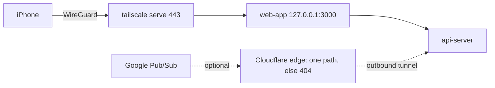

# AOS-616 — Private network only: no public listener (Tailscale), webhook-only path for Gmail push

| Field | Value |
|---|---|
| **Type** | Task |
| **Parent** | [AOS-S6.4](AOS-S6.4.md) (Epic [AOS-E6](AOS-E6.md)) |
| **Status** | ✅ Done (the go-live steps in the guide are Pragun's, at AOS-605) |
| **Priority** | P0 (security) |
| **Owner** | Claude |
| **ETA** | 3h |
| **Actual** | 3h |
| **Created / Updated / Done** | 2026-10-17 / 2026-10-17 / 2026-10-17 |
| **Branch** | `aos-616-private-access` |
| **Decisions** | D-91, D-32, D-59 · proposed **D-97** |
| **Blocked by / Blocks** | — / go-live (AOS-605), AOS-623 |

## Description
Make "nobody can reach it except me" true at the network layer (D-91 layer 1): document and script how the
owner reaches AdminOS from their iPhone and Mac with **no public listener**, keep every service on loopback
or the compose network, enforce that with a check, make `APP_URL` and cookies correct for a tailnet HTTPS
host, and design how the iOS SMS Shortcut and Gmail push reach the API without opening the site.

## Why
D-91: "nobody is able to access it except me, even if I deploy it". A public URL protected only by the app
login is rejected in D-91; every app or dependency bug would be one request away from the internet.

## Scope
- **In:** research and comparison; `docs/guides/PRIVATE-ACCESS.md`; Tailscale policy template; optional
  sidecar overlay; optional webhook-only Cloudflare Tunnel overlay; exposure check script and tests;
  `APP_URL` validation; `.env.example`.
- **Out:** actually creating the tailnet / tunnel (Pragun, at go-live); Pub/Sub pull (new ticket if wanted);
  checking the `Tailscale-User-Login` header in the app (possible later extra layer, see Risks);
  CI wiring of the check (AOS-622).

## Acceptance criteria
- [x] Options compared with evidence: Tailscale + serve, Cloudflare Tunnel + Access, WireGuard by hand, public port (rejected). → guide §2
- [x] Step-by-step go-live guide: tailnet settings (device approval, key expiry, MagicDNS, HTTPS, Tailnet Lock), policy, Mac host and VPS sidecar, verification checklist, lost device. → guide §3–§7
- [x] Tailnet policy: only the owner's devices reach `tag:adminos:443`; everything else denied; Funnel can't be enabled; policy tests included. → `deploy/tailscale/policy.hujson`
- [x] Optional compose overlay that keeps every service on loopback or the compose network: the Tailscale sidecar publishes no port, runs unprivileged (userspace, caps dropped, read-only, no-new-privileges). → `docker-compose.tailnet.yml`
- [x] `APP_URL` for the tailnet HTTPS host: the API refuses a plain-http non-loopback `APP_URL`, or one with a path/query/fragment/credentials; cookies are `Secure` for the tailnet host. → `AppUrlConfigTest` (6)
- [x] iOS Shortcut path designed (phone on the tailnet, VPN On Demand, device token); Gmail push options with a recommendation. → guide §5
- [x] Gmail push option 2 is ready and verified: the tunnel routes only `^/api/v1/webhooks/gmail$` to the API, everything else 404. → `cloudflared-ingress.test.sh` (17)
- [x] Every published port in every compose stack and profile is `127.0.0.1`; a check fails on any wider publish, host networking or privileged service. → `check-compose-exposure.test.sh` (16)

## Design
- **Context:** compose already publishes `127.0.0.1` only (AOS-110/119); the web app proxies `/api/*` to the
  API (D-32), which needs an edge proxy that owns `X-Forwarded-For`. Cookies drop `Secure` only for loopback
  http (AOS-610). Gmail push needs a public HTTPS endpoint for Pub/Sub (AOS-405/609).
- **Options considered (network):**
  1. **Tailscale + `tailscale serve`** (tailnet-only HTTPS, MagicDNS, deny-by-default policy, device
     approval, key expiry, Tailnet Lock). No public listener; end-to-end WireGuard; XFF set by serve.
  2. Cloudflare Tunnel + Cloudflare Access (email IdP + WARP posture): no inbound port, but a public
     hostname with a login page, and Cloudflare decrypts all traffic.
  3. Hand-run WireGuard: no third party, but an inbound UDP port, manual keys, DNS and certificates.
  4. Public port + app login: rejected by D-91.
- **Options considered (Gmail push):** 1) no push: daily fallback + Sync now (D-59); 2) webhook-only Cloudflare
  Tunnel, one path, OIDC-verified; 3) Pub/Sub pull from a worker (new code).
- **Decision:** network option 1; Gmail option 1 at go-live, option 2 shipped as an opt-in overlay, option 3
  proposed as a follow-up if fresher email is wanted. **Patterns:** defence in depth; deny by default;
  fail closed (config validation, policy tests, exposure check).
- **Extensibility:** another private-only service is a new compose service with no `ports:` (or `127.0.0.1:`);
  another device joins the tailnet and needs the owner's approval; another webhook would be a new, tested
  ingress rule (the test pins the rule count, so it can't be added by accident).
- **Impact:** API config only (`AppConfig.appUrl`); compose overlays are additive and opt-in; no schema or
  contract change.

## Security (threat review, ENGINEERING §4a)
- **Exposes:** nothing new by default. Opt-in only: a tailnet-only HTTPS listener (owner's devices), and,
  if chosen, one public path at Cloudflare's edge.
- **Abuse and what stops it:**
  - stranger on the internet → no DNS name or port answers (tailnet only; policy default deny; Funnel blocked);
  - stolen Google session adds a device → device approval and Tailnet Lock;
  - compromised Tailscale coordination server → Tailnet Lock (it can't sign new nodes); it never sees traffic;
  - a wider port publish slips into compose → `check-compose-exposure.sh` fails (CI in AOS-622);
  - cleartext or spoofed origin via a bad `APP_URL` → start-up refuses it;
  - spoofed client IP → `tailscale serve` overwrites `X-Forwarded-For` with the real tailnet address (D-32);
  - (option 2) webhook route used to reach other routes → only the exact path is routed; `..`, encoded
    slashes, prefixes, case tricks and other hosts all 404 (tested with cloudflared's own matcher); the API
    still requires a Google-signed OIDC token and fails closed (AOS-609).
- **Tests that attack it:** exposure-check fixtures (bare, wildcard v4/v6, LAN IP, long form, variable
  default, profile-only, host network, privileged, unrenderable); ingress path tricks; `APP_URL` hostile values
  (`javascript:`, userinfo, paths, `0.0.0.0`, `localhost.example.in`). No route or screen added, so no new
  route-inventory or Playwright specs.

## Implementation plan
1. Exposure check script + shell tests. 2. Overlays (tailnet sidecar, gmail-push tunnel) + ingress test.
3. `APP_URL` validation + tests. 4. Guide and policy template. 5. `.env.example`.

## Verification
- `scripts/tests/check-compose-exposure.test.sh` → 16 passed (incl. the real `docker-compose.yml` alone and with both overlays).
- `scripts/tests/cloudflared-ingress.test.sh` → 17 passed (`cloudflared 2026.10.1` `ingress validate` / `ingress rule`).
- shellcheck (`-S warning`) clean on all scripts.
- `docker compose config -q` valid for the base file (`--profile full`) and with each overlay (dummy env).
- API: `./gradlew test integrationTest koverVerify` → green (unit 1,512, integration 125, coverage gate passes); `AppUrlConfigTest` 6/6.
- Manual at go-live (Pragun): guide §6 checklist.

## Risks / notes
- **Google OAuth on `*.ts.net`:** expected to work (public suffix), but the consent screen's "authorised
  domains" may ask for a domain you can't verify. Guide §4a.5 says what to do; record the outcome.
- **Sidecar runtime not exercised here** (needs a real auth key); config validated and based on Tailscale's
  documented `TS_*` settings and containerboot's `${TS_CERT_DOMAIN}` substitution.
- **Possible extra layer later:** the app could also require `Tailscale-User-Login` (set and stripped by
  serve) to equal the owner's login; only safe while nothing but serve can reach the web app.
- Bugs/findings outside this task: see the PR description (reported, not fixed).

## Activity log
- 2026-10-17 — Claude: ticket created (🟦), research and design.
- 2026-10-17 — Claude: check script, overlays, ingress test, `APP_URL` validation, guide; all checks green (✅).

## Proposed decision D-97 — Private network only: Tailscale; Gmail push off by default
Type: Architecture / Security · Tasks: AOS-616 · Builds on D-91, D-32, D-59
- AdminOS has **no public listener**. The owner reaches it over **Tailscale**: `tailscale serve` on 443
  (tailnet only), MagicDNS, HTTPS certificates, device approval, key expiry on user devices, Tailnet Lock,
  and the repo's deny-by-default policy (owner devices → `tag:adminos:443` only; no Funnel).
- On the Mac the Tailscale app serves `127.0.0.1:3000`; on a server, the `docker-compose.tailnet.yml` sidecar.
- Compose publishes only on `127.0.0.1`; `scripts/check-compose-exposure.sh` enforces it for every stack and profile.
- `APP_URL` must be https unless loopback, and a bare origin; the API refuses to start otherwise.
- **Gmail push is off at go-live**; the daily fallback and Sync now cover email (D-59). If push is needed,
  prefer Pub/Sub pull (new ticket); the webhook-only Cloudflare Tunnel overlay (one path, OIDC-verified,
  everything else 404 at the edge) is the opt-in alternative.
- **Rejected:** Cloudflare Tunnel + Access for the whole site (public login page; Cloudflare sees plaintext);
  hand-run WireGuard (inbound port, manual keys and certs); a public port with the app login (D-91).

## Definition of Done (docs/ENGINEERING.md §4)
- [x] Each acceptance criterion covered by a test or a documented manual check
- [x] Tests/build green (API unit + integration + Kover; shell tests; compose config)
- [x] Layer rules respected; no silent fallbacks; no secrets/PII in logs (the check never prints the rendered config)
- [ ] Decisions recorded · story, epic and board updated · PROGRESS.md updated — **for the integrator** (D-97 proposed above; this task may not edit those files)
- [x] Commit message starts with `AOS-616:`

## Resolution
Done. Added `docs/guides/PRIVATE-ACCESS.md`, `deploy/tailscale/{policy.hujson,serve.json}`,
`docker-compose.tailnet.yml`, `docker-compose.gmail-push.yml`, `deploy/cloudflared/config.yml`,
`scripts/check-compose-exposure.sh`, `scripts/tests/{check-compose-exposure,cloudflared-ingress}.test.sh`;
changed `AppConfig.appUrl` (+ `AppUrlConfigTest`) and `.env.example`. Verified as above. Actual 3h vs ETA 3h.
