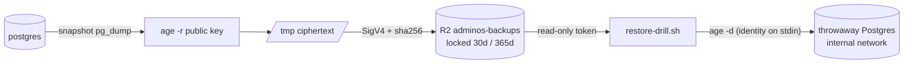

# AOS-621 — Encrypted backups: client-side age, separate locked R2 bucket, restore drill, key backup

| Field | Value |
|---|---|
| **Type** | Task |
| **Parent** | [AOS-S6.4](AOS-S6.4.md) (Epic [AOS-E6](AOS-E6.md)) |
| **Status** | ✅ Done (bucket, tokens, keys and the first drill are Pragun's go-live steps) |
| **Priority** | P0 (security) |
| **Owner** | Claude |
| **ETA** | 5h |
| **Actual** | 5h |
| **Created / Updated / Done** | 2026-10-17 / 2026-10-18 / 2026-10-18 |
| **Branch** | `aos-621-backups` (stacked on `aos-616-private-access`) |
| **Decisions** | D-91, D-60 · proposed **D-98** |
| **Blocked by / Blocks** | AOS-616 (stack base) / go-live (AOS-605) |

## Description
Nightly Postgres backups, encrypted on the host before upload, to a separate private R2 bucket, with retention,
checksums, a scripted restore drill, key-backup guidance and a FileVault check.

## Why
D-91 layer 5 ("encrypted backups"); the story AC "data survives a lost laptop, encrypted". D-60: the vault is
only as safe as `TOKEN_ENCRYPTION_KEY`, which must be backed up offline.

## Scope
- **In:** backup image and scheduler, restore check, drill script, bucket setup script, compose overlay,
  guide, tests.
- **Out:** backing up R2 document objects (they're already ciphertext in R2, D-60; a cross-bucket copy is a
  possible follow-up); alerting on an unhealthy backup through push/email (AOS-620 can pick up the healthcheck);
  a dedicated read-only DB role for pg_dump (follow-up; the job uses the app role like the workers).

## Acceptance criteria
- [x] Nightly `pg_dump`, encrypted client-side with age (plaintext never on disk), uploaded to a separate bucket. → e2e "stored dump is age ciphertext", "no plaintext row data"
- [x] The host holds only the public key; a secret key in `BACKUP_AGE_RECIPIENT` is refused without being echoed. → unit + e2e
- [x] Narrowest bucket-scoped token; deletion/overwrite impossible during retention (bucket lock); no public access. → `setup-r2-bucket.test.sh` (12)
- [x] Retention 30 daily + 12 monthly; a missed monthly is made up by the next run. → unit "retention selection" (9) + e2e tiers
- [x] Checksums: SHA-256 sent as the SigV4 payload hash on upload (a checksum, not a signature), stored beside the dump and in the encrypted manifest; mismatch fails the restore. → e2e "corrupted dump fails the checksum"
- [x] Scripted restore drill into a throwaway DB that checks every table's row count. → e2e (drill latest/monthly/by key; wrong identity, path-trick key, empty identity, forged manifest all fail)
- [x] Key-backup guidance: age key, `TOKEN_ENCRYPTION_KEY`, `JWT_SECRET` offline / password manager, never in the bucket. → `docs/guides/BACKUPS.md` §4
- [x] FileVault check in the guide. → §5
- [x] Runs as a compose service with a healthcheck; misconfiguration stops start-up. → e2e scheduler/healthcheck tests

## Design
- **Context:** Postgres 18 in compose; R2 already used for the vault (D-60) with an S3 adapter; Adobe S3Mock
  is the API's S3 test double; GitGuardian on every commit; no secrets in the repo.
- **Options considered (encryption):**
  1. **age** (chosen): X25519 + ChaCha20-Poly1305, a small spec (C2SP) and a single, simple mode; public-key
     recipients mean the host can encrypt but never decrypt; packaged in Alpine; maintained by Filippo
     Valsorda (former Go security lead). We know of no formal third-party audit; its strength is a minimal,
     well-reviewed design with standard primitives.
  2. GnuPG: audited and ubiquitous, but a large legacy surface (OpenPGP packet parsing, many historical CVEs,
     easy-to-misuse options, key management overhead) for a job that needs one recipient.
  3. restic (or Kopia) to S3: encryption + dedup + `forget --keep-daily 30 --keep-monthly 12`, but the
     repository key is symmetric and must sit on the host (a compromised host can read every backup), and
     pruning needs delete rights, which defeats the lock.
- **Options considered (retention):** 1) **server-side**: R2 bucket lock (no delete/overwrite) + lifecycle
  deletion (chosen; the host never needs delete); 2) client-side pruning (needs list + delete on the host token).
- **Options considered (scheduling):** 1) **in-container daily scheduler** with retries and a healthcheck
  (chosen; same on Mac and VPS, visible in `docker compose ps`); 2) host cron/launchd running `compose run`
  (differs per OS, failures invisible to compose).
- **Decision / patterns:** pipeline (dump → encrypt → hash → upload), fail closed config, defence in depth
  (encryption, scoped token, lock, checksums, drill). Pure functions in `lib.sh` are unit-tested; I/O is
  end-to-end tested.
- **Extensibility:** another store is another `s3_*` endpoint (any S3-compatible); another tier is a case in
  `backup_tiers`/`object_base`/`retention_days` and a rule in the setup script.
- **Impact:** new `services/backup` image, `docker-compose.backup.yml` overlay, scripts; no API/schema change.

## Security (threat review, ENGINEERING §4a)
- **Exposes:** outbound HTTPS to R2 only; no listener, no port; a new token on the host (backup bucket only).
- **Abuse and what stops it:**
  - bucket read by a stranger or with the leaked token → ciphertext only; secret key never on the host;
  - host compromise / ransomware deletes or rewrites backups → bucket lock; keys unique per run;
  - plaintext dump on disk → piped encryption; restore pipes into a memory-backed throwaway DB;
  - credentials on command lines → curl reads them from stdin; drill passes env by name only;
  - path tricks in a restore key → strict key regex; S3 key/bucket validation;
  - restore over real data by mistake → `check` refuses a non-empty database;
  - cleartext endpoint → https only; http only behind `BACKUP_TEST_ALLOW_HTTP_ENDPOINT=1` (tests);
  - forged backup (anyone with the public key) → the drill names the key it used; restore a key you chose.
- **Logs:** key, size, table count, checksum; never row data, passwords or keys (asserted in e2e).
- **Containers:** non-root (uid 10001), read-only root, all capabilities dropped, no-new-privileges; base image pinned by digest.

## Verification
- `services/backup/tests/run.sh` → unit **82/82** (network none, read-only) and end-to-end **45/45** (seeded
  Postgres 18 with schemas, a quoted mixed-case table and an empty table; S3Mock 4.7.0; the real drill script),
  after the review fixes. First version: unit 61, e2e 26.
- The scheduler regression test was checked against the old code: with `( run_once )` put back, it fails
  ("a failed run recorded last-success", "a failed run uploaded objects").
- `scripts/tests/setup-r2-bucket.test.sh` → 15/15. shellcheck `-S warning` clean.
- `scripts/check-compose-exposure.sh` → OK for the base and every overlay including `docker-compose.backup.yml`; `docker compose config -q` valid.
- Not exercisable here: real R2 (payload-hash enforcement, bucket lock) — first drill at go-live (Pragun).

## Risks / notes
- R2 has no write-only token (only Object Read & Write / Read only per bucket), so "write-only" is achieved in
  effect: can't decrypt (no key) and can't delete or overwrite (lock). Documented honestly in the guide.
- Row counts and the dump come from one exported snapshot, so concurrent writes can't make the drill flaky.
- Alpine package versions are pinned by the base-image digest plus `postgresql18-client~18`; exact `apk`
  pins break when Alpine drops old builds.

## Review findings (D-101)
Code and security review on PR #97 blocked the merge (2026-10-18). Fixed on `aos-621-backups`:

**Blocking**
- **Code B1: the scheduler ran each attempt with `set -e` off.** `if ( run_once ); then` runs the subshell with
  errexit disabled, so a failing unguarded step (the manifest `jq | age`, `sha256sum`, `stat`) was ignored and the
  run still uploaded and wrote `last-success`.
  - Fix: each attempt is its own process (`"$here/backup.sh" once`), so `set -euo pipefail` holds.
  - `BACKUP_ATTEMPTS` and `BACKUP_RETRY_DELAY_SECONDS` are validated.
  - Test (e2e): scheduler mode with a `jq` that always fails. It asserts "attempt 1 of 1 failed", no upload and no `last-success`. With the old code put back, the test fails.
- **Code B2: `restore-drill.sh --latest --identity-file <path>` always failed** (the next argument was taken as the tier).
  - Fix: only `daily` or `monthly` right after `--latest` is taken as a tier.
  - Tests (e2e): `--latest --identity-file`, `--latest monthly --identity-file`, `--identity-file … --latest`.
- **Security B1: `--latest` could be steered to a planted backup.** Before, it ordered by the timestamp in the key, which the uploader picks.
  - **Order by R2's `LastModified`** (set by the store; `s3_list_objects`, `select_latest_dump`). The old `latest_dump_key` is removed.
  - **Refuse implausible keys** (`key_is_plausible`): a timestamp more than 5 min in the future, or more than 1 h from the object's `LastModified`. `--latest` skips them and logs why; `--key` refuses them (HEAD `Last-Modified`).
  - **Replay check:** `check` requires the manifest's `createdAt` to equal the key's timestamp, and the checksum file to name that same backup.
  - **Print what was chosen:** `chose <key>, uploaded <time>, <bytes>`.
  - **Least privilege on restore:**
    - `check` refuses to run as a superuser and refuses a non-empty database;
    - the drill restores as a throwaway non-superuser `drill_restorer`;
    - the real-restore procedure uses `adminos_restore`, then hands ownership back;
    - `pg_restore --list` is summarised before anything runs, and object types AdminOS never creates are refused (extension, event trigger, foreign server…).
  - Tests: unit (future-dated, backdated, clock skew, ordering by `LastModified`, unreadable dates, XML parsing in any field order). End to end:
    - `--latest` with a 2099 plant and a backdated plant chooses the real one and reports both skips;
    - `--key` refuses each plant;
    - an old backup replayed under a new plausible key fails, by `--key` and by `--latest` (it picks the newest upload, then fails closed);
    - a checksum file naming another backup fails;
    - a superuser restore is refused.
  - **Residual risk (documented in the guide):** a fake uploaded *now* with a correct timestamp can't be told apart by the tooling. Read the "chose" line, and for a real restore pick the key yourself.

**Non-blocking, done**
- Code N1: the dump uploads **last** (checksum and manifest first), so an interrupted run never leaves a "latest" dump.
- Code N2: BACKUPS.md "real restore" is now runnable step by step (non-superuser role, fetch with the read-only token, `check`, hand back, drop the role). The e2e test runs the same SQL and checks the data, ownership and role removal.
- Security N6: the hand-run restore uses `docker compose run` of the read-only service with its memory `/tmp`, so the identity never lands on disk. The drill's tmpfs mounts are size-limited.
- Code N3: retention numbers validated (`require_retention`: daily 1–3650, monthly 1–120). It's shared by the job and `setup-r2-bucket.sh`; the setup test refuses 0, 99999 and `abc`.
- Security N1 (docs): "3 attempts in total"; `BACKUP_RUN_ON_START`, `BACKUP_ATTEMPTS`, `BACKUP_RETRY_DELAY_SECONDS` and `BACKUP_MAX_AGE_HOURS` are documented. Checksums are described as SigV4 payload hashes, "a checksum, not a signature".
- Security N3: the backup container is on its own `backup` network, shared only with Postgres (plus egress for R2).
- Security N5: the scheduler logs `encrypting to age1…` at start-up, and the guide adds a step to compare it with `age-keygen -y` on the offline key.
- Security N8: the backup tmpfs is size-limited (`/tmp:size=2g`), and so are the drill's.
- Curl config escaping (from the follow-ups): credentials are validated (`is_credential`: `[A-Za-z0-9+/=_.-]{8,255}`), so a value can't break out of curl's config line. Unit tests cover quote, backslash, newline and space.

**Found after the review fixes (while rebasing AOS-622)**
- The new `pg_restore --list` step was flaky. `pg_restore` stops reading the pipe once it has the table of contents, so `age` could die of SIGPIPE, and `pipefail` turned that into "cannot read the dump's contents".
  - It showed up intermittently in e2e (`drill by key`, `--latest monthly`).
  - Fix: that pipeline is judged on `pg_restore`'s status, with `age` allowed to exit 0 or by SIGPIPE (141). The full restore afterwards still decrypts and authenticates every byte.
  - e2e 45/45 on 4 consecutive runs.

**Follow-ups (not done)**
- A dedicated read-only role for `pg_dump` (`pg_read_all_data`) instead of the app's superuser `adminos`.
- A server-side monthly copy (R2 can't copy without read; today the monthly is a second upload).
- `trap … RETURN EXIT` in `run_once` is now harmless (one run per process). It could be simplified to `EXIT` only.
- The AOS-622 stack (PR #105) must be rebased onto this. `docker-compose.backup.yml` now uses its own `backup` network, while #105 moves Postgres to `backend`; keep the backup service on `backup` with Postgres joined to both.

## Activity log
- 2026-10-18 — Claude (integrator): rebased, D-98 recorded, code + security review (D-101).
- 2026-10-17 — Claude: ticket created (🟦); R2 token and bucket-lock research; design.
- 2026-10-18 — Claude: image, scripts, overlay, guide; unit 61, e2e 26, setup 12 green (✅).
- 2026-10-18 — Claude: review findings (D-101) fixed: 3 blocking, 8 non-blocking; unit 82, e2e 45, setup 15 green.

## Decision D-98 (recorded in DECISIONS.md)
See [DECISIONS.md](../DECISIONS.md) D-98.

## Definition of Done (docs/ENGINEERING.md §4)
- [x] Each acceptance criterion covered by a test or a documented manual check
- [x] Tests/build green (unit, end-to-end, setup, shellcheck, compose config)
- [x] Layer rules respected; no silent fallbacks; no secrets/PII in logs
- [ ] Decisions recorded · story, epic and board updated · PROGRESS.md updated — **for the integrator** (D-98 proposed above)
- [x] Commit message starts with `AOS-621:`

## Resolution
Done. Added `services/backup/{Dockerfile,bin/lib.sh,bin/backup.sh,bin/restore.sh,tests/*}`,
`docker-compose.backup.yml`, `scripts/backup/{setup-r2-bucket.sh,restore-drill.sh}`,
`scripts/tests/setup-r2-bucket.test.sh`, `docs/guides/BACKUPS.md`, `.env.example` entries. Verified as above.
Actual 5h vs ETA 5h.
