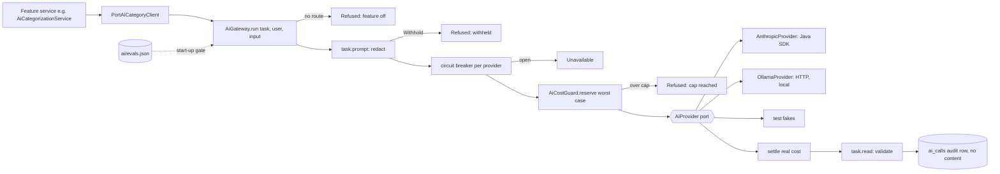

# AOS-702 — AI layer: one provider port, adapters, redaction, cost cap, audit, flags, eval gate

| Field | Value |
|---|---|
| **Type** | Task |
| **Parent** | [AOS-S7.1](AOS-S7.1.md) (Epic [AOS-E7](AOS-E7.md)) |
| **Status** | ✅ Done (PR open; not merged) |
| **Priority** | P2 |
| **Owner** | Claude |
| **ETA** | 10h |
| **Actual** | 5h |
| **Created / Updated / Done** | 2026-10-17 / 2026-10-17 / 2026-10-17 |
| **Branch** | `aos-702-ai-layer` |
| **Decisions** | D-33, D-57, D-61, D-62, D-67; proposes D-68 |
| **Blocked by / Blocks** | AOS-512 ✅ / AOS-703, AOS-704, AOS-705… |

## Description
Every model call in AdminOS goes through one domain port, `AiProvider`, behind one gateway that enforces the D-67 rules:
- adapters: Anthropic (official Java SDK, reused from AOS-512), Ollama (local HTTP) and a test fake;
- per-feature redaction (the feature's task decides exactly what is sent, with a shared Indian-format PII masker as a guard);
- a monthly cost cap that fails closed;
- an audit row per call with no content (feature, provider, model, prompt version, tokens, cost, outcome, latency);
- per-feature flags, off by default, with model IDs from configuration;
- an eval gate: a feature can't be enabled with a provider, model and prompt version unless a committed eval record for exactly that combination meets its floor (generalising D-61).

The AOS-512 fallback categoriser moves onto the port without changing its behaviour. The legacy Go `internal/claude` client and its handlers are checked and, if dead, retired.

## Why
D-67 (AI ground rules) requires a single port so caps, redaction, audit and evals are solved once. Without it each feature re-solves keys, retries and logging, and they drift. The Go client has no cap, redaction or audit, and uses a retired model id.

## Scope
- **In:** domain port and gateway (`domain/ai`), Anthropic and Ollama adapters, the categorisation task and its client on the port, config, Koin wiring, the audit and spend tables (one migration), eval records, the harness writing the record, Go retirement, `.env.example` and compose.
- **Out:** consent and Settings (AOS-704), the Ollama compose profile and bake-off (AOS-703), new AI features.

## Acceptance criteria
- [x] One `AiProvider` port in the domain; adapters for Anthropic (SDK) and Ollama (HTTP); a test fake; no vendor type above layer 5.
- [x] Model IDs and provider per feature come from configuration (`AI_<FEATURE>_PROVIDER`, `AI_<FEATURE>_MODEL`); `claude-haiku-5-5` is the default for categorisation on Anthropic.
- [x] Flags are per feature and off by default; a half-configured setup refuses to start with a clear message; keys never printed.
- [x] Per-feature redaction: the feature's task builds the only text sent; the PII masker (cards and accounts → last 4, phone, email, VPA, Aadhaar-like and PAN) is tested on Indian formats and blocks a categorisation question that contains PII.
- [x] Monthly cost cap (`AI_MONTHLY_CAP_USD`) fails closed: a call whose worst-case cost would exceed the cap is not made; concurrent calls can't overshoot it (in memory and on Postgres).
- [x] An audit row per provider call with no content (feature, provider, model, prompt version, tokens, cost, outcome, reason code, latency, user, time); a property test shows no input text reaches it.
- [x] Eval gate: start-up refuses an enabled feature whose (provider, model, prompt version) has no passing committed eval record; the categorisation record is regenerated by `categorizationReport -PwriteBaseline` and checked by a unit test.
- [x] AOS-512 behaviour unchanged: its golden-set gates (rules, rules + AI) and all its tests pass on the port.
- [x] Go: the `internal/claude` client and the briefing/anomaly-explain handlers are verified unused by the API and retired; `CLAUDE_*` removed from `.env.example` and compose.

## Design (see docs/ENGINEERING.md §6)
- **Context:**
  - AOS-512 has a categorisation-specific port (`AiCategoryClient`), a Claude adapter that owns the prompt, schema and strict parsing, and a circuit-breaker decorator.
  - D-67 asks for one port with Anthropic, Ollama and fake adapters; caps, audit, redaction and flags per feature; and a per-feature eval gate.
  - The Go workers still carry a Claude client (`claude-sonnet-4-20250514`, `CLAUDE_API_KEY`) for the briefing and anomaly-explain handlers.
- **Options considered:**
  1. **A gateway over a thin provider port, features as tasks (chosen).**
     - `AiProvider.complete(AiRequest) → AiCompletion` is the only vendor seam: text in, schema-constrained text plus token usage out.
     - Each feature is an `AiTask<I, O>`: its prompt version, its redactor (`prompt(input)` returns `Send` or `Withhold`) and its validator (`read(text, input)` returns `Valid` or `Invalid(code)`).
     - `AiGateway.run(task, user, input)` is the single entry point and applies, in order: flag/route → redaction → circuit breaker → cost reservation → provider → settle cost → validation → audit.
     - Pros: every rule lives in one place, adapters stay dumb, a new feature is one task class, and a new vendor is one adapter class.
  2. **Decorators around each adapter** (`CostCappedProvider(AuditingProvider(RedactingProvider(Anthropic)))`).
     - Familiar, but the decorators need feature context (prompt version, validation outcome) that a plain completion call doesn't carry. The order of decorators becomes a hidden rule, and validation (which decides the audit outcome) sits above them.
  3. **A third-party framework** (LangChain4j, Spring AI, Koog): rejected in D-67 (dependency weight, harder to audit what's sent).
- **Eval gate options:**
  - (a) Run the eval at start-up: impossible offline, and it would cost calls.
  - (b) **Committed eval records (chosen):** `src/main/resources/ai/evals.json` lists, per (feature, provider, model, prompt version), the scored metrics, the floor and where the answers came from (`recorded-synthetic`, `recorded-real`, `live`). Start-up refuses an enabled route without a record whose metrics meet its floor. A unit test re-derives the categorisation record from the golden set, so the file can't drift from the code. A prompt change means a new prompt version, so the old record no longer matches until the eval is re-run.
  - (c) A test only: it can't stop a deploy with a different model in its environment.
- **Cost cap options:**
  - (a) Sum the audit log before each call: racy with concurrent calls and several instances.
  - (b) **A spend ledger with reservations (chosen):** one row per UTC month. Each call reserves its worst-case cost (input estimate plus `max_tokens` at the model's price) atomically against the cap, then settles to the real cost. On Postgres the reservation locks the month's row (`FOR UPDATE`), so concurrent calls and instances can't overshoot. Unknown prices refuse start-up; local models cost 0.
- **Decision:** option 1 with eval gate (b) and cost ledger (b), D-68. **Patterns:**
  - Ports and adapters (`AiProvider`; `AnthropicProvider`, `OllamaProvider`, fakes);
  - Strategy (`AiTask` per feature);
  - a Gateway/Facade (`AiGateway`) applying policy in one place;
  - Circuit breaker (per provider, moved from AOS-512);
  - Repository (`AiCallLogRepository`, `AiSpendLedger`; InMemory + Exposed);
  - Specification (`AiEvalGate` floor check).
- **Extensibility:**
  - a new feature is an `AiFeature` entry, one `AiTask` class (redactor + validator), an eval set and a record (exactly D-67's list);
  - a new vendor is one `AiProvider` class plus a price table;
  - a model switch is configuration plus a committed eval record.
- **Impact:**
  - **Domain:** new `domain/ai` (port, gateway, task, breaker, cost guard, audit, eval gate, PII masker); `domain/financial/ai` gets `CategorizeMerchantTask` and `PortAiCategoryClient`, and the old breaker moves to the gateway;
  - **Infrastructure:** `AnthropicProvider` replaces `AnthropicCategoryClient`; new `OllamaProvider`; Exposed tables and repositories for `ai_calls` and `ai_spend`;
  - **Config:** `AiConfig` replaces `AiCategorizationConfig` (same env names, plus provider, Ollama and cap);
  - **Schema:** one migration (`ai_calls`, `ai_spend`);
  - **Go:** dead LLM handlers and client removed;
  - **Contracts:** none (no new API or queue payloads).
- **Diagram:**

## Implementation plan
1. Domain `ai`: port, request/completion types, task, results, reason codes, breaker, cost guard + ledger, audit log, eval gate, PII masker; unit tests with fakes.
2. Categorisation on the port: `CategorizeMerchantTask` (prompt, schema, strict validation moved from the Claude adapter), `PortAiCategoryClient`; port the AOS-512 tests.
3. Adapters: `AnthropicProvider` (SDK, price table, thinking per model), `OllamaProvider` (`/api/chat` with a JSON schema `format`); tests against local stub servers.
4. Persistence: migration, tables, Exposed repositories, integration tests (including concurrent reservations).
5. Config and Koin; start-up eval gate; `evals.json` written by the report task and checked by a test.
6. Go retirement; `.env.example`, compose.
7. Gates: `./gradlew test integrationTest koverVerify`, Go in Docker.

## Verification
- **API:** `./gradlew test integrationTest koverVerify` is green.
  - 1,562 unit and 129 integration tests, 0 failed, 0 skipped.
  - Coverage is 99.32% lines and 90.04% branches (gate 90/85).
  - `domain/ai` 99.6% / 90.1%; `domain/ai/eval` 100% / 79.2%; `domain/financial/ai` 99.4% / 89.4%; `infrastructure/ai` 98.1% / 85.3%.
- **AOS-512 unchanged:** `CategorizationRegressionTest` and `AiEvaluationTest` (rules 82.6%, rules + AI 91.7% on the recorded answers) pass on the port. `categorizationReport -PwriteBaseline` rewrites both baselines byte for byte and regenerates the same eval record.
- **Acceptance criteria → tests:**
  - port, adapters, fake → `AnthropicProviderTest` (14, a local fake of the Messages API), `OllamaProviderTest` (8, a local stub of `/api/chat`), `AiFakes.kt`;
  - config, flags, refusal to start → `AiConfigTest` (13, including DI on and off, the eval gate and an unknown price);
  - redaction → `PiiMaskerTest` (6, Indian formats), `CategorizeMerchantTaskTest` (8), `PortAiCategoryClientTest` (3);
  - cost cap → `AiGatewayTest` (12), `AiPartsTest` (13), `AiLayerIntegrationTest`:
    - 50 concurrent calls never pass the cap;
    - free calls pass a 0 cap;
    - a throwing provider is charged its worst case;
    - on Postgres, 40 concurrent reservations of 10 against a cap of 95 grant exactly 9;
  - audit row with no content → `AiAuditPropertyTest` (jqwik, 300 random inputs and answers), `AiGatewayTest`, `AiLayerIntegrationTest`;
  - eval gate → `AiEvalGateTest` (7), `CategorizationEvalRecordTest` (3: the committed record equals a fresh run, and a model that changes a rule-decided row fails the gate).
- **Go:**
  - `docker run … golang:1.27 sh -c 'go build ./... && go vet ./... && go test ./...'` is green (98 tests);
  - `go vet -tags integration ./...` is green too.
- **Compose:** `docker compose config -q` parses.
- **Was the Go client used?** No. Searched the API, web, workers and tools:
  - the API enqueues only `gmail_ingest` (`IngestionService`), and only the Go bridge reads the Redis list;
  - nothing schedules `agent_briefing` or `anomaly_explain` (the Go side has no scheduler), and D-57 moved the briefing to Kotlin;
  - so the Claude client, both handlers, their tests and `CLAUDE_*` were removed.

## Risks / notes
- **Behaviour change (intended):** a categorisation model with no committed eval record now refuses to start. Before, any model id was accepted. The default (`claude-haiku-5-5`) has a record, so the AOS-512 switch works as before.
- **The default eval record is synthetic.** Its answers are AOS-512's hand-written recording (`answers: recorded-synthetic`), so it measures the policy, not Claude. Run `-PrecordAi` with a real key, then `-PwriteBaseline`, to make it `recorded-real`.
- **Error reason strings changed.** `AiCategoryResult.Rejected/Unavailable` now carry codes (`http_429`, `category_not_allowed`) instead of sentences. They are not stored (`metadata.ai` keeps only `status: rejected`).
- **Spend is in US dollars**, as vendors bill. Settings (AOS-704) shows dollars rather than inventing an exchange rate.
- **The ledger uses READ COMMITTED.** The pool runs REPEATABLE READ, where a `FOR UPDATE` on a row that is updated concurrently fails with "could not serialize access". The integration test found this. `dbQueryReadCommitted` is used only by the ledger.
- **Prices live in the Anthropic adapter** (checked 2026-10-17). A new Claude model needs one line there and an eval record.
- **Findings outside this task (reported, not fixed):**
  1. The retired Go `anomaly_explain` handler logged its whole prompt (merchant name and amount) at info level, against ENGINEERING §2. It is gone with this change.
  2. The Go `waste_score` handler (`WasteScoringHandler`) is also never enqueued by the API (D-58 moved waste scoring to Kotlin). It is dead code, but not an LLM path, so it was left alone. Worth a ticket.
  3. **Possible:** `ExposedJobRunRepository.claim` uses the same insert-then-`FOR UPDATE` pattern under REPEATABLE READ. Two instances retrying one slot at the same moment may get a serialisation error instead of a clean "not claimed". Not reproduced here.

## Activity log
- 2026-10-17 — Claude: ticket created from the task template; design written (gateway over a thin provider port, committed eval records, reservation ledger). Branch `aos-702-ai-layer` from `origin/main` (913b337).
- 2026-10-17 — Claude: domain `ai` (port, gateway, task, breaker, cost guard, audit log, eval gate, PII masker), categorisation on the port, Anthropic and Ollama adapters, migration, Exposed repositories, config and wiring built, with tests. The Postgres concurrency test found serialisation failures under REPEATABLE READ, so the ledger now runs at READ COMMITTED.
- 2026-10-17 — Claude: Go LLM path verified dead and retired; `.env.example`, compose and ENGINEERING §1 updated. All gates green; PR opened (not merged).

## Definition of Done (docs/ENGINEERING.md §4)
- [x] Each acceptance criterion covered by a test or a documented manual check
- [x] Tests/build green (integration tests if the DB is touched)
- [x] Layer rules respected; no silent fallbacks; no secrets/PII in logs
- [ ] Decisions recorded · ticket, story, epic and board updated · PROGRESS.md updated (D-68 proposed below; DECISIONS, BACKLOG, PROGRESS, story and epic are left to the integrator)
- [x] Commit message starts with `AOS-702:`

## Proposed decision D-68

### D-68 — One AI gateway over a thin provider port; features are tasks; committed eval records gate start-up
2026-10-17 · Proposed (Claude, AOS-702; awaiting Pragun) · Type: Architecture · Tasks: AOS-702, AOS-512, AOS-703, AOS-704 · Builds on D-61, D-62, D-67
- **Port:** `AiProvider.complete(AiRequest) → AiCompletion` is the only vendor seam: text plus a JSON schema in, text plus token usage out. Failures are values with a code, never exceptions.
  - `AnthropicProvider`: the official Java SDK, structured output, low effort, thinking off where the model allows it.
  - `OllamaProvider`: `/api/chat`, schema in `format`, temperature 0, `think: false`.
  - Tests use a fake.
- **Features are tasks:** each `AiTask<I, O>` names its `AiFeature` and prompt version, and owns its redactor (`prompt` → send or withhold) and validator (`read` → valid, or invalid with a code).
- **One gateway** (`AiGateway.run`) applies, in order:
  1. flag/route;
  2. redaction;
  3. a circuit breaker per provider (3 failures → 15 minutes);
  4. a cost reservation;
  5. the call;
  6. settling to the real cost;
  7. validation;
  8. an audit row per call.
  Steps 1–4 make no call and write no row.
- **Cost cap:**
  - `AI_MONTHLY_CAP_USD` (default 2.00) per UTC month, in micro-dollars (never `Double`);
  - each call reserves its worst case (input bounded by its UTF-8 bytes, plus `max_tokens`) under a row lock, then settles;
  - an unknown cost (a provider that throws) is charged its worst case;
  - local models cost 0;
  - a model with no known price refuses start-up.
- **Audit (`ai_calls`):** user, feature, provider, model, prompt version, tokens, cost, outcome (accepted/rejected/error), reason code (`[a-z0-9_]{1,48}`, so text can't fit), latency and time. No content.
- **Flags:** `AI_<FEATURE>_ENABLED` (off by default), `_PROVIDER` (`anthropic` by default, or `ollama`) and `_MODEL` (`claude-haiku-5-5` by default on Anthropic; required on Ollama).
  - Keys and URLs are needed only for the providers in use.
  - A malformed setup refuses to start.
- **Eval gate (generalises D-61):**
  - `src/main/resources/ai/evals.json` holds one record per (feature, provider, model, prompt version): metrics, floor, and where the answers came from (`recorded-synthetic` / `recorded-real` / `live`);
  - start-up refuses an enabled route without a passing record;
  - the categorisation record is written by `categorizationReport -PwriteBaseline` and re-derived by a unit test;
  - it adds `ruleDecidedUnchanged` (floor 1.0), so "never change a rule-decided row" is part of the gate.
- **Redaction guard:** `PiiMasker` is shared. Cards and accounts become their last 4 digits; mobiles, emails, VPAs, Aadhaar-like numbers and PANs are masked. A categorisation name containing PII is withheld.
- **Go:** the legacy `internal/claude` client and the briefing/anomaly-explain handlers were never enqueued, so they were removed along with `CLAUDE_*`. The API's port is the only path to a model.
- **Rejected:**
  - decorators per adapter (they need feature context, and their order becomes a hidden rule);
  - running evals at start-up (needs a network, costs calls);
  - a test-only gate (can't stop a deploy with a different model);
  - summing the audit log for the cap (racy across calls and instances);
  - a framework (D-67).
- **Consequence:**
  - a new AI feature is an `AiFeature` entry, one task class, an eval set and a record;
  - a new vendor is one adapter with a price table;
  - a model switch is configuration plus a committed record.

## Resolution
- **Built:** the shared AI layer (`domain/ai`):
  - the port, gateway, tasks, results and reason codes;
  - the circuit breaker, cost guard and spend ledger;
  - the audit log, eval gate and records, and the PII masker.
- **Adapters:** Anthropic (generalised from AOS-512's client) and Ollama (new).
- **Persistence:** `ai_calls` and `ai_spend` (migration `V29__ai_layer.sql`, tentative number), each with InMemory and Exposed repositories.
- **Config:** `AiConfig` replaces `AiCategorizationConfig`. It keeps the same env names and adds provider, Ollama and cap settings. `AiWiring.kt` checks the eval records at start-up.
- **AOS-512 on the port:** `CategorizeMerchantTask` (its prompt, schema and strict validation) and `PortAiCategoryClient`. Behaviour and golden-set gates are unchanged.
- **Go:** the dead LLM path was removed.
- **Docs:** `.env.example`, compose and ENGINEERING §1 updated.
- **Verified:** the full API gate, and Go in Docker.
- **Actual vs ETA:** 5h vs 10h.
