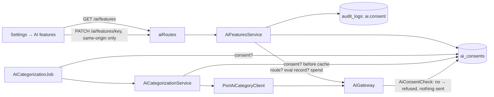

# AOS-704 — AI consent and notice per feature; Settings → "AI features"

| Field | Value |
|---|---|
| **Type** | Task |
| **Parent** | [AOS-S7.1](AOS-S7.1.md) (Epic [AOS-E7](AOS-E7.md)) |
| **Status** | ✅ Done (PR open; not merged) |
| **Priority** | P2 |
| **Owner** | Claude |
| **ETA** | 3h |
| **Actual** | 3.5h |
| **Created / Updated / Done** | 2026-10-17 / 2026-10-17 / 2026-10-17 |
| **Branch** | `aos-704-ai-consent` (stacked on `aos-703-local-models`, which is stacked on `aos-702-ai-layer`) |
| **Decisions** | D-22, D-67, D-68, D-100; proposes D-70 |
| **Blocked by / Blocks** | AOS-702, AOS-703 / AOS-602 (DPDP notice), every later AI feature |

## Description
Each AI feature is its own purpose, with its own consent and notice (D-67; DPDP s.5–6):
- **API:**
  - stores each user's choice per feature (off by default);
  - **the AI port refuses any call for a feature the user hasn't turned on**;
  - the categoriser doesn't even use a cached answer without consent.
- **Web:** Settings gets an **AI features** section. For each feature it shows:
  - a switch;
  - a plain notice of exactly what is sent, what never is, and where it goes (local vs cloud);
  - whether the server runs the feature (and how it was measured);
  - this month's spend.

## Why
D-67 makes each AI feature a separate purpose with its own toggle and notice. DPDP needs consent that is "free, specific, informed … limited to the purpose" (s.6) with an itemised notice (s.5), which feeds AOS-602. Today the AOS-512 categoriser runs for every user as soon as the server flag is on.

## Scope
- **In:**
  - consent domain (repository, check) and its enforcement in the gateway and in the categoriser's service and job;
  - one migration;
  - `GET/PATCH /api/v1/ai/features`, plus a reusable same-origin guard for cookie mutations;
  - an audit-log entry for every change;
  - the web section, its unit tests and its Playwright spec.
- **Out:**
  - showing AI suggestions on transactions (an AOS-512 follow-up);
  - a per-user spend cap (the cap is per server);
  - rolling the same-origin guard out to every mutation (AOS-618).

## Acceptance criteria
- [x] **Default off:** a user with no stored choice is refused, with no call, no audit row and no spend. The categoriser asks nothing and uses no cached answer. → `AiGatewayTest`, `AiCategorizationServiceTest`, `PortAiCategoryClientTest`
- [x] **Stored per user and per feature,** on Postgres and in memory alike; another user's choice never applies. → `AiLayerIntegrationTest`, `AiFeaturesServiceTest`, `AiRoutesTest`
- [x] **Server must run it:** turning on a feature the server doesn't run (not configured, or not evaluated, D-68) is refused (409); turning off always works. → `AiFeaturesServiceTest`, `AiRoutesTest`
- [x] **Consent evidence:** every change writes an `ai.consent` audit entry (before, after, feature). → `AiFeaturesServiceTest`
- [x] **Settings shows, per feature:**
  - title and purpose;
  - what is sent and what is never sent (the task's own notice, kept next to its redactor);
  - where it goes (local server vs Anthropic's cloud);
  - provider and model;
  - how it was measured (a synthetic recording is said so);
  - this month's spend, and the server's cap.
  → `AiFeatures.test.tsx`, `AiRoutesTest`
- [x] **Accessible:**
  - the switch is a named `role="switch"` (`aria-checked`), described by the "where it runs" line;
  - the lists are named;
  - keyboard works;
  - an unavailable feature's switch is disabled.
  → `AiFeatures.test.tsx`, `e2e/ai-features.spec.ts` (axe)
- [x] **TanStack Query and existing Settings patterns:** a self-contained section like `PushDevice`, with calls through `lib/ai.ts` → `lib/query.ts` → `lib/api.ts`.

## Design (see docs/ENGINEERING.md §6)
- **Context:**
  - AOS-702's gateway is the single entry point for model calls.
  - The categoriser also has a per-merchant cache shared by all users, so a cached answer could be applied without a call.
  - Settings already has self-contained sections (`PushDevice`, `DeviceTokens`).
  - There is no CSRF token; the session cookie is `SameSite=Strict`, and AOS-618 plans the review.
- **Where consent is enforced. Options considered:**
  1. **In the gateway, as a small `AiConsentCheck` port, plus in each feature before it uses cached results (chosen).** No model call can skip it, because it is in the only path to a model. The feature-level check closes the cache gap. Offline tools (eval harness, bake-off) pass an explicit allow-all.
  2. **Only in each feature's job or service:** simpler, but a new feature that forgets the check would call a model without consent. Rejected.
  3. **As a route or UI concern only:** the background job runs without a request, so this doesn't work. Rejected.
- **Where the notice text lives. Options considered:**
  - (a) **On the feature's `AiTask`, next to its redactor (chosen):** what is sent and what the notice says change in the same file and the same review.
  - (b) In the web app: it would drift from the redactor, and the API couldn't serve it to other clients.
  - (c) In a separate catalogue in the domain: one more place to keep in sync.
- **Storage options:**
  - (a) **one row per (user, feature) in `ai_consents` (chosen):** no row means off, the latest choice wins, and history is in the audit log;
  - (b) columns on `notification_preferences`: mixes purposes, and a schema change for every feature;
  - (c) an append-only consent ledger: more than needed, since the audit log already keeps the history.
- **Cross-site protection for the new mutation:**
  - (a) rely on `SameSite=Strict` only;
  - (b) **a route-scoped `SameOriginMutations` plugin (chosen):**
    - a cookie-authenticated mutation must carry `Sec-Fetch-Site: same-origin`/`none`, or `Origin` equal to `APP_URL`;
    - `Authorization: Bearer` requests pass;
    - anything else is 403 `AUTH_007` (fails closed).
    - It is reusable for AOS-618.
  - (c) synchroniser tokens: needs a token endpoint and web changes everywhere, which is AOS-618's call.
- **Decision:** 1 + (a) + (a) + (b), D-70. **Patterns:**
  - Port (`AiConsentCheck`), Repository (InMemory + Exposed);
  - a Facade for Settings (`AiFeaturesService`);
  - a route-scoped plugin as a Specification (`SameOrigin.allows`).
- **Extensibility:**
  - a new AI feature appears in Settings automatically, from its `AiTask.notice` and `AI_TASKS`;
  - consent, the 409 rule, audit and spend need no change.
- **Impact:**
  - **API:** `domain/ai` (consent, features service, routes); gateway signature (consent check); categoriser service and job (consent); `infrastructure/plugins/SameOrigin.kt`; Exposed repository and table; one migration; DI; `Application.aiModule()`.
  - **Web:** `lib/ai.ts`, `components/AiFeatures.tsx`, the Settings page, fixtures, MSW and Playwright defaults, a new e2e spec.
  - No Go change.
- **Diagram:**

## Security (threat review, ENGINEERING §4a, D-100)
- **What this exposes:**
  - **two new authenticated routes** (`GET /api/v1/ai/features`, `PATCH /api/v1/ai/features/{key}`);
  - one new table (`ai_consents`: user id, feature key, on/off, time);
  - audit entries.
  - **No new listener, dependency, secret or outbound call.**
- **How it could be abused, and what stops it:**
  - **A stranger on the internet:** both routes sit inside `authenticate("auth-jwt")`, and a missing, forged or expired token is 401. Sign-in itself is owner-only (AOS-614).
  - **A malicious web page using the owner's cookie to switch a cloud feature on** (CSRF):
    - the cookie is `SameSite=Strict`;
    - the new `SameOriginMutations` guard refuses any cookie mutation whose `Sec-Fetch-Site` is cross-site or same-site, whose `Origin` isn't `APP_URL`, or that has neither header (403 `AUTH_007`).
  - **Another user's data:** there are no ids in the path; everything is scoped to the token's user, and another user's choice is never shown or applied.
  - **Hostile input:**
    - an unknown, oversized, path-trick or HTML-ish feature key is 404 and is **not echoed**;
    - a malformed, non-boolean or empty body is 400 and changes nothing;
    - keys are a closed enum, and the DB has a CHECK on the key's shape.
  - **A stale row for a retired feature** is ignored, never read as "on".
  - **Turning on an unevaluated feature:** impossible. The server runs only features whose eval passed (D-68), and turning on anything else is 409.
  - **The consent store failing:** the gateway check throws, so the call fails closed and nothing is sent.
  - **Untrusted text in the UI:** all text renders as React text nodes; tests feed `` and `<script>` and find no element and no execution.
  - **Secrets client-side:** the API returns provider, model and destination only, never a key or config name. The e2e test checks the page and storage for key or token patterns.
- **Data at rest:** `ai_consents` holds a user id, a feature key and a boolean, so there is nothing secret to encrypt (justified). The audit entry holds the same.
- **Tests that attack it:**
  - `AiRoutesTest`:
    - signed out, a forged token or a junk token → 401;
    - a cross-site or same-site request, a foreign `Origin`, or no headers → 403 with no effect;
    - hostile keys → 404, not reflected;
    - hostile bodies → 400;
    - another user's view stays off.
  - `SameOriginTest` (unit, hostile origins and headers);
  - `AiGatewayTest` (no consent → nothing sent, no spend; the consent store failing → fails closed);
  - `AiCategorizationServiceTest` (no consent → no cached answer used; the job doesn't read the user's transactions);
  - `AiLayerIntegrationTest` (an unknown feature row is ignored);
  - `AiFeatures.test.tsx` (HTML/script injection rendered as text);
  - `e2e/ai-features.spec.ts`: signed out → login with no API call; a refused session → login with no PATCH; injection rendered safely; no secrets in DOM or storage; axe.
  - **The route-inventory test (AOS-619) doesn't exist yet.** The new routes need no allowlist entry: both require auth.

## Implementation plan
1. Consent domain, gateway check, categoriser service and job checks, with tests.
2. Settings service, routes, same-origin guard, migration and Exposed repository, with route and integration tests.
3. Web: `lib/ai.ts`, the component, the Settings page; unit tests; the Playwright spec; default mocks.
4. Gates, ticket, PR.

## Verification
- **API:** `./gradlew test integrationTest koverVerify` is green.
  - 1,615 unit and 131 integration tests, 0 failed.
  - Coverage is 99.30% lines and 89.88% branches (gate 90/85).
  - **New tests:**
    - `AiRoutesTest` 8, `SameOriginTest` 7, `AiFeaturesServiceTest` 5;
    - `AiGatewayTest` +3, `AiCategorizationServiceTest` +2, `PortAiCategoryClientTest` +1;
    - `AiLayerIntegrationTest` +2 (Postgres).
- **Web:**
  - `npm ci && npm run typecheck && npm run lint && npm run test:coverage && npx next build` is green;
  - 369 tests; coverage 98.53% statements / 95.62% branches / 97.69% functions / 99.11% lines;
  - `AiFeatures.tsx` 100% lines; `AiFeatures.test.tsx` has 9 tests.
  - One unrelated test, `documents/page.test.tsx` › "lists documents…", failed once with a timeout while the machine was heavily loaded. It passed alone and on the full re-run (a flake; see notes).
- **Playwright:** `e2e/ai-features.spec.ts` (9 tests) was written but **not run** here (fixed ports, per instructions). The integrator runs it with `e2e/security.spec.ts`.

## Risks / notes
- **Behaviour change (intended):** with `AI_CATEGORIZATION_ENABLED=true`, the categoriser now runs only for users who turn it on in Settings. **Pragun must turn on "Categorise unknown shops"** after deploying, or nothing is categorised by AI.
- **Spend is shown in US dollars** (as billed). The cap is per server, shared by features; the spend shown is the user's own.
- The same-origin guard is applied only to this route. AOS-618 should decide whether to roll it out to every cookie mutation, and should confirm the web proxy forwards `Sec-Fetch-Site`/`Origin` in every deployment. Both are standard request headers, and `Origin` is checked against `APP_URL` when `Sec-Fetch-Site` is absent.
- **Flaky web test (reported, not fixed):** `src/app/documents/page.test.tsx` › "lists documents with kind, type, size and expiry, with download links" timed out once under load.
- **Migration:** `V30__ai_consents.sql` (tentative number; it follows AOS-702's `V29__ai_layer.sql`).

## Activity log
- 2026-10-18 — Claude (integrator): rebased onto main (kept AOS-702's `Withheld` result; `NO_CONSENT` is unavailable, never cached), migration stays V30, reviewed (code + security), D-70 recorded, merged.
- 2026-10-17 — Claude: ticket created from the task template; design written. Branch `aos-704-ai-consent`, stacked on `aos-703-local-models` (the gateway's constructor changes, so stacking keeps the chain linear).
- 2026-10-17 — Claude: consent domain and enforcement, Settings service, routes, same-origin guard, migration, Exposed repository, web section, unit, route, integration and Playwright tests built. Security gate (D-100) applied. All gates green except Playwright (not run, per instructions); PR opened (not merged).

## Definition of Done (docs/ENGINEERING.md §4)
- [x] Each acceptance criterion covered by a test or a documented manual check
- [x] Tests/build green (integration tests if the DB is touched)
- [x] Layer rules respected; no silent fallbacks; no secrets/PII in logs
- [ ] Decisions recorded · ticket, story, epic and board updated · PROGRESS.md updated (D-70 proposed below; DECISIONS, BACKLOG, PROGRESS, story and epic are left to the integrator)
- [x] Commit message starts with `AOS-704:`

## Decision D-70 (recorded in DECISIONS.md)
See [DECISIONS.md](../DECISIONS.md) D-70.

## Resolution
- **Built:**
  - per-feature AI consent (`AiConsent`, `AiConsentCheck`/`AiConsents`, InMemory and Exposed repositories, `ai_consents`), enforced in `AiGateway` and in the categoriser's service and job;
  - `AiFeaturesService` and `aiRoutes` (`GET/PATCH /api/v1/ai/features`), with a reusable `SameOriginMutations` guard and consent audit entries;
  - `AiTask.notice` (the categoriser's notice);
  - web: `lib/ai.ts`, the `AiFeatures` component in Settings, unit tests and a Playwright spec.
- **Verified:** API and web gates. Playwright was written, not run.
- **Migration:** `V30__ai_consents.sql` (tentative number).
- **Actual vs ETA:** 3.5h vs 3h. The security gate (D-100) arrived mid-task and added the same-origin guard and attack tests.
