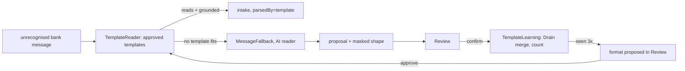

# AOS-706 — Template learning from repeated message shapes

| Field | Value |
|---|---|
| **Type** | Task |
| **Parent** | AOS-S7.2 (Epic AOS-E7) |
| **Status** | 🟨 Done, unverified (PR open, stacked on AOS-705 #121; reviews and merge by the integrator) |
| **Priority** | P2 |
| **Owner** | Claude |
| **ETA** | 8h |
| **Actual** | 4h |
| **Created / Updated / Done** | 2026-10-18 / 2026-10-18 / — |
| **Branch** | `aos-706-template-learning` (base `aos-705-message-fallback`) |
| **Decisions** | D-33, D-67, D-106 (proposed); **proposes D-107** |
| **Blocked by / Blocks** | AOS-705 (#121) / — |

## Description
Messages the AI reader handles come in repeating bank formats. After the user confirms three AI readings of the same
format, AdminOS proposes that format in Review as a **template**: the bank's wording with every value replaced by a slot.
Once the user approves it, the template reads matching messages itself (plain code, no model) before the AI reader,
straight into the intake. That is LILAC's pattern (an LLM behind a cache of learnt templates), with Drain-style merging.

## Why
- Each format the model reads again costs a call (time on a laptop, money on cloud) and a Review click.
- Bank SMS are machine-generated from templates, so a confirmed format can be read exactly by code (research §6: "A, then B").
- The research metric: the share of fallback messages a learnt template handles.

## Scope
- **In:**
  - masked shapes built from confirmed readings;
  - Drain-style merge into formats per sender and direction;
  - proposal after 3 confirmations; approve or reject in Review (API + web);
  - a template reader in front of the AI reader;
  - the same grounding validator for template readings;
  - migration `V71__message_templates.sql`.
- **Out:**
  - retiring or editing an approved template (approvals are final for now; a follow-up adds "stop using this format");
  - learning from dismissals;
  - Gmail (with AOS-705's Gmail transport).

## Acceptance criteria
- [x] Only **masked shapes** are kept, never raw text. Every value becomes a slot: amount, balances, last 4, dates, payee, other numbers, a greeting's name. A shape with a digit can't exist in code (`MessageShape` init) or in the database (CHECK). Tests: `MessageShapeTest`, `MessageTemplateRepositoryIntegrationTest`.
- [x] Shapes of one sender and direction that differ in at most 25% of their plain words merge, the differing words becoming `<ANY>` (Drain). Slots never merge with anything else. Tests: `MessageShapeTest`, `TemplateLearningTest`.
- [x] A format is proposed after 3 **confirmed** readings, never from unconfirmed ones; only the user approves it. A rejected format is never proposed again. A decided format's shape never changes. Tests: `TemplateLearningTest`, `TemplateLoopTest`.
- [x] An approved template reads its format before any model. Its reading passes **the same validator** as a model's (`ReadMessageTask.read`: grounding, direction words, ambiguity, date window). It goes straight into the intake with `parsedBy = template:<id>`; anything else goes on to the AI reader. It still works with AI off. Tests: `TemplateLearningTest`, `TemplateLoopTest`, `AiMessagesConfigTest`.
- [x] SMS and WhatsApp intakes count template-read messages as accepted or duplicate. Tests: `TemplateLoopTest`.
- [x] Review lists formats waiting for a decision; approve and reject are owner-only and decided once. Tests: `TemplateLoopTest` (routes), `LearnFormats.test.tsx`, Playwright specs.
- [x] Metric on the golden set: every SMS format the model read right at least 3 times is learnt, and its repeats are read by template with the confirmed fields exactly. Test: `TemplateLoopTest`.

## Design
- **Context:** AOS-705 keeps grounded AI readings as proposals and turns confirmed ones into intake events. The reader is fed through `UnrecognisedMessageSink`.
- **Options considered:**
  1. **Approved templates as data in front of the model, read by code, into the intake** (chosen): exact once approved; no model, no Review click; it keeps working with AI off.
  2. **Approved templates also go to Review:** safer, but it keeps the click this task exists to remove. An approved template already rests on three confirmations and the user's approval, and still has to pass grounding.
  3. **Generate a regex parser class (or `BankSmsParser` pattern) from each format:** couples learning to code. A user's approved formats are data (like the D-44 catalogue), not code.
  4. **Ask the LLM to write the regex (LILAC's template generation):** more general, but it sends more text, and an LLM-written regex needs its own validation. Masked shapes give the regex by construction.
- **Decision:** option 1.
  - **Patterns:** Chain of responsibility (`TemplateReader` → `MessageFallback`, both `UnrecognisedMessageSink`); Observer (`ProposalConfirmedListener`, so `MessageReviewService` doesn't know about learning); Repository (InMemory + Exposed).
- **Shapes** (`MessageShapes.of`): built from the redacted text the model saw, plus its confirmed reading:
  - the merchant span → `<M>`;
  - the moved amount → `<AMT>`; other money → `<BAL>`;
  - dates → `<DATE>`;
  - the account's last 4 → `<ACCT>`; other endings → `<N>`;
  - the word after "Dear/Hi/Hello" → `<NAME>`;
  - any digit left → `<N>`.
  - Masker tokens (`<PHONE>`, `<VPA:x>`) stay as literal wording.
- **Reading** (`TemplateReading`):
  - the shape compiles to an anchored, case-insensitive regex: literals quoted; `\s+` between words; bounded slots (`.{2,60}?` payee, `.{6,20}?` date, a back-reference for a repeated payee); at most 3 open-ended slots;
  - the captures become a JSON answer for `ReadMessageTask.read`.
- **Impact:**
  - **API:** `domain/ingestion/fallback/templates/*`; `MessageProposal.shape`; `FallbackOffer.ReadByTemplate`; `MessageReviewService` listeners; `SmsIntake` and `WhatsAppImportService` mappings; DI.
  - **DB:** `V71__message_templates.sql` (adds `message_proposals.shape`, creates `message_templates`).
  - **Web:** the Review section "Formats AdminOS can learn".

## Proposed decision D-107 (for DECISIONS.md; not edited here)
**D-107 — Confirmed AI readings teach message formats; approved formats are read by code before any model**
· Type: Architecture / Product · Tasks: AOS-706 · Builds on D-33, D-67, D-106
- **What is kept:** only masked shapes. Every value is a slot (amount, balance, last 4, date, payee, other numbers, a greeting's name), and a shape with a digit is refused in code and by a database CHECK. No message text, amount or payee is stored in a shape.
- **Learning:**
  - only from readings the user **confirmed**;
  - one sender (channel + bank) and direction per format;
  - Drain-style merge (same length, ≤ 25% plain words differ, never a slot) turns differing words into `<ANY>`;
  - proposed after 3 confirmations.
- **Approval:** only the user approves a format. A rejected format is never proposed again. A decided format's shape never changes.
- **Reading:**
  - approved formats are tried before the AI reader, even with AI off;
  - a template's reading must pass the same grounding validator as a model's;
  - it goes straight into the intake with `parsedBy = template:<id>` (exact, like a regex parser), and anything else goes on to the AI reader;
  - regexes are compiled from shapes with quoted literals and bounded slots (no ReDoS).
- **Rejected:**
  - Review for template reads (keeps the click it removes);
  - generated parser code;
  - LLM-written regexes (more data sent, unverified patterns).

## Security (threat review, ENGINEERING §4a, D-100)
- **What this exposes:**
  - **New routes:** `GET /api/v1/review/templates`, `POST /api/v1/review/templates/{id}/approve|reject`. Signed-in user only; user-scoped queries; another user's id is 404; a malformed id is 400. CSRF as all cookie mutations today (`SameSite=Strict`; AOS-618 adds Origin).
  - **New data at rest:** `message_templates` (shape, sender, direction, counts) and `message_proposals.shape`. Shapes are masked wording, so they are not encrypted (justified: no values, and the CHECK refuses digits).
  - **No new outbound calls:** templates *remove* model calls.
  - **No new dependencies.**
- **How it could be abused, and what stops it:**
  - **Poisoning a template with crafted messages:** a format is learnt only from readings the user confirmed, three times, then approved by the user. A hostile message that is never confirmed teaches nothing.
  - **A template that reads too much** (an over-general `<ANY>`): merging never widens a slot, and is capped at 25% of words. Every template reading passes the full grounding validator: it can't accept an ungrounded amount, a conflicting direction, an ambiguous figure or a stale date. A template only reads messages from its own sender.
  - **ReDoS through a crafted message against a template regex:** literals are quoted (`Regex.escape`), slots are bounded, a repeated payee is a back-reference, and a template has at most 3 open-ended slots. A test runs a hostile 1,000-character message against the most open template.
  - **Personal data in a shape:**
    - values are slots, and a greeting's name is a slot;
    - residual risk: a constant personal word the bank prints elsewhere in its format (e.g. an account holder's name in an unusual position) would stay in the shape. It is visible to the owner in Review before approval, and stored only on the owner's server;
    - a follow-up could add a "hide this word" control.
  - **Spoofed sender:** a template reads only its own sender's messages. SMS business headers are hard to spoof. A WhatsApp display name is the AOS-403 trust model (the user exports a chosen bank chat; D-66).
  - **XSS through a shape:** shapes are returned as JSON and rendered as text. Unit and Playwright tests use an `` shape.
- **Tests that attack it:**
  - **Unit:** `MessageShapeTest` (no digit survives; refuses digit shapes); `TemplateLearningTest` (grounding still applies; another bank's or user's templates are unused; an instruction-bearing message is never matched; ReDoS bound; regex syntax in wording is literal).
  - **Route:** `TemplateLoopTest` (401, 404 for another user's template, 400, decided once).
  - **Integration:** `MessageTemplateRepositoryIntegrationTest` (CHECK refuses digit shapes in both tables; concurrent decisions; user scoping).
  - **Playwright (written, not run):** `e2e/review-messages.spec.ts` (hostile shape renders as text; refused decision), `e2e/full-stack.spec.ts` (forged token 401; unknown id 404).

## Metric (synthetic golden set, SMS positives)
- **Round 1:** the 84 positive SMS rows are read by the AI reader (recorded answers) and confirmed. 6 formats reach 3 confirmations and are approved.
- **Round 2:** the same 84 messages, offered again as new messages.
  - **74 (88%) are read by a template, with 0 field errors** and no model call.
  - The other 10 belong to formats with fewer than 3 confirmations (or a different bank sender), so they still go to the model.
- `TemplateLoopTest` holds these: exactness = 100%, and coverage ≥ 80% of confirmed repeats.

## Verification
- `cd services/api && ./gradlew test integrationTest koverVerify` → green: 1,716 unit and 135 integration tests, 0 failures. The coverage gate passes.
- `cd apps/web && npm ci && npm run typecheck && npm run lint && npm run test:coverage && npx next build` → green: 376 tests, 98.6% lines, 95.7% branches.
- Go: not touched.
- Playwright: specs written, not run.

## Risks / notes
- Approvals can't be undone from the UI yet (follow-up). A wrongly approved format can still only accept grounded readings.
- Templates are per user and per sender. A bank that changes its wording falls back to the AI reader until the new format is learnt.

## Activity log
- 2026-10-18 — Claude: ticket created (🟦), stacked on AOS-705. Built shapes, Drain merge, learning, template reader, review routes and UI, migration V71. Gates green. PR opened; not merged.

## Definition of Done (docs/ENGINEERING.md §4)
- [x] Each acceptance criterion covered by a test or a documented manual check
- [x] Tests/build green (integration tests if the DB is touched)
- [x] Layer rules respected; no silent fallbacks; no secrets/PII in logs
- [ ] Decisions recorded · ticket, story, epic and board updated · PROGRESS.md updated (D-107 proposed above; left to the integrator)
- [x] Commit message starts with `AOS-706:`
- [ ] Security gate and the two reviews (§4a, §4b), run by the integrator

## Resolution
- **Built:** `fallback/templates/` (`MessageShape`/`MessageShapes`, `MessageTemplate`/`TemplateReading`, `TemplateLearning`, `TemplateReader`, repositories, `TemplateReviewService` + routes); `ExposedMessageTemplateRepository`; `V71__message_templates.sql`; the proposal shape; the listener hook in `MessageReviewService`; intake mappings; DI; and the web section `LearnFormats` with specs.
- **Tests:** 26 new API unit tests and 3 integration tests; 7 new web unit tests; Playwright specs (4 mocked, 1 full-stack).
- **Actual vs ETA:** 4h vs 8h.
