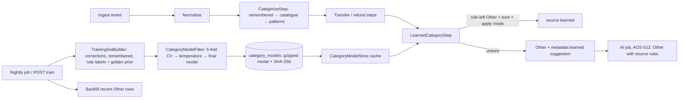

# AOS-707 — Local learned categoriser (learns from your corrections)

| Field | Value |
|---|---|
| **Type** | Task |
| **Parent** | [AOS-S7.2](AOS-S7.2.md) (Epic [AOS-E7](AOS-E7.md)) |
| **Status** | ✅ Done (off by default: `LEARNED_CATEGORIZATION_ENABLED=true` turns it on) |
| **Priority** | P2 |
| **Owner** | Claude |
| **ETA** | 8h |
| **Actual** | 7h |
| **Created / Updated / Done** | 2026-10-17 / 2026-10-18 / 2026-10-17 |
| **Branch** | `aos-707-learned-categoriser` |
| **Decisions** | D-41, D-50, D-61, D-62, D-67; D-71 |
| **Blocked by / Blocks** | AOS-511 ✅, AOS-512 ✅ / AOS-708 |

## Description
A small model inside the API that learns categories from the user's own corrections, with the synthetic golden set as a prior:
- **Where it sits:** after the rules and remembered corrections, before the AI fallback. It never overrides a rule (D-67).
- **Confidence:** each guess has a calibrated confidence. Sure guesses set the category (source `learned`); unsure ones stay Other with a suggestion in `metadata.learned`, which the Review queue (AOS-708) asks about.
- **Models:** one per user, retrained nightly (a D-50 `ScheduledJob`) and on demand, and stored serialised (new table).
- **Cold start:** fewer than 20 corrected payees means it's off.
- **Measured:** on the D-61 golden set, with its own baseline.
- **Privacy:** nothing leaves the machine.

## Why
- After AOS-511 the rules are precise (0.95–1.00 per category) but cover only 69%.
- D-41 corrections are exact per payee, but they don't generalise: correcting "SHREE GANESH MEDICAL" teaches nothing about "SAI MEDICOS".
- AOS-512's AI fallback closes part of the gap by sending business names to a cloud model.
- A local model can close part of the same gap with no data leaving AdminOS, and it gets better with every correction (research report §9, D-67 "local-first where feasible").

## Scope
- **In:**
  - the model port and an implementation (features, training, calibration);
  - the eligibility policy (never over a rule), the pipeline step and backfill;
  - per-user storage (migration), the nightly job and the on-demand retrain;
  - status and retrain API endpoints;
  - config and wiring, off by default;
  - the golden-set harness variant and its baseline;
  - the Tribuo comparison.
- **Out:**
  - UI (the Review queue is AOS-708);
  - subcategories from the model (research §9: later, per parent category);
  - a per-user consent toggle (follow-up, once AOS-702's `AiFeature` registry lands; see Risks);
  - rules + learned + AI as one measured variant (follow-up).

## Acceptance criteria
- [x] **Local model, swappable:**
  - a `CategoryModel` port, with a `CategoryModelTrainer` and a `CategoryModelFitter` (cross-validation and calibration) that works for any trainer;
  - shipped: hand-written multinomial logistic regression over TF-IDF features;
  - no new dependency, and nothing is sent off the machine.
  → `SoftmaxRegressionTest` (11), `CalibrationTest` (10)
- [x] **Features:**
  - payee words and their character 3–5-grams;
  - UPI handle words and n-grams, the app or bank after `@`, and a phone-handle marker;
  - narration notes (with bank structure, references and the UPI ID removed);
  - payment method, spend or refund, and an amount bucket;
  - generic words ("India", "general", "Ltd") are dropped, because they caused confident mistakes.
  → `CategoryFeaturesTest` (10)
- [x] **Calibrated confidence:**
  - a temperature is fitted on 5-fold held-out answers, using the rows the rules can't decide (the only rows the model is ever asked about);
  - expected calibration error on the golden set's held-out rows is 0.071 (naive Bayes 0.136).
  → `CalibrationTest`, `LearnedEvaluationTest`
- [x] **Never overrides a rule (D-67):**
  - only rows the built-in rules left as plain Other are candidates (source `rules`, no subcategory, not a catalogue brand, no remembered rule for the payee, spending or refund);
  - every changed golden row was rule-Other before.
  → `LearnedCategorizerTest` (15), `LearnedCategoryStepTest` (3), `LearnedEvaluationTest`
- [x] **Order: rules → remembered → learned → AI → Other:**
  - the learned step is the last pipeline step;
  - sure guesses (≥ 0.8, from a model in `apply` mode) get source `learned`, which the AI job (`categorySource = rules` only) then skips;
  - unsure guesses (≥ 0.4) stay Other with source `rules` and `metadata.learned = {status: suggested, category, confidence, cues, model, at}`, so the AI still looks at them.
  → `LearnedCategorizerTest`
- [x] **Per user; cold start; edge cases:**
  - fewer than 20 corrected payees, or a single category, is a cold start: there is no model, and a stored one is removed;
  - empty corrections, one class only, unseen merchants (low confidence, no error) and a corrupt stored model (checksum, truncated, wrong magic, format, algorithm or category, bad numbers, trailing bytes) are all handled. A corrupt model is ignored, logged with the user id only, and shown as `corrupt` until it is retrained.
  → `CategoryModelTrainingServiceTest` (12), `CategoryModelCodecTest` (8), `CategoryModelStoreTest` (6), `SoftmaxRegressionTest`
- [x] **Trusted before it applies:**
  - a model applies sure guesses only if, on the user's own held-out corrections it was sure of, it was right ≥ 90% of the time over ≥ 5 of them;
  - otherwise it is stored in `suggest` mode and only suggests.
  → `CategoryModelTrainingServiceTest`
- [x] **Retrained nightly and on demand:**
  - the `category-model-training` job runs daily at 03:30 (scheduler zone), with a 30-minute timeout; failing users are isolated;
  - `POST /api/v1/categories/model/train` retrains now (409 `LEARN_001` when off, 429 after 6 an hour);
  - `GET /api/v1/categories/model` returns the status;
  - after training, recent Other rows (30 days, at most 500) are re-scored: this is idempotent, never overwrites a correction made meanwhile, and removes an older model's suggestion that the new model no longer stands behind.
  → `CategoryModelTrainingJobTest` (2), `LearnedCategoryRoutesTest` (6), `LearnedCategorizerTest`
- [x] **Stored serialised:**
  - `category_models` (migration `V42__category_models.sql`, tentative number): one row per user, deleted with the user;
  - the gzipped, versioned binary model, its SHA-256, the mode and the training numbers;
  - an in-memory cache with a 10-minute checksum re-check, so the pipeline doesn't decode a model per transaction.
  → `CategoryModelIntegrationTest` (2, Postgres, the same checks as InMemory)
- [x] **No feedback loop:**
  - the model learns from corrections (`user`), remembered re-labels and real rule categories, one row per payee, with the user's own choice winning;
  - it never learns from `learned`, `ai` or `linked` labels, rows "left as Other", transfers or income.
  → `TrainingSetBuilderTest` (7)
- [x] **D-61 gate holds; new baseline:**
  - `baseline.json` and `baseline-ai.json` are unchanged;
  - `baseline-learned.json` is new (85.1%);
  - no category's precision drops;
  - every applied golden label is right (7/7);
  - payments to people are never relabelled;
  - a learning-curve test shows accuracy rising with corrections on shop kinds the prior has never seen.
  → `LearnedEvaluationTest` (9)
- [x] **Off by default (D-67):** `LEARNED_CATEGORIZATION_ENABLED` must be true or false (anything else refuses to start). When off, there is no job and no pipeline step, and the status says `off`. → `LearnedCategorizationConfigTest` (3)

## Design
- **Context:**
  - The pipeline categorises in `CategorizeStep` (remembered → catalogue → patterns → Other).
  - After it, `TransferStep` and `RefundReversalStep` may set Transfer or a linked category.
  - The AI fallback (AOS-512) is a 15-minute job that only touches rows with category Other and source `rules`.
  - Corrections (D-41) set source `user`, and they re-label the payee's other rows as `remembered`.
  - The golden set (D-61) is synthetic and labelled by a careful person.
  - Scheduled jobs (D-50) are claimed per slot.
- **Model. Options considered:**
  1. **Tribuo 4.3.2 (`tribuo-classification-sgd`: logistic regression via `LinearSGDTrainer` + AdaGrad), as the research recommended.**
     - It is Apache-2.0 (checked in the POM), and 4.3.2 is the latest on Maven Central.
     - But it was released 2025-04-04, 18 months ago, which fails ENGINEERING §7's "a release in the last 12 months" (the previous release was 2022-12).
     - It pulls **24 jars, 7.7 MB**: protobuf-java 3.25.6, OLCUT with 6 JLine terminal jars and jansi, opencsv, commons-text, commons-collections 3.2.2 and 4.4, and **commons-beanutils 1.9.4, which has CVE-2025-48734** (fixed in 1.11.0).
     - The ONNX runtime comes only as an optional dependency.
     - It has no TF-IDF for hand-built examples, and it throws on an example with no known feature, which we would have to guard.
  2. **Hand-written multinomial logistic regression (softmax) over TF-IDF sparse features, AdaGrad SGD with L2, deterministic seed (chosen).**
     - About 200 lines and no dependency.
     - It is fully testable under the coverage gate, and it serialises to our own small validated format.
     - It is calibrated by temperature scaling.
  3. **Hand-written multinomial naive Bayes:**
     - the same accuracy here, but it is known to be over-confident, and it measured worse calibrated;
     - kept in test sources as the comparison the report prints.
  4. Not tried:
     - Smile (recent versions are GPL-3.0);
     - ONNX Runtime or DJL (for models trained elsewhere; heavy, and no gain for a linear model);
     - fastText (no maintained JVM binding).
- **Evidence** (golden set, 288 rows, 5-fold cross-validated, same features, apply at 0.8 unless noted; Tribuo was run once with a temporary test dependency, not committed):

| Variant | Accuracy | Macro-F1 | Coverage | Applied (right) | Held-out ECE | A category's precision drops? | 5-fold run time* |
|---|---|---|---|---|---|---|---|
| Rules (AOS-511 baseline) | 82.6% (238) | 0.827 | 69.4% | — | — | — | — |
| **Rules + softmax (shipped)** | **85.1% (245)** | **0.851** | **71.9%** | **7 (7)** | **0.071** | **no** | 0.29 s |
| Rules + softmax, apply at 0.7 | 85.8% (247) | 0.858 | 72.6% | 9 (9) | 0.071 | no | — |
| Rules + naive Bayes (α 0.5) | 85.1% (245) | 0.853 | 71.9% | 7 (7) | 0.136 | no (yes at 0.7: Transport) | 0.14 s |
| Rules + Tribuo LinearSGD (lr 0.1, 30 epochs) | 85.1% (245) | 0.851 | 71.9% | 7 (7) | 0.126 | no | 1.19 s |
| Rules + Tribuo, lr 0.5, apply at 0.7 | 85.8% (247) | 0.860 | 73.3% | 11 | 0.116 | yes (Shopping) | — |

  \*Inside the instrumented test JVM; only the relative times mean anything.
  - The three are equally accurate: same features, same family of model. The choice rests on dependency weight, maintenance and calibration, and all three favour option 2.
  - The softmax settings (30 epochs, learning rate 0.1, L2 1e-3) were picked from a grid of 18 by calibration error among those with no precision drop. Accuracy varied only between 84.0% and 86.1% across the grid.
- **Where it runs. Options considered:**
  - (a) **The last pipeline step, plus a re-score of recent Other rows after each training (chosen).** Inference is local and takes microseconds, so ingestion pays nothing. A new model also reaches existing rows. The AI job sees only what is still Other.
  - (b) A batch job only, like AOS-512: new rows would wait up to a night for a label the model already knew.
  - (c) Inside `CategorizationService`'s chain: this mixes per-user model state into the single rule categoriser (D-41), and it would run before `TransferStep` and the refund links, which must win.
- **Prior. Options considered:**
  - (a) **The golden set as the prior, evaluated by cross-validation (chosen).** One synthetic, carefully labelled set serves both purposes. No row is ever scored by a model that saw it. `golden.csv` and its loader move to main sources so they can ship.
  - (b) A second synthetic "prior" file: two sets to maintain, written by the same author anyway.
  - (c) No prior: a new user would need many more corrections before anything works.
- **Storage. Options considered:**
  - (a) **A gzipped, versioned binary in `bytea` with a SHA-256 column (chosen):** compact (floats), strict to read, and corruption is detected.
  - (b) JSON in `jsonb`: about 3× larger, and parsing doubles is slower.
  - (c) Files on disk: they don't survive container rebuilds, and aren't covered by backups or user deletion.
- **Decision:** model option 2, where (a), prior (a), storage (a) (D-71). **Patterns:**
  - Ports and adapters: `CategoryModel` and `CategoryModelTrainer` (the softmax adapter, plus naive Bayes and fakes in tests); `CategoryModelRepository` (InMemory and Exposed);
  - Decorator: `CalibratedCategoryModel`;
  - Strategy: the evaluation labeller;
  - Specification: `isRuleLeftOther`;
  - Pipeline step: open/closed, one more `IngestStep`;
  - Cache-aside: `CategoryModelStore`;
  - `ScheduledJob`.
- **Extensibility:**
  - a new model (kNN or embeddings, research option C) is a new `CategoryModelTrainer`/`CategoryModel`, plus a codec branch keyed by `algorithm`;
  - the thresholds live in `LearnedPolicy`;
  - subcategories could become one model per parent;
  - the Review queue (AOS-708) reads `metadata.learned`.
- **Impact:**
  - **Domain:** new package `domain/financial/learning/`; `GoldenSet` moved to main; `LearnedCategoryStep` in the pipeline.
  - **Infrastructure:** `CategoryModelsTable` and `ExposedCategoryModelRepository`.
  - **Schema:** `V42__category_models.sql`.
  - **API:** two endpoints.
  - **Config:** `LEARNED_CATEGORIZATION_ENABLED` (`.env.example`, compose).
  - **Build:** report task comment only.
  - No web or Go change.
- **Diagram:**

## Verification
- **Golden set:** `./gradlew -q categorizationReport` prints three tables (rules, rules + AI, rules + learned) and two learned summaries (softmax and naive Bayes), and writes `report-learned.json`.

| | Rules | Rules + learned (shipped) |
|---|---|---|
| Accuracy | 82.6% (238) | **85.1% (245)** |
| Coverage (not Other) | 69.4% | 71.9% |
| Macro-F1 | 0.827 | 0.851 |
| Subcategory accuracy | 72.5% | 72.5% (the model doesn't set subcategories) |
| Rows the model was asked about | — | 75 (applied 7, all right; suggested 14; unsure 54) |

- **Per-category F1, rules → rules + learned:**
  - EMI 0.727 → 0.880 (Bajaj Finance, Home First, HDB, all NACH lenders);
  - Subscription 0.851 → 0.920 (LinkedIn Premium, The Hindu e-paper, Dropbox);
  - Shopping 0.897 → 0.911 (a supermarket on UPI);
  - Other 0.631 → 0.667;
  - all others unchanged, and no precision drop anywhere.
- **Calibration:**
  - held-out ECE 0.071 over the 75 rows the model was asked about;
  - mean confidence 0.40 against accuracy 0.36 over those rows; the top bins (≥ 0.7) are slightly under-confident (right 100% at about 0.83).
- **API:** `./gradlew test integrationTest koverVerify` is green.
  - 1,599 unit and 127 integration tests, 0 failed, 0 skipped.
  - Coverage is 99.36% lines and 89.35% branches (gate 90/85).
  - `domain/financial/learning` is at 99.7% lines. Its branch figure (81%) is pulled down mainly by the Ktor and serializer branches in the routes file.
- **New tests (104):**
  - `CategoryFeaturesTest` 10, `SoftmaxRegressionTest` 11, `CalibrationTest` 10, `CategoryModelCodecTest` 8, `TrainingSetBuilderTest` 7;
  - `CategoryModelStoreTest` 6, `LearnedCategorizerTest` 15, `CategoryModelTrainingServiceTest` 12, `CategoryModelTrainingJobTest` 2;
  - `LearnedCategoryRoutesTest` 6, `LearnedCategoryStepTest` 3, `LearnedCategorizationConfigTest` 3, `LearnedEvaluationTest` 9;
  - `CategoryModelIntegrationTest` 2 (Postgres);
  - plus 1 assertion in `FinancialModuleWiringCoverageTest`.
- No web, Go or Playwright run (nothing there changed).

## Risks / notes
- **Small evidence:** the golden set's 75 rule-left-Other rows are few. A 1-row change moves accuracy by 0.35%, and ECE on 75 rows is noisy.
  - The real protection in use is the per-user held-out check: a model applies guesses only if it was right ≥ 90% of the time on the user's own held-out corrections.
  - The threshold (0.8) is conservative: 0.7 gained 2 more right rows on the golden set, but that was tuned on the same set.
- **Generalisation errors seen and fixed:** generic words shared across categories ("India" → Air India, "general" → general stores, "personal" → personal loan) gave confident wrong guesses. They are now not features. Character n-grams still link look-alikes ("hospitality" ~ "hospital"); such guesses were below the threshold here.
- **Golden set moved:** `golden.csv` is now in `src/main/resources/categorization/`, because it ships as the prior. D-61's text names the old test path (integrator: update D-61). Its rows must stay synthetic, as before.
- **Personal data:** a stored model holds n-grams of the user's payee names. It is in the database (not logged), deleted with the user (`ON DELETE CASCADE`), and never returned by the API (the status has counts only).
- **Consent (D-67):** the deployment switch is off by default. A per-user consent toggle and notice line belong with AOS-702's `AiFeature` registry, which is in flight in parallel. Follow-up: register `learned-categories` there.
- **CPU:** training is 6 fits (5 folds + final) over at most 5,000 newest rows plus 276 prior rows, off the request thread and one per user at a time. The retrain endpoint is limited to 6 an hour.
- **Migration number:** `V42` (renumbered from the tentative `V31` at integration).
- **Not done here:** measuring rules + learned + AI together. Doing so needs the recorded AI answers for rows the model now labels; follow-up.

## Decision D-71 (recorded in DECISIONS.md)
See [DECISIONS.md](../DECISIONS.md) D-71.

## Activity log
- 2026-10-17 — Claude: ticket created from the template; read D-41, D-61, D-62, D-67, AOS-511, AOS-512, the research report §4 and §9.
- 2026-10-17 — Claude: checked Tribuo on Maven Central (4.3.2, Apache-2.0, released 2025-04-04) and its dependency tree; built the hand-written softmax regression, features, calibration and the cross-validated golden-set labeller.
- 2026-10-17 — Claude: first run 85.1% at 0.5, with precision drops (Transport, Shopping, EMI, Health). Found the generic-word errors (India, general, personal) and the calibration shift (fitted on easy rows), and fixed both. Ran an 18-setting grid plus naive Bayes, and Tribuo with a temporary dependency (not committed). Same accuracy everywhere; chose the hand-written softmax at 0.8.
- 2026-10-17 — Claude: storage (V31, renumbered V42 at integration), store and cache, service, job, step, routes, config and wiring, tests, and `baseline-learned.json`. `./gradlew test integrationTest koverVerify` green (1,599 + 127; 99.36% / 89.35%).
- 2026-10-17 — Claude: PR opened against main.
- 2026-10-18 — Claude (integration engineer): rebased onto main and integrated; D-71 recorded in DECISIONS.md; story, board and PROGRESS updated. PR #80.

## Definition of Done (docs/ENGINEERING.md §4)
- [x] Each acceptance criterion covered by a test or a documented manual check
- [x] Tests/build green (integration tests if the DB is touched)
- [x] Layer rules respected; no silent fallbacks; no secrets/PII in logs
- [x] Decisions recorded · ticket, story, epic and board updated · PROGRESS.md updated
- [x] Commit message starts with `AOS-707:`

## Resolution
- **Built:** a local, per-user learned categoriser, off by default.
  - **Domain** (`domain/financial/learning/`):
    - `CategoryModel` (the ports), `CategoryFeatures`, `CategoryInput`, `SoftmaxRegression`, `Calibration` (temperature, ECE, fitter, calibrated decorator);
    - `CategoryModelCodec`, `CategoryModelRepository` (+ InMemory), `CategoryModelStore`;
    - `TrainingSet`, `CategoryPrior`, `LearnedCategorizer` (policy, eligibility, decision, backfill);
    - `CategoryModelTrainingService`, `CategoryModelTrainingJob`, `LearnedCategoryRoutes`.
  - **Pipeline:** `LearnedCategoryStep`.
  - **Infrastructure:** `CategoryModelsTable`, `ExposedCategoryModelRepository`.
  - **Schema:** `V42__category_models.sql`.
  - **Config:** `LearnedCategorizationConfig`.
  - **Wiring:** `AppModule`, `FinancialModule`, `.env.example`, `docker-compose.yml`.
  - **Moved:** `golden.csv` and `GoldenSet.kt` from test to main sources.
  - **Harness:** `LearnedLabeller`, `NaiveBayesTrainer` (comparison), `baseline-learned.json`, and the report extension.
- **Verified:** the full API suite with the coverage gate, and the golden-set report (numbers above).
- **Result:**
  - rules + learned is at 85.1% vs 82.6%, with 7 rows fixed and none broken, and no precision drop;
  - calibration error 0.071;
  - zero new dependencies.
- **Actual vs ETA:** 7h vs 8h.
