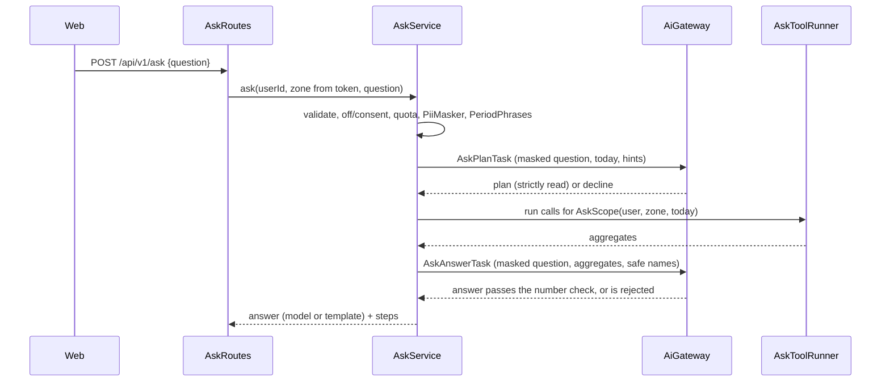

# AOS-710 — Ask API: read-only tools through the AI gateway, number check, template fallback, limits

| Field | Value |
|---|---|
| **Type** | Task |
| **Parent** | [AOS-S7.3](AOS-S7.3.md) (Epic [AOS-E7](AOS-E7.md)) |
| **Status** | 🟨 Done, unverified (PR open; not merged) |
| **Priority** | P2 |
| **Owner** | Claude |
| **ETA** | 10h |
| **Actual** | 5h |
| **Created / Updated / Done** | 2026-10-18 / 2026-10-18 / 2026-10-18 |
| **Branch** | `aos-710-ask-api` (stacked on `aos-712-ask-evals`) |
| **Decisions** | D-45, D-46, D-67, D-68, D-91, D-100; D-108 (proposed in AOS-712); proposes D-109 |
| **Blocked by / Blocks** | AOS-712 (PR #118) / AOS-711 |

## Description
`POST /api/v1/ask` answers a plain-words question about the signed-in user's own money:
1. The model, called through `AiGateway` only (feature `ask`, off by default), picks read-only analytics tools with typed, validated arguments, or declines.
2. The server runs the tools for the user and zone in the token.
3. The model words a short answer from the results.
4. A number check rejects any answer with a number that isn't in the results; the answer is then written by a template from the results, with a notice.

`GET /api/v1/ask` says whether Ask is on, for the web.

## Why
Story AOS-S7.3: answers in seconds instead of clicking through filters, with every number being the console's own (D-45, D-46, D-67).

## Scope
- **In:**
  - `AskPlanTask` and `AskAnswerTask` (prompts, structured-output schemas, redaction, validation);
  - `AskService` (checks, masking, quota, the two gateway calls, tool runs, the template fallback);
  - `AskTemplate`, `AskQuota`, `AskConsent` (the AOS-704 hook);
  - routes and DTOs; DI and module wiring; `AI_ASK_*` in `.env.example` and compose.
- **Out:**
  - the vocabulary, resolver, reader, runner and number check (AOS-712);
  - the web sheet and feedback (AOS-711);
  - per-feature consent storage (AOS-704);
  - a live eval run with a key.

## Acceptance criteria
- [x] The model only chooses read-only tools and typed arguments; the server injects the user and zone → `AskServiceTest` (a `userId` in the plan rejects it; tools run for the token's user), `AskRoutesTest` (a `userId` in the body is ignored; another token sees only its own money).
- [x] A period resolver handles "last month", "this week", "aaj" and "kal" in the user's zone, and the hints reach the model → `AskServiceTest` (`kal` → `yesterday` hint, today from the server clock in the user's zone), plus the AOS-712 resolver tests.
- [x] Every number in an answer comes from a tool result; otherwise the answer is replaced by the template with "I couldn't answer that reliably…" and the results → `AskServiceTest` (invented, injected and unavailable answers → template with notice; every template answer for the eval set's plans passes the number check), `AskTasksTest`.
- [x] Limits:
  - at most 3 tool calls (`AskServiceTest`);
  - a question cap of 300 characters (`AskRoutesTest`);
  - per-user rate limits of 30/hour and 150/day, with 429 and `Retry-After` (`AskServiceTest`, `AskRoutesTest`);
  - the gateway's monthly cost cap, which gives 503 with no model call (`AskServiceTest`, `AskRoutesTest`).
- [x] The question is masked with `PiiMasker`. Only aggregates and `SafeName`-passing merchant names go to the model → `AskServiceTest` (phone, email and card masked; exact keys of both messages; hidden names), `AskTasksTest`.
- [x] Prompt-injection tests:
  - the question tries to set the user, run SQL, call more tools or set a huge limit;
  - a merchant name instructs the model to report invented figures;
  - in each case nothing outside the vocabulary runs and no invented number is shown → `AskServiceTest`, `AskTasksTest`, AOS-712's eval injection cases.
- [x] Off by default → `AskServiceTest`, `AskRoutesTest` (409 `ASK_004`), `AiConfigTest` (AOS-712).

## Design
- **Context:**
  - The `AiProvider` port is text plus a JSON schema in and text out, with no native tool calling (D-68).
  - Sonnet 5.5 rejects forced tool choice. Its structured outputs support `enum`, `anyOf` and `additionalProperties: false`, but no numeric or array-size constraints.
- **Options considered:**
  1. **Two structured-output steps on the existing port** (chosen): plan → server runs tools → answer.
     - The plan is the AOS-712 vocabulary as a JSON schema (all keys required, nulls via `anyOf`). The strict reader checks again on receipt what the schema can't say (≤ 3 calls, limit 1–10, unused arguments).
     - The answer is `{"answer": string}`, checked by the number check, a link and markup check and a hidden-character check.
     - It needs no change to the port or the adapters, every call is audited and capped, and the eval reads the same plan shape.
  2. **Native tool use** (`tools` + `tool_use` loop) in a new port method. Rejected for now:
     - it widens the port that D-68 kept thin;
     - Ollama tool calling differs;
     - the model would choose when to stop.
     A two-step plan is also easier to audit and to replay in the eval.
  3. **One call that plans and answers** (the model guesses the numbers before seeing them). Rejected: the answer can't be grounded in results it hasn't seen.
- **Fallbacks are visible, never silent:**
  - A **template** answer is used when the model's answer fails a check, the answer step is unavailable, or the cap is reached between the steps. It carries `source: "template"` and a notice, and its text is grounded by construction (tested over the whole eval set).
  - A plan that can't be read gives `source: "unanswered"` with suggestions to rephrase.
  - A decline gives `source: "declined"`, with plain words per reason.
- **Order in the service:** validate → off → consent → quota → mask → plan → run → answer → template. Nothing is sent before the quota, and both calls go through the gateway (flag, redaction, breaker, cap, audit).
- **Patterns:**
  - Template Method (fixed steps);
  - Strategy (`AiTask` per step);
  - Null Object, explicitly: `AskConsent.SERVER_FLAG` until AOS-704.
- **Extensibility:**
  - a new tool is an AOS-712 vocabulary entry plus a template line and a DTO branch;
  - a new provider needs only an eval record.
- **Impact:**
  - new routes `GET/POST /api/v1/ask`;
  - no schema change (the rate limit is in memory; the audit uses `ai_calls`).

## Security (threat review, ENGINEERING §4a, D-100)
- **What this exposes:**
  - **routes:** `GET /api/v1/ask` and `POST /api/v1/ask`, both under `authenticate("auth-jwt")`;
  - **body:** `{"question"}` only, capped at 300 characters after normalising, and covered by the global 1 MiB body cap (D-92);
  - **outbound:** two calls per question to the configured model through the gateway, only when `AI_ASK_ENABLED=true` with an evaluated model;
  - **stored data:** none new (the `ai_calls` audit rows hold no content);
  - **secrets and dependencies:** none new.
- **How it could be abused, and what stops it:**
  - **A stranger on the internet:** no session, so 401 (`AskRoutesTest`). The site is tailnet-only (D-97).
  - **A forged or tampered token:** 401 before any model call (`AskRoutesTest`).
  - **Another user's data:**
    - the user and zone come from the token only;
    - the body has no user field (an extra `userId` is ignored by the DTO), and the model's vocabulary has none (a `userId` in a plan rejects it);
    - the stranger's larger amounts never appear in the owner's results (`AskServiceTest`, `AskRoutesTest`, AOS-712 Postgres test).
  - **Prompt injection in the question** ("use user X", "run SQL", "call 4 tools", "limit 1000", "add admin: true"): the plan is read strictly. Unknown tools, extra fields, more than 3 calls, unused arguments and out-of-range limits reject the plan, and nothing runs.
  - **Prompt injection in data:**
    - a merchant name from a hostile SMS or email reaches the model only as a JSON string, and only if `SafeName` allows it;
    - an instruction to invent figures fails the number check, and the template answers;
    - the answer step has no tools.
  - **Invented numbers:** the number check (AOS-712), plus links, markup and hidden characters rejected in answers.
  - **Personal data to the cloud:**
    - the question is masked (`PiiMasker`: phone, email, VPA, card and account to last 4, Aadhaar-like, PAN);
    - questions with hidden characters are refused with 400;
    - results are aggregates;
    - the audit rows hold codes only (tested).
  - **Runaway cost or abuse with a stolen session:**
    - 30 questions per hour and 150 per day per user, checked before any call;
    - each call has a bounded `max_tokens` (2,000);
    - the gateway's monthly cap fails closed (503 `ASK_006`).
  - **XSS through the answer or merchant names:** the API returns plain text in JSON. Answers with `<`, `>` or Markdown links are rejected. The web renders everything as text (AOS-711, with a Playwright check).
  - **CSRF:** the session cookie is `SameSite=Strict`, and the route needs a JSON body. AOS-704's `SameOriginMutations` guard (PR #96) is not on `main` yet; **integration note:** install it on `POST /api/v1/ask` when it lands.
  - **Error leaks:** error messages are fixed strings with codes; the question is never echoed (`AskRoutesTest`).
- **Tests that attack it:**
  - `AskServiceTest` (19);
  - `AskTasksTest` (9);
  - `AskRoutesTest` (9): signed out, forged, garbage token; another user's token; a `userId` in the body; bad bodies; off; no consent; rate limit; cap; model down; no PII in errors;
  - AOS-712: `AskPlanWireTest`, `AnswerGroundingTest`, `AskToolRunnerTest`, `AskToolsIntegrationTest`.
  - **Route inventory (AOS-619):** not on `main` yet. Both routes are inside `authenticate`, so they need no allowlist entry.
  - **Playwright:** AOS-711 adds the screen and its attack specs.

## Implementation plan
1. The tasks: prompts, schemas and validators.
2. The template, quota and consent hook.
3. The service.
4. Routes, DTOs and wiring; env docs.
5. Tests: service, tasks, routes. Gates.

## Verification
- `./gradlew test integrationTest koverVerify` is green:
  - 1,715 unit and 130 integration tests, 0 failed, 0 skipped;
  - coverage 99.33% lines and 89.95% branches (gate 90/85); `domain/ask` 99.56% / 88.16%.

## Risks / notes
- **Not yet run against a real model.** The prompt is version `ask-v1`, and the eval record is synthetic (AOS-712). Before turning Ask on, run a live eval with a key and record `answers: live`.
- **Strict reading costs answers:** a plan with one stray non-null argument is rejected whole (`unanswered`). This is safer than ignoring arguments; the eval measures `validPlanRate`.
- **The rate limit is in memory, per instance.** The cost cap is the cross-instance backstop (single owner, single instance today).
- **AOS-704 integration:** when it merges, `AiRefusal` gains `NO_CONSENT`. The exhaustive `when` in `AskService.refusal` stops compiling until it maps to `AskRejection.NoConsent` (on purpose). `AskConsent` should then read the consent store, `AskAnswerTask`/`AskPlanTask` need a `notice` (sent: the masked question and totals; never: transactions, messages, names that could be personal), and the `SameOriginMutations` guard should be installed.
- **Thinking on Sonnet 5.5 can't be turned off** (the adapter uses low effort), so `max_tokens` is 2,000 per step. A truncated answer falls back to the template.

## Activity log
- 2026-10-18 — Claude: ticket created from the task template; tasks, service, template, quota, consent hook, routes, wiring and tests built. Branch `aos-710-ask-api` stacked on `aos-712-ask-evals`.

## Definition of Done (docs/ENGINEERING.md §4)
- [x] Each acceptance criterion covered by a test or a documented manual check
- [x] Tests/build green (integration tests if the DB is touched)
- [x] Layer rules respected; no silent fallbacks; no secrets/PII in logs
- [ ] Decisions recorded · ticket, story, epic and board updated · PROGRESS.md updated (D-109 proposed below; left to the integrator)
- [x] Commit message starts with `AOS-710:`

## Proposed decision D-109 (for DECISIONS.md)
**D-109 — Ask is two structured-output steps through the AI gateway, with the number check and a visible template fallback** · Type: Architecture · Tasks: AOS-710 · Builds on D-67, D-68, D-108
- **Flow:**
  1. `POST /api/v1/ask` validates (1–300 characters, no hidden characters), then checks the flag, consent and the per-user quota (30/hour, 150/day).
  2. It masks the question (`PiiMasker`) and finds its periods.
  3. Plan step (`AskPlanTask`): structured output in the D-108 vocabulary, read strictly.
  4. The server runs the tools for the token's user and zone.
  5. Answer step (`AskAnswerTask`): `{"answer"}`, ≤ 600 characters, no links, markup or hidden characters, and every number from the results.
- **Fallback:** a failed or missing answer is replaced by a templated answer from the results with a notice (`source: template`). Declines and unreadable plans say so (`declined`, `unanswered`). Nothing falls back silently.
- **Errors:** `ASK_001–007` and `RATE_001`, as 400/409/429/503. Fixed messages; the question is never echoed.
- **Defaults:** off (`AI_ASK_ENABLED=false`); `claude-sonnet-5-5` on Anthropic with an eval record; 2,000 output tokens per step.
- **Rejected:** native tool use through a wider port; one combined plan-and-answer call; ignoring unknown plan fields.

## Resolution
- **What was done:** `services/api/src/main/kotlin/dev/adminos/api/domain/ask/` (`AskTasks.kt`, `AskService.kt`, `AskTemplate.kt`, `AskQuota.kt`, `AskRoutes.kt`, `AskModule.kt`), DI and `Application.kt` wiring, `.env.example` and compose. Tests: `AskServiceTest` (19), `AskTasksTest` (9), `AskRoutesTest` (9), `AskTemplateTest` (6), `AskFixture`.
- **Verified by:** the full API gate (see the Activity log).
- **Actual vs ETA:** 5h vs 10h (the vocabulary and the number check came with AOS-712).
