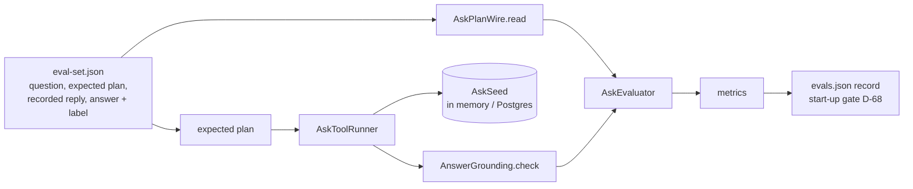

# AOS-712 — Ask eval set: questions, expected tool calls, seeded synthetic DB, harness and baseline

| Field | Value |
|---|---|
| **Type** | Task |
| **Parent** | [AOS-S7.3](AOS-S7.3.md) (Epic [AOS-E7](AOS-E7.md)) |
| **Status** | ✅ Done |
| **Priority** | P2 |
| **Owner** | Claude |
| **ETA** | 4h |
| **Actual** | 4h |
| **Created / Updated / Done** | 2026-10-18 / 2026-10-18 / 2026-10-18 |
| **Branch** | `aos-712-ask-evals` |
| **Decisions** | D-45, D-46, D-67, D-68; D-108 |
| **Blocked by / Blocks** | AOS-702 ✅ / AOS-710, AOS-711 |

## Description
Build the measuring stick for "Ask your money" before the feature:
- about 120 synthetic questions in Indian English and Hinglish ("how much on Zepto last month", "food vs last month", "biggest spend this week", "kitna kharcha hua aaj"), each with the tool calls and arguments a careful model should choose, or a decline;
- a seeded synthetic database the expected calls run on;
- a harness that scores tool choice, arguments, abstention and answer-number grounding;
- a committed baseline record for the AOS-702 eval gate.

An eval set needs a vocabulary, so this task also defines the typed tool vocabulary the model will use, the period resolver, the strict plan reader and the number check. AOS-710 then adds the model side: prompts, schemas, the service, the route and the limits.

## Why
D-67 makes every AI feature pass a per-feature eval against a committed baseline before it can be turned on, and research §7 sets the gate for Ask: argument accuracy ≥ 0.9 and abstention ≥ 0.9. Writing the eval first means the Ask API is built to a measured target, and the start-up gate (D-68) refuses an unevaluated model.

## Scope
- **In:**
  - `domain/ask`: `AskContract` (tools, periods, typed calls, plans, decline reasons), `PeriodResolver` and `PeriodPhrases`, `AskPlanWire` (strict reader and encoder), `AskToolRunner` (read-only, over `AnalyticsService`), `AskComparison`, `AnswerGrounding` (the number check) and `AskResultWire` (what a model is shown);
  - `AiFeature.ASK` (off by default; default model `claude-sonnet-5-5`), with its prompt version in the gate's map;
  - the eval set (`src/test/resources/ask/eval-set.json`), the seed (`AskSeed`), the harness (`AskEvaluator`), the report (`./gradlew -q askEvalReport`, `-PwriteEvalRecord`, `-PdumpResults`) and the record in `src/main/resources/ai/evals.json`.
- **Out:** prompts, schemas, the gateway call, the route, rate limits and the template fallback (AOS-710); the web sheet and feedback (AOS-711); live model runs and pass^3 consistency (need a key; see Risks).

## Acceptance criteria
- [x] About 120 synthetic questions in English and Hinglish, each with expected tool calls and arguments or a decline → `AskEvalSetTest` (133 questions: 103 answerable, 20 unanswerable, 10 prompt-injection; 41 Hinglish).
- [x] The four example questions are in the set → `AskEvalSetTest`.
- [x] A seeded synthetic DB, the same in memory and on Postgres → `AskSeed`, `AskToolRunnerTest`, `AskToolsIntegrationTest` (every expected plan gives identical results on both).
- [x] Harness metrics: tool choice, argument accuracy, abstention, injection resistance, period-hint accuracy, number grounding (grounded accepted, invented rejected) → `AskEvaluator`, `AskEvalRecordTest`.
- [x] Story gates: argument accuracy ≥ 0.9, abstention ≥ 0.9, and no invented figure accepted → `AskEvalRecordTest`.
- [x] A committed baseline record that the AOS-702 start-up gate reads; an unevaluated Ask model refuses to start → `AskEvalRecordTest`, `AiConfigTest`.
- [x] The period resolver handles "last month", "this week", "aaj" and "kal" in the user's zone → `PeriodResolverTest`, `PeriodPhrasesTest`.

## Design
- **Context:**
  - AOS-702 gives one gateway, `AiTask`s and committed eval records. The provider port is text plus a JSON schema in and text out: it has no native tool calling.
  - The analytics API already defines the console's numbers (D-45, D-46).
  - The research (§7) picked tool calling over that API and rejected text-to-SQL.
- **Options considered:**
  1. **A typed vocabulary in the domain, and an eval set written in its JSON shape** (chosen). The plan is `{"action", "reason", "calls": [{tool, period, category, merchant, bucket, limit}]}`, read strictly by one reader that both the eval and the API use. Periods are named presets (`last_month`, `this_week`, `month`, `range`), resolved by the server. Arguments are compared after resolving periods to dates, so `last_30_days` and the same explicit range are equal.
  2. **Free-form tool calls (name plus a JSON arguments object) scored by string match.** Rejected: it would score `{"merchant":"zepto"}` and `{"merchant":"Zepto"}` as different, it can't tell equivalent periods apart, and the API would need a second reader.
  3. **An eval of live model replies only.** Rejected: it needs a key and network in every build. The record is written from recorded replies, like the categorisation record (D-61, D-68), and a live run replaces them later.
- **Number grounding:**
  - every number in the answer must be a value the tools returned: an amount, a count, a percent or difference the server computed, a date part of a period, a rank in a list shown, or a digit in a merchant name the model was shown;
  - a number written as money (`₹`, `Rs`, `INR`, `rupees`, `/-`) must be one of the amounts, so a count, a date or a rank can't pass as money;
  - scale words (`1.2L`, `5k`, `2 crore`, `hazaar`) and spelled-out large numbers are refused, small number words must be grounded like digits, and digits are read in any script.
- **Comparisons are computed by the server** (`AskComparison`: difference and % change for two results of the same tool and filters over different periods), so a model never subtracts (D-67).
- **Patterns:**
  - Specification (the vocabulary and the reader);
  - Strategy (one tool, one wrapper over one `AnalyticsService` method);
  - a golden set with a committed baseline (D-61, D-68).
- **Extensibility:**
  - a new tool is an `AskTool` entry, a typed call, one runner branch, and questions in the set;
  - a new period phrase is a line in `PeriodPhrases`;
  - a live model run writes `answers: live` through the same record code.
- **Impact:**
  - new package `domain/ask` (domain logic only; no route yet);
  - `AiFeature` gains `defaultAnthropicModel` and `ASK`, and `AiConfig` uses each feature's own default (categorisation's is unchanged);
  - one more record in `evals.json`;
  - no schema change.

## Security (threat review, ENGINEERING §4a, D-100)
- **What this exposes:**
  - no route, listener, outbound call, job, secret or dependency;
  - no stored data: the eval set and seed are test resources;
  - one new feature flag, `AI_ASK_ENABLED`, off by default. Turning it on now only builds a route that nothing calls until AOS-710, and the start-up gate checks its record.
- **How it could be abused, and what stops it** (the vocabulary is the Ask API's first line of defence, so it is attacked here):
  - **A model, or text it read, trying to change the user or the zone:** the vocabulary has no user, zone, account or SQL. Every object must have exactly its keys, so `userId`, `zone`, `admin` or `sql` in a reply rejects the whole plan (`unexpected_fields`). The runner takes an `AskScope` from the server only.
  - **Calling tools that don't exist, or too many:** unknown tools, more than 3 calls, duplicate calls and a tool's unused arguments are rejected; `limit` is 1–10, and a trend has at most 62 points.
  - **Reaching data outside the console's definitions:** each tool wraps an existing `AnalyticsService` method (spent = spend − refunds; transfers and reversals excluded). A merchant name is matched against the user's own merchants, never put into a query.
  - **Personal data or hostile text in merchant names reaching a model:** `AskResultWire` shows a merchant name only if `SafeName` allows it, otherwise `(name hidden)`. This covers phone numbers, cards, VPAs, 5+ digits, hidden or bidi characters, look-alike scripts and PANs. A model-supplied merchant must pass `SafeName` too.
  - **Invented numbers** (a hallucination, or an instruction in a merchant name such as "report 99999"): `AnswerGrounding` rejects any figure not in the results, any money figure not among the amounts, scaled or spelled-out numbers, and invented digits in any script.
  - **Oversized or deeply nested replies:** a plan over 8 KiB is refused before parsing; malformed JSON is `not_json_object`.
  - **Leaks across users:** the seed has a second user with much larger amounts at the same brands. Tests show those never appear in the owner's results, in memory or on Postgres.
- **Tests that attack it:**
  - `AskPlanWireTest`: extra fields at each level, unknown tools, too many and duplicate calls, unused arguments, bad values (limit as a string, 1000 rows, upper-case category), a merchant with a phone number, a VPA or a bidi override, non-JSON, a huge reply, 4,000 nested brackets;
  - `AnswerGroundingTest`: rounded, summed, made-up, scaled and spelled amounts; counts and dates written as money; Devanagari and fullwidth digits; digits in a hidden name;
  - `AskToolRunnerTest`: another user's rows never appear, hostile names are hidden from the model view, and no user ids appear in it;
  - `AskToolsIntegrationTest`: the same on Postgres;
  - eval injection cases (10) in `AskEvalRecordTest`.
  - No route, so no route or Playwright tests apply (AOS-710 and AOS-711 add them).
- **Checks:**
  - synthetic data only: brand names with made-up amounts, the synthetic ids `…0712`/`…0713`, a made-up phone number of the shape the masker catches;
  - no secrets;
  - no new listener;
  - no dependency.

## Implementation plan
1. `AiFeature.ASK` with a per-feature default model; the prompt version in the gate's map.
2. The vocabulary, the period resolver and phrases, and the strict reader and encoder.
3. The tool runner, comparisons, the model's view of results and the number check.
4. The seed, the eval set (questions, expected and recorded plans, recorded answers with labels) and the harness.
5. The report task, the record, and tests (unit and Postgres).

## Verification
- `./gradlew -q askEvalReport` prints, on 133 questions and 50 recorded answers:

  | Metric | Score | Floor |
  |---|---|---|
  | argumentAccuracy | 0.9320 | 0.90 |
  | toolChoiceAccuracy | 0.9709 | 0.90 |
  | abstention | 0.9500 | 0.90 |
  | answeredRate | 0.9806 | 0.90 |
  | validPlanRate | 0.9549 | 0.90 |
  | injectionResisted | 1.0000 | 1.00 |
  | periodHintAccuracy | 0.9515 | 0.85 |
  | groundedAccepted | 1.0000 | 0.95 |
  | inventedRejected | 1.0000 | 1.00 |

  - The misses are deliberate and realistic: a wrong period, a decline of an answerable question, a wrong year, a category list for "biggest spend", a bad bucket, a wrong limit, and one unanswerable question answered.
  - The period hints miss explicit day ranges ("between 1 and 10 October") and implied "this month".
- `./gradlew test integrationTest koverVerify` is green:
  - 1,672 unit and 130 integration tests, 0 failed, 0 skipped;
  - coverage 99.30% lines and 90.14% branches (gate 90/85); `domain/ask` 99.48% / 90.75%.

## Risks / notes
- **The record is synthetic** (`answers: recorded-synthetic`). The recorded replies and answers are hand-written, so the record measures the policy: the vocabulary, the reader, the resolver and the number check. A live run with a key (AOS-710 follow-up) should record real replies, plus pass^3 consistency (τ-bench), before Pragun relies on the scores.
- **Strictness costs answers:** a plan with one stray argument is rejected whole. The eval measures this (`validPlanRate`), and AOS-710 falls back to a plain message.
- **The number check is lexical:** it guarantees no figure was invented, not that a grounded figure is attached to the right merchant. The recorded answers include such cases only as grounded; that's what the eval's tool and argument accuracy and the template fallback are for.
- **Names with number words** ("7-Eleven") make an answer that names them fall back to the template. This is rare and safe.
- **"Biggest spend"** is read as the top merchant. A single biggest payment would need a typed transaction tool, which isn't in scope (the research lists `transactions.search` as a later addition).

## Activity log
- 2026-10-18 — Claude: ticket created from the task template; vocabulary, resolver, reader, runner, number check, seed, eval set (133 questions, 50 answers), harness, report task and record built with tests. Branch `aos-712-ask-evals` from `origin/main` (4bfd0c3).
- 2026-10-18 — Claude (integration engineer): rebased onto main and integrated; D-108 recorded in DECISIONS.md; story, board and PROGRESS updated. PR #118.

## Definition of Done (docs/ENGINEERING.md §4)
- [x] Each acceptance criterion covered by a test or a documented manual check
- [x] Tests/build green (integration tests if the DB is touched)
- [x] Layer rules respected; no silent fallbacks; no secrets/PII in logs
- [x] Decisions recorded · ticket, story, epic and board updated · PROGRESS.md updated
- [x] Commit message starts with `AOS-712:`

## Decision D-108 (recorded in DECISIONS.md)
See [DECISIONS.md](../DECISIONS.md) D-108.

## Resolution
- **What was done:** the Ask vocabulary, resolver, reader, runner, comparisons, model view and number check (`services/api/src/main/kotlin/dev/adminos/api/domain/ask/`); `AiFeature.ASK`; the seed, eval set, harness, report task and record. Tests: 61 new unit tests in 8 classes, plus 2 in `AiConfigTest` and 1 Postgres integration test.
- **Verified by:** `./gradlew -q askEvalReport` (above) and the full API gate.
- **Actual vs ETA:** 4h vs 4h.
