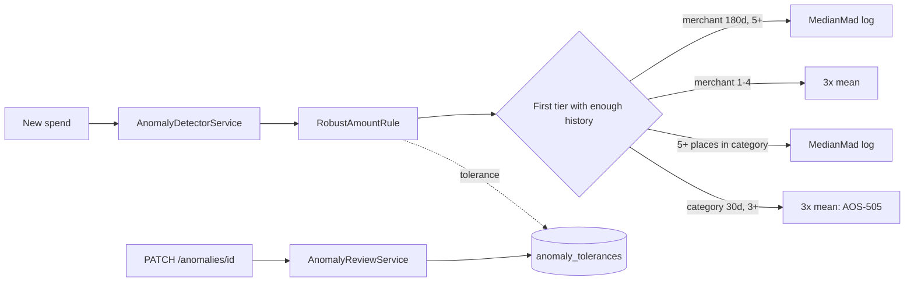

# AOS-713 — Robust anomaly baselines (median/MAD per merchant) + learning from dismissals

| Field | Value |
|---|---|
| **Type** | Task |
| **Parent** | [AOS-S7.4](AOS-S7.4.md) (Epic [AOS-E7](AOS-E7.md)) |
| **Status** | ✅ Done |
| **Priority** | P2 |
| **Owner** | Claude |
| **ETA** | 6h |
| **Actual** | 5h |
| **Created / Updated / Done** | 2026-10-17 / 2026-10-17 / 2026-10-17 |
| **Branch** | `aos-713-anomaly-baselines` |
| **Decisions** | D-53, D-61, D-67; D-73 (proposed below) |
| **Blocked by / Blocks** | AOS-505 ✅ / — |

## Description
Replace the "more than 3× the 30-day category average" large-amount rule with robust per-merchant baselines (median and MAD, modified z-score above 3.5), falling back step by step when there is too little history. Dismissing an alert raises that merchant's tolerance (capped); confirming it brings the tolerance back down. Measure old vs new on a synthetic labelled set of spending streams.

## Why
- Research report §10: averages are pulled up by single big spends, categories mix very different merchants, and dismissing an alert teaches nothing, so the same false alarm repeats.
- The goal is fewer, better alerts: "₹4,800 is more than usual at Swiggy: usually ₹435–₹582.50 (6 payments in 180 days)".

## Scope
- **In:** the amount rule, its baselines and fallback chain; per-(user, merchant, rule) tolerance and the dismiss/confirm feedback; the alert text with the usual range; an eval set, a committed baseline and a gate test; moving the anomaly routes' logic into a service.
- **Out:** Isolation Forest / seasonal ESD (rejected in the research); an LLM explanation; a web change (the anomaly page already sends `confirmed_safe` / `confirmed_fraud`).

## Acceptance criteria
- [x] Large-amount alerts use a per-merchant robust baseline over the 180 days before the spend, in the user's days (`UserCalendar`), from 5 earlier payments; with fewer, the fallbacks below; with nothing comparable, no amount alert. → `RobustAmountRuleTest`
  - 1–4 earlier payments at the merchant: over 3× their mean (so a flight isn't judged by cab rides);
  - a first payment somewhere: the typical amount of each other place in the category, robust, from 5 places;
  - else today's 3× 30-day category average (from 3 spends).
- [x] Unusual = modified z-score `0.6745·(x − median)/MAD` above 3.5 (+ one per tolerance step), on log amounts, and at least ₹2,000 (D-53). → `BaselineModelsTest`, `BaselinePropertyTest`
- [x] Zero MAD falls back to the mean absolute deviation (×1.2533), and the spread is never below 10% of the median, so nothing divides by zero and ₹649 → ₹700 never alerts. A history containing ₹0 gives no log baseline. → `BaselineModelsTest`
- [x] Only spends of the same currency count; refunds, reversals, transfers, ₹0 rows, later spends and the spend itself never enter a baseline. → `RobustAmountRuleTest`
- [x] The alert text shows the usual range (25th–75th percentile) and how many payments, spends or places it is based on. → `AgentDetectorCoverageTest`, `RobustAmountRuleTest`
- [x] "This is normal" (`confirmed_safe` or `dismissed`) raises that merchant's amount tolerance one step, capped at 3; "this was unexpected" (`confirmed_fraud`) lowers it one step, never below the start. Only the first answer to an anomaly teaches. Stored per (user, merchant, rule) in V33; concurrent answers all count. → `AnomalyReviewServiceTest`, `AnomalyToleranceIntegrationTest`
- [x] Tolerance never affects the duplicate, card-testing, foreign-currency or odd-hours rules. → `AnomalyReviewServiceTest`
- [x] A synthetic labelled eval set (`anomalies/streams.csv`, 3,789 spends, 6 streams, 20 injected anomalies) with a committed baseline (`anomalies/baseline.json`) and a gate test; old vs new below. → `AnomalyRegressionTest`
- [x] Dismissal replay: a repeated false alarm (₹3,000 monthly where ₹2,000 is usual) stops after one dismissal. → `AnomalyReviewServiceTest`
- [x] Evidence-driven change to a crisp rule: a duplicate under ₹100 is recorded but not pushed (every false duplicate alert in the set was a ₹10–₹26 tea or chai bought twice). → `AgentDetectorCoverageTest`, `AnomalyRegressionTest`

## Design
- **Context:**
  - `AnomalyDetectorService` built five `AnomalyRule`s per spend (AOS-505, D-53). `LargeAmountRule` compared with 3× the 30-day category mean (≥ 3 spends, ≥ ₹2,000).
  - `PATCH /anomalies/{id}` updated the row directly from the route (a layer-rule gap) and taught nothing.
  - The research (§10) recommends median + MAD with the Iglewicz–Hoaglin 3.5 cut-off and a capped tolerance per (merchant, rule).
- **Options considered:**
  1. **A fallback chain of baseline tiers behind a `BaselineModel` port** (chosen). Each tier is (scope: merchant / category / category-of-merchants, look-back, model). The first tier with enough history decides. Models: `MedianMadBaseline` (robust, linear or log scale) and `MeanMultipleBaseline` (today's rule). The old detector is the one-tier chain, so the eval runs old and new through the same code.
  2. **Replace the rule's arithmetic in place** (median/MAD inside `LargeAmountRule`). Less code, but the old rule can't be measured beside the new one, and every new model means editing the rule.
  3. **Precomputed baselines in a table**, refreshed nightly. Faster reads, but stale on the day a pattern changes, and a second source of truth; computing over 180 days per spend is cheap for one person.
- **Tolerance options:**
  1. **An integer level per (user, merchant key, rule), +1 on "normal", −1 on "unexpected", 0..3** (chosen). Each model turns the level into its own threshold (z 3.5 → 4.5 → 5.5 → 6.5; 3× → 4× → 5× → 6×). Explainable and capped, so a real fraud far above normal still alerts.
  2. A Beta-Bernoulli "useful alert" estimate per merchant: principled, but needs many labels per merchant to move. Noted as the upgrade path.
  3. Muting a merchant after a dismissal: simple, but it would hide a real fraud there.
- **Decision:** option 1 + tolerance option 1 (D-73). **Patterns:** Strategy/port (`BaselineModel`), Chain of Responsibility (tiers), Specification (`AnomalyRule`), Repository (`AnomalyToleranceRepository`).
- **What the eval changed in the design** (ablations on the same set; false alerts per stream-month, lower is better):

  | Chain (all with today's duplicate rule) | Precision | Recall | False alerts/month |
  |---|---|---|---|
  | E0 old: 3× 30-day category mean | 10.3% | 90% | 2.18 |
  | merchant (rupees) → category (rupees) → old | 11.7% | 100% | 2.10 |
  | merchant (log) → category (rupees) → old | 13.1% | 100% | 1.85 |
  | merchant (log) → category (log) → old | 15.8% | 100% | 1.49 |
  | merchant (log) → old | 14.2% | 100% | 1.68 |
  | merchant (log) → places in category (log) → old | 22.5% | 100% | 0.96 |
  | merchant (log) only | 33.3% | 80% (no new merchant found) | 0.44 |
  | merchant (log) → places in category (log), no old rule | 33.3% | 80% | 0.44 |
  | **merchant (log) → merchant 3× (1–4 payments) → places (log) → old** | **26.7%** | **100%** | **0.76** |
  | same with 4× instead of 3× | 27.4% | 100% | 0.74 |
  | same with 3 instead of 5 places | 28.8% | 95% | 0.65 |

  - **Log amounts:** spending at one place is roughly log-normal (a big shop is a multiple of the usual), so the linear z flagged ordinary big orders at wide-ranging merchants (Amazon, flights).
  - **Places, not spends, for the category:** a chai stall paid 30 times a month made every dinner out "unusual" against the category's spends.
  - **Merchant 3× for 1–4 payments:** flights, hotels and fuel were judged by cab rides until they had 5 payments.
  - **Today's rule stays last:** without it, no new-merchant anomaly was found (recall 80%).
  - Tighter variants (4×, 3 places) were within noise of the chosen one or lost recall; the round numbers were kept.
- **Extensibility:** a new model is one `BaselineModel`; a new scope or look-back is one tier; another rule can use tolerance by adding a `TolerableRule`.
- **Impact:**
  - **Domain:** `RobustAmountRule` (tiers) replaces `LargeAmountRule`; `baselines/` (`BaselineModel`, `MedianMadBaseline`, `MeanMultipleBaseline`, `ToleranceLevel`); `AnomalyTolerance` + repository; `AnomalyReviewService` holds list/find/resolve + feedback + audit (routes only map HTTP); `MerchantKey` (one "same merchant" rule); `DuplicateChargeRule` takes a small-amount bar; `AnomalyDetectorService` now takes `UserCalendar` and the tolerance repository.
  - **Schema:** `V33__anomaly_tolerance.sql` (tentative number): `anomaly_tolerances` and `anomalies.rules_fired` / `anomalies.merchant_key`.
  - **Persistence:** `dbQueryReadCommitted` for row-locked read-modify-write (at REPEATABLE READ a concurrent answer failed with "could not serialize access").
  - **API:** unchanged shapes; the reason text now shows the usual range.

## Security (docs/ENGINEERING.md §4a, D-100)
- **What it exposes:**
  - no new route: `PATCH /anomalies/{id}` now also moves a tolerance;
  - new stored data: `anomaly_tolerances` (merchant key, a 0..3 level, counts) and `anomalies.rules_fired` / `merchant_key`;
  - no new dependency, outbound call, job or listener.
- **Abuse and what stops it:**

  | Threat | What stops it | Test |
  |---|---|---|
  | **Stranger / forged session** relaxes alerts so a later fraud stays quiet | The route needs a valid JWT (cookie or bearer); a token signed with another secret is 401, and nothing changes | `AnomalySecurityTest` |
  | **Another user's anomaly ID** used to tune someone else's tolerance | Ownership is checked before anything is written: 404, both users' tolerances untouched | `AnomalySecurityTest`, `AgentRoutesCoverageTest` |
  | **CSRF** (a cross-site PATCH) | Session cookies are `SameSite=Strict` (AOS-109), and the API has no other cookie auth. There is no separate Origin check (platform-wide, not this task) | — |
  | **A fraudster trains the detector**: many small "normal" charges, then one big one | The baseline is robust (median/MAD), the tolerance is capped at 3 steps (z 6.5), and duplicate/card-testing rules ignore tolerance. Only the user's own answers move it, the first answer per alert only | `AgentDetectorCoverageTest` (cap), `AnomalyReviewServiceTest` |
  | **A hostile merchant name** (markup, RTL override) in the alert text | Kept as plain text in the API. The web renders text, never HTML. Push bodies are JSON-encoded | `AnomalySecurityTest` |
  | **Absurd amounts** (₹10¹³, ₹0.01) | Doubles and BigDecimal, no overflow; never divides by zero (spread floor); `ln` only on positive amounts | `AnomalySecurityTest`, `BaselineModelsTest` |
  | **Hostile bodies** (10 kB status, SQL text, non-JSON, null) | 400 with nothing changed. Exposed binds parameters (no SQL is built from input) | `AnomalySecurityTest` |
  | **A failure halfway** (tolerance write fails) | It propagates: no "resolved" answer is returned, and production rolls back the one READ COMMITTED unit of work | `AnomalySecurityTest`, `AnomalyToleranceIntegrationTest` |

- **Checks:**
  - no secrets or personal data in code, fixtures or logs: the eval streams are synthetic, and logs carry IDs and levels only;
  - no new listener or bind;
  - no new dependency;
  - data at rest: a tolerance is a merchant name in lower case plus a small integer, the same sensitivity as the transaction's merchant name already stored, so it isn't separately encrypted;
  - no AI.
- **Playwright:** no new screen or flow (the anomaly page is unchanged), so no new attack spec.

## Verification
- **Gate:** `./gradlew test integrationTest koverVerify` green: **1,563 unit + 129 integration tests** (rebased on `main` with AOS-614/AOS-012), 0 disabled; line coverage 99.3%.
- **Eval (synthetic, `./gradlew -q anomalyReport`):** 3,789 spends over 6 imagined people × 12 months; 20 injected anomalies (8 spikes, 4 new expensive merchants, 4 duplicates, 4 card tests); normal variation includes festival shopping, yearly premiums, school fees, dining out at new places, travel and foreign charges abroad, and chai twice a day.

  | Variant | Alerts | Precision | Recall | False alerts per month | Quiet streams, alerts per month |
  |---|---|---|---|---|---|
  | **Old (AOS-505)** | 175 | **10.3%** | **90%** | **2.18** | 0.79 |
  | New amount rule, duplicates as before | 75 | 26.7% | 100% | 0.76 | 0.67 |
  | **New (AOS-713)** | 46 | **43.5%** | **100%** | **0.36** | 0.17 |
  | New + the user answers every alert | 46 | 43.5% | 100% | 0.36 | 0.17 |

  - False alerts fell by 83% (126 → 24 from the amount rule; 29 → 0 small duplicates) and both previously missed spikes are now found.
  - The remaining 26 false alerts are first payments at new places (festival gold, a yearly premium, the first dinners of the year, a hotel abroad) and 2 foreign-currency charges while travelling. Answering alerts doesn't move these numbers because a tolerance only helps a merchant seen again; the dismissal replay test shows that effect.
  - `AnomalyRegressionTest` fails if precision or recall drop or false alerts rise for any variant, if the committed CSV no longer matches the seeded generator, or if a label or kind of normal disappears.
- **Unit:** baselines (median/MAD maths, zero MAD, identical history, zero amounts, log vs linear, tolerance steps, quantiles), jqwik properties (the median is never unusual; more tolerance never more unusual; log scale is unit-free), the tier chain (each fallback, user-zone window edges, currency/nature/self filters, wording), the review service (each status, cap, floor, first answer only, legacy rows, no merchant, crisp rules, audit, not found), detector end to end.
- **Postgres:** tolerance round trip, cap, six concurrent dismissals all counted; `rules_fired` / `merchant_key` round trip; resolve + tolerance in one READ COMMITTED unit of work.

## Risks / notes
- **A tolerance could hide a real fraud at a dismissed merchant:** it is capped at 3 steps (z 6.5), and the duplicate and card-testing rules ignore it.
- **Synthetic data:** the numbers come from imagined people; real thresholds should be revisited once Pragun has answered a few months of alerts (the tolerance table records every answer).
- **The story says "a confirmation lowers it"; the task brief says "confirming keeps it":** both hold — a confirmation lowers a raised tolerance one step and never goes below the start.
- **Concurrent first answers** to the same anomaly from two devices could both teach (no conditional update on `status = open`); harmless and capped.
- **Foreign currency while travelling** alerts every time (crisp rule, kept per D-53 and the research); a per-trip "I'm abroad" switch would be a separate product decision.
- **Not wired yet:** AOS-709's confirmed merchant aliases should feed `MerchantKey` here so a renamed merchant keeps its history; noted for AOS-709.

## Activity log
- 2026-10-17 — Claude (background agent): started (Pragun: "start all [E7 tasks] with the best decision long term").
- 2026-10-17 — Claude: first eval run showed the plain median/MAD chain barely beat the old rule (2.10 vs 2.18 false alerts a month); ablations above led to log amounts, places-per-category, the merchant 3× tier and the small-duplicate bar.
- 2026-10-17 — Claude: done; gates green; PR opened (not merged).

## Definition of Done (docs/ENGINEERING.md §4)
- [x] Each acceptance criterion covered by a test or a documented manual check
- [x] Tests/build green (integration tests too: schema V33)
- [x] Layer rules respected (routes → `AnomalyReviewService` → repositories); no silent fallbacks; logs carry IDs and levels only, never amounts or merchant names
- [x] Security gate (§4a): threat review above, attack tests (`AnomalySecurityTest`), no new route, listener or dependency
- [ ] Decisions recorded · ticket, story, epic and board updated · PROGRESS.md updated — **integrator** (D-73 proposed below)
- [x] Commit message starts with `AOS-713:`

## Resolution
Done. Robust per-merchant baselines with a measured fallback chain, tolerance learnt from answers, and an eval harness with a committed floor. Files: `domain/agent/{RobustAmountRule, AnomalyTolerance, AnomalyReviewService, AnomalyDetectorService, AnomalyRules, AnomalyRoutes, AgentModule, Models}.kt`, `domain/agent/baselines/*`, `domain/financial/MerchantKey.kt`, `infrastructure/database/{DbQuery.kt, repositories/ExposedAnomalyToleranceRepository.kt, repositories/ExposedAnomalyRepository.kt, tables/AgentTables.kt}`, `V33__anomaly_tolerance.sql`, `di/AppModule.kt`, `build.gradle.kts` (`anomalyReport`), tests and `src/test/resources/anomalies/*`. Actual 5h vs ETA 6h.

## Proposed decision D-73
> **D-73 — Unusual amounts are judged against the merchant's own robust baseline, and answers tune it** · Type: **Architecture / Product** · Tasks: AOS-713 · 2026-10-17 · Builds on D-53, D-61
>
> **Context:** The AOS-505 rule (over 3× the 30-day category mean) alerted 2.2 times a month per person on synthetic streams with 10% precision: averages are pulled up by outliers, categories mix chai with dinners and flights with cab rides, and a dismissal taught nothing.
>
> **Decision:**
> - **Baselines:** a `BaselineModel` port with two models (robust median/MAD; the old 3× mean). An amount is unusual when the modified z-score on **log amounts** is above 3.5, it is at least ₹2,000, and it is above the median. Spread: MAD, else 1.2533 × mean absolute deviation, never below 10% of the median.
> - **Fallback chain**, the first tier with enough history decides, in the user's days:
>   1. the merchant's last 180 days, 5+ payments;
>   2. 1–4 payments at the merchant: over 3× their mean;
>   3. a first payment: the typical amount of each other place in the category, 5+ places;
>   4. the AOS-505 rule (3× the 30-day category mean, 3+ spends).
> - **History:** same-currency spends only; refunds, reversals, transfers and the spend itself never count.
> - **Text:** the alert shows the usual range (25th–75th percentile) and the count it rests on.
> - **Answers teach:** "this is normal" raises the (user, merchant, rule) tolerance one step, "unexpected" lowers it one, within 0..3 (z 3.5 → 6.5); only the first answer per anomaly counts. Crisp rules (duplicate, card testing, foreign currency, odd hours) are never relaxed.
> - **Duplicates under ₹100** are recorded but not pushed (confidence 0.5); everything else in D-53 is unchanged.
> - **Measured (D-61 style):** `anomalies/streams.csv` (synthetic, seeded, committed) and `anomalies/baseline.json`; `./gradlew -q anomalyReport` prints old vs new; a gate test fails on a drop. On the set: false alerts per month 2.18 → 0.36, precision 10.3% → 43.5%, recall 90% → 100%.
>
> **Alternatives rejected:** median/MAD on rupees (flags ordinary big orders), a category baseline over all spends (frequent small merchants outvote the rest), dropping the old rule (new expensive merchants missed), precomputed nightly baselines (stale, second source of truth), muting a merchant on dismissal (hides fraud), Beta-Bernoulli per merchant (needs many labels; the upgrade path).
>
> **Consequences:** new models or scopes are one class or one tier; thresholds are constants to revisit on real answers; AOS-709's merchant aliases should feed the merchant key.
