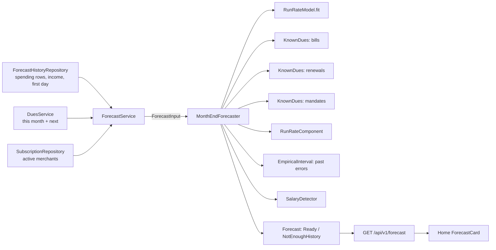

# AOS-714 — Month-end forecast and "money left until salary"

| Field | Value |
|---|---|
| **Type** | Task |
| **Parent** | [AOS-S7.4](AOS-S7.4.md) (Epic [AOS-E7](AOS-E7.md)) |
| **Status** | ✅ Done |
| **Priority** | P2 |
| **Owner** | Claude |
| **ETA** | 8h |
| **Actual** | 9h |
| **Created / Updated / Done** | 2026-10-17 / 2026-10-17 / 2026-10-17 |
| **Branch** | `aos-714-forecast` |
| **Decisions** | D-39, D-45, D-46, D-49, D-54, D-55, D-56, D-61, D-67, D-76 (proposed below) |
| **Blocked by / Blocks** | — / — |

## Description
Forecast this month's spending at its end, with a range, and say how much of the last salary will be left when the next one comes. Every number is computed by deterministic code and traces to its parts on screen ("How we got this"). Below three months of history it says so instead of guessing.

## Why
The console shows what happened. It can't say "at this pace you'll spend about ₹62k this month" or "₹18,400 left until salary on the 1st, after rent and two AutoPays" (research report §11). D-67 requires that numbers shown as fact come from deterministic code, never from a model.

## Scope
- **In:**
  - a pure forecaster with one component per source (bills, renewals, mandates, everyday spending);
  - a robust run-rate, an empirical range and a salary detector;
  - `GET /api/v1/forecast` and a self-contained Home card;
  - a synthetic backtest with a committed baseline and a no-regression test (D-61 style).
- **Out:**
  - **bank balance:** it isn't stored. Statement balances stay in `ingest_events.metadata` and aren't carried to transactions; SMS balances aren't parsed. "Money left" is therefore measured from the last salary, and the card says the balance isn't known (follow-up below);
  - other income besides the salary (it isn't counted in "money left", and the card says so);
  - projecting bills that haven't arrived yet (see Risks);
  - ML libraries, Prophet and deep models (rejected by the research; the backtest below agrees).

## Acceptance criteria
- [x] **Month-end** = spent so far (the console's own "spent", D-46) + known unpaid dues after today (bills, renewals, mandates; D-54/D-55/D-56) + a robust run-rate × the remaining days, by weekday and weekend. → `MonthEndForecasterTest` › `the month-end is spent so far plus each source plus everyday spending, and it adds up`; `ForecastServiceTest` › `a full forecast with history, dues and salary`
- [x] **No double counting:**
  - what an active subscription, a mandate or a bill payment took is kept out of the run-rate (it's forecast as a due instead);
  - credit-card bills aren't dues (they're paid by transfer, D-39, and their purchases are already spending).
  → `ForecastServiceTest` › `subscription, mandate and bill payments are recurring, not everyday spending`; `paid, cancelled, card and empty bills are not known dues`
- [x] **Range:** an 80% range from the user's own past forecast errors on the same day of the month (±3 days), split-conformal ranks. With fewer than 3 past months there's no range, and the card says how many more months it needs. → `MonthEndForecasterTest` (range tests); `ForecastBacktestTest` › `the 80 percent range covers between 70 and 90 percent of month-ends`
- [x] **Salary:** the date and amount are learnt from income credits: the same payer, about monthly, a similar amount, a similar day (plain day or from the month's end), and the payer's own weekend habit. Irregular, stopped or missing salaries are named, not guessed. → `SalaryDetectorTest` (18 tests)
- [x] **Money left until salary** = the last salary − spent since it − what the same components expect until the day before the next one. It may be negative ("Short by …"). A late salary shows no number. → `MonthEndForecasterTest` (5 tests); `ForecastCard.test.tsx`
- [x] **Not enough history:** below 90 days the API returns `not_enough_history` with the days so far and the date it starts; no forecast is made. → `MonthEndForecasterTest` › `below 90 days of history…`; `ForecastServiceTest` › `a new user…`; `ForecastCard.test.tsx`
- [x] **Every number traces to its parts:** the API returns each part (items for dues; rates, day counts and the learning window for everyday spending), and the card's "How we got this" lists them with the sum. → `ForecastRoutesTest`, `ForecastCard.test.tsx`
- [x] **The user's zone and calendar:** "today", month edges and local days are the user's (token `tz`, AOS-120). → `ForecastServiceTest` › `days are the user's own, not the server's`; `ForecastHistoryIntegrationTest` (IST and Tokyo)
- [x] **Edge cases:** no history; transfers only; the last day of the month; a leap February; payday tomorrow; a 1st/30th/31st payday; mid-month (16th) paydays; bonus months; weekly payouts; reimbursements near payday; credits after today; refunds; overdue bills; due-today bills. → unit tests named for each
- [x] **Backtest with a committed baseline:** `./gradlew -q forecastReport` (numbers below), and `ForecastBacktestTest` fails if MAPE, relative MAE or salary accuracy get worse than `src/test/resources/forecast/baseline.json`.
- [x] **Home card (D-49):**
  - one figure;
  - plain bars for the parts;
  - Indian number formatting;
  - "short by" and "left" said in words, so colour is never the only signal;
  - shown only for the month in progress.
  → `ForecastCard.test.tsx` (14 tests), `home.test.tsx` (+2), `e2e/forecast.spec.ts` (4, not run here)

## Design
- **Context:**
  - **Analytics** (D-45/D-46) defines "spent".
  - **The dues calendar** (`DuesService`, D-55/D-56) knows bills, renewals and mandates for a month.
  - **Recurring payments are marked:**
    - mandate debits set `isRecurring` (AOS-502);
    - bill payments link `paymentTxnId` (AOS-508);
    - subscriptions keep their merchant (AOS-513).
  - **Income** is `nature = income` (D-39).
  - **No balance is stored.**
- **Options considered:**
  1. **Decomposition with a robust run-rate (chosen).** Spent so far + known dues + run-rate × days left, with an empirical range. It uses what we know exactly and estimates only the rest, and it is explainable part by part.
  2. **ETS / seasonal naive on daily totals.** These are standard, but daily personal spending is spiky and intermittent. They also can't use known dues, and rent on the 5th dominates them (see the naive and seasonal-naive rows below).
  3. **Prophet or a foundation model.** They need years of history and a heavy dependency (or Python/GPU), and they can't explain a number. Rejected by the research; the backtest gives no reason to revisit that, because the simple engine is already at 9.5% MAPE.
  4. **An LLM writing the forecast.** Barred by D-67.
- **Run-rate options (measured, table below):**
  - median per day (0 for intermittent spenders);
  - trimmed means (5%, 10%);
  - plain mean;
  - the median of weekly totals;
  - each pooled or split by weekday and weekend.
  - **Chosen:** the weekly median, split by weekday/weekend. It has the best MAPE, it is robust to one big purchase (the median of 8 weeks), and it is robust to days without spending (weekly totals).
- **Range options (measured):**
  - same day vs ±3/±5 days;
  - interpolated quantiles vs split-conformal ranks.
  - **Chosen:** ±3 days with conformal ranks: coverage 75.6% at a narrower width than same-day conformal. Interpolated quantiles of few months under-cover (61.6%).
- **Decision:** option 1 (D-76). **Patterns:**
  - **Strategy:** `RunRateModel` (estimator and split) and `QuantileMethod`.
  - **Composite:** `ForecastComponent` per source, summed by the forecaster.
  - **Repository:** `ForecastHistoryRepository`, with InMemory and Exposed implementations.
  - **Pure core:** `MonthEndForecaster` does no I/O, and `ForecastService` loads its inputs.
- **Extensibility:**
  - **A new source of expected spending** (projected bills, planned purchases, a trip, goals) is one `ForecastComponent` implementation added in `componentsFor`. It then appears as a part in the API and on the card.
  - **A balance**, once stored (follow-up), changes only `UntilSalary`.
  - **A better rate or range** is a new `RateEstimator`/`QuantileMethod`, chosen by re-running the backtest.
- **Impact:**
  - **API:** new package `domain/forecast`, a route `GET /api/v1/forecast` and `ExposedForecastHistoryRepository` (SQL, read-only); Koin wiring.
  - **Web:** `lib/forecast.ts`, `components/console/ForecastCard.tsx` and one line in Home.
  - **Build:** a Gradle `forecastReport` task.
  - No schema change, no migration, no Go or parser change.
- **Diagram:**

## Implementation plan
1. Write the pure domain: history, statistics, run-rate, components, interval, salary detector, forecaster.
2. Write the synthetic generator and backtest; compare the variants; choose the defaults; commit the baseline.
3. Write the loader (`ForecastService`), the repository port with InMemory and Exposed implementations, the route and the wiring.
4. Build the web card and its tests; add the default mocks (MSW and Playwright); add the e2e spec.

## Verification
- **Backtest** (`./gradlew -q forecastReport`):
  - setup:
    - 24 synthetic histories: 6 personas (steady, intermittent, spiky, weekend-heavy, drifting with a festive season, freelancer with irregular income) × 4 seeds;
    - January 2027 – June 2028, including the leap February 2028;
    - recurring payments: rent on the 5th, a SIP on the 10th, Netflix on the 12th, electricity on the 20th, Spotify on the 31st (clamped to the month's end);
  - the forecast is made on the 10th and the 20th of every month from April 2027, with only what was known that day: 720 forecasts.

| Method | MAPE | MAE | Rel. MAE vs naive | 80% range coverage | Mean width | MAPE @10th | MAPE @20th |
|---|---|---|---|---|---|---|---|
| Naive pace (baseline) | 62.36% | ₹29,861 | 1.000 | — | — | 93.91% | 30.80% |
| Seasonal naive, last month (baseline) | 21.76% | ₹11,351 | 0.380 | — | — | 21.76% | 21.76% |
| **Engine (shipped): weekly median, weekday/weekend** | **9.54%** | **₹5,637** | **0.189** | **75.6%** | 36% | 12.25% | 6.83% |
| Median per day, pooled | 14.07% | ₹7,930 | 0.266 | 74.6% | 35% | 19.00% | 9.15% |
| Median per day, weekday/weekend | 11.71% | ₹6,736 | 0.226 | 74.4% | 36% | 15.68% | 7.74% |
| Trimmed mean 10%, pooled | 10.49% | ₹6,202 | 0.208 | 74.9% | 36% | 13.83% | 7.16% |
| Trimmed mean 10%, weekday/weekend | 9.76% | ₹5,769 | 0.193 | 74.6% | 36% | 12.66% | 6.87% |
| Trimmed mean 5%, weekday/weekend | 9.81% | ₹5,619 | 0.188 | 72.2% | 38% | 12.33% | 7.29% |
| Weekly median, pooled | 9.92% | ₹5,802 | 0.194 | 75.0% | 38% | 12.72% | 7.12% |
| Plain mean, weekday/weekend | 11.30% | ₹6,091 | 0.204 | 73.7% | 39% | 13.98% | 8.62% |

- **Reading the table:**
  - The naive pace (spent so far × days in month ÷ days elapsed) is badly hurt by rent on the 5th, so seasonal naive is the meaningful baseline.
  - Against seasonal naive the engine's MAE is 0.50×, and against the naive pace it is 0.19× (a MASE-style ratio).
  - The research gate is met: it beats naive, and coverage is within ±10 points of 80%.
- **Ranges** (on the shipped run-rate):

| Range method | Coverage | Width |
|---|---|---|
| Same day, interpolated quantiles | 61.6% | 27% |
| Same day, conformal ranks | 75.6% | 40% |
| ±3 days, interpolated | 71.1% | 33% |
| **±3 days, conformal (shipped)** | **75.6%** | **36%** |
| ±5 days, conformal | 75.6% | 35% |

  Coverage stays a little under 80% because of the festive boost and drift, which past months can't show. The range only models everyday spending, because the dues are known amounts.
- **MAPE by persona** (engine vs seasonal naive):
  - steady 4.6% vs 8.3%;
  - intermittent 8.1% vs 12.5%;
  - spiky 14.4% vs 40.3%;
  - weekend-heavy 9.2% vs 20.0%;
  - drifting/festive 8.6% vs 20.8%;
  - freelancer 12.3% vs 28.6%.
- **Salary:**
  - the next payday is exactly right in 94.4% of forecasts and within 2 days in 100%;
  - irregular (freelance) income is left "unknown" in 98.3%;
  - the money-left error is 6.4% of a salary on average (696 forecasts).
  - Learning the weekend habit raised the exact-date accuracy from 63.9% to 94.4% (measured during development).
- **Baseline:** `src/test/resources/forecast/baseline.json` records MAPE 9.5425, relative MAE 0.1888, coverage 0.756, salary date accuracy 0.9444 and irregular honesty 0.9833. `ForecastBacktestTest` holds the engine to it.
- **API:** `./gradlew test integrationTest koverVerify` is green:
  - 1,571 unit and 126 integration tests, 0 failed, 0 skipped;
  - coverage 99.34% lines and 90.10% branches (gate 90/85);
  - `domain/forecast` is at 99.55% lines and 87.24% branches.
- **Web:** `npm ci && npm run typecheck && npm run lint && npm run test:coverage && npx next build` is green:
  - 32 files and 374 tests;
  - coverage 98.41% statements and 94.92% branches overall;
  - `ForecastCard.tsx` 100% lines.
- **Playwright** wasn't run here (fixed ports; the integrator runs it). `e2e/forecast.spec.ts` has 4 specs, and the mocked API has a default `GET /api/v1/forecast`.

## Risks / notes
- **Bills not received yet:**
  - A bill's past payments are kept out of the run-rate. If next month's bill hasn't arrived (by email) when the forecast is made, it isn't forecast at all.
  - This under-forecasts mostly on the 10th.
  - **Follow-up:** a `ProjectedBillsComponent` that projects a monthly bill from its last two, until the real one arrives.
- **Subscription detection is broad:** any merchant charged at regular intervals becomes a "subscription" (AOS-513), for example a weekly grocery shop. Its charges are then forecast as renewals instead of everyday spending, which is consistent with the dues calendar but only as good as that detection (AOS-709 is improving grouping).
- **Today is partial:** "spent so far" includes today's entries, and the rest of today isn't forecast (the window starts tomorrow). The run-rate includes today's partial day (1/56 of the lookback), which is negligible.
- **Synthetic data:** the backtest numbers are for synthetic personas, not Pragun's data. Real-shaped scrubbed histories would be a better test (the same process as D-61).
- **Coverage** of 75.6% is under the nominal 80%. The card says "8 in 10" because that is the level we aim for; the measured figure is in this ticket.

## Follow-ups (for the integrator to ticket)
1. **Store the latest balance per account:** carry `balance` from statement rows (`ingest_events.metadata`) and parse "Avl Bal" in bank SMS. Then "money left" can be the balance − the expected spending until payday.
2. **`ProjectedBillsComponent`** for monthly bills that haven't arrived yet (see Risks).
3. **Let the user confirm or correct the detected salary** (payer and day). Today it is detected only.

## Activity log
- 2026-10-17 — Claude: ticket created from the task template; started (branch `aos-714-forecast`).
- 2026-10-17 — Claude: pure domain and synthetic backtest. The first run (trimmed-mean rate, interpolated range) gave MAPE 9.76% and coverage 60.1%, and the salary date was exact in 63.9%. Changed the default to the weekly median, conformal ±3 days and weekend-habit learning; weekly payouts are rejected as a salary. Baseline recorded.
- 2026-10-17 — Claude: API route, Exposed repository + integration test, Home card, unit and e2e specs. API and web gates green; PR opened.

## Definition of Done (docs/ENGINEERING.md §4)
- [x] Each acceptance criterion covered by a test or a documented manual check
- [x] Tests/build green (integration tests run: the new repository is SQL)
- [x] Layer rules respected; no silent fallbacks; no secrets/PII in logs (the forecast logs nothing)
- [ ] Decisions recorded · ticket, story, epic and board updated · PROGRESS.md updated: **left to the integrator** (D-76 proposed below)
- [x] Commit message starts with `AOS-714:`

## Resolution
- **What was done:** a deterministic month-end forecast and "money left until salary" (D-76 proposed).
  - API: `GET /api/v1/forecast`, with every part returned.
  - Home: a self-contained card with "How we got this".
  - A synthetic backtest with a committed baseline: MAPE 9.5% vs seasonal naive 21.8% and the naive pace 62.4%; 80% range coverage 75.6%; payday exact 94%.
- **Files:**
  - **API main:** `domain/forecast/` (`ForecastHistory.kt`, `ForecastComponents.kt`, `RunRate.kt`, `ForecastInterval.kt`, `SalaryDetector.kt`, `MonthEndForecaster.kt`, `ForecastHistoryRepository.kt`, `ForecastService.kt`, `ForecastRoutes.kt`), `infrastructure/database/repositories/ExposedForecastHistoryRepository.kt`, and wiring in `di/AppModule.kt` and `FinancialModule.kt`.
  - **API tests:** `domain/forecast/*Test.kt` (68 unit tests), `domain/forecast/evaluation/` (generator, backtest, report and the 6-test gate), `ForecastHistoryIntegrationTest`, the wiring test, and `src/test/resources/forecast/baseline.json`.
  - **Build:** the `forecastReport` Gradle task.
  - **Web:** `lib/forecast.ts`, `components/console/ForecastCard.tsx` and its test, Home (`app/page.tsx`) and `home.test.tsx`, fixtures, the MSW default, the Playwright mock default, and `e2e/forecast.spec.ts`.
- **Schema:** no migration.
- **Verified:** see Verification. Playwright is left to the integrator.
- **Actual vs ETA:** 9h vs 8h. The backtest variants and the salary weekend habit took longer than planned.

## Proposed decision D-76
### D-76 — The month-end forecast is deterministic decomposition, measured by a backtest
2026-10-17 · Proposed (Claude, AOS-714; awaiting Pragun) · Type: Architecture / Product · Tasks: AOS-714 · Builds on D-39, D-46, D-55, D-56, D-61, D-67
- **What it says:**
  - **month-end** = spent so far (the console's "spent", D-46) + known payments after today, one component per source (unpaid bills except credit cards, renewals, mandate debits) + everyday spending at a robust daily rate × the days left;
  - **money left until salary** = the last salary − spent since it − what the same components expect until the day before the next salary.
- **No double counting:**
  - what a mandate, a bill payment or an active subscription took is kept out of the everyday rate;
  - credit-card bills aren't dues (they're paid by transfer, D-39).
- **The rate:** the median of weekly totals over the last 8 weeks, separately for weekdays and weekends. It is robust to one big purchase and to days without spending.
- **The range:**
  - an 80% range from the user's own past errors on the same day of the month (±3 days), using split-conformal ranks;
  - none with fewer than 3 past months, and the card says how many more months it needs.
- **Salary:**
  - learnt from income credits: the same payer, about monthly, a similar amount, a similar day (a plain day or from the month's end), and the payer's own weekend habit;
  - weekly payouts and irregular credits are not a salary;
  - "late", "stopped", "varies" and "none" are said, never guessed.
- **Not enough history:** below 90 days the API says so and when the forecast starts; nothing is estimated.
- **Explainable:** the API returns every part (dues items; rates × day counts and the learning window), and Home's "How we got this" shows the sum. No model computes any number (D-67).
- **Measured (D-61 style):**
  - a synthetic backtest (24 histories, 720 forecasts on the 10th and 20th) against the naive pace and seasonal naive;
  - `forecast/baseline.json` is a floor that a test enforces;
  - it is raised only deliberately (`./gradlew -q forecastReport -PwriteBaseline`).
  - Today: MAPE 9.5% (seasonal naive 21.8%), coverage 75.6%, payday exact 94%.
- **Rejected:**
  - ETS / seasonal naive on daily totals (they can't use known dues and are 2.3× worse);
  - Prophet and foundation models (they need years of data, a heavy dependency, and give no explanation);
  - an LLM (D-67);
  - medians of days (0 for intermittent spenders);
  - interpolated quantiles of few months (61.6% coverage).
- **Consequences:**
  - a new source of expected spending is one `ForecastComponent`;
  - "money left" from a bank balance needs the balance stored (follow-up);
  - unreceived bills aren't forecast yet (follow-up `ProjectedBillsComponent`).
