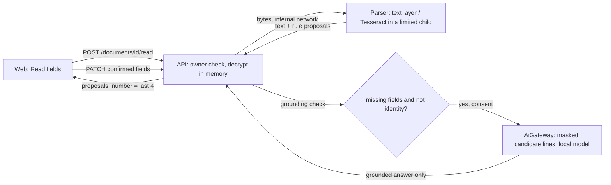

# AOS-717 — Documents vault: local OCR and field proposals

| Field | Value |
|---|---|
| **Type** | Task |
| **Parent** | [AOS-S7.5](AOS-S7.5.md) (Epic [AOS-E7](AOS-E7.md)) |
| **Status** | 🟨 Done, unverified (PR #158 open, awaiting review; the Trivy exception was accepted by Pragun, D-174) |
| **Priority** | P1 |
| **Owner** | Claude |
| **ETA** | 10h |
| **Actual** | 12h |
| **Created / Updated / Done** | 2026-10-18 / 2026-10-18 / — |
| **Branch** | `aos-717-documents-ocr` |
| **Decisions** | D-30, D-33, D-37, D-60, D-67, D-68, D-70, D-91, D-100, D-173, D-174, D-175 |
| **Blocked by / Blocks** | AOS-626 (merged) / AOS-719 (receipts OCR can reuse the reader) |

## Description
The vault (D-60) keeps encrypted files, but `expiresOn` is typed by hand, so the expiry reminders (`DocumentExpiryJob`, AOS-507) only fire if the owner reads each policy, PUC certificate or passport and types the date.

This task reads the document and **proposes** fields, and the owner confirms them:
- expiry date;
- policy or document number, stored as its **last 4 only**;
- issuer;
- amount paid.

A confirmed expiry feeds the existing reminders.

## Why
The BRD asks for renewals that are never missed, and research area 4 (docs/research/AI-ML-RESEARCH.md §8) recommends this: text layer first, then local OCR, then rules, with an optional local model for what is left, grounded and confirmed.

## Scope
- **In:**
  - the parser service reads PDFs (text layer, or OCR of scanned pages) and PNG/JPEG/WebP photos with Tesseract;
  - deterministic field rules with evidence;
  - `POST /documents/{id}/read`;
  - grounding checked again in the API;
  - an optional AI step through `AiGateway` (off by default, local-first, consent, identity withheld);
  - confirmed fields saved through `PATCH` (V80);
  - a web "Read fields" panel;
  - a synthetic eval set with a committed baseline and a CI gate.
- **Out:**
  - HEIC photos (they need another native decoder; the reader refuses them with a clear code);
  - storing OCR text or keywords (the research says that is a separate decision);
  - an eval record for the AI step: until one exists, the AI step cannot be enabled (see D-175);
  - Hindi OCR.

## Acceptance criteria
- [x] A text-layer PDF is read exactly, without OCR (`test_a_text_layer_pdf_is_read_exactly_without_ocr`, `ocrSurvival.text_pdf = 1.0`).
- [x] Scans and phone photos are read by local OCR, with no network (`test_scans_and_photos_are_read_by_ocr`, `test_reading_needs_no_network`, and a live run in the hardened container with `--network none`).
- [x] The four fields are proposed with evidence, and none is saved until confirmed (`DocumentFieldServiceTest`, `ReadFields.test.tsx`, Playwright `read fields`).
- [x] A document number is shown and stored as its last 4 only (`DocumentReadRoutesTest`, the V80 check constraint, `DocumentRepositoryIntegrationTest`).
- [x] A confirmed expiry feeds the reminders: the PATCH sets `expiresOn`, which resets `expiryRemindersSent` (the existing AOS-507 path).
- [x] Identity documents (passport, Aadhaar, PAN, voter ID, licence) never go to any model, whether recognised by category or by their text (`DocumentFieldServiceTest`, `DocumentFieldsTaskTest`).
- [x] The AI step goes through `AiGateway`, with a local default (Ollama), consent, `PiiMasker` and `SafeName`, and every proposed value is grounded in the OCR text (`DocumentFieldsTaskTest`).
- [x] The parser keeps its hardening:
  - each read runs in the AOS-626 child process (60 s, 1 GiB);
  - Tesseract runs as a process with a time limit, a fixed environment and no shell;
  - pixels are capped before decoding;
  - at most 5 pages are read, of at most 300.
- [x] Synthetic eval set with a committed baseline and a gate (`tests/doc_eval/baseline.json`, `test_doc_eval.py`).

## Design
- **Context:**
  - The Python parser already handles PDFs, is internal-only (its compose network has no internet), runs each parse in a limited child process (AOS-626), and keeps nothing (D-37).
  - The API holds the encryption keys (D-60) and the AI gateway (D-68).
- **Options considered (OCR engine; the evidence was measured on this repo's synthetic set, in the parser's base image `python:3.14-slim`):**

| | Tesseract 5.5 (chosen) | docTR (OnnxTR build, CPU) | PaddleOCR |
|---|---|---|---|
| Licence | Apache-2.0, Debian package | Apache-2.0 | Apache-2.0 |
| Installs on Python 3.14 | yes (apt) | yes | **no**: no `paddlepaddle` wheel for cp314 |
| Image size added | +148 MB (318 → 466 MB) | +528 MB of wheels, plus 105 MB of models fetched from GitHub on first use (must be baked in: the parser has no internet) | — |
| CPU-only | yes | yes | — |
| Time for the 108 eval docs | about 20 s | 203 s | — |
| Number recall (dev / held-out / fresh) | 0.95 / 0.90 / 0.97 | 0.68 / 0.80 / 0.77 | — |
| Expiry precision | 1.0 on all sets | 1.0 on all sets | — |

  The docTR run reused rules written against Tesseract's output, which may favour Tesseract a little; the gap in size, time and offline use stands either way.
- **Decision (D-173, Architecture):** Tesseract 5.5 from Debian, run as a process.
  - **Patterns:** an `Ocr` protocol, so docTR can be plugged in later; a `DocumentReader` port in the API with an HTTP adapter; rules as data (`issuers.py`).
- **Where the rules live:** in the parser, next to the OCR, as statement mapping already is. The API doesn't parse again: it only checks grounding (`FieldGrounding`: the evidence is in the text and the value is in the evidence), so a rule bug or a model can't invent a value.
- **Proposals are stateless (D-174, Product / Architecture):** `POST /read` returns proposals and stores nothing. Confirmation is the existing `PATCH` with three new fields.
  - Rejected: a proposals table, which would keep OCR-derived data at rest with nothing gained for one owner.
  - Identity documents never go to **any** model, not only the cloud (stricter than D-67). This is decided by category or by the text, so a passport filed under Other is still withheld.
  - The AI step never asks for numbers (minimum data).
- **The AI step is fail-closed until measured (D-175, Process):** `AI_DOCUMENT_FIELDS_*` defaults to off, with Ollama as the provider. No eval record is committed, so the D-68 start-up gate refuses to enable it until a real bake-off on this eval set is recorded.
  - Rejected: a hand-written "recorded-synthetic" record, which would let the feature be enabled without the model ever being measured.
- **Impact:**
  - parser: new endpoint and modules, Tesseract in the image, a CI step;
  - API: a new route, migration V80, a new AI feature `document_fields`, and a per-feature default provider in `AiConfig`;
  - web: the documents page;
  - compose: three env vars.

## Eval (synthetic, never real documents)
- **Generator:** `services/pdf-parser/tests/doc_eval/synthetic.py`, covering 12 kinds (motor, health and life policies, PUC, passport, PAN, Aadhaar, licence, RC, warranty, rent agreement, Form 16) and 4 renderings (text PDF, scanned PDF, PNG, phone-photo JPEG with rotation, blur, noise and uneven light).
  - Aadhaar-shaped numbers fail the Verhoeff check, and PAN-shaped ones use the unassigned holder letter Z, so none can be real.
  - Names are obviously made up (tested).
- **Sets:**
  - `dev` (48 documents, the rules were written against it);
  - `heldOut` (24, with label and layout variants dev doesn't have);
  - `fresh` (36, generated and scored only after the rules were final).
- **First run** (before any tuning), expiry precision: dev 0.879, held-out 0.867.
- **Committed baseline** (`tests/doc_eval/baseline.json`, Tesseract 5.5.0; identical under CI's 5.3.4):

| Set | Expiry recall / precision | Number recall / precision | Issuer recall / precision | Amount recall / precision |
|---|---|---|---|---|
| dev | 1.0 / 1.0 | 0.95 / 0.974 | 1.0 / 1.0 | 1.0 / 1.0 |
| heldOut | 0.9375 / 1.0 | 0.90 / 1.0 | 1.0 / 1.0 | 1.0 / 1.0 |
| fresh | 1.0 / 1.0 | 0.967 / 0.967 | 1.0 / 1.0 | 1.0 / 1.0 |

- **Gate (every set):** expiry precision ≥ 0.95 (the research gate), expiry recall ≥ 0.85, number ≥ 0.90 precision and ≥ 0.80 recall, issuer and amount ≥ 0.95 precision and ≥ 0.90 recall.
- **Remaining misses are OCR confusions on photos.** The rules never "correct" them, because a corrected value would no longer be in the text:
  - O read for 0 in a PAN and in a licence number;
  - `$` read for S in passport numbers;
  - "tillO7" (the space lost, and 0 read as O).
- **One measured non-change:** auto-contrast before OCR lowered held-out photo survival from 0.917 to 0.833, so it was not kept.

## Security (threat review, ENGINEERING §4a, D-100)
**What it exposes**
- **New route:** `POST /api/v1/documents/{id}/read`.
  - Behind `auth-jwt` (the route inventory covers it), owner-only, with the same 404 for others and for unknown ids (IdorTest row added).
  - A POST, so the app-wide `OriginCheck` applies.
  - 10 reads a minute per user, `Cache-Control: no-store`.
- **New parser endpoint:** `POST /v1/documents:read`, reachable only on the internal `parser` network (no published port, no internet).
- **New stored data:** `documents.issuer`, `number_last4` (checked `^[A-Z0-9]{4}$` by V80) and `amount`.
  - These are not encrypted. They are the same sensitivity as the title and notes already stored. The full number is never stored.
- **New dependency:** Tesseract 5.5 and English data (Debian apt, signed archive, held to the 5.5 line). There are no new Python or JVM libraries.
- **No new secrets or listeners.**
- **One new AI feature,** off by default.

**How it could be abused, and what stops it**
| Threat | Control | Test |
|---|---|---|
| A stranger, a forged token, another user's id | `auth-jwt`; ownership checked before decrypting; the same 404 | `DocumentReadRoutesTest`, `IdorTest`, `RouteInventoryTest` |
| CSRF: another site makes the owner's browser read documents | `OriginCheck` on the POST; SameSite=Strict cookie | `DocumentReadRoutesTest` (no Origin and a foreign Origin are 403) |
| A CPU or memory exhaustion file (decompression bomb, huge page, thousands of pages, endless OCR) | pixels checked before decoding (40 MP) and Pillow's own guard; huge pages rendered smaller or refused; at most 5 of at most 300 pages read; Tesseract killed after 20 s; each read in an AOS-626 child (60 s, 1 GiB); 2 at once; 10/min per user | `test_documents.py` (bomb, wall-sized page, page cap, OCR timeout), AOS-626 tests |
| A malformed or hostile file crashing the parser or leaking content in errors | type from the first bytes; every failure is a code; Tesseract's stderr is never read into a message or log; logs hold counts only | `test_bad_files_fail_closed_with_a_code`, `test_an_ocr_failure_never_carries_its_stderr`, `test_the_route_logs_counts_never_the_text` |
| Command injection into Tesseract | a fixed argument list, no shell, a fixed environment (no proxy variables), the image on stdin; the language is letters only | `test_ocr_gets_a_fixed_environment_and_no_shell` |
| Tesseract's own CVEs | the six unfixed HIGH ones need a crafted `.traineddata`; ours comes read-only from the Debian package. libtiff is never given TIFF (Tesseract only gets a PNG that Pillow re-encoded). libcurl is never used (input is `stdin`, and there is no internet) | Trivy report; hardened live run (read-only root, no capabilities, `--network none`) |
| A parser that misbehaves (compromised or buggy) pushing data into the API | the answer is size-capped (64 kB, text ≤ 20 000, ≤ 20 proposals), the source is a closed enum, codes match `[A-Z_]{3,32}`, the API uses its own error words, unknown fields are dropped, every proposal is re-grounded | `HttpDocumentReaderTest`, `DocumentFieldServiceTest` (an ungrounded rule is dropped) |
| Prompt injection in the document text; a model inventing values | data, not instructions, in the prompt; schema; evidence must be in what was sent **and** in the document; the value must be in the evidence; the issuer must pass `SafeName`; any failure rejects the whole answer; the owner confirms | `DocumentFieldsTaskTest` |
| Personal data reaching a model | identity documents withheld (by category or text); only candidate lines sent; lines about people dropped; `PiiMasker` on each line; numbers never asked for; local model by default; consent per feature (AOS-704) | `DocumentFieldsTaskTest`, `DocumentFieldServiceTest` |
| A full document number reaching the browser or the database | the value is the last 4; the context line has the number replaced and is masked; V80 refuses anything but 4 characters; PATCH accepts only 4 | `DocumentReadRoutesTest`, `DocumentRepositoryIntegrationTest`, Playwright (`no \d{9,}` in the page) |
| XSS through text read from a document | React renders it as text; the CSP | `ReadFields.test.tsx`, Playwright attack spec (no `img`/`script` created, no dialog) |

**Checks**
- [x] No secrets or personal data: synthetic documents only, and the eval checks this.
- [x] No new public listener: the parser stays on the internal network with no published port.
- [x] Dependency: Tesseract is Apache-2.0, Debian 5.5.0. **Trivy: one CRITICAL, CVE-2026-6653 in libxml2**, pulled in through libarchive (Tesseract's language-data loader). It is not reachable, because the parser never parses XML, and Debian has no fix yet. It is in `.trivyignore.yaml` **accepted by Pragun on 2026-10-18 (D-174)**, expiring 2026-12-31.
- [x] Data at rest: the number is last 4 only; the issuer and amount are justified above.
- [x] AI: off by default, minimum data, outputs validated, and cannot be enabled without a measured eval (D-175).

## Implementation plan
1. Parser: `ocr.py`, `documents.py`, `fields.py`, `issuers.py`, the route and limits; eval set, baseline and gate; tests.
2. Image and CI: Tesseract in the Dockerfile and in the CI job; Trivy.
3. API: the reader port and HTTP adapter, grounding, the AI task and service, the route, V80, PATCH, DI, compose; tests.
4. Web: the `ReadFields` panel and the row details; vitest; Playwright.

## Verification
- Parser: 129 tests pass (image Tesseract 5.5.0), and the gate, field and document tests also pass under Ubuntu's 5.3.4 (CI).
- API: `./gradlew test integrationTest koverVerify` is green, with 2,506 unit tests and 188 integration tests.
- Web: typecheck, lint and build pass; vitest has 568 tests (14 for documents); Playwright `documents.spec.ts` and `security.spec.ts` have 123 passing in 3 browsers.
- Image: Trivy is OK with the accepted exception (D-174); the hardened live read works (`--read-only --cap-drop ALL --network none`).

## Risks / notes
- **Trivy exception:** accepted by Pragun on 2026-10-18 ("1. Accept the exception"; D-174). It expires 2026-12-31; re-check then, or when Debian ships a fixed libxml2.
- **Playwright locally:** the whole mocked suite had 21 failures, all in specs this PR doesn't touch (forecast, home, merchant-merge, login callback). They look environmental (they ran on a temporary port, because another session held 3100). Left for CI and the integrator.
- **Follow-up:** a live bake-off of local models on this eval set, to record an eval for `document_fields` (D-175).
- **Follow-up:** HEIC support.
- **Migration:** V80 sits above V47 on main. Flyway runs it in order on new databases, but a database already past V80 would need out-of-order handling if V48–V79 land later (the reserved range was set by the integrator).

## Activity log
- 2026-10-18 — Claude: ticket created (🟦). The parser side was built on #120.
- 2026-10-18 — Claude: work was paused (local WIP commit) at the coordinator's request, then resumed after #120 merged. Merged main, finished the API, web and tests, opened the PR #158 with the Trivy exception pending.
- 2026-10-18 — Claude: Pragun accepted the Trivy exception; decisions renumbered to D-173, D-174, D-175 (D-140 was taken by AOS-716) and recorded; main merged in again.

## Definition of Done (docs/ENGINEERING.md §4)
- [x] Each acceptance criterion covered by a test or a documented manual check
- [x] Tests/build green (integration tests if the DB is touched)
- [x] Layer rules respected; no silent fallbacks; no secrets/PII in logs
- [x] Decisions recorded (D-173, D-174, D-175) · ticket, story and board updated · PROGRESS.md updated
- [x] Commit message starts with `AOS-717:`

## Resolution
Done; awaiting review and merge. Trivy exception accepted by the owner (D-174). See Verification.
