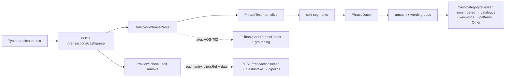

# AOS-718 — Cash quick-add from free text or dictation

| Field | Value |
|---|---|
| **Type** | Task |
| **Parent** | [AOS-S7.5](AOS-S7.5.md) (Epic [AOS-E7](AOS-E7.md)) |
| **Status** | ✅ Done |
| **Priority** | P3 |
| **Owner** | Claude |
| **ETA** | 5h |
| **Actual** | 6h |
| **Created / Updated / Done** | 2026-10-17 / 2026-10-17 / 2026-10-17 |
| **Branch** | `aos-718-cash-text` |
| **Decisions** | D-33, D-41, D-42, D-44, D-61, D-67, D-100, D-77 (proposed below) |
| **Blocked by / Blocks** | — (AOS-702 later, for the AI fallback) / — |

## Description
Typing or dictating "200 chai and 150 auto" or "paid 1.2k for groceries yesterday" fills in one or more cash entries (amount, category, date and note). They are shown as a preview to check, edit or remove before saving, and they are saved through the existing cash intake (`CashIntake`, D-42). A deterministic grammar does the reading. A clean extension point lets an AI fallback fill only what the rules leave open, later, through AOS-702's `AiProvider`.

## Why
Cash quick-add (AOS-204) needs an amount and a category tap for each entry. Several spends at once ("chai 40, auto 120 yesterday") take several rounds. The research (§14) recommends rules first, an LLM fallback only for what's left, keyboard dictation for voice, and a confirm sheet before saving.

## Scope
- **In:**
  - the rules parser (amounts incl. ₹/rs/inr, k/lakh/hundred, "/-", "15 x 2", English and Hinglish number words; dates incl. kal/parso, weekdays and written dates; times; quantities);
  - cash keywords as data;
  - categories in the D-41 order;
  - a preview API, and `date` on the cash entry;
  - the web preview with edit and remove;
  - the `CashPhraseParser` port and `FallbackCashPhraseParser` with grounding;
  - a synthetic eval set and baseline;
  - security tests.
- **Out:**
  - the AI parser itself (AOS-702 is in progress elsewhere; see the TODO below);
  - server-side audio or Whisper (the keyboard's dictation is enough, research §14);
  - receipts (AOS-719).

## Acceptance criteria
- [x] **Free text → one or more entries,** each with amount, category, date and note:
  - "200 chai and 150 auto" → ₹200 Food + ₹150 Transport;
  - "paid 1.2k for groceries yesterday" → ₹1,200 Shopping (groceries) yesterday.
  → `CashPhraseParserTest`; the eval set (B001–B030)
- [x] **Preview to confirm or edit before saving:** amount, category, day and note are editable and entries can be removed. Nothing is saved by the reading. Saving posts each entry once with its own `clientRef`. → `CashPhraseRoutesTest` › `… nothing is saved`; `CashTextEntry.test.tsx` (12 tests); `e2e/cash-text.spec.ts`
- [x] **Rules first:**
  - **amounts:** k, lakh/lac, hundred/thousand, ₹/rs/inr, "/-", 1,200 and 1,20,000 grouping, "15 x 2", English and Hinglish number words (do sau, dedh sau, paanch hazaar), Devanagari and full-width digits;
  - **words** mapped through the user's remembered rules (D-41), the merchant catalogue (D-44) and cash keyword rules (`resources/cash/keywords.json`: chai, auto, sabzi…);
  - **relative dates** in the user's zone.
  → `CashPhraseParserTest`, `CashPhraseFallbackTest` (category sources), the eval set
- [x] **AI extension point, not a dependency on AOS-702:**
  - `CashPhraseParser` is the port; `RuleCashPhraseParser` is shipped;
  - `FallbackCashPhraseParser(rules, fallback)` lets a later parser fill only:
    - segments the rules found no amount in, and only if the amount is written in that text;
    - categories the rules couldn't decide.
  - It never touches what the rules decided and never proposes Transfer.
  - TODO linked to this ticket: `di/AppModule.kt` and the section below.
  → `CashPhraseFallbackTest` (6 tests)
- [x] **Dictation:**
  - the words box is a plain `<textarea>` (`inputmode="text"`), so the phone keyboard's mic writes into it like typing;
  - text inserted at once (as dictation does) enables "Read it", and Ctrl/Cmd+Enter reads it.
  → `CashTextEntry.test.tsx` › `dictated text…`; **manual check for Pragun on the iPhone** (see Verification)
- [x] **Eval set with expected entries and a baseline:**
  - `src/test/resources/cash/phrases.tsv`: 165 synthetic phrases, 40 of them held out;
  - `src/test/resources/cash/baseline.json`;
  - `CashPhraseRegressionTest` fails on any drop;
  - the numbers are below.
- [x] **Edge cases:** zero, negative, over ₹1 crore and over-precise amounts; amounts with no words; words with no amount; future dates ("tomorrow", "20 oct" on the 17th); impossible dates (31/02); leap days; dates over a year ago; year boundaries; quantities; times; ambiguous "kal" and "parso" (flagged); several dates in one text; filler-only text. → tests named for each, and the eval set

## Design
- **Context:**
  - `CashIntake` (AOS-204) saves one entry per idempotent `clientRef` through the common intake.
  - The pipeline keeps a cash entry's category as user-set.
  - The merchant catalogue and `CategorizationService` exist (D-41, D-44).
  - D-67 says a model may extract a number from its input but never invent one.
- **Options considered:**
  1. **A deterministic grammar, with a port for a later fallback (chosen).** It is local, private, testable and explainable: every entry says which text it came from and where its category came from. It covers the common "word number" shapes; the eval set measures the rest.
  2. **An LLM parse of every entry** (research option B). It handles odd phrasing, but it would send every cash note to a model (privacy, cost, latency), need AOS-702 first, and need grounding for every field. Rejected as the primary path; kept as the fallback.
  3. **A small trained model (CRF or sequence tagger).** It needs labelled real data we don't have (and mustn't commit), it is harder to explain, and the grammar already scores 97.5% exact on the held-out phrases.
- **Saving options:**
  - (a) **The existing `POST /transactions/cash` per confirmed entry, with a new optional `date` (chosen).** It is one intake path (D-42), each entry is idempotent by `clientRef`, and partial failures are shown and retried per entry.
  - (b) **A batch save endpoint.** It is atomic but duplicates the intake path. Rejected: nothing needs atomicity, because each entry stands alone.
- **Decision:** option 1 + (a) (D-77). **Patterns:**
  - **Port and adapters:** `CashPhraseParser`, implemented by `RuleCashPhraseParser` and, later, an AI parser.
  - **Decorator:** `FallbackCashPhraseParser` wraps the rules.
  - **Chain of Responsibility:** categories go remembered → catalogue → keyword → pattern → Other.
  - **Pipeline of pure steps:** normalize → split → dates → times → tokens → groups.
  - **Data, not code:** the keyword list.
- **Extensibility:**
  - **A new word** is a line in `keywords.json`; it is validated on load and a bad file fails startup.
  - **A new grammar shape** is a step in `RuleCashPhraseParser` plus phrases in the eval set.
  - **The AI fallback** is one new `CashPhraseParser` (an adapter over AOS-702's `AiProvider`), wired as `FallbackCashPhraseParser(rules, ai)` behind its consent toggle and eval gate (D-67). It must also score at or above the rules baseline on this eval set.
- **Impact:**
  - **API:** a new parse route; an optional `date` on the cash entry; a per-user rate limit (`RateLimiters.cashParse`).
  - **Web:** a section in the cash sheet.
  - **Build:** a `cashPhraseReport` Gradle task.
  - No schema change, no migration, no new dependency.
- **Diagram:**

## AI fallback (TODO, AOS-718 → AOS-702)
- When AOS-702's `AiProvider` lands, add `AiCashPhraseParser : CashPhraseParser`. It uses structured output `[{amount, category, date, note}]` for one segment, with a local model by default (D-67: these are raw personal notes).
- Wire it as `FallbackCashPhraseParser(RuleCashPhraseParser(...), AiCashPhraseParser(...))` in `di/AppModule.kt` (the TODO is there). Put it behind the feature's own toggle, off by default.
- Add a rules+AI baseline on `phrases.tsv`, as AOS-512 did for categories. It must not lower the rules' scores, and `FallbackCashPhraseParser` already guarantees it can't change a rule-decided entry.

## Security (D-100 threat review)
- **What it exposes:**
  - `POST /api/v1/transactions/cash/parse` (authenticated; reads JSON `{text}`, at most 500 characters; returns a preview; stores and logs nothing);
  - an optional `date` on `POST /api/v1/transactions/cash`;
  - a new resource file (keywords);
  - no outbound calls, no new dependency, no new listener or port.
- **Abuse and what stops it:**
  - **A stranger on the internet:** every route is behind `authenticate("auth-jwt")` → 401. A forged or tampered token → 401 (test). Only the owner can sign in (AOS-614).
  - **Cross-site request (CSRF):** the session cookie is SameSite=Strict. On top of that, the parse route accepts only `application/json` (a form or text/plain post, which another site could send without a preflight, gets 415; test).
  - **Another user's data:** the parse is scoped to the signed-in user. Remembered rules are looked up by the token's user id, so one user's corrections never shape another's preview (test). There are no IDs in the route to enumerate.
  - **Hostile text** (oversized, HTML/script, SQL-ish, zero-width and right-to-left marks, full-width digits, pathological repetition):
    - the body is capped at 500 characters (400 otherwise);
    - invisible format characters are stripped before reading;
    - notes are built from letters only, so they can't carry markup;
    - nothing is concatenated into SQL (the parser does no I/O; saving goes through the existing intake);
    - every regex is linear on repetitive input (tested at 2,000–4,000 characters, each under 3 s; real input is capped at 500);
    - the web renders all of it as text (unit and Playwright tests check that no `` or `<script>` is created and no handler runs).
  - **Flooding:** 30 previews a minute per user (`RateLimiters.cashParse`) → 429 `RATE_001` (test with a small limit).
  - **Bad saves:** a `date` after today, a malformed one, or a `date` together with `occurredAt` → 400 naming the field. Amounts are still validated by `CashIntake`, and saving is idempotent per `clientRef`.
  - **Fails closed:** a reading that fails or can't connect shows the error, saves nothing and keeps the text; a save that fails keeps only the unsaved entries, with their error.
- **Data at rest:** nothing new is stored. A confirmed entry is the same cash event as before (note = the user's own words), and the free text itself is never stored or logged.
- **Secrets:** none. The Playwright spec checks that no token-like string is in the DOM or storage.
- **AI:** none shipped. The fallback port can only add what is grounded in the text and can't change rule-decided entries (D-67).

## Implementation plan
1. Write the eval set first (125 phrases, labelled by hand).
2. Build the grammar, the keywords (as data), the category order and the port with the fallback decorator.
3. Write the report and the baseline; then write 40 held-out phrases and run them once before changing anything.
4. Add the routes, the `date` field, the rate limit and the content-type guard, with route tests.
5. Build the web preview in the cash sheet and its unit tests; add the e2e and attack specs.

## Verification
- **Eval set** (`./gradlew -q cashPhraseReport`): 165 synthetic phrases, Saturday 17 Oct 2026 unless the row says otherwise.

| | Phrases | Exact | Entry precision | Entry recall | Refusals right |
|---|---|---|---|---|---|
| Baseline: every number is an entry (Other, today) | 165 | 7.9% | 5.8% | 6.7% | 0% |
| Rules, first run on the 125 written first | 125 | 98.4% | 98.0% | 99.3% | 90.9% |
| Rules, first run on the 40 held out (before any change) | 40 | 95.0% | — | — | — |
| **Rules (shipped), written-first set** | 125 | **100%** | 100% | 100% | 100% |
| **Rules (shipped), held-out set** | 40 | **97.5%** | 100% | 100% | 50% (1 of 2) |
| **Rules (shipped), all (baseline.json)** | 165 | **99.4%** | **100%** | **100%** | **92.3%** |

- **Fixes after the first runs** (general, each covered by a test):
  1. "1.5 lakh" was read as 1.5 and 1,00,000: a multiplier word alone is no longer a number.
  2. A written date within the next 31 days ("20 oct" on the 17th) is a future date, not last year.
  3. "15 x 2" is a price times a count: 30, flagged.
- **Remaining miss:**
  - H027 "zero": the label expected "no amount" and the parser says "the amount is 0". Both refuse, and the label was kept as written.
  - The held-out refusal score is 1 of 2 because of this row.
- **Category accuracy** is 100% on entries with the right amount and date (catalogue, keywords and patterns).
- **Caveat:** the same author wrote the set and the grammar, so the held-out 95% (first run) is the more honest number. Growing the set from real, scrubbed phrases (the D-61 process) is the remedy.
- **API:** `./gradlew test integrationTest koverVerify` is green (see Resolution).
- **Web:** `npm ci && npm run typecheck && npm run lint && npm run test:coverage && npx next build` is green (see Resolution).
- **Playwright** wasn't run here (fixed ports; the integrator runs it). `e2e/cash-text.spec.ts` has 5 specs:
  - read → check → save;
  - a failed reading;
  - untrusted text not run;
  - an unrefreshable session → login;
  - no token in the DOM or storage.
  The mocked API has a default `POST /api/v1/transactions/cash/parse`.
- **Manual check for Pragun (iPhone):** open + Cash, tap the words box, tap the keyboard's mic, say "two hundred chai and one fifty auto yesterday", then tap Read it.
  - Expected: the text appears as typed (iOS usually writes "200 chai and 150 auto yesterday"), and the preview shows two entries.
  - Known gap: "one fifty" as words reads as 51, so dictation's numerals are what's relied on.

## Risks / notes
- **Number words** are English compositional ("two hundred fifty") plus Hindi before sau/hazaar. Spoken shorthand ("one fifty" for 150) isn't read; iOS dictation writes digits for amounts in practice. Measure with real phrases.
- **"kal" and "parso"** mean both directions in Hindi. Cash is logged after it's spent, so the past is assumed and flagged on the entry.
- **A small number before a word with another amount later** ("2 samosa 30") is read as a quantity and flagged. "2 chai" alone is read as ₹2 chai, because no other amount follows.
- **The note becomes the merchant name** in the pipeline (unchanged, AOS-204), so a remembered correction (D-41) applies to the next preview with that note.
- **Bug found outside the task (not fixed globally):** a request body with a non-JSON content type on any route that calls `call.receive<…>()` (e.g. `POST /transactions/cash` with a form body) falls into the catch-all handler and returns **500** instead of 415. The new parse route guards its own content type. Suggested fix: map Ktor's `UnsupportedMediaTypeException` to 415 in `ErrorHandling.kt`, with a regression test.

## Activity log
- 2026-10-17 — Claude: ticket created from the task template; started (branch `aos-718-cash-text`).
- 2026-10-17 — Claude: 125 phrases labelled first. Grammar, keywords, category order, port + fallback decorator. First run 98.4% exact; then 40 held-out phrases written and run once: 95.0%. Three general fixes (lakh, near-future dates, "x 2"); baseline recorded.
- 2026-10-17 — Claude: routes (JSON-only, rate limit, `date`), D-100 security review and attack tests, web preview + tests, e2e specs; rebased onto main (AOS-614, D-100); gates green; PR opened.
- 2026-10-18 — Claude (integration engineer): rebased onto main and integrated; D-77 recorded in DECISIONS.md; story, board and PROGRESS updated. PR #95.

## Definition of Done (docs/ENGINEERING.md §4, §4a)
- [x] Each acceptance criterion covered by a test or a documented manual check (dictation: manual on the iPhone)
- [x] Tests/build green (no DB change, so no new integration test; the integration suite still passes)
- [x] Layer rules respected; no silent fallbacks; no secrets/PII in logs (the free text is never logged)
- [x] Security gate (§4a): threat review above; hostile-input unit tests; route tests (auth, forged token, user isolation, JSON-only/CSRF, limits); Playwright attack specs; no new listener; no new dependency; nothing new at rest
- [x] Decisions recorded · ticket, story, epic and board updated · PROGRESS.md updated
- [x] Commit message starts with `AOS-718:`

## Resolution
- **What was done:** cash from free text or dictation (D-77 proposed):
  - the rules parser, the keyword data and the category order;
  - the preview API and `date` on cash entries;
  - the fallback port with grounding;
  - the web preview in the cash sheet;
  - the eval set and baseline;
  - D-100 security tests.
- **Files:**
  - **API main:** `domain/ingestion/cash/` (`CashPhrase.kt`, `RuleCashPhraseParser.kt`, `PhraseText.kt`, `PhraseDates.kt`, `CashCategories.kt`, `FallbackCashPhraseParser.kt`, `CashRoutes.kt`), `resources/cash/keywords.json`, the wiring in `di/AppModule.kt` and `IngestionModule.kt`, and `RateLimiters.cashParse`.
  - **API tests:** `CashPhraseParserTest` (17), `CashPhraseFallbackTest` (9), `CashPhraseRoutesTest` (8), `evaluation/CashPhraseRegressionTest` (4), and `evaluation/CashPhraseEvaluation.kt` (the set, evaluator, naive baseline and report). Resources: `cash/phrases.tsv` and `cash/baseline.json`.
  - **Build:** the `cashPhraseReport` Gradle task.
  - **Web:** `lib/cash.ts`, `components/CashTextEntry.tsx` with its test (12), `CashQuickAdd.tsx` (shared categories; the words section), fixtures, the Playwright mock default, and `e2e/cash-text.spec.ts` (5).
- **Schema:** no migration.
- **Gates** (after rebasing onto main with AOS-614 and D-100):
  - **API:** `./gradlew test integrationTest koverVerify` is green. 1,544 unit and 125 integration tests, 0 failed, 0 skipped. Coverage 99.32% lines and 90.16% branches; `domain/ingestion/cash` 99.49% lines and 89.49% branches.
  - **Web:** `npm ci && npm run typecheck && npm run lint && npm run test:coverage && npx next build` is green. 372 tests; coverage 98.45% statements and 95.38% branches.
- **Actual vs ETA:** 6h vs 5h. The security gate (D-100) came in mid-task.

## Decision D-77 (recorded in DECISIONS.md)
See [DECISIONS.md](../DECISIONS.md) D-77.
