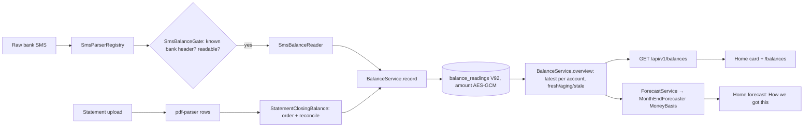

# AOS-720 — Latest balance per account, for money left until salary

| Field | Value |
|---|---|
| **Type** | Task |
| **Parent** | [AOS-S7.4](AOS-S7.4.md) (Epic [AOS-E7](AOS-E7.md)) |
| **Status** | 🟦 In review |
| **Priority** | P2 |
| **Owner** | Claude |
| **ETA** | 4h |
| **Actual** | 7h |
| **Created / Updated / Done** | 2026-10-18 / 2026-10-18 / — |
| **Branch** | `aos-720-account-balance` |
| **Decisions** | D-33, D-39, D-67, D-76, D-100, D-112, D-170 (proposed below) |
| **Blocked by / Blocks** | AOS-714 / — |

## Description
Keep the latest known balance per account: carry `balance` from statement rows (`ingest_events.metadata`) and parse "Avl Bal" / "Bal" in bank SMS. Then "money left" can be the balance minus the spending expected until payday.

## Why
A follow-up from AOS-714 (month-end forecast and money left until salary, D-76): today "money left" is the last salary minus what was spent since, which ignores money already in the account.

## Scope
- **In:** a balance per account with its date and source; SMS and statement parsing; the forecast using it when it is recent.
- **Out:**
  - aggregator feeds (D-15); balances of other people;
  - Gmail bank alerts (see Research §3 and the decision for Pragun);
  - credit-card outstanding (a debt, not a balance; the dues calendar owns card bills, D-39);
  - banks without their own SMS parser entry (their header isn't trusted; adding a bank is one registry line).

## Acceptance criteria
- [x] **A statement row or bank SMS with a balance updates that account's latest balance (newer wins, never an older one).**
  → `BalanceServiceTest` › `a newer reading replaces an older one and an older one arriving late never does`, `at the same moment a statement's closing beats an SMS`; `SmsIntakeTest` › `a trusted bank's Avl Bal is noted…`, `a pure balance alert…`; `StatementImportServiceTest` › `a reconciled closing balance becomes the account's balance, once…`; `StatementImportIntegrationTest` (real parser + Postgres); `BalanceReadingsIntegrationTest` › `…the newest observed is the latest, whatever the arrival order`; the eval set (122 SMS).
- [x] **The forecast uses a balance not older than a set number of days (7), and says so in "How we got this".**
  → `MoneyLeftFromBalanceTest` (7 tests: balance basis, stale and before-salary not counted, today's balance, overdrawn); `ForecastRoutesTest` › `money left starts from recent balances and says how…`; `ForecastCard.test.tsx` (2 tests); `e2e/balances.spec.ts` › `money left until salary starts from the balances and says how`.
- [x] **A balance never appears in logs.**
  → `BalanceService` logs only the user id, the source and a refusal name; every new type's `toString` leaves the figure and the account out (`BalanceServiceTest` › `nothing prints a balance or a full account`, `SmsBalanceReaderTest` › `nothing printed holds the figure or the account`, `StatementClosingBalanceTest` › `printing a closing never shows the figure`); the raw-SMS response never echoes it (`DeviceTokenSecurityTest`).

## Phase 1 — Research

### 1. Where balances already are in our inputs
- **Bank SMS** (`SmsParserRegistry` → `BankSmsParser`, AOS-203/214/215):
  - Indian banks put the balance **after** the transaction it follows, with many spellings:
    - HDFC "Avl bal:INR 12,345.67" and "Avl Bal in HDFC Bank A/c XX1234 as on 14-OCT-26 is INR…";
    - SBI "Avl Bal Rs.80,250.75", "Available Balance Rs.5300" (ATM), "Clr Bal: Rs 3,210.00 CR";
    - ICICI "Avl Bal Rs…", "Total Avbl. Bal: INR…", with the account masked to 3 digits ("Acct XX123");
    - Axis "Avl Bal- INR 9,001.00", "Bal for A/c no. XX8888 as on…";
    - Kotak "Bal: Rs…", "Avl. Bal: Rs…".
  - Overdrafts are "Rs -1,250.00" or "… Dr". Balance enquiries carry "as on <date>".
  - **What we extracted and dropped:** `SmsSignals.withoutBalances` blanks balance and limit figures so they're never read as the amount or the direction (AOS-214). A message that is only a balance is dropped as `balance alert`. So **every balance figure was read and thrown away**.
- **Statements** (`pdf-parser` → `HttpStatementParser` → `StatementImportService`, D-37):
  - the parser maps "Closing Balance" / "Running Balance" / "Balance" columns to `balance` on each row (a trailing Dr or brackets make it negative);
  - zero is returned as no balance (`parse_amount` treats `0.00` as empty), so a zero closing is lost (noted, not changed here);
  - the API copied each row's balance into `ingest_events.metadata` as plain JSON, where nothing read it.
- **Gmail bank alerts** (Go worker, `gmail_handler.go`, AOS-205/D-112): alerts from admitted bank senders carry "Available balance" too. The worker's extractor takes the **first** money figure in the mail. A mail that names the balance before the amount would be read with the balance as the amount (a bug risk, reported in PROGRESS, not changed here).
- **WhatsApp exports, Shortcut records and cash:** the WhatsApp text has no trusted sender (anyone can forward text), the Shortcut's structured records have no balance field, and cash has none.

### 2. The AOS-714 gap
`MonthEndForecaster.untilSalary` computes `left = last salary − spent since it − expected until payday` (D-76). It ignores money that was already there, savings drawn down and other credits, and it can't say "Short by" honestly when the account was nearly empty before the salary.

### 3. Choosing the latest trustworthy balance
- **Out of order:** the Mac reader backfills, Shortcuts batch, and a statement arrives weeks later. "Latest" must be the newest **moment the balance was true** (`observedAt`), never the newest to arrive.
- **Before or after the transaction:** SMS balances are after the transaction (the SMS's time is right). A statement's row balance is after that row; the **closing** balance is after the last row of the last day.
- **Statement order:** files are oldest-first or newest-first, and the dates say which. When every row is on one day, the running balances do.
- **Statement time:** the end of the closing day in India, or the period's end when it's later, but never after the import. A statement downloaded today is true as of now.
- **Ties:** at the same moment a statement's closing beats an SMS.
- **"As on" dates:** a balance enquiry that says "as on 14-10-26" is true at the end of that day, not when the SMS came.
- **Stale:** a balance is a snapshot. Spending since it is known (the history), but credits and other accounts aren't. So the forecast counts only recent ones (7 days) and from the salary's day or later (an older one doesn't hold the salary).
- **Credit cards:** "Avl Limit", "Available credit limit", "Total due", "Outstanding" are a card's limit and debt, not money in an account. A card statement's "balance" grows with spending, so it fails the running-balance check.
- **Other non-balances:** wallets (PayZapp), loans ("Outstanding Bal"), deposits ("FD Bal"), reward points, and "opening", "closing" (a period summary in an SMS), "average" or "minimum" balances.

### 4. Tying a balance to an account
- The account is its **last 4 digits**, plus the bank when the input names it. An account number is preferred to a debit card's ("Debit Card XX9876 … A/c XX1234": the account). A debit card alone isn't an account: its account isn't known, so the same money would be counted twice beside that account's own SMS or statement.
- ICICI masks 3 digits. A 3-digit hint joins the **one** known account ending in them, or is refused.
- A reading without a bank (a statement the parser couldn't name) joins the account with the same digits, unless two banks share them; then it can't be placed and is left out.
- Two different accounts in one SMS ("from A/c XX1234 to A/c XX5678 … Avl Bal") can't be told apart, so the SMS is refused.

### 5. Failure modes handled
| Failure | Handling |
|---|---|
| Spoofed SMS (personal number, unknown or promotional header) | Not trusted: only headers our bank parsers own (HDFC, SBI, ICICI, Axis, Kotak) |
| Fake figure in a merchant or payee name ("at SHOP AVL BAL RS 9999999.00 On…", "from MR X. AVL BAL RS 9,99,999.00 Ref…") | A balance must start its own clause (text start, or after `. ; : ! | )`, optionally "Your"/"The"/"Total"), must not follow at/to/from/VPA, and must not be followed by a transaction's date or reference (On 13-10-26, Ref, UPI); a second, different available figure makes the SMS ambiguous |
| Debit card only ("Debit Card XX9876 … Avl Bal") | Refused (`CARD_ONLY`): the card's account isn't known, and its own SMS or statement would count the same money again |
| OTP, failed or declined, promise, request, upcoming notice, mandate notice | Never read |
| Credit card, wallet, loan, deposit, points | Not a balance (named reason) |
| Opening, closing, average, minimum balance | Not current |
| Two figures (Avl and Ledger) | Available, then cleared, then ledger, then plain "Bal"; two different figures of the same kind are refused |
| Two accounts, no account, masked account | Refused, refused, joined only if exactly one known |
| "As on" with a time ("as on 14-10-26 09:30") | Dated at that time in India; a bare date at the end of that day; only when before the SMS |
| Over-precise figure ("Rs 12.345") | Not a figure (never cut to 12.34) |
| One-row statement (can't be checked; a card's amount owed looks the same) | No reading (`UNCHECKABLE`) |
| A stored figure that can't be decrypted (another key, a copied value) | Skipped and logged by row id; the page and the forecast still load |
| Times or dates after the label ("as on 15.10.2026 at 10.30 is…") | A bare figure needs a thousands comma or 3 whole digits; dates and times are connecting words |
| Future time (wrong clock, forgery), ±₹100 crore or more, over-precise | Refused before storing |
| Replayed SMS or re-imported statement | One reading (unique source ref) |
| Statement whose order is unclear, or whose closing doesn't reconcile (misread column, card statement) | No reading |
| Late backfill | Stored, never wins over a newer reading |
| Hostile text (huge, repetitive, unicode digits, markup) | Atomic, possessive between-words pattern (a digit run is never split; a shape that took 7.7 s per message now reads in milliseconds), ASCII digits only, rendered as text |

All examples here and in the tests are synthetic.

## Phase 2 — Design
- **Context:** balances are in SMS and statements already (§1). The forecast's components are pure and take loaded inputs (D-76). Secrets and sensitive fields at rest use `TokenEncryptor` (AES-GCM, bound to the row, D-110/D-111).
- **Options considered:**
  1. **Append-only readings per account, encrypted, latest by observed time, captured at the edge of each trusted intake path (chosen).** It is order-proof, deduplicated, keeps no text, and the forecast stays pure.
  2. **A single "current balance" column per account, updated in place.** It is simpler, but a late message can overwrite a newer one unless every writer compares times. It loses the evidence, and the `accounts` table isn't populated today (`discoverAccount` has no caller).
  3. **Derive the balance from ingest-event metadata at read time.** It needs the plaintext balance kept in `ingest_events` (sensitive, unencrypted) and can't hold SMS balance alerts, which make no event.
- **Domain model** (`domain/balances`):
  - `BalanceAccount(bankCode?, last4)`;
  - `BalanceReading(id, userId, account, amount, observedAt, source: SMS | STATEMENT, sourceRef, recordedAt)`, validated in `init` (2 decimals, below ±₹100 crore, SHA-256 ref). Its `toString` has no amount.
  - `BalanceObservation`: what an intake path saw, with a 3- or 4-digit hint.
  - `BalanceService.record` → `Saved | Duplicate | Refused(FUTURE | IMPLAUSIBLE | NO_ACCOUNT | ACCOUNT_AMBIGUOUS)`.
  - `BalanceService.overview(user, zone)` → `AccountBalance(account, reading, observedOn, ageDays, freshness)` per account.
  - `BalanceRepository` (InMemory + Exposed).
- **Storage: `V92__balance_readings.sql`.**
  - One row per reading: user (cascade delete), bank code (checked), last 4 (checked), source (checked), source ref (unique per user and source), `observed_at`, `recorded_at`.
  - The amount is `v2:` AES-GCM ciphertext bound to `balance_readings:<id>:amount`.
  - The newest 20 readings per account are kept; older ones are deleted on insert.
- **Capture per intake path:**
  - **Raw SMS** (`SmsIntake`, Mac reader / Shortcut raw):
    1. `SmsBalanceGate`: the sender is a known bank header and the message is readable.
    2. `SmsBalanceReader` (deterministic; an account number is required, a debit card alone is refused).
    3. `observedAt` is the SMS's time, or its "as on" time (the end of a bare "as on" day) when that is earlier.
    4. `sourceRef` is the SMS fingerprint, so a resend is the same reading.
    - It happens beside the transaction, whatever that result was. The batch response counts `balances`.
  - **Statement** (`StatementImportService`):
    - `StatementClosingBalance` (order, reconciliation, day);
    - the ref is (bank, last4, day, figure);
    - the response says `balanceNoted`;
    - **the running balance is no longer copied into `ingest_events.metadata`.**
  - **Gmail:** not in this task (decision for Pragun below).
  - **WhatsApp, Shortcut records, cash:** none (untrusted sender or no balance).
- **"Latest balance" rule and labels:**
  - **Latest:** newest `observedAt`; at the same moment a statement; then the later recorded.
  - **Labels:**
    - fresh: today or yesterday;
    - aging: 2–7 days, still counted;
    - stale: over 7 days, shown, never counted.
- **API:** `GET /api/v1/balances`, owner-only (`auth-jwt`, user from the session, no ids in the request).
  - It returns `{today, accounts: [{bank, last4, amount, observedAt, observedOn, source, ageDays, freshness, counted}], total, countedAccounts, maxAgeDays}`.
  - Money is exact strings. 401 when signed out, forged or expired; nothing else can fail.
- **Forecast:**
  - `ForecastService` loads each account's latest balance into `ForecastInput.balances`.
  - `MonthEndForecaster` picks a `MoneyBasis`:
    - `Balances(accounts, asOf)`: the balances at most 7 days old and from the salary's day or later. Spending is counted from the oldest of their days **in full**, through today (the history is by day, so a spend after a reading on its own day is never missed).
    - The choice lives in its own component, `MoneyLeftBasisPicker` (`forecast/MoneyLeftBasis.kt`), so the forecast's spending components (AOS-721/722) and this starting point change apart.
    - `LastSalary` (D-76), when none qualifies.
  - **money left** = start − spent since − expected until the day before the next salary. The range moves with the start.
  - **API fields:** `untilSalary` gains `basis`, `spentFrom`, `balance`, `balanceAsOf`, `accounts`, `notCounted` (with `stale` / `before_salary`) and `balanceMaxAgeDays`.
  - **Conservative on purpose:** the oldest balance's whole day is subtracted, even for an account read later, and spending before a reading on its own day counts twice. Credits after the reading aren't added. Unpaid card bills aren't subtracted (D-39; the card's outstanding is out of scope).
- **Web:**
  - a **Bank balances** card on Home (total counted, each account with its age in words and its source, "Overdrawn" in words; `All ›`);
  - a **/balances** page (also under More) that explains the rule;
  - **Home's forecast** says "₹X left before it comes", and "How we got this" lists "In your accounts: ₹… (HDFC ••1234 ₹… on 16 Oct from a bank SMS, …)", "− Spent since 13 Oct", "− Expected …" and "Not counted: … (older than 7 days)".
- **Patterns:**
  - Strategy + Registry (the bank parsers own their headers; a new bank is one entry);
  - a Specification-style gate (`SmsBalanceGate`);
  - Repository (InMemory + Exposed);
  - pure domain functions (`StatementClosingBalance`, `MoneyBasis`).
- **Extending it:**
  - a new bank is one `BankSmsParser` entry;
  - a new source is a `BalanceSource` value plus a capture call;
  - Gmail can call `BalanceService` once its parsing moves to the API (or through a port).
- **Impact:**
  - API: one migration, one route, two additive response fields (`balances`, `balanceNoted`), forecast DTO fields;
  - Web: a card, a page and a More link;
  - Build: the `balanceReport` Gradle task.
  - No new dependency, port or listener; Go and Python are unchanged.

## Security (D-100 threat review)
- **What it exposes:**
  - a new read route, `GET /api/v1/balances` (session only);
  - new stored data: encrypted balance figures, last 4 digits, bank code and times;
  - new forecast fields;
  - two additive counts in existing responses.
  - No new upload, outbound call, job, secret, dependency or listener.
- **Abuse and what stops it:**
  - **A stranger on the internet:** the route is inside `authenticate("auth-jwt")`, and the route-inventory test passes with no new allowlist entry. Signed out, forged or garbage tokens get 401 (`BalanceRoutesTest`). The page redirects signed-out visitors (`/balances` is in `PAGES`), and an expired session that can't refresh ends at login (`e2e/balances.spec.ts`).
  - **Another user's IDs (IDOR):** the request names no user or account; the user is the session's. Bob's `/balances` and `/forecast` never show Alice's figure or digits (`IdorTest` › `Bob's balances and forecast never show Alice's balance`; `BalanceRoutesTest`).
  - **Spoofed SMS balances** (a text from a personal number, an unknown or promotional header, a fake "Bal" in a merchant name, a second fake figure):
    - only headers our bank parsers own are trusted;
    - OTP, failed, promise, request, notice, mandate, pay-later and booking messages are never read;
    - a balance must start its own clause, not follow at/to/from/VPA, and not be followed by a transaction's date or reference (the review found 4 shapes that got past the first rule; all are now in the eval set);
    - two different available figures, two accounts, or only a debit card are refused;
    - ±₹100 crore and future times are refused.
    - The eval set has 20 hostile or untrusted messages and **0 false balances** (`BalanceRegressionTest` fails on any). Tests: `SmsIntakeTest` › `balances from generic, promotional or personal senders are never noted`; `DeviceTokenSecurityTest` (a mixed batch notes only the trusted one).
    - **Residual risk:** a trusted header can't be forged on the Indian network, but the device token's holder (the owner's own reader) could post a fake sender. That needs the owner's device token (scoped `ingest:sms`, revocable, D-28), and the worst effect is a wrong "money left" that shows its source and date. No money moves.
  - **Hostile files:** a statement's closing must reconcile with the row before it, or nothing is recorded (a misread column, a forged row, a card statement).
  - **Values in logs:** `BalanceService` logs only the user id, the source key and a refusal name. `toString` of `BalanceReading`, `BalanceObservation`, `AccountBalance`, `BalanceOverview`, `SmsBalance`, `ClosingBalance` and `BankBalance` has no figure and no account (tests). Errors never quote SMS text (D-33), and the raw-SMS response doesn't echo the figure (test).
  - **Hostile text in the browser:** the only free text is the bank code. The API restricts it to `[a-z0-9_]{1,16}`, and the web renders it as text anyway (Vitest + Playwright: no ``/`<script>`, no handler runs).
  - **Storage and URLs:** no balance or account digits in local/session storage or the URL (Playwright).
  - **Flooding and ReDoS:** the route is a cheap read of at most 20 rows per account. The SMS route's existing caps (100 messages, 2,000 characters) bound the input. The review found catastrophic backtracking in the between-words pattern (one 2,000-character message took 7.7 s); its tokens are now atomic and its separators possessive, and `SmsBalanceReaderTest` reads that shape and others within 1 s in total.
- **Data at rest:** balance figures are encrypted (AES-256-GCM, `TokenEncryptor`, bound to the row id; the integration test shows ciphertext, a copied value doesn't decrypt and is skipped, and the schema refuses plaintext). The last 4 digits, bank and times stay readable, as in transactions, for ordering and grouping. **The plaintext running balance is no longer written to `ingest_events.metadata`.** Rows written before this change still hold it (decision for Pragun).
- **AI:** none. Extraction, choice and forecast are deterministic (D-67).
- **Secrets:** none. Fixtures use example.com and obviously synthetic numbers.

## Phase 3 — Implementation
- **API:**
  - `domain/balances/` (`BalanceReading`, `BalanceRepository` + InMemory, `BalanceService`, `BalanceRoutes`);
  - `ingestion/sms/SmsBalanceReader.kt`, `SmsBalanceGate.kt`; `SmsIntake.receive`; `RawSmsBatchResponse.balances`; `SmsParserRegistry.knownBankOf`;
  - `ingestion/statements/StatementClosingBalance.kt`; `StatementImportService` (no metadata balance, `balanceNoted`);
  - `forecast/` (`BankBalance`, `MoneyBasis`, `NotCounted`, DTO fields);
  - `ExposedBalanceRepository`, `BalanceReadingsTable`, `V92__balance_readings.sql`;
  - Koin wiring and `FinancialModule`.
- **Web:** `lib/balances.ts`, `components/balances/BalancesCard.tsx`, `app/balances/page.tsx`, the Home card, the More link, `ForecastCard` "How we got this", MSW and mock-API defaults, fixtures.
- **Tests:**
  - **Unit:** `BalanceServiceTest` (12), `SmsBalanceReaderTest` (11), `StatementClosingBalanceTest` (7), `MoneyLeftBasisTest` (7), `MoneyLeftFromBalanceTest` (7), and new cases in `SmsIntakeTest`, `StatementImportServiceTest`, `ForecastRoutesTest`, `BalanceRoutesTest`, `DeviceTokenSecurityTest` and `IdorTest`.
  - **Integration (Postgres):** `BalanceReadingsIntegrationTest` (6) and `StatementImportIntegrationTest` (real parser container + encrypted store).
  - **Eval:** `src/test/resources/balances/sms.tsv` (132 synthetic SMS, 42 held out, 10 from the review), `baseline.json`, `BalanceRegressionTest` (6), `./gradlew -q balanceReport`.
  - **Web:** `balances.test.ts`, `BalancesCard.test.tsx` (7), `balances/page.test.tsx`, `ForecastCard.test.tsx` (+2).
  - **Playwright:** `e2e/balances.spec.ts` (8, including 4 attack specs); `/balances` added to `PAGES` in `e2e/security.spec.ts` and to `navigation.spec.ts`.

## Verification
- **Eval set** (`./gradlew -q balanceReport`): 132 synthetic SMS from 5 trusted banks and 5 untrusted senders.

| | Messages | Exact | Precision | Recall | False balances | Reasons right |
|---|---|---|---|---|---|---|
| Baseline: first figure after any "bal" | 122 | 47.5% | 64.9% | 73.5% | 48.1% | — |
| Rules, first run on the 80 written first | 80 | 95.0% | 97.8% | 95.7% | 2.9% | — |
| Rules, **first run on the 42 held out** (before any change) | 42 | 95.2% | 95.7% | 100% | 5.0% (HO28, a fake figure in a merchant name) | — |
| Rules after the first round (all 122) | 122 | 100% | 100% | 100% | 0% | 100% |
| Review round: 4 payee-name shapes from the security review (R01–R04) | 4 | 0% | — | — | 100% (all 4 read as balances) | — |
| Rules, shipped (all 132, incl. 10 review cases; 5 debit-card cases now `card_only`) | 132 | 100% | 100% | 100% | 0% | 100% |

  - The held-out misses (HO28 and HO42) and the 4 tuned-on misses were fixed by general rules, not by matching the cases:
    - a label after at/to/from/VPA is a name;
    - "direction unclear" transfers are readable;
    - bare figures need a comma or 3 whole digits.
  - The 100% is on a synthetic set written alongside the rules. Expect lower on real messages; add real-shaped (scrubbed) misses to the set as they show up.
- **Gates:** see the PR description (API `test integrationTest koverVerify`; web typecheck, lint, `test:coverage`, `next build`; Playwright desktop-chrome, iphone-safari, android-chrome).

## Decisions for Pragun
1. **Gmail balances:** the Go worker parses bank mail, and D-26's "no Kotlin/Go duplicates of a rule" argues against a second balance reader in Go. Options:
   - (a) move bank-alert parsing to the API (it already owns SMS rules);
   - (b) a Go port of the reader with the same eval set;
   - (c) leave Gmail out (SMS covers the same alerts).
   This ticket does (c).
2. **Old plaintext balances:** statement events imported before this change hold `metadata.balance` in plaintext. A one-off migration could remove the key (`UPDATE ingest_events SET metadata = metadata - 'balance' WHERE source = 'statement'`). It is destructive on stored data, so it isn't done here.
3. **More banks:** only HDFC, SBI, ICICI, Axis and Kotak headers are trusted for balances. Adding PNB, BoB, Canara, Union, IDFC and others needs their verified TRAI headers (one registry line each).
4. **The 7-day limit and the conservative spending subtraction** (see Design) are product choices to confirm.

## Activity log
- 2026-10-18 — Claude (integration engineer): ticket created from AOS-714's follow-ups.
- 2026-10-18 — Claude (agent): picked up (🟦); research, design (D-170 proposed) and implementation on `aos-720-account-balance`; eval set written first, held-out set run once before tuning.
- 2026-10-18 — Claude (agent, parent): merged origin/main; child agents isolated the money-left choice into `MoneyLeftBasisPicker`, ran the full mocked Playwright suite (730 passed, 0 failed) and reviewed the diff as an attacker; fixed the review's blocking findings (payee-name injection, ReDoS, debit-card double count) and five non-blocking ones (same-day spending, "as on" times, one-row statements, over-precise figures, an unreadable row).

## Resolution
Built: the latest balance per account from trusted bank SMS and reconciled statement closings, encrypted at rest (V92); `GET /api/v1/balances`; money left until salary from recent balances with its working, falling back visibly to the last salary; Home card and /balances page. Awaiting review and merge.
