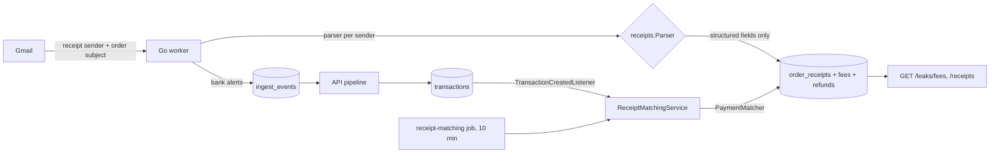

# AOS-903 — Order-receipt emails: hidden fees and item counts, matched to the payment

| Field | Value |
|---|---|
| **Type** | Task |
| **Parent** | [AOS-S9.1](AOS-S9.1.md) (Epic [AOS-E9](AOS-E9.md)) |
| **Status** | ✅ Done |
| **Priority** | P0 |
| **Owner** | Claude |
| **ETA** | 8h |
| **Actual** | 6h |
| **Created / Updated / Done** | 2026-10-17 / 2026-10-18 / 2026-10-18 |
| **Branch** | `aos-903-order-receipts` |
| **Decisions** | D-33, D-38, D-43, D-54, D-59, D-80, D-100, D-88 |
| **Blocked by / Blocks** | — / AOS-902 (the "Where it leaks" page reads `/api/v1/leaks/fees`) |

## Description
Quick-commerce, food-delivery and e-commerce apps (Zepto, Blinkit, Swiggy and Instamart, Zomato, Amazon, Flipkart) email a receipt for every order. The receipt shows what the bank alert never does: the item count and the fees on top of the items (delivery, handling, small-cart, platform, surge or rain, packaging, tip).

This task:
- reads those receipts from Gmail with one parser per sender;
- keeps only structured fields (D-33);
- matches each order to the payment that paid it instead of creating a second spend;
- totals the hidden fees per app and month through an API for the E9-A "Where it leaks" page.

## Why
BRD §5.6 "Where it leaks" lists hidden fees as a lens, and AOS-S9.1 says "Hidden fees are totalled per app when receipts exist". Small fees on frequent orders are a typical leak: a ₹15 handling fee plus a ₹25 small-cart fee on a ₹180 order is 22% on top. The owner can only cut what they can see (D-80).

## Scope
- **In:**
  - Gmail sender filters for the six apps (receipt subjects only);
  - per-sender parsers with synthetic fixtures;
  - an `order_receipts` store with fees and refunds;
  - matching to payments, in both directions;
  - `GET /api/v1/leaks/fees` and `GET /api/v1/receipts`;
  - confirming or rejecting a suggested match.
- **Out:**
  - the "Where it leaks" page (AOS-902, E9-A);
  - habit lenses (AOS-901);
  - item names or addresses (never stored);
  - receipts from SMS or app notifications;
  - pay-later dues (AOS-909).

## Acceptance criteria
- [x] Receipt emails from Zepto, Blinkit, Swiggy, Swiggy Instamart, Zomato, Amazon and Flipkart (also Flipkart Minutes) are fetched (sender filters, full and incremental sync), and only when the subject reads like an order, a cancellation or a refund. Promotions from the same senders are never fetched in full. (`TestReceiptSendersAreReadOnlyForOrderSubjects`, `TestSearchQueryReadsReceiptSendersOnlyWithOrderSubjects`)
- [x] Each sender has its own parser strategy, chosen by the sender's domain, with synthetic fixtures (no real emails, names or addresses). It extracts:
  - the app and its vertical;
  - the order total and item count;
  - each fee, where a waived fee ("FREE", or struck through to ₹0) counts as nothing, and a member's fee discount nets that fee;
  - the payment mode, and the amount charged to the bank when the email shows it.
  (`TestEveryFixtureParsesToItsExpectedReceipt`: 13 fixtures; `extract_test.go`)
- [x] A receipt never becomes a transaction: an email from a receipt sender is never passed to the generic bank-email parser. (`TestAReceiptEmailBecomesAReceiptAndNeverATransaction`; on Postgres: the pipeline integration test counts one transaction)
- [x] Only structured fields are stored (D-33). The order ID is stored only as a SHA-256 hash. (`TestEveryEmailAboutOneOrderHasTheSameKey`, `TestScriptAndMarkupNeverReachTheReceipt`)
- [x] Duplicate emails for one order become one receipt. Blanks are filled and values are never overwritten. (`TestGmailPersistMergesEveryEmailAboutAnOrder_Integration`)
- [x] Cancelled orders are kept but their fees aren't counted. A cancellation that arrives before the order still cancels it. (Go integration; `HiddenFeesServiceTest`)
- [x] Partial refunds are recorded per order. The same refund twice counts once. A refund of the whole order counts like a cancellation. (Go integration; Kotlin round-trip; `HiddenFeesServiceTest`)
- [x] Matching (D-38 ideas):
  - exact amount;
  - the time window;
  - auto-linked only with payee evidence, a score of at least 8 and a margin of 3;
  - otherwise suggested;
  - 1:1, with rejections remembered.
  (`PaymentMatcherTest`, `ReceiptMatchingServiceTest`, unique index on Postgres)
- [x] Matching runs both ways: the listener and the `receipt-matching` job every 10 minutes. (`ReceiptMatchingServiceTest`, the pipeline integration test)
- [x] Wallet-only, pay-later and cash-on-delivery orders are `no_payment` and their fees still count. A split payment matches on its bank part.
- [x] `GET /api/v1/leaks/fees` returns the agreed shape (below), in the user's months. (`ReceiptRoutesTest`, `HiddenFeesServiceTest` time-zone case)
- [x] `GET /api/v1/receipts`, `POST /api/v1/receipts/{id}/match` and `DELETE /api/v1/receipts/{id}/match` work as specified. Another user's receipt or payment is 404. (`ReceiptRoutesTest`)

## Design (fill in and get approval before coding; see docs/ENGINEERING.md §6)
- **Context:**
  - The Gmail worker (Go) fetches financial mail with sender filters (D-59) and extracts in memory. Transactions go to `ingest_events`; bills go straight to `bills`.
  - The API owns the accuracy pipeline (D-34) and bill matching (D-54).
  - Raw bodies never leave the worker (D-33), so receipt parsing must happen in Go.
  - A receipt is evidence *about* a payment that is recorded, or will be, from the bank SMS, email or statement. It is not a transaction itself.
- **Options considered:**
  1. **Receipts as ingest events,** with a pipeline step that merges them into the payment.
     - Reuses dedup.
     - But an unmatched receipt would become a second spend (the bug this task exists to avoid) or need a new "drop but keep" outcome.
     - Receipts arriving before their payment would be lost.
     - And the pipeline would have to carry fees.
  2. **A receipts store of their own, written by the worker (like bills), matched by the API** with a reusable payment matcher, in both directions (listener and sweep, like D-54) — **chosen**.
  3. **Match in Go at sync time.**
     - Duplicates the D-38 rules in a second language (against D-34 and DRY).
     - Misses payments that arrive later.
- **Decision:** option 2. **Patterns:**
  - Strategy and Registry: one `receipts.Parser` per sender, chosen by sender domain; a shared label-line engine keeps each strategy small;
  - Repository (`OrderReceiptRepository`: in-memory and Exposed);
  - a pure `PaymentMatcher` (hard rules, points, bands, ambiguity margin, evidence-gated auto-link), reusable by AOS-910;
  - Observer (`ReceiptPaymentListener`) plus a scheduled sweep (`receipt-matching`).
- **Extensibility:**
  - A new app is one Go function with its labels, plus its domains in `gmail.ReceiptDomains` (a test keeps the two lists equal), plus a fixture.
  - A new fee kind is one `FeeKind` value on both sides and one CHECK value.
  - A new claim source (a booking, a document) builds a `PaymentClaim`.
- **Impact:**
  - Go: `internal/receipts` (new); `gmail/filters.go`; `handlers/gmail_handler.go` (routing); `handlers/gmail_receipts.go` (persist).
  - DB: `V38__order_receipts.sql`.
  - API:
    - `domain/common/TimeRange`;
    - `domain/financial/matching`;
    - `domain/financial/receipts` (model, repository, matching service, fees service, routes, listener, job);
    - `ExposedOrderReceiptRepository`, `ReceiptTables`;
    - Koin wiring and `FinancialModule`.
  - No change to `ingest_events` or the pipeline.
- **Diagram:**


### API shape agreed for E9-A (AOS-902)
`GET /api/v1/leaks/fees?from=2026-08&to=2026-10`. Both parameters are optional (YYYY-MM): the default is this month, `to` defaults to `from`, and the span is at most 12 months.
```json
{ "data": {
  "from": "2026-08", "to": "2026-10", "currency": "INR",
  "months": [{
    "month": "2026-10",
    "totals": { "orders": 12, "cancelledOrders": 1, "items": 31, "orderTotal": "5400.00",
                "hiddenFees": "612.00", "tips": "40.00", "feeShare": "0.1133" },
    "apps": [{
      "app": "Swiggy", "vertical": "food_delivery",
      "orders": 5, "cancelledOrders": 0, "items": 9, "orderTotal": "2100.00",
      "hiddenFees": "260.00", "tips": "20.00", "feeShare": "0.1238",
      "fees": [{ "kind": "delivery", "amount": "150.00", "orders": 4 }],
      "matchedOrders": 3, "unmatchedOrders": 1, "noPaymentOrders": 1,
      "transactionIds": ["…"], "receiptIds": ["…"]
    }]
  }]
} }
```
- **Money:** exact strings. `feeShare` = hiddenFees / orderTotal, with 4 places (`"0.0000"` when the total is 0).
- **Tips:** `hiddenFees` excludes tips (a tip is a choice, not a fee). `fees` lists every kind, tips included, sorted by amount.
- **Months:** a month with no receipts is listed with zeros, so trends have no holes. Months are the user's own (time zone).
- **Apps:** sorted by hidden fees. `app` is the merchant-catalogue brand (AOS-901 lenses can group by it); `vertical` is `quick_commerce`, `food_delivery` or `ecommerce`.
- **Which orders count:** cancelled orders and orders refunded in full count in `cancelledOrders` only, and add no fees. `noPaymentOrders` are wallet, pay-later or cash-on-delivery orders: no bank payment to match, but their fees count.

`GET /api/v1/receipts?month=YYYY-MM&app=Swiggy` lists one month's receipts (all apps, or one), oldest first. Each has:
- `id`, `app`, `vertical`, `orderedAt`, `status`;
- `orderTotal`, `itemCount`, `paymentMode`, `paidAmount`, `refunded`;
- `fees` [{kind, amount}], `hiddenFees`, `tips`, `counts`;
- `matchState` (`unmatched` | `matched` | `suggested` | `no_payment`), `transactionId`, `matchReason`, `matchedBy`.

`POST /api/v1/receipts/{id}/match` `{ "transactionId": "…" }` → the updated receipt. The errors:

| Status | Code | When |
|---|---|---|
| 404 | `RECEIPT_001` | receipt not found |
| 404 | `RECEIPT_002` | payment not found |
| 400 | `RECEIPT_003` | the transaction isn't a spend |
| 409 | `RECEIPT_004` | the payment is already another order's |

`DELETE /api/v1/receipts/{id}/match` → the receipt matched afresh, without that payment (remembered). It returns 409 `RECEIPT_005` when there is nothing to reject.

## Security (D-100, ENGINEERING §4a)
**What the change exposes:**
- New authenticated routes: two GETs and two mutations (POST, DELETE).
- New input: email content from six sender domains.
- New stored data: order amounts, fees, item counts, payment mode, a hash of the order number.
- A new scheduled job.
- No new dependency, outbound call or listener.

**Threats and what stops them:**

| Threat | What stops it |
|---|---|
| A **forged receipt email** (anyone can put "Swiggy" in From). It can't create or change a transaction. | The parser is chosen by the address's domain only (display name ignored; look-alike, punycode, subdomain-of-another and hidden-character domains get no parser; `TestSpoofedAndLookAlikeSendersHaveNoParser`). Gmail's own spoofing defences (SPF/DKIM/DMARC) apply before our filter. A receipt never becomes a transaction. A forged receipt is auto-linked only with an exact amount, the time window and payee evidence; at worst it adds fees to the "leaks" numbers. Every number links to its receipt. The user can reject a link, and the rejection is remembered. |
| **Hostile content:** oversized bodies, markup and script, malformed HTML, invisible or bidi characters, look-alike digits, implausible numbers. | The body is capped at 64 KB upstream and 2,000 lines here. All patterns are RE2 (linear time). Zero-width and bidi controls are removed before reading. Digits are ASCII only, so look-alike digits never read as an amount and the email fails closed. The fees must not exceed the total, the paid amount must not exceed the total, the total is at most ₹50 lakh and the item count at most 500. The order ID is limited to letters, digits and dashes. Nothing textual from the email is stored: app names are the parser's constants, and the order number is a hash. (`hostile_test.go`: 8 tests) |
| Raw text leaking into **logs or errors** (D-33). | Failures log the parser name and message ID only. Error strings contain no content. |
| **Another user's IDs** on the routes. | Every query is scoped to the signed-in user. Another user's receipt or payment is 404, never 403 (`ReceiptRoutesTest`). |
| **Cross-site mutations.** | The session cookie is `SameSite=Strict` (Authentication.kt), so no cross-site request carries it. There is no separate Origin check in the API today (see bugs and gaps). |
| **Bad parameters.** | `month`, `from` and `to` must be YYYY-MM within 5 years, with at most 12 months; `app` must match `[A-Za-z][A-Za-z0-9 .'&-]{0,39}`; IDs must be UUIDs; a malformed body is 400. |
| **Data at rest.** | Amounts and fees are the same class of data as `transactions` (not encrypted, in the owner's own database). The order number is hashed. No new secrets. |
| **AI.** | None. |

## Implementation plan
1. Go: `internal/receipts` (types, money and label engine, registry, six parsers), with synthetic and hostile fixtures.
2. Go: receipt senders in `gmail/filters.go` (the search query and the header check).
3. Go: Gmail handler routing and persistence (upsert, fees, refunds).
4. DB: `V38__order_receipts.sql`.
5. API: `PaymentMatcher`; the receipts domain; the Exposed repository; routes; the listener and the job; wiring.
6. Gates.

## Verification
- **Go in Docker** (`go build ./... && go vet ./... && go test ./...`): green, 156 test runs in all.
  - `internal/receipts`: 22 tests, 35 runs with subtests: 13 synthetic fixtures, 4 non-receipt or invalid fixtures, 8 hostile-input tests.
  - Gmail: filter tests.
  - Handlers: routing tests.
- **Go integration** (`go test -tags integration ./internal/handlers/`, against Postgres 18.6 with every API migration applied): all green, including the new `TestGmailPersistMergesEveryEmailAboutAnOrder_Integration`.
- **API** (`./gradlew test integrationTest koverVerify`): green.
  - 1,548 unit tests (+51) and 129 integration tests (+4).
  - Kover line coverage 99.31%; the branch gate (85%) passes.

## Risks / notes
- **Formats change.** The fixtures are synthetic, modelled on the usual layout of each app's receipt (label, then amount on the same line or the next). Parsers read labels, not positions. A changed format shows up as `receipt_failures` in the sync result, never as a wrong spend. When real receipts arrive, the owner can compare one receipt per app against the parsed row; adjusting a label is a one-line change.
- **Backfill:** only mail synced after deploy is read. Receipts already in the mailbox are read by the next full sync (a reconnect, or an expired history ID).
- **Brand family:** Instamart orders are often paid to "Swiggy" (same company). The matcher's payee evidence is the brand's first word, as a whole word, in the payment's merchant, narration or UPI ID.
- **A deleted payment** sets `transaction_id` to NULL. The receipt then reads as unmatched and the sweep matches it again.

## Activity log
- 2026-10-17 — Claude: started; design (options, API shape) written.
- 2026-10-17 — Claude: rebased on main after AOS-614 and AOS-012 (security gate D-100); added the Security section and hostile-email tests.
- 2026-10-17 — Claude: done; PR opened (not merged).
- 2026-10-18 — Claude (integration): rebased onto main (AOS-617…620, 702…704, 901); migration renumbered V50 → V38; D-88 recorded; gates green.

## Definition of Done (docs/ENGINEERING.md §4)
- [x] Each acceptance criterion covered by a test or a documented manual check
- [x] Tests/build green (integration tests if the DB is touched)
- [x] Layer rules respected; no silent fallbacks; no secrets/PII in logs
- [x] Security gate (§4a): threat review, hostile-input unit tests, route tests (auth, 404 for others, validation). No new screen, so no Playwright spec.
- [x] Decisions recorded (D-88) · story and board updated · PROGRESS.md updated
- [x] Commit message starts with `AOS-903:`

## Resolution
Done: order receipts are read from Gmail, merged per order, matched to their payment, and their hidden fees are served per app and month. The files are listed under Impact, and the verification is above.

## Decision D-88 (recorded in DECISIONS.md)
See [D-88 in DECISIONS.md](../DECISIONS.md#d-88--order-receipts-parsed-per-sender-in-the-worker-stored-apart-matched-to-the-payment).
