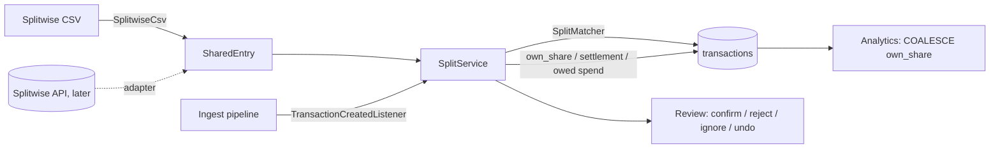

# AOS-911 — Splitwise import: count only my share of shared bills; settle-ups are neither spending nor income

| Field | Value |
|---|---|
| **Type** | Task |
| **Parent** | [AOS-S9.4](AOS-S9.4.md) (Epic [AOS-E9](AOS-E9.md)) |
| **Status** | ✅ Done |
| **Priority** | P1 |
| **Owner** | Claude |
| **ETA** | 8h |
| **Actual** | 8h |
| **Created / Updated / Done** | 2026-10-18 / 2026-10-18 / 2026-10-18 |
| **Branch** | `aos-911-splitwise` (API); `aos-911-splitwise-web` (web, stacked on it) |
| **Decisions** | D-30, D-38, D-39, D-46, D-59, D-64, D-78, D-80, D-91, D-100, D-111 |
| **Blocked by / Blocks** | — / the habit lenses (AOS-90x) can rely on `settlement` being excluded |

## Description
The owner splits bills with friends on Splitwise and settles by UPI. Today a ₹4,000 dinner they paid for counts as ₹4,000 of spending, and the ₹3,000 friends pay back looks like income (or an unknown person-to-person transfer). This task imports Splitwise so that:
- a bill the owner paid for everyone counts only **their share**; the rest is **owed by friends** (a receivable, not spending);
- a bill a friend paid becomes the owner's share as a **spend owed to that friend**;
- Splitwise settle-ups ("payments") mark the matching UPI transfer as a **settlement**: neither spending nor income;
- every change is reversible, and uncertain matches wait in **Review**.

## Why
North star D-80: the savings rate must be true. Shared bills inflate spending and paybacks inflate income, so both halves of the savings rate are wrong for anyone who eats out with friends. It also makes the "party / eating out" lens (D-80) honest: only the owner's share is their habit.

## Scope
- **In:** CSV import (API + web), the matcher, owner's share in every total, the `settlement` nature, Review actions (confirm, pick a transaction, reject, ignore, undo, undo a whole import), the friends balance, an eval set with a committed baseline, a port so the Splitwise API can be a second source later.
- **Out:**
  - the Splitwise API adapter itself (option b below): designed, not built;
  - splitting bills inside AdminOS (BRD §8 keeps "Splitting expenses with friends" out of scope; this only *reads* Splitwise);
  - a bill paid partly by the owner and partly by a friend (the CSV can't say how much the owner paid; see Risks);
  - per-friend balances (only the total per currency);
  - the habit lenses themselves (`coach/lenses.json` doesn't exist on `main` yet; a settlement is its own nature, so a lens that counts `spend` never sees it).

## Acceptance criteria
- [x] Uploading a Splitwise "Export as spreadsheet" CSV with "which column is me" imports every row; the file isn't kept; re-importing the same or a longer export adds only new rows and reports rows whose split changed. (`SplitwiseCsvTest`, `SplitServiceTest`)
- [x] A bill the owner paid: the matching bank debit (exact amount, bank day −1…+3) counts only the owner's share in every console total; the bank amount itself never changes. (`SplitServiceTest`, `SplitwiseIntegrationTest`)
- [x] A bill a friend paid: the owner's share is a spend on that date, with category from Splitwise's (or the merchant catalogue), source `splitwise`, merchant "Splitwise", no names or descriptions in it. (`SplitServiceTest`)
- [x] A settle-up: the UPI transfer to/from the friend (exact amount, ±2 days) becomes `settlement`: not spending, not income. Applied only when the friend's name or UPI handle is on the bank record; otherwise suggested. (`SplitMatcherTest`, `SplitServiceTest`)
- [x] Uncertain matches (ambiguous, a day off without other evidence, no name on a settle-up) wait in Review; the owner confirms, picks another transaction, rejects (never suggested again; the next best is offered), or ignores. (`SplitServiceTest`, `SplitRoutesTest`)
- [x] Everything is reversible: undo one entry (share removed, settlement restored to its exact prior nature/category, created spend deleted) or undo a whole import. (`SplitServiceTest`, `SplitwiseIntegrationTest`)
- [x] Totals stay consistent with D-46: total = Σ categories = Σ buckets after an import, on Postgres and in memory. (`SplitServiceTest`, `SplitwiseIntegrationTest`)
- [x] A bank record that arrives later (a statement uploaded after the Splitwise import) is offered to entries still waiting for one. (`SplitServiceTest`, `SplitwiseIntegrationTest`)
- [x] Friends' names and descriptions are encrypted at rest, never logged, never in error messages, and never sent to a model. (`SplitwiseIntegrationTest`, `SplitwiseRowsElsewhereTest`, `SplitwiseCsvTest`)
- [x] A Splitwise share is never merged as a duplicate, linked as a refund, matched as a bill payment, or detected as a subscription. (`SplitwiseRowsElsewhereTest`)
- [x] An eval set of synthetic Splitwise + bank data reports match precision/recall and spend correctness against a committed baseline that CI enforces. (`SplitEvalTest`, `./gradlew -q splitwiseReport`)
- [x] Web: import card on Import, a Splitwise section in Review with every action, "Settle-up" and "your share" in the feed. (Vitest; Playwright spec written, not run here)

## Design (see docs/ENGINEERING.md §6)

### Research: what Splitwise offers (checked 2026-10-18)
- **CSV export** (help centre, `kb.splitwise.com/account-issues/how-do-i-export-my-splitwise-data`): per group or per friend, on web and mobile, **free** (only the full JSON backup needs Pro). "The numbers under people's names show the impact to that person's balance from the transaction in that row. When they spend money or make a payment, the number is positive; when they borrow money, the number is negative. There is also a 'Cost' column." Third-party importers describe the layout as `Date,Description,Category,Cost,Currency,<member>,<member>,…`, one row per expense or payment, a final "Total balance" row, a BOM and CRLF line endings, ISO dates (`2026-01-15`) (groupcation.net, split-the-bill.app, deudin.app guides). One of those guides states the opposite sign convention; we follow Splitwise's own help text and check that each row balances to zero.
- **API** (`dev.splitwise.com`, OpenAPI v3.0.0): "Splitwise uses OAuth 2 with the authorization code flow" (`/oauth/authorize`, `/oauth/token`, apps registered at `secure.splitwise.com/apps`). The scheme declares **no scopes** (`"scopes":{}`), so there is no read-only grant: a token can create and delete expenses and groups. PKCE isn't mentioned. A personal API key also exists ("an access token for your personal account, so keep it as safe as you would a password"). `get_expenses` gives per-user `paid_share`, `owed_share`, `net_balance`, a `payment` flag, `deleted_at` and `updated_after`, which the CSV lacks.
- **API terms:** "not intended for commercial use"; "you will obtain explicit consent from end users"; "Splitwise may impose conditions on the use of the Self-Serve API, including, for example, maintaining an active Splitwise Pro subscription"; access can be revoked and the API changed without notice. Personal, non-commercial use by the account owner (D-78) fits, but the terms and limits can change.

### Data in. Options considered
1. **(a) CSV export the owner downloads (chosen as the default, built).** No credentials, nothing stored about Splitwise, works on the free plan, nothing to revoke. Costs: manual (export per group), and the CSV only shows each person's *net* change, so "who paid how much" must be inferred (see the share rule), deleted or edited expenses aren't flagged, and descriptions/names come as free text.
2. **(b) Splitwise API via OAuth 2 (designed, not built).** Automatic and exact (`paid_share`/`owed_share`, deletions, `updated_after` for incremental sync). Costs: a full-access token (no read-only scope exists), so a leaked token could rewrite the owner's Splitwise; OAuth state + PKCE (D-64) would still apply but PKCE support isn't documented; the token would be encrypted with `TokenEncryptor` like Gmail (D-59); terms allow change or a Pro requirement at any time.
3. (c) A personal API key pasted into settings: simplest automation, but it is a long-lived full-access secret with no expiry. Rejected.

**Recommendation:** (a) now. (b) only if manual exports prove too tedious, and then behind the same port: the import service takes `SharedEntry` values (date, kind, cost, currency, the owner's net change, counterparty), so an API adapter maps `get_expenses` to the same entries (and gets exact shares). **Port:** `SplitService.import(userId, source, entries)`; `SplitSource` gains `SPLITWISE_API`.

### The owner's share from a CSV row
The owner's column is their net change `n` for a row with cost `C`:
- `n > 0`: they paid more than their share. Assumed to have paid the whole bill (the common case), so **share = C − n** and the bank debit to find is **C**.
- `n < 0`: assumed to have paid nothing, so **share = −n**, owed to a friend.
- `n = 0`: not in it, or paid exactly their share: no effect either way (the bank debit is already right).
- A row whose members don't sum to zero (within a paisa per member) or whose `|n| > C` is skipped and counted.
- Category `Payment` = a settle-up; the counterparty is the only other member it moved (or the one mirroring the owner).

### How "only my share" reaches the totals. Options considered
1. **`transactions.own_share` (chosen):** a nullable column; every total sums `COALESCE(own_share, amount)`. The bank amount is untouched (D-38: source values never overwritten), undo clears one column, and D-46 holds by construction because every fact uses the same number. Written only through `setOwnShare` (one narrow UPDATE), so the general `update` can't clobber it with an older copy (the D-63 narrow-write pattern).
2. **A synthetic "owed by friends" refund row** (amount C − share) that nets the category like a refund (D-40). No analytics change, but it is a fake transaction in the feed, distorts refund counts, and a payback would then have to be suppressed too. Rejected.
3. **An allocation table joined into every total.** Same effect as 1 with a join in every query and more places to forget it. Rejected.

### Settle-ups. Options considered
1. **A new nature `settlement` (chosen):** honest in the feed ("Settle-up"), excluded from every total automatically (they all select `spend`/`refund`/`income`), and the habit lenses never count it.
2. Reuse `transfer`: no migration, but D-39 defines a transfer as between your own accounts, and the transfer review would show it. Rejected.

### Matching (`split-v1`, same shape as D-38)
- **Hard rules:** same user and currency (INR only), exact amount, the right direction and nature (spend for a bill or a settle-up paid, income for one received), not already split, not a Splitwise-made row, not rejected for this entry, not held by another entry, inside the window.
- **Points:** 4 for the amount; +3 same day / +2 one day / +1 further; bills +3 when the description shares a word with the merchant, +2 when Splitwise's category maps to the bank row's; settle-ups +4 when a name token of the friend is a word of the narration or inside the UPI handle, +1 for UPI.
- **Bands:** apply a bill at ≥ 7, a settle-up at ≥ 9 *and* named; suggest at ≥ 5; ambiguous (best − runner-up < 3) is only suggested. A settle-up is stricter because it removes money from both spending and income.
- **One transaction serves one entry** (partial unique index on applied entries; suggestions also hold their transaction).
- **Later bank records:** the service is a `TransactionCreatedListener`, so a statement imported after Splitwise is offered to waiting entries (idempotent).

### Privacy (friends' names are personal data)
- Stored only where needed: the entry's description and the settle-up counterparty, **encrypted** with `TokenEncryptor` v2 bound to `split_entries:<id>:<field>`. Other members' names are read in memory only to find a settle-up's counterparty and are never stored.
- The created spend carries no personal data: merchant "Splitwise", subcategory = Splitwise's category label, `categorySource = splitwise`.
- Never logged (no log line in the feature), never in errors ("Your name isn't a column in this export" never lists the columns), never sent to a model (`AiCategorizationService.isCandidate` refuses `splitwise` rows, and they are never `rules` rows anyway).

**Decision:** CSV (a) + `own_share` + `settlement` + `split-v1`, proposed as **D-111**. **Patterns:** Adapter (CSV → `SharedEntry`), Specification/points matcher, Observer (`TransactionCreatedListener`), Repository (InMemory + Exposed), Unit of Work.

- **Extensibility:** the Splitwise API is one adapter producing `SharedEntry`; another app (Tricount, a WhatsApp "split" export) is another adapter; matching rules are data in `SplitMatcher`.
- **Impact:**
  - **schema:** V41;
  - **API:** new routes; `TransactionResponse.ownShare`; nature `settlement`;
  - **analytics:** `COALESCE(own_share, amount)` in facts and the old `spendingByCategory`/category average;
  - **guards:** the dedup matcher, refund detector, bill matcher, subscription detector and AI fallback skip `splitwise` rows;
  - **web:** import card, Review section, feed labels.

## Security (threat review, ENGINEERING §4a, D-100)
**What it exposes**
- Routes (all behind `auth-jwt`, owner-only, every lookup scoped to the signed-in user):
  - `POST /api/v1/imports/splitwise` (multipart: `file`, `me`);
  - `GET /api/v1/splitwise/entries|summary|imports`;
  - `POST /api/v1/splitwise/entries/{id}/confirm|reject|ignore|undo`;
  - `DELETE /api/v1/splitwise/imports/{id}`.
- **Stored data:**
  - descriptions and counterparties (personal data), encrypted;
  - amounts, dates, Splitwise category labels, states (plain, needed for queries).
- No outbound calls, no new secrets, no new dependencies, no new listener or port, no AI use.

**How it could be abused, and what stops it**
| Threat | Control | Test |
|---|---|---|
| A stranger or a signed-out browser calls the routes | `authenticate("auth-jwt")`; the site is owner-only and private-network (D-91, D-97) | `SplitRoutesTest` every route 401 signed out, forged token 401 |
| Another user's entry or import ids (IDOR) | every service method checks `userId`; not found = 404 `SPLIT_001` (no existence leak) | `SplitServiceTest`, `SplitRoutesTest` (404, and nothing changes) |
| Confirming with someone else's transaction id | the transaction must belong to the user and pass the matcher's hard rules | `SplitServiceTest` |
| CSRF on the mutations | session cookie is `SameSite=Strict` (Authentication.kt); the web posts same-origin | existing session tests; Playwright spec signs in via the fixture |
| Oversized upload / memory exhaustion | the default 1 MiB body cap before routing (not added to `UPLOAD_PATHS`), `readRemaining(1 MB + 1)`, parser caps: 1 MB, 20,000 rows, 60 members, 1,000 chars per field, 200-char descriptions; linear CSV reader | `SplitwiseCsvTest`, `SplitRoutesTest` 413 |
| Malformed or hostile CSV (unclosed quotes, binary, formula `=HYPERLINK(...)`, HTML, control/zero-width chars, look-alike names) | fail closed with a code (`SPLITWISE_NOT_AN_EXPORT` etc.); text is kept as text (never evaluated, never re-exported); control and format characters stripped; NFKC comparison for "me"; unbalanced rows skipped | `SplitwiseCsvTest` |
| Injection in ids/params | ids parsed as UUID (400), `state` via `enumParam`, `limit` 1..500; Exposed binds every value | `SplitRoutesTest` |
| XSS via descriptions or names | API returns JSON strings; React renders text, never HTML | `SplitRoutesTest` (raw `<b>` comes back as text); web tests and Playwright spec check it renders as text |
| Personal data leaking into logs/errors/models | no logging in the feature; error messages never quote the file; AI candidate guard; created spends carry no names | `SplitwiseCsvTest`, `SplitServiceTest`, `SplitwiseRowsElsewhereTest` |
| Data at rest | descriptions/counterparties AES-256-GCM with row-bound AAD (a ciphertext copied to another row fails) | `SplitwiseIntegrationTest` |
| A wrong match silently changing totals | conservative bands, settle-ups need a name, ambiguity → Review; everything reversible; eval shows 0 wrong applied matches on the baseline seed and on 30 other seeds | `SplitEvalTest` |
| Deleting a transaction breaks an entry | FK `ON DELETE SET NULL`; the entry reads back as unmatched (or ignored for a created spend) | `SplitwiseIntegrationTest` |

**Checks**
- [x] No secrets, tokens or personal data in code or fixtures: synthetic names only ("Asha R.", "Kabir M."…).
- [x] No new public listener; compose untouched.
- [x] No new dependency.
- [x] Sensitive fields encrypted.
- [x] No AI.
- [x] Route-inventory test (AOS-619) isn't on `main` yet; the routes' auth is tested directly.

**Residual risks (for Pragun)**
- The CSV can't prove who paid, so a bill split with mixed payers is left unmatched (the bank debit keeps counting in full) until the owner links it by hand.
- Splitwise descriptions are encrypted, but the Splitwise category label and the amounts are not.

## Implementation plan
1. V41: `settlement` nature, `splitwise` source type, `transactions.own_share`, `split_imports`, `split_entries`.
2. Domain: `SplitwiseCsv` (adapter), `SplitMatcher`, `SplitService` (+ listener), `SplitRepository` (InMemory + Exposed with encryption).
3. Totals: `countedAmount`/`COALESCE(own_share, amount)` in analytics and the category sums; guards in the dedup matcher, refund detector, bill matcher, subscription detector and AI fallback.
4. Routes + DTOs; DI.
5. Eval set + baseline + `splitwiseReport`.
6. Web (second PR): import card, Review section, feed labels, Vitest + Playwright spec.

## Verification
- API: `./gradlew test integrationTest koverVerify`: all green (see Resolution for counts and coverage).
- Eval: `./gradlew -q splitwiseReport` on seed 911 (57 cases: 44 to match, 41 with a bank record; 30 background spends):

| Metric | Value |
|---|---|
| Auto-applied precision | **1.000** (30 right, 0 wrong) |
| Auto recall (applied without asking) | **0.732** (30/41) |
| Review recall (applied, or suggested with the right record) | **0.927** (38/41) |
| Wrong suggestions / matches with no bank record | 1 / 0 |
| Friend-paid shares right | 8/8 |
| Spending, true | ₹87,563.00 |
| Console spent, no Splitwise / after import / after review | ₹1,18,032.50 / ₹97,062.50 / ₹86,040.50 |
| Spend error, no Splitwise / after import / after review | ₹30,469.50 / ₹9,499.50 / **₹1,522.50** |
| "Received" (income), no Splitwise / after import | ₹7,750 / ₹1,700 (paybacks stop counting as income) |

  - The remaining error is the two known gaps: mixed-payer bills (counted in full) and bills paid from an account not in AdminOS (the share isn't seen).
  - Over seeds 1–30: no wrong match applied on any seed; mean auto recall 0.781, review recall 0.938.
- Web: `npm ci && npm run typecheck && npm run lint && npm run test:coverage && npx next build` (results in the web PR).

## Risks / notes
- **Format drift:** the CSV format isn't documented by Splitwise beyond the help text; a changed header fails closed (`SPLITWISE_NOT_AN_EXPORT`), never silently.
- **Mixed payers:** see residual risks. The API option (b) has `paid_share` and would fix it.
- **Edited or deleted expenses:** a re-import reports "changed" rows but keeps the first numbers; undo the import and import again. Deleted expenses aren't visible in a CSV.
- **Group vs friend exports:** importing both a group export and a friend export can import the same expense twice if descriptions match exactly (same fingerprint → second is skipped) or differ (two entries). A transaction serves one entry, so a bill is never split twice; a friend-paid share could be. Advice in the UI: import group exports.
- **Splitwise dates** are the date the expense was entered for, not the card's posting date; the windows (−1…+3 bills, ±2 settle-ups) are the tunable part (`split-v1`).
- **Subscriptions** still see a split bill's full amount (e.g. a shared Netflix); out of scope.
- **Migration number** V41 (renumbered from the tentative V90 by the integrator; Flyway rejects out-of-order versions on an existing DB).

## Activity log
- 2026-10-18 — Claude: researched Splitwise's export and API docs and terms (evidence above); designed options; built the API (V41, parser, matcher, service, routes, guards), the eval set and baseline, then the web. Gates green.
- 2026-10-18 — Claude (integration): API rebased onto main (AOS-617…620, 702…707, 901…904, 622); migration renumbered V90 → V41; DI and the financial module keep AOS-903's receipts and AOS-707's learned categoriser beside Splitwise; the coach test fixture maps the new `settlement` nature; the AI-fallback test passes AOS-704's consent check; IdorTest rows for the import undo, the four Review actions and the three Splitwise lists, plus an unchanged-entries check (D-93); D-111 recorded; gates green.
- 2026-10-18 — Claude (integration): web rebased onto the integrated API; the MSW server keeps the coach and limits handlers beside the Splitwise ones; no new page, so `PAGES` is unchanged; gates green. Done.

## Definition of Done (docs/ENGINEERING.md §4)
- [x] Each acceptance criterion covered by a test or a documented manual check
- [x] Tests/build green (integration tests too: the DB is touched)
- [x] Layer rules respected; no silent fallbacks; no secrets/PII in logs
- [x] Decisions recorded (D-111) · story and board updated · PROGRESS.md updated
- [x] Commit messages start with `AOS-911:`
- [ ] Code and security reviews (D-101) by the integrator

## Decision D-111 (recorded in DECISIONS.md)
See [D-111 in DECISIONS.md](../DECISIONS.md#d-111--splitwise-import-the-csv-export-count-the-owners-share-settle-ups-are-settlements).

## Resolution
Built in two PRs, not merged (the integrator reviews, renumbered V90 → V41, and merges).

**API PR** (`aos-911-splitwise`):
- **New:**
  - `domain/financial/splits/`: `SplitModels`, `SplitwiseCsv`, `SplitwiseCategories`, `SplitMatcher`, `SplitRepository` (+ InMemory), `SplitService` (also the transaction listener), `SplitRoutes`;
  - `ExposedSplitRepository`, `SplitTables`;
  - `V41__splitwise_splits.sql`;
  - the eval set (`splits/eval/`), `splits/baseline.json`, and the `splitwiseReport` Gradle task.
- **Changed:**
  - `Transaction.ownShare` / `countedAmount`, `TransactionNature.SETTLEMENT`;
  - `TransactionRepository.setOwnShare`;
  - analytics facts and the category sum/average count the share;
  - `TransactionResponse.ownShare`;
  - guards for `splitwise` rows in the dedup matcher, refund detector, bill matcher, subscription detector and AI fallback;
  - DI and the financial module.
- **Verified:** `./gradlew test integrationTest koverVerify` green.
  - 1,673 unit tests (56 new) and 135 integration tests (6 new), none skipped.
  - Kover over the whole API: 99.3% lines, 89.5% branches (gate 90/85).

**Web PR** (`aos-911-splitwise-web`, stacked on the API PR):
- **What:**
  - the "Import from Splitwise" card (which column is you, read from the header in the browser; past imports with undo);
  - the Splitwise section in Review;
  - "Settle-up" and "your share" in the feed;
  - a "Settle-ups" filter.
- **Verified:** `npm ci && npm run typecheck && npm run lint && npm run test:coverage && npx next build` green.
  - 383 tests (23 new).
  - Coverage: 98.4% statements, 95.7% branches, 97.8% functions, 99.2% lines.
  - `e2e/splitwise.spec.ts` (8 tests) is written but not run here.

**Actual vs ETA:** 8h / 8h.
